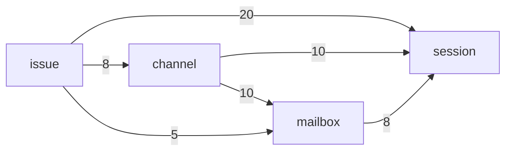

# Agent Note: 工单和频道经 Mailbox 一道门找到帮工

Status: proposed

## Problem

[帮工](docs/subsystems/session.md)、[Mailbox](docs/subsystems/mailbox.md)、[频道](docs/subsystems/channel.md)和[工单](docs/subsystems/issue.md)的文档已经分好了工：工单和频道决定给谁说什么，Mailbox 管投递、刹车和唤醒，帮工只管跑一轮。代码没有照这条路走：工单和频道越过 Mailbox 直接用帮工投递，还用着 Mailbox 内部的步骤。结果是这几个模块的接口都很宽，彼此缠在一起，测一个就得搭起整座农场（服务端测试里 `Effect.provide(world(…))` 写了 418 处）。

2026-11-09 按语法树数的调用关系（`apps/server/src`，不含测试；成员是服务 `X.of({ … })` 交出去的）：

| 服务 | 成员 | 农场外圈在用 | 只有这几个模块互相用 | 只有测试用或没人用 |
|---|---:|---:|---:|---:|
| `Issue` | 26 | 24 | 0 | 2 |
| `Session` | 36 | 14 | **20** | 2 |
| `Channel` | 36 | 26 | **5** | 5 |
| `Mailbox` | 27 | 8 | **13** | 6 |
| `Inbox` | 6 | 3 | 0 | 3 |
| `Ingress` | 7 | 5 | 0 | 2 |

「只有这几个模块互相用」的 38 个成员，是内部步骤漏到了共享接口上。按边看（括号里是这条边用到的成员总数，后面列的是其中只有这几个模块在用的）：

- 工单 → 帮工（20）：腾位置和投递 `noRoom`、`makeRoom`、`send`、`register`，工作区和交接 `withWorkplace`、`withIdleWorkplace`、`handOver`、`clearWorkplace`、`discardWork`、`dismiss`，消息流 `news`、`startedIssues`、`finishedRuns`。
- 频道 → 帮工（10）：`makeRoom`、`send`、`register`、`runOf`、`reportOf`、`onIssue`、`news`。
- 频道 → Mailbox（10）：`registerTalk`、`deliverDirect`、`kick`、`consumed`、`unreadSummary`、`breakerNotices`、`waitingOn`、`dropSession`、`dropEnvelope`。
- 工单 → Mailbox（5）：`queuedInputs`、`issueInputs`、`registerInitialInputs`、`retireDispatches`。
- Mailbox → 帮工（8）：`deliver`、`launches`、`inputsConsumed`、`inputsReturned`、`register`。
- 工单 → 频道（8）：`say`、`issueThread`、`notice`、`ownerInThread`。

其余的成员（如 `sessionOf`、`present`、`receive`、`history`）外圈也在用，是真正的对外接口。



外圈用这几个模块的，主要是接口的处理（42 个成员）、帮工的工具（27）、`resource`（12）、管家（9）和 `cron`（7）。`Inbox`、`Ingress` 的接口小、只有外圈在用，已经是深模块，不动。

## Proposal

一句话：**工单和频道要找帮工，只经 Mailbox。** Mailbox 对它们只交出几个动词，帮工投递相关的成员只给 Mailbox 用。不新建模块，不改名，不改表。

1. **Mailbox 是唯一的门。** 它对工单和频道只交出 `receive`、`withdraw`、`pending`、`changes` 四个动词（见下面的「名词和路径」）。腾位置、开会话、`kick`、直投、消费回执、刹车提示，都变成 Mailbox 里面的事。
2. **帮工只交出它自己的事。** 投递和唤醒（`deliver`、`launches`、消费和退回的回执）只给 Mailbox 用。读帮工的事实和它的生命周期（`sessionOf`、`present`、`runOf`、`reportOf`、`onIssue`、`news`、`startedIssues`、`finishedRuns`）不是投递：频道靠它们开关串、标出一条话出自哪一轮，工单靠它们跟进度，这些留在帮工的接口上，挪到 Mailbox 后面只会多一跳转发。工作区和交接（`withWorkplace`、`withIdleWorkplace`、`handOver`、`clearWorkplace`、`discardWork`、`dismiss`）是工单生命周期要的，留给工单用。开一个帮工（`makeRoom`、`noRoom`、`send`、`register`）见「名词和路径」里未决的一件。
3. **一次挪一条边，频道先。** 频道到帮工、到 Mailbox 的 20 处最集中，也最好验证：先把它们换成 Mailbox 的几个动词，跑完频道和派活的测试、数一遍调用关系；再挪工单；最后收 Mailbox 用帮工的那 8 处。每一步单独一个 PR。
4. **测试对着门写。** 门窄了以后，工单和频道的测试可以只给一个假的 Mailbox，不用搭整座农场；`world()` 留给真正跨模块的流程（`src/flows`）。不另做「测试入口」：那是给宽接口包一层，不解决耦合。

## 名词和路径

动代码之前先收敛：一个概念一个名字，一件事一条路。

| 概念 | 留下的名字 | 收掉的叫法（只在投递这件事上） |
|---|---|---|
| 从一个来源记下的一条：主人说的话、定时任务、GitHub、agent 的带话 | 触发 `Trigger` | — |
| 交给帮工的一封 | 信 `Envelope` | input（`queuedInputs`、`issueInputs`、`registerInitialInputs`、`returnInput`）、talk（`registerTalk`、`TalkRow`）、mail（`ChannelMail`）、dispatch（`retireDispatches`） |
| 一封信交给一个帮工的状态 | 投递 `Delivery`（`mailbox_delivery`：`pending` → `handed` → `consumed`） | — |
| 收信的一方 | 帮工 `Session` | recipient（`pump.ts` 的 `kick`）、participant、agent |

`launch`（帮工被拉起的一次）和一轮 `Run` 是不是同一件事，第一步读代码时定：是就只留 `Run`，不是就在本节写清两者的分别。

一条路：

```
上游记下触发 → Mailbox.receive → 路由、蓄水池、三道刹车 → 投递 → 帮工跑一轮 → 消费或退回的回执 → Mailbox
```

[Mailbox](docs/subsystems/mailbox.md) 的文档已经这样规定（上游记下 `Trigger`，提交后调 `Mailbox.receive`）；`registerTalk`、`registerInitialInputs`、`deliverDirect`、`kick` 是绕开它的旁路，收进这一条。

门上的动词，各合并了一批现在分开的入口。退回（`returnOne`、`returnInput`：把一封信还回去重新投递）和撤回意思相反，不并进 `withdraw`；`waitingOn`、`openDeliveries` 是投递的读。这几个留在接口上，各说各的事。


| 动词 | 做什么 | 合并的 |
|---|---|---|
| `receive` | 把一个触发交给它的受众 | `registerTalk`、`registerInitialInputs`、`deliverDirect`、`kick`，和工单、频道直接用帮工的 `makeRoom`、`send`、`register` |
| `withdraw` | 撤回一个帮工、一封信或一张工单的待投递 | `dropSession`、`dropEnvelope`、`retireDispatches` |
| `pending` | 工单池里等着的触发：排队的工单的（派活的在前），或一张工单的（按路由的顺序） | `queuedInputs`、`issueInputs` |
| `changes` | 投递的变化：消费、刹车 | `consumed`、`breakerNotices` |

两件事已定（2026-11-09，主人）：

- **开一个帮工**：选哪个档案是工单或频道的决定；开帮工、登记最初的信、唤醒都在 Mailbox 里。门上是 `receive` 的 `Talk` 这一种：调用方给档案、开场的话、最初的几封信，和它自己要和帮工一起写下的东西（频道的 `channel_participant`），Mailbox 腾位置、开帮工、登记、唤醒。工单派活照此办。
- **直说**并进 `receive`：调用方先记下触发（`recordTrigger`），再 `receive` 给那一个帮工；记进 `mailbox_trigger`，过三道刹车，至少投递一次。

## 进度

- 第一步（频道）做完：`withdraw` 取代 `dropSession`、`dropEnvelope`；`changes` 取代 `consumed`、`breakerNotices`；`receive(arrival)` 收下记好的触发（可带频道消息的受众或一个帮工）和私聊开帮工（`Talk`），`registerTalk`、`kick`、`deliverDirect` 从接口上去掉。频道用 Mailbox 的成员从 10 个降到 `recordChannelTrigger`、`recordTrigger`、`receive`、`withdraw`、`changes`、`unreadSummary`。频道不再用帮工的 `makeRoom`、`send`、`register`。
- 直说的行为变化有测试：没有串的帮工被直说一句，`mailbox_trigger` 记下一条，投递给它、原因是 `addressed`。
- Mailbox 对外的成员实际是 34 个（服务和泵各有一组），比上表少算了 7 个。
- 第二步（工单）做完：派活走 `receive` 的 `Open`（私聊的 `Talk` 推广成它：最初的信是私聊最近的话，或工单池里的触发）；`pending` 合并 `queuedInputs`、`issueInputs`，两种查法返回同一种形状；`withdraw` 多了 `Issue`，取代 `retireDispatches`（照旧在工单自己的事务里，不拿 Mailbox 的写锁）；`registerInitialInputs` 从接口上去掉。原来同步的 `pending(session)` 是一个帮工的投递，改名 `openDeliveries`，免得一个名字指两件事；`waitingOn`（一封信还在等的投递数）同理是投递的读，留着。
- 派活的顺序变了一处：腾位置挪进 Mailbox 后在记下工单之后。依赖未完、父工单的工作区出错而被拒时，不再先请走一个空闲的帮工；新工单遇上农场满了，记下后随即删掉（开帮工被拒时原来就删）。
- 第三步不用另做：帮工投递和开帮工的成员（`deliver`、`launches`、`inputsConsumed`、`inputsReturned`、`makeRoom`、`send`）在帮工模块之外只剩 Mailbox 在用。
- 工单还直接用帮工的：`noRoom`（只问有没有位置，排队用）和管家的 `register`（管家不经 `send` 开）。这两处是读和管家自己的事，不归投递，留在帮工。

## Alternatives considered

**把工单、帮工、频道、Mailbox 合成一个大模块**：调用关系一下就消失了，但一个模块要管工单状态机、频道、投递和 oar 的生命周期，文档里分好的四件事又混在一起，表名和测试也要全改。问题在接口宽，不在模块多。

**一个统一的测试入口（`it.farm(…)`）**：把 418 处 provide 收成一处。这是在宽接口外面再包一层浅模块，测试仍然要整座农场，只是写得短了。

**先改帮工的接口**：帮工被 11 个模块用，外圈的 14 个成员也在里面，先动它牵连最广。从频道开始，影响面最小、最早能看到效果。

## Acceptance criteria

- 用同样的数法重数一遍：投递相关、只在这几个模块之间用的成员清零；剩下的只有读帮工的事实和生命周期、工单用帮工的工作区和交接、工单在自己的串里说话（`say`、`issueThread`、`notice`、`ownerInThread`）和 Inbox 读主人的阅读位置（`ownerReads`），这些是真实的依赖，不归投递。
- 工单和频道不再用帮工跑一轮相关的成员，也不再用 Mailbox 的内部步骤；Mailbox 对它们只交出 `receive`、`withdraw`、`pending`、`changes`。
- 频道和工单各至少有一组测试只用假的 Mailbox，不用 `world()`。
- `vp run server:check` 通过；派活、带话、刹车和私聊的流程测试（`src/flows`）不改断言。
- 投递这件事上只用「名词和路径」一节留下的名字：表里收掉的标识符（`queuedInputs`、`issueInputs`、`registerInitialInputs`、`registerTalk`、`retireDispatches`、`deliverDirect`、`dropSession`、`dropEnvelope`、`breakerNotices`）不再出现在 Mailbox 的接口和 Mailbox 以外的代码里（Mailbox 内部的步骤怎么叫不限）。
- 投递行为不变：`mailbox_delivery` 的状态、刹车计数和唤醒顺序和改之前一样。

## Risks

- **门变成转发器**：如果 Mailbox 的新动词只是把原来的调用一一转给帮工，接口没有变窄，只是多了一跳。验收时数动词个数，并检查每个动词背后是不是合并了几种原来分开的入口。
- **事务和锁的位置**：频道和工单现在有些地方在自己的事务里同时写消息和登记投递。改成经 Mailbox 时，要保留「写入和投递一起提交」的保证，不能拆成两次提交。
- **私聊和管家的路径**：私聊直投（`deliverDirect`）和管家的带话有自己的时序约定，挪的时候用现有的私聊和管家测试守住。
