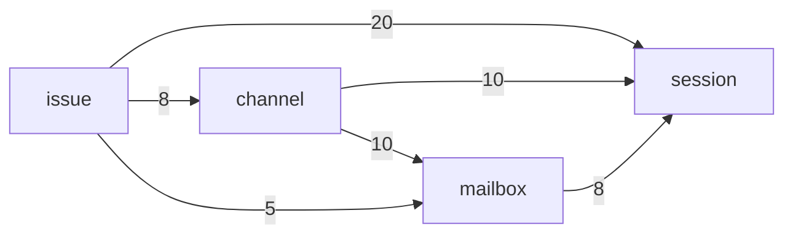

# Agent Note: 工单和频道经 Mailbox 一道门找到帮工

Status: proposed

## Problem

[帮工](docs/subsystems/session.md)、[Mailbox](docs/subsystems/mailbox.md)、[频道](docs/subsystems/channel.md)和[工单](docs/subsystems/issue.md)的文档已经分好了工：工单和频道决定给谁说什么，Mailbox 管投递、刹车和唤醒，帮工只管跑一轮。代码没有照这条路走：工单和频道越过 Mailbox 直接用帮工投递，还用着 Mailbox 内部的步骤。结果是这几个模块的接口都很宽，彼此缠在一起，测一个就得搭起整座农场（服务端测试里 `Effect.provide(world(…))` 写了 418 处）。

2026-11-09 按语法树数的调用关系（`apps/server/src`，不含测试；成员是服务 `X.of({ … })` 交出去的）：

| 服务 | 成员 | 农场外圈在用 | 只有这几个模块互相用 | 只有测试用或没人用 |
|---|---:|---:|---:|---:|
| `Issue` | 26 | 24 | 0 | 2 |
| `Session` | 36 | 14 | **20** | 2 |
| `Channel` | 36 | 26 | **5** | 5 |
| `Mailbox` | 27 | 8 | **13** | 6 |
| `Inbox` | 6 | 3 | 0 | 3 |
| `Ingress` | 7 | 5 | 0 | 2 |

「只有这几个模块互相用」的 38 个成员，是内部步骤漏到了共享接口上。按边看（括号里是这条边用到的成员总数，后面列的是其中只有这几个模块在用的）：

- 工单 → 帮工（20）：腾位置和投递 `noRoom`、`makeRoom`、`send`、`register`，工作区和交接 `withWorkplace`、`withIdleWorkplace`、`handOver`、`clearWorkplace`、`discardWork`、`dismiss`，消息流 `news`、`startedIssues`、`finishedRuns`。
- 频道 → 帮工（10）：`makeRoom`、`send`、`register`、`runOf`、`reportOf`、`onIssue`、`news`。
- 频道 → Mailbox（10）：`registerTalk`、`deliverDirect`、`kick`、`consumed`、`unreadSummary`、`breakerNotices`、`waitingOn`、`dropSession`、`dropEnvelope`。
- 工单 → Mailbox（5）：`queuedInputs`、`issueInputs`、`registerInitialInputs`、`retireDispatches`。
- Mailbox → 帮工（8）：`deliver`、`launches`、`inputsConsumed`、`inputsReturned`、`register`。
- 工单 → 频道（8）：`say`、`issueThread`、`notice`、`ownerInThread`。

其余的成员（如 `sessionOf`、`present`、`receive`、`history`）外圈也在用，是真正的对外接口。



外圈用这几个模块的，主要是接口的处理（42 个成员）、帮工的工具（27）、`resource`（12）、管家（9）和 `cron`（7）。`Inbox`、`Ingress` 的接口小、只有外圈在用，已经是深模块，不动。

## Proposal

一句话：**工单和频道要找帮工，只经 Mailbox。** Mailbox 对它们交出少数几个动词，帮工投递和开帮工的成员只给 Mailbox 用。不新建模块，不改表；名字照 [命名](docs/style/naming.md) 收敛（见「名词和路径」）。

1. **Mailbox 是唯一的门。** 工单和频道用的只有：`receive`（收下一个触发，或开一个帮工）、`withdraw`（撤回待投递）、`news`（投递的变化）、`triggersOf` 和 `queuedTriggers`（工单池里等着的触发）。腾位置、开会话、唤醒、直说、消费回执、刹车提示，都是 Mailbox 里面的事。
2. **帮工只交出它自己的事。** 投递、开帮工和回执（`deliver`、`hire`、`makeRoom`、`launches`、`inputsConsumed`、`inputsReturned`）只给 Mailbox 用。读帮工的事实和它的生命周期（`sessionOf`、`present`、`runOf`、`reportOf`、`onIssue`、`news`、`startedIssues`、`finishedRuns`）不是投递：频道靠它们开关串、标出一条话出自哪一轮，工单靠它们跟进度，这些留在帮工的接口上，挪到 Mailbox 后面只会多一跳转发。工作区和交接（`withWorkplace`、`withIdleWorkplace`、`handOver`、`clearWorkplace`、`discardWork`、`dismiss`）是工单生命周期要的，留给工单用。
3. **一次挪一条边，频道先**：频道，再工单，最后看 Mailbox 用帮工的那几处是不是只剩 Mailbox。各步是 PR #237 里单独的提交。
4. **测试对着门写。** 门窄了以后，工单和频道的测试可以只给一个假的 Mailbox，不用搭整座农场；`world()` 留给真正跨模块的流程（`src/flows`）。不另做「测试入口」：那是给宽接口包一层，不解决耦合。

## 名词和路径

一个概念一个名字，一件事一条路。

| 概念 | 名字 | 收掉的叫法（只在投递这件事上） |
|---|---|---|
| 从一个来源记下的一条：主人说的话、定时任务、GitHub、agent 的带话 | 触发 `Trigger` | — |
| 交给帮工的一封 | 信 `Envelope` | input（`queuedInputs`、`issueInputs`、`registerInitialInputs`、`returnInput`）、talk（`registerTalk`）、letter、dispatch（`retireDispatches`） |
| 一封信交给一个帮工的状态 | 投递 `Delivery`（`mailbox_delivery`：`pending` → `handed` → `consumed`） | — |
| 收信的一方 | 帮工 `Session` | recipient、participant、agent |
| 开一个帮工 | `hire`（`Session.hire`、`receive` 的 `Hire`、`Hired`、`hiring`） | send、open |
| 帮工跑的一轮 | 一轮 `Run`（`session_run`，一次触发一轮，有结局和花费） | — |
| 帮工接上一次农机进程 | `launch`（`${id}#n`，只在内存里） | — |

`launch` 和 `Run` 不是一件事：一次接上里可以跑好几轮。投递在 `handed` 时记下 `launch`，进程重连后没有回执的投递按它退回、重新投递。

一条路：

```
上游记下触发 → Mailbox.receive → 路由、蓄水池、三道刹车 → 投递 → 帮工跑一轮 → 消费或退回的回执 → Mailbox
```

[Mailbox](docs/subsystems/mailbox.md) 的文档已经这样规定（上游记下 `Trigger`，提交后调 `Mailbox.receive`）；`registerTalk`、`registerInitialInputs`、`deliverDirect`、`kick` 是绕开它的旁路，已收进这一条。

| 门上的动词 | 做什么 | 取代的 |
|---|---|---|
| `receive` | `Trigger`：把一个记好的触发交给它的受众（按串和订阅，或一条频道消息的听众，或指定的一个帮工）；`Hire`：开一个帮工，登记最初的信（私聊最近的话，或工单池里的触发），唤醒它 | `registerTalk`、`registerInitialInputs`、`deliverDirect`、`kick`，和工单、频道直接用帮工的 `makeRoom`、`send`、`register` |
| `withdraw` | 撤回一个帮工、一封信或一张工单的待投递 | `dropSession`、`dropEnvelope`、`retireDispatches` |
| `triggersOf`、`queuedTriggers` | 工单池里等着的触发：一张工单的（按路由的顺序）、所有排队工单的（派活的在前）。两个问题筛法和排序不同，起两个名字 | `issueInputs`、`queuedInputs` |
| `news` | 投递的变化：一封信被模型收下（`Consumed`）、一个帮工被熔断（`Braked`） | `consumed`、`breakerNotices` |

帮工那头也只有一条流：`Session.news`。帮工做的每件事都在上面说，订阅方按 `_tag` 取自己要的：`Hired`、`Reported`、`Left`（频道开关串、贴汇报，工单收汇报），`IssueStarted`、`RunFinished`（工单出池、一轮结束），`Consumed`、`Returned`（投递的回执），和一次启动的动静 `Spoke`、`Ended`、`HandedOff`、`Settling`、`Closed`、`Compacting`（Mailbox 的泵）。它取代原来的六条流 `news`、`launches`、`startedIssues`、`finishedRuns`、`inputsConsumed`、`inputsReturned`。

留在接口上、各说各的事的：退回和撤回意思相反，不并进 `withdraw`：`handBack` 把一封信还回去重新投递，`decline` 是帮工说这封不归它、带着理由退回工单池。`deliveriesOf`（一个帮工的投递）、`waitingOn`（一封信还在等的投递数）、`isRouted`（一个触发路由过没有）是投递的读。

主人定的两件（2026-11-09）：

- **开一个帮工**：选哪个档案、开场的话、在哪干，是工单或频道的决定；腾位置、开帮工、登记最初的信、唤醒在 Mailbox 里（`receive` 的 `Hire`）。调用方要和帮工一起写下的自己的东西经 `hiring` 交进来：频道写 `channel_participant`，工单记下帮工开始干。
- **直说并进 `receive`**：调用方先记下触发（`recordTrigger`），再 `receive` 给那一个帮工；记进 `mailbox_trigger`，过三道刹车，至少投递一次。

## 进度

都在 PR #237（分支 `fix/testable-module-boundaries`）。

| 步 | 状态 | 提交 | 做了什么 |
|---|---|---|---|
| 频道 | 完成 | `90d9e3ce5`、`741e368bd` | 撤回走 `withdraw`，投递的变化走一条流；私聊开帮工和直说走 `receive`。频道用 Mailbox 的只剩 `recordChannelTrigger`、`recordTrigger`、`receive`、`withdraw`、`news`、`unreadSummary`、`waitingOn`，不再用帮工的 `makeRoom`、`hire`、`register` |
| 工单 | 完成 | `f5f0ce669` | 派活走 `receive` 的 `Hire`；工单池走 `triggersOf`、`queuedTriggers`；撤回一张工单的派活走 `withdraw`（照旧在工单自己的事务里，不拿 Mailbox 的写锁） |
| Mailbox 用帮工 | 完成，不用另改 | — | 帮工投递和开帮工的成员在帮工模块之外只剩 Mailbox 在用 |
| 改名 | 完成 | `39ed4f87c` | 照「名词和路径」；旧名字写进 `scripts/stale-names.ts`（Mailbox 自己的文件夹除外，内部步骤怎么叫不限） |
| 帮工的流 | 完成 | `b028fc724` | 六条流并成一条 `Session.news`，一次启动的动静从 `kind` 改成 `_tag`；旧名字写进 `scripts/stale-names.ts` |
| 假 Mailbox 的测试 | 未做 | — | 验收的第三条 |

改之前没有、改之后有的行为：

- **直说**：没有串的帮工被直说一句，`mailbox_trigger` 记下一条，过刹车，投递给它、原因是 `addressed`（测试 `a line told to a session with no thread is a recorded trigger delivered to it alone`）。
- **派活的先后**：腾位置挪进 Mailbox，在工单自己的检查之后。依赖未完、父工单的工作区出错而被拒时，不再先请走一个空闲的帮工；新工单遇上农场满了，记下后随即删掉（开帮工被拒时原来就删）。
- **私聊开帮工后的唤醒**：开完立刻唤醒，不等补上开帮工期间漏掉的话；补上的那几封投递时自己会唤醒。

数的时候发现、写在这里免得再数错的：Mailbox 对外的成员实际是 34 个（服务和泵各有一组），Problem 的表少算了 7 个。

工单还直接用帮工的 `noRoom`（只问有没有位置，排队用）是读，不归投递，留在帮工。管家的会话不经 `hire` 开，由帮工在档案存下时自己登记（[一件事一条路](docs/subsystems/foundation.md#模块和服务)）。

## Alternatives considered

**把工单、帮工、频道、Mailbox 合成一个大模块**：调用关系一下就消失了，但一个模块要管工单状态机、频道、投递和 oar 的生命周期，文档里分好的四件事又混在一起，表名和测试也要全改。问题在接口宽，不在模块多。

**一个统一的测试入口（`it.farm(…)`）**：把 418 处 provide 收成一处。这是在宽接口外面再包一层浅模块，测试仍然要整座农场，只是写得短了。

**先改帮工的接口**：帮工被 11 个模块用，外圈的 14 个成员也在里面，先动它牵连最广。从频道开始，影响面最小、最早能看到效果。

**门上凑成四个动词**：起初想把工单池的两种查法并成一个带标签参数的 `pending`、把投递的读也并进去。两种查法的筛法和排序不同，并起来是一个名字答两个问题，读的人还得看标签；按 [命名](docs/style/naming.md) 拆成 `triggersOf`、`queuedTriggers`。深模块看接口藏了多少，不看动词有几个。

## Acceptance criteria

- 用同样的数法重数一遍：投递相关、只在这几个模块之间用的成员清零；剩下的只有读帮工的事实和生命周期、工单用帮工的工作区和交接、工单在自己的串里说话（`say`、`issueThread`、`notice`、`ownerInThread`）和 Inbox 读主人的阅读位置（`ownerReads`），这些是真实的依赖，不归投递。
- 工单和频道不再用帮工跑一轮、开帮工的成员，也不再用 Mailbox 的内部步骤；它们用的投递动词只有「名词和路径」里那张表上的。
- 频道和工单各至少有一组测试只用假的 Mailbox，不用 `world()`。
- `vp run server:check` 通过；派活、带话、刹车和私聊的流程测试（`src/flows`）不改断言。
- 收掉的名字不再出现在 Mailbox 的接口和 Mailbox 以外的代码里，由 `scripts/stale-names.ts` 守着（`vp run docs:verify`）。
- 投递行为不变，除了「进度」里写明的三处：`mailbox_delivery` 的状态、刹车计数和唤醒顺序和改之前一样。

## Risks

- **门变成转发器**：如果 Mailbox 的动词只是把原来的调用一一转给帮工，接口没有变窄，只是多了一跳。验收时看每个动词背后是不是合并了几种原来分开的入口。
- **事务和锁的位置**：频道和工单有些地方在自己的事务里同时写消息和登记投递。经 Mailbox 时要保留「写入和投递一起提交」：开帮工时调用方自己的行经 `hiring` 和帮工一起写；撤回一张工单的派活仍在工单的事务里。
- **管家的路径**：管家的带话有自己的时序约定，挪的时候用现有的管家测试守住；管家的会话仍经帮工的 `register` 开。
