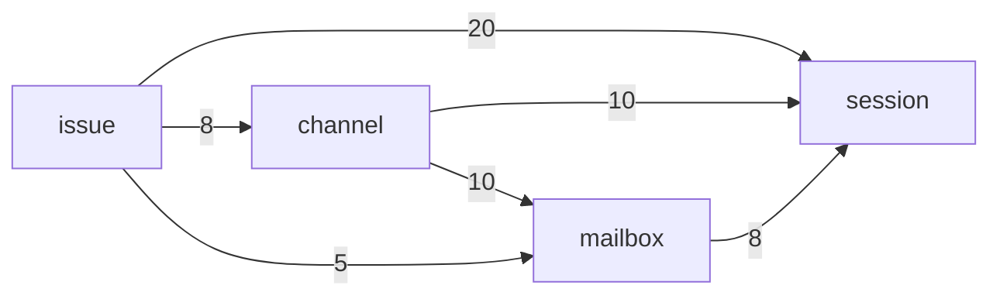

# Agent Note: 工单和频道经 Mailbox 一道门找到帮工

Status: proposed

## Problem

[帮工](docs/subsystems/session.md)、[Mailbox](docs/subsystems/mailbox.md)、[频道](docs/subsystems/channel.md)和[工单](docs/subsystems/issue.md)的文档已经分好了工：工单和频道决定给谁说什么，Mailbox 管投递、刹车和唤醒，帮工只管跑一轮。代码没有照这条路走：工单和频道越过 Mailbox 直接用帮工投递，还用着 Mailbox 内部的步骤。结果是这几个模块的接口都很宽，彼此缠在一起，测一个就得搭起整座农场（服务端测试里 `Effect.provide(world(…))` 写了 418 处）。

2026-11-09 按语法树数的调用关系（`apps/server/src`，不含测试；成员是服务 `X.of({ … })` 交出去的）：

| 服务 | 成员 | 农场外圈在用 | 只有这几个模块互相用 | 只有测试用或没人用 |
|---|---:|---:|---:|---:|
| `Issue` | 26 | 24 | 0 | 2 |
| `Session` | 36 | 14 | **20** | 2 |
| `Channel` | 36 | 26 | **5** | 5 |
| `Mailbox` | 27 | 8 | **13** | 6 |
| `Inbox` | 6 | 3 | 0 | 3 |
| `Ingress` | 7 | 5 | 0 | 2 |

「只有这几个模块互相用」的 38 个成员，是内部步骤漏到了共享接口上。按边看（括号里是这条边用到的成员总数，后面列的是其中只有这几个模块在用的）：

- 工单 → 帮工（20）：腾位置和投递 `noRoom`、`makeRoom`、`send`、`register`，工作区和交接 `withWorkplace`、`withIdleWorkplace`、`handOver`、`clearWorkplace`、`discardWork`、`dismiss`，消息流 `news`、`startedIssues`、`finishedRuns`。
- 频道 → 帮工（10）：`makeRoom`、`send`、`register`、`runOf`、`reportOf`、`onIssue`、`news`。
- 频道 → Mailbox（10）：`registerTalk`、`deliverDirect`、`kick`、`consumed`、`unreadSummary`、`breakerNotices`、`waitingOn`、`dropSession`、`dropEnvelope`。
- 工单 → Mailbox（5）：`queuedInputs`、`issueInputs`、`registerInitialInputs`、`retireDispatches`。
- Mailbox → 帮工（8）：`deliver`、`launches`、`inputsConsumed`、`inputsReturned`、`register`。
- 工单 → 频道（8）：`say`、`issueThread`、`notice`、`ownerInThread`。

其余的成员（如 `sessionOf`、`present`、`receive`、`history`）外圈也在用，是真正的对外接口。

外圈用这几个模块的，主要是接口的处理（42 个成员）、帮工的工具（27）、`resource`（12）、管家（9）和 `cron`（7）。`Inbox`、`Ingress` 的接口小、只有外圈在用，已经是深模块，不动。

## Proposal

一句话：**工单和频道要找帮工，只经 Mailbox。** Mailbox 对它们只交出几个动词，帮工投递相关的成员只给 Mailbox 用。不新建模块，不改名，不改表。

1. **Mailbox 是唯一的门。** 它对工单和频道交出的，只有「把这段输入交给这些受众」「撤回某个受众或某封信的待投递」「这个工单或频道现在等着什么」和一条变化的流。腾位置、开会话、`kick`、直投、消费回执、刹车提示，都变成 Mailbox 里面的事。具体几个动词、各叫什么，在第一步读完这 38 个成员的调用处再定，原则是能合就合：同一件事的几种入口合成一个动词加参数，只读的查询合成一个。
2. **帮工只交出它自己的事。** 跑一轮所需的（`send`、`register`、`makeRoom`、`noRoom`、`deliver`、`launches`、消费和退回的回执、`runOf`、`reportOf`、`onIssue`、消息流）只给 Mailbox 用。工作区和交接（`withWorkplace`、`withIdleWorkplace`、`handOver`、`clearWorkplace`、`discardWork`、`dismiss`）是工单生命周期要的，留给工单用。外圈在用的 14 个不变。
3. **一次挪一条边，频道先。** 频道到帮工、到 Mailbox 的 20 处最集中，也最好验证：先把它们换成 Mailbox 的几个动词，跑完频道和派活的测试、数一遍调用关系；再挪工单；最后收 Mailbox 用帮工的那 8 处。每一步单独一个 PR。
4. **测试对着门写。** 门窄了以后，工单和频道的测试可以只给一个假的 Mailbox，不用搭整座农场；`world()` 留给真正跨模块的流程（`src/flows`）。不另做「测试入口」：那是给宽接口包一层，不解决耦合。

## Alternatives considered

**把工单、帮工、频道、Mailbox 合成一个大模块**：调用关系一下就消失了，但一个模块要管工单状态机、频道、投递和 oar 的生命周期，文档里分好的四件事又混在一起，表名和测试也要全改。问题在接口宽，不在模块多。

**一个统一的测试入口（`it.farm(…)`）**：把 418 处 provide 收成一处。这是在宽接口外面再包一层浅模块，测试仍然要整座农场，只是写得短了。

**先改帮工的接口**：帮工被 11 个模块用，外圈的 14 个成员也在里面，先动它牵连最广。从频道开始，影响面最小、最早能看到效果。

## Acceptance criteria

- 用同样的数法重数一遍：「只有这几个模块互相用」的成员从 38 个降到 15 个以内，只剩工单用帮工的工作区和交接（6 个）、工单在自己的串里说话（`say`、`issueThread`、`notice`、`ownerInThread`）和 Inbox 读主人的阅读位置（`ownerReads`）；这些是真实的依赖，不归投递。
- 工单和频道不再用帮工跑一轮相关的成员，也不再用 Mailbox 的内部步骤；Mailbox 对它们交出的动词不超过 5 个。
- 频道和工单各至少有一组测试只用假的 Mailbox，不用 `world()`。
- `vp run server:check` 通过；派活、带话、刹车和私聊的流程测试（`src/flows`）不改断言。
- 投递行为不变：`mailbox_delivery` 的状态、刹车计数和唤醒顺序和改之前一样。

## Risks

- **门变成转发器**：如果 Mailbox 的新动词只是把原来的调用一一转给帮工，接口没有变窄，只是多了一跳。验收时数动词个数，并检查每个动词背后是不是合并了几种原来分开的入口。
- **事务和锁的位置**：频道和工单现在有些地方在自己的事务里同时写消息和登记投递。改成经 Mailbox 时，要保留「写入和投递一起提交」的保证，不能拆成两次提交。
- **私聊和管家的路径**：私聊直投（`deliverDirect`）和管家的带话有自己的时序约定，挪的时候用现有的私聊和管家测试守住。
