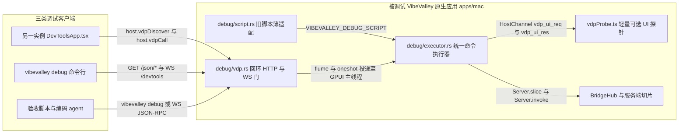

# Agent Note: VDP 远程实时调试协议（VibeValley DevTools Protocol）

Status: proposed

## Problem

当前调试运行中的原生应用 `apps/mac` 存在三处结构性缺口，无法支撑另一 VibeValley 实例、命令行或编码 agent 实时挂载与交互调试：

| 缺口 | 源码位置 | 现状与限制 |
|---|---|---|
| 仅支持启动前静态脚本与轮询转储 | 原 `apps/mac/src/debug.rs`（现拆分至 [script.rs](apps/mac/src/debug/script.rs)） | 必须在启动前配置 `VIBEVALLEY_DEBUG_SCRIPT` 逐行静态执行（固定 `400 ms` 步进与手写 `wait:<ms>` 盲等）和 `VIBEVALLEY_DEBUG_DUMP` 每 `1000 ms` 整份覆盖写 JSON 文件，无法对运行中实例热挂载，也不支持实时事件流 |
| 无法按语义检视与触发 `nsh` 界面 | 原 `apps/mac/src/debug.rs`（现拆分至 [executor.rs](apps/mac/src/debug/executor.rs)） | 只能向窗口注入裸坐标 `mouse:click,x,y` 与盲发快捷键 `key:...`，无法按 `testID`、文本或 `role` 查询节点树和边界框，也无法做语义点击或条件等待，验收脚本极易因布局微调失效 |
| 调试通道与状态分散在三处 | [debug/mod.rs](apps/mac/src/debug/mod.rs)、[hosted/debug.rs](apps/mac/src/hosted/debug.rs)、[shell/devtools.rs](apps/mac/src/shell/devtools.rs)、[DevToolsApp.tsx](apps/mac/ui/features/devtools/DevToolsApp.tsx) | 原 `debug.rs` 独立维护非类型化文本脚本解析、键鼠注入、Metal 截屏与壳状态转储；`ShellDebugHandle` 独立向服务端 `HostDebugBridge` 汇报路由、缓存与帧耗时；`devtools.rs` 与 `DevToolsApp.tsx` 仅支持进程内 `VIBEVALLEY_DEBUG=1` 自我观察，无法跨进程调试另一个 VibeValley 实例 |

既有提案 [VibeValley DevTools V2](.agents/notes/proposed/architecture/2026-11-22-devtools-and-protocol-boundaries.md) 规划了进程内画布 `Inspector`、Trajectory 联动与 Loro 状态检视，并提出以强类型命令替代旧文本脚本。本提案在此基础上定义跨进程热挂载的 VDP（VibeValley DevTools Protocol）协议、统一宿主执行器与三类客户端架构。

## Proposal

引入借鉴 CDP（Chrome DevTools Protocol）发现与 JSON-RPC 2.0 分层、但域模型完全对齐 VibeValley 原生宿主的实时调试协议 **VDP（VibeValley DevTools Protocol）**，收拢旧调试钩子并打通「VibeValley 调试 VibeValley」、命令行与自动化脚本三种调试入口。

### 1. 默认关闭的回环发现与安全边界

- **默认关闭、零开销**：未显式传入开关时，应用不应监听 VDP 端口、不应写出 `debug.json`、不应向 `host.params` 注入 `vdpEnabled`，保持零端口占用与零运行期开销。
- **显式开启**：通过命令行参数 `--remote-debugging-port=<port>` 或环境变量 `VIBEVALLEY_DEBUG_PORT=<port>` 开启（`0` 由操作系统分配临时空闲端口）；`VIBEVALLEY_DEBUG_PORT` 应加入 [home.rs](crates/protocol/src/home.rs) 的 `CANONICAL_ENV_VARS`。
- **严格回环与每进程随机令牌**：VDP 监听门应仅绑定 `127.0.0.1:<port>`。启动时生成 32 字节随机十六进制令牌，连同实例元数据构成 `VdpEndpointInfo`（`protocolVersion: "1"`、`pid`、`channel`、`appVersion`、`home`、`port`、`httpUrl`、`wsUrl`、`token`、`startedAt`），由 `write_debug_endpoint` 以 Unix `0600` 权限原子写入 `$VIBEVALLEY_HOME/debug.json`；返回的 `DebugEndpointGuard` 在进程正常退出或 `Drop` 时核对 PID 一致后删除该文件。`VdpEndpointInfo` 的 `Debug` 实现应脱敏 `token`。
- **HTTP 与 WebSocket 端点及强制鉴权**：
  - `GET /json/version`：返回 `VdpVersionInfo`（同 `VdpEndpointInfo` 字段但不含 `token`）。
  - `GET /json/list`：返回当前目标列表 `VdpTarget[]`（`id`、`kind` 为 `shell | view | diorama | webview | server`、`title`、`url?`、`attached`）。
  - `GET /devtools`：升级为 WebSocket，收发 JSON-RPC 2.0 请求/响应并接收服务端推送事件。
  - 上述三个端点均应强制校验 `Authorization: Bearer <token>` 或查询参数 `?token=<token>`；缺失或错误的请求一律返回 `401 Unauthorized`，且任何 HTTP 响应体不应包含 `token`。
- **多通道存活发现**：[home.rs](crates/protocol/src/home.rs) 应新增 `DEBUG_FILE = "debug.json"`、`debug_json_path`、`is_pid_alive`（Unix `kill -0` 检测）、`read_debug_endpoint`（自动忽略已退出进程遗留的陈旧文件）与 `discover_local_debug_endpoints(extra_homes)`（按 `extra_homes`、`VIBEVALLEY_HOME` 与 `dev`/`alpha`/`beta`/`release` 默认家目录顺序扫描并按规范路径去重）。

### 2. 单源类型化线协议（`crates/protocol/src/vdp.rs`）

全部 VDP 线格式（camelCase JSON）以 `crates/protocol/src/vdp.rs` 为唯一事实源：

- **JSON-RPC 2.0 信封**：定义 `VdpRequest`（`id`、`method`、`params`、`sessionId?`）、`VdpResponse`（`id`、`result?`、`error?`、`sessionId?`）、`VdpError`（标准错误码 `-32700`–`-32603` 及自定义 `-32000` `UNAVAILABLE`、`-32001` `TIMEOUT`、`-32002` `UNAUTHORIZED`）、`VdpEvent`（`method`、`params`、`sessionId?`）与客户端联合类型 `VdpWireMessage`（`Response | Event`）。
- **边界一次解码**：入口经 `VdpCommand::from_wire(method, params)` 将全部 26 个方法解码为封闭枚举 `VdpCommand`，服务端推送经 `VdpNotification`（6 类事件）编码与解码，执行器内部不应按裸字符串或 `serde_json::Value` 分支：

| 域 | 方法（`VdpCommand`） | 事件（`VdpNotification`） | 职责与返回值要点 |
|---|---|---|---|
| `Target` | `Target.list`、`Target.attach { targetId }`、`Target.detach { sessionId }` | `Target.created`、`Target.destroyed` | 枚举与挂载 `shell`、`view`、`diorama`、`webview`、`server` 目标，维护会话生命周期 |
| `Shell` | `Shell.getState`、`Shell.navigate { route }`、`Shell.openPane { kind, params? }`、`Shell.closePane { kind?, tabId?, titleContains? }`、`Shell.resize { width, height }`、`Shell.setTheme { dark? }`、`Shell.getTerminalGrid { terminalId? }`、`Shell.sendTerminalInput { text, enter? }`、`Shell.runCommand { command }` | — | 取代定时 `dump.json` 与文本脚本命令；实时读取壳状态与终端文本网格、驱动路由/分栏/窗口尺寸/主题（`dark` 为空时切换） |
| `Page` | `Page.captureScreenshot { target?: "shell" \| "webview", width?, height? }`、`Page.getMetrics` | `Page.frame` | 按需抓取 GPUI Metal 帧（`--features shot`）或原生 `WKWebView` 图像并返回 `{ mime, data, width, height }`，输出窗口尺寸、缩放比与帧耗时 |
| `Input` | `Input.dispatchKey { keys }`、`Input.typeText { text }`、`Input.dispatchMouse { kind, x, y, button?, endX?, endY? }` | — | 沿真实 GPUI 事件分发路径注入键鼠输入（支持 `down`/`up`/`move`/`click`/`drag` 与 `left`/`right`/`middle`），统一返回 `{ handled }` |
| `UI` | `UI.getTree { view?, maxDepth? }`、`UI.query { testId?, text?, role?, view? }`、`UI.press { testId, view? }`、`UI.waitFor { testId?, text?, view?, timeoutMs? }` | `UI.console` | 经可选 UI 探针查询页面节点树与边界框、按 `testID` 触发语义点击与条件等待 |
| `Server` | `Server.slice { name }`、`Server.invoke { method, params? }` | `Server.event` | 经 `BridgeHub` 直读 6 路域切片快照或调用进程内服务端 RPC，推送服务端调试事件 |
| `Log` | `Log.enable`、`Log.disable`、`Log.getEntries { sinceId?, limit? }` | `Log.entry` | 开关实时日志与错误流推送，并支持从有界环形缓冲按游标增量拉取近期事件 |

### 3. 统一宿主调试架构与可选 `UI.*` 探针

- **重构 `apps/mac/src/debug/` 模块**：将 437 行的单体 `apps/mac/src/debug.rs` 拆分为四个职责清晰的子文件，消除脚本与远程调试的重复解析：
  - `apps/mac/src/debug/mod.rs`：解析 `--remote-debugging-port` / `VIBEVALLEY_DEBUG_PORT`，装配脚本适配与 VDP 监听门生命周期，应用退出时经 `on_app_quit` 清理 `debug.json`。
  - `apps/mac/src/debug/executor.rs`：唯一命令执行器，接收已解码的 `VdpCommand` 并在 GPUI 主线程执行壳状态快照、导航、分栏、终端读写、键鼠派发、`BridgeHub` 服务端调用及截屏；`Page.captureScreenshot` 对 `target: "webview"` 直接复用 [capture.rs](apps/mac/src/capture.rs) 的原生 `WKWebView` 截屏，对 `target: "shell"` 在编译启用 `--features shot` 时从 Metal 纹理内存编码 PNG，未启用时返回明确的 `UNAVAILABLE` 错误。
  - `apps/mac/src/debug/script.rs`：保留对既有 `VIBEVALLEY_DEBUG_SCRIPT` 与 `VIBEVALLEY_DEBUG_DUMP` 的向后兼容适配，将脚本行转换为 `VdpCommand` 委托给 `executor.rs`，不保留第二套执行逻辑。
  - `apps/mac/src/debug/vdp.rs`：复用既有 `axum`（开启 `ws`、`json`、`query` 特性，零新外部依赖）运行在共享 Tokio 运行时上，通过异步 `flume` + `oneshot` 通道将命令投递至 GPUI 前台任务（严格遵守 [Rust 异步并发规范](docs/style/rust-async-concurrency.md)，禁止在异步上下文或 `Drop` 中调用 `rt::block_on`），并维护有界事件环形缓冲支撑 WS 广播与 `Log.getEntries`。
- **轻量可选 UI 探针（`apps/mac/ui/infra/vdpProbe.ts`）**：
  - 仅在 VDP 开启时由宿主向 `host.params` 注入 `vdpEnabled: true`；关闭态不注册监听器、不包装 `console`。
  - 启用后通过既有 `HostChannel` 与 `HostedView` 通信：宿主向页面发送 `vdp_ui_req`（`{ type: "vdp_ui_req", reqId, method, params }`）与 `vdp_ui_config`（`{ type: "vdp_ui_config", logEnabled }`）；页面通过 `host.post("action", ...)` 回复 `vdp_ui_res`（`{ type: "vdp_ui_res", reqId, result?, error? }`）并在开启日志转发时发送 `vdp_ui_log`（`{ type: "vdp_ui_log", level, message, time }`）。
  - `HostedView` 在引擎线程直接拦截 `vdp_ui_res` 与 `vdp_ui_log`，直接唤醒等待中的 `oneshot`（默认超时 `5 s`）或写入事件总线，既不经 GPUI 主线程中转，也不必扩大业务 `HostAction` 枚举。

### 4. 三类客户端

1. **另一实例的 `DevToolsApp.tsx`（VibeValley 调试 VibeValley）**：`nsh-platform-gpui` 的 QuickJS 运行时不直接开放本机网络/WebSocket 与文件系统访问，因此在 [host.rs](crates/protocol/src/contract/host.rs) 新增两个封闭 `HostOp`——`HostOp::VdpDiscover`（`host.vdpDiscover`，入参 `{ extraHomes? }`，返回存活 `VdpEndpointInfo[]`）与 `HostOp::VdpCall`（`host.vdpCall`，入参 `{ wsUrl?, port?, token?, method, params?, sessionId?, timeoutMs? }`，由宿主后台线程通过 VDP WebSocket 执行单次 JSON-RPC 并以 `Envelope` 返回）。在 [DevToolsApp.tsx](apps/mac/ui/features/devtools/DevToolsApp.tsx) 中接入 `apps/mac/ui/features/devtools/RemoteVdpPanel.tsx`，支持自动发现本机其他运行实例或手动输入端口/令牌连接，挂载后展示目标列表、远端壳状态与快捷动作（导航、主题切换、窗口缩放、实时截屏预览）、UI 探针查询与点击、原始 JSON-RPC 控制台以及基于 `Log.getEntries` 的事件日志流。
2. **`vibevalley debug` 命令行**：在 `crates/cli/src/domains/debug.rs` 新增 `debug` 子命令（复用既有 `tokio-tungstenite` 与 `reqwest`），统一支持 `--home`、`--port`、`--url`、`--token` 与 `--json`，提供 `discover`、`version`、`targets`、`state`、`navigate`、`resize`、`theme`、`key`、`type`、`click`、`screenshot`、`ui-tree`、`ui-query`、`ui-press`、`ui-wait`、`server-slice`、`server-rpc`、`call` 与 `watch`。连接解析按固定优先级执行：`--url` → `--port`（自动匹配本机 `debug.json` 令牌或使用 `--token`）→ `--home` → `VIBEVALLEY_HOME/debug.json` → 唯一存活实例（检测到多个存活实例时打印清单要求用户显式指定）。
3. **验收脚本与编码 agent**：[vv-acceptance](.agents/skills/vv-acceptance/SKILL.md) 流程与编码 agent 可直接对运行中实例调用 `vibevalley debug ui-wait`、`ui-press`、`state`、`screenshot` 与 `watch`，取代脆弱的 `wait:1500` 固定睡眠与 1 秒轮询 `dump.json`，同时通过 `script.rs` 保持既有脚本兼容。

## Alternatives considered

**直接套用浏览器标准 CDP（Chrome DevTools Protocol）**：复刻 `DOM.*`、`Page.*`、`Runtime.*`、`Network.*` 等标准浏览器域以直接接入 Chrome DevTools 前端。未选：VibeValley 原生工作台运行在 GPUI + `nsh` 渲染树与 `wgpu` 3D 纸雕场景上，而非 Chromium DOM/V8，强套浏览器协议会产生大量无意义空方法，且无法表达 `Shell` 分栏、终端网格、`BridgeHub` 6 路切片与 `WKWebView` / Metal 双目标截屏；仅复用 CDP 成熟的 `/json/version`、`/json/list` 与 WebSocket JSON-RPC 2.0 传输习惯。

**仅提供 HTTP 轮询接口，不引入 WebSocket**：全部命令走 `POST /rpc`、日志走 `GET /logs` 定时拉取。未选：失去服务端主动推送能力，`Target.created`/`destroyed`、`Page.frame`、`UI.console`、`Server.event` 与 `vibevalley debug watch` 均只能退化为高频轮询，增加延迟与空转开销；WebSocket 为主干、同时在 `Log.getEntries` 提供有界缓冲游标查询可兼顾长连接订阅与 `HostOp::VdpCall` 单次代理调用。

**立即修改 `nsh-platform-gpui` 内部以暴露原生节点与布局树**：在渲染引擎层直接实现全局 `testID` 索引与像素边界框查询。未选：`nsh-platform-gpui` 为仓外依赖，直接改造会阻塞本轮交付并增加上游同步成本；先在 `apps/mac/ui/infra/vdpProbe.ts` 落地零默认开销的可选探针，并将 `UI.*` 线协议设计为引擎无关结构，待上游 `nsh` 提供原生检查器能力时可直接替换后端实现，无需变更协议与客户端。

**仅使用 Unix Domain Socket 作为传输层**：绕过 TCP 端口分配，靠文件权限控制访问。未选：脱离 `http://127.0.0.1:<port>/json/*` 与 `ws://` 工具链，增加通用 WebSocket 客户端与 `--port` / `--url` 调试场景的接入成本；严格绑定 `127.0.0.1` 配合 `0600` 权限 `debug.json` 与 32 字节每进程随机令牌已在单机用户边界内提供等价隔离。

## Acceptance criteria

- **默认关闭零开销**：不传 `--remote-debugging-port` 且未设 `VIBEVALLEY_DEBUG_PORT` 时，不绑定 VDP 端口、不创建 `$VIBEVALLEY_HOME/debug.json`、`host.params` 不含 `vdpEnabled`。
- **回环鉴权与发现文件不变量**：启用 `VIBEVALLEY_DEBUG_PORT=0` 时，`$VIBEVALLEY_HOME/debug.json` 以 Unix `0600` 权限原子写入且包含有效非零端口；未携带令牌或令牌错误访问 `/json/version`、`/json/list`、`/devtools` 均返回 `401`；任何 HTTP 响应体不含 `token`；应用正常退出后删除 `debug.json`，陈旧死进程文件由 `read_debug_endpoint` 忽略。
- **宿主执行器统一**：原 `apps/mac/src/debug.rs` 拆分为 [mod.rs](apps/mac/src/debug/mod.rs)、[executor.rs](apps/mac/src/debug/executor.rs)、[script.rs](apps/mac/src/debug/script.rs) 与 [vdp.rs](apps/mac/src/debug/vdp.rs)，VDP WebSocket 与 `VIBEVALLEY_DEBUG_SCRIPT` 共用 `executor.rs`，既有脚本命令保持兼容。
- **双进程实机验收**：以隔离 `VIBEVALLEY_HOME`、`VIBEVALLEY_STORE` 与 `VIBEVALLEY_DEBUG_PORT=0` 启动 `vibevalley-mac --features shot`，通过 `vibevalley debug` 实测 `discover`、`targets`、`state`、`navigate /library`、`ui-query`、`screenshot`（写出非空有效 PNG）与 `server-slice board` 全部成功；另一实例的 [DevToolsApp.tsx](apps/mac/ui/features/devtools/DevToolsApp.tsx) 可经 `host.vdpDiscover` / `host.vdpCall` 发现、挂载、执行远端命令并预览实时截屏。
- **静态、契约与测试门禁全绿**：`cargo xtask protocol`、`cargo xtask audit`、`cargo fmt --all --check`、`cargo clippy --workspace --all-targets -- -D warnings`、`cargo test -p vibevalley-protocol -p vibevalley-cli -p vibevalley-mac`、`vp run packages:check`、`vp run mac:check`、`vp run deadcode`、`vpx scripts/audit/ui-tokens.ts`、`vpx scripts/gen/i18n.ts check` 与 `vp run docs:verify` 全部通过。
- **沉淀文档**：功能合入主线后，将长期成立的协议、发现文件约定与宿主架构沉淀至 [客户端](docs/subsystems/app.md) 与 [核心状态](docs/subsystems/core.md)，并删除本 Note。

## Risks

- **本机回环控制面权限过大**：持有令牌的本机进程可向被调试窗口注入键鼠事件并经 `Server.invoke` 调用服务端接口。缓解：默认彻底关闭、仅监听 `127.0.0.1`、32 字节随机令牌仅存 `0600` 权限 `debug.json` 且禁止经任何 HTTP 响应或 `Debug` 日志输出；回退办法为移除启动参数或环境变量立即停用。
- **跨线程调度引起 GPUI 主线程卡顿或死锁**：若 VDP 服务端在异步任务或 `Drop` 中同步等待主线程，可能阻塞 Tokio 工作线程或触发重入死锁。缓解：所有跨线程投递均采用异步 `flume` + `oneshot` 加显式超时，禁止 `rt::block_on`（由 `cargo xtask audit` 静态守卫）；`HostedView` 引擎线程直接应答 `vdp_ui_res`，避免二次切回 GPUI 主线程。
- **`vdpProbe.ts` 节点覆盖受限于应用层注册**：在未改造 `nsh-platform-gpui` 之前，未接入探针的深层组件无法自动上报真实渲染边界框。缓解：首版优先覆盖当前路由、显式地标与可触发动作，线协议已预留 `bounds` 与 `role` 字段，后续对接上游原生节点树时可直接替换底层实现。
- **`shot` 特性未开启时壳截屏不可用**：未带 `--features shot` 编译的二进制无法读取 GPUI Metal 纹理。缓解：`Page.captureScreenshot` 对 `target: "shell"` 返回明确 `UNAVAILABLE` 错误并指明需启用 `--features shot`，对 `target: "webview"` 仍可直接走原生 `WKWebView` 截屏。
- **进程强杀遗留 `debug.json` 与 PID 复用**：`SIGKILL` 终止时 `DebugEndpointGuard::drop` 无法执行。缓解：`read_debug_endpoint` 通过 `kill -0` 过滤已退出进程，并在客户端连接拒绝时返回明确错误提示；下次同家目录启动时原子覆写 `debug.json`。
