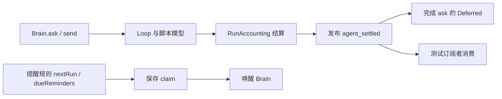
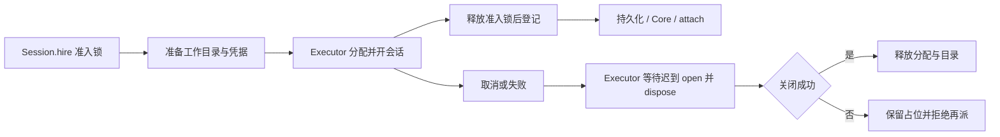
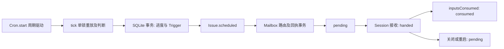

# Agent Note: 把可控制、可观察和可关闭做成模块边界

Status: proposed

## Problem

测试需要修改全局时间、等待不明数量的事件循环、构造整座农场或了解内部调用顺序，往往说明模块没有明确输入、完成条件或资源归属。本提案按[架构、模块边界与测试设计](docs/style/module-design.md)推进：先审查业务不变量与所有权，再调整边界和模块内部设计，同时确定证明行为的测试层；最后提炼测试设施。Clock 是已发现的依赖边界问题，不是整个改造的主线。

静态审查发现以下问题；尚未测量它们对运行耗时和偶发失败的贡献。

| 证据 | 设计上的缺口 | 优先级 |
|---|---|---|
| [agent 测试夹具](packages/agent/src/testing.ts)的 `withAgent` 用 `Date.now()` 构造消息，Brain 使用 Effect Clock；`ask` 后连续两次 `yieldNow` 等事件收集 | 输入和业务不在同一条时间线上；回答完成与观察者消费完成的区别没有表达出来 | P0 |
| [提醒测试](packages/agent/src/tools.test.ts)的 `run a missed reminder once` 使用每读一次加一毫秒的函数，又用真实时间构造提醒 | 时钟读取次数成了隐藏输入；时间兼任排序手段 | P0 |
| [测试农场](apps/server/src/testing/world.ts)调用 [platform](apps/server/src/services.ts)，后者装入 `FetchHttpClient.layer` 和 `Llm.layer`；[offline](apps/server/src/testing/layers.ts)不是这个默认装配的一部分 | 默认装配没有从结构上拒绝意外出站请求；不代表已经发生联网 | P0 |
| [测试探测器](apps/server/src/testing/worker.ts)的 `installedOnly` 用真实时间生成 `checkedAt` | 外部替身生成的时间不随 TestClock 变化 | P0 |
| [通用等待](packages/testkit/src/until.ts)靠真实时间轮询；`aTurn` 只让出一轮事件循环；[cron 测试](apps/server/src/cron/cron.test.ts)把它命名为 `drained` | 等待条件、业务期限和消费确认容易混为一谈 | P1 |
| [worldBelowIngress](apps/server/src/testing/world.ts)装到 Issue、Cron，[world](apps/server/src/testing/world.ts)继续装配工具和 MCP | 对只测一项模块行为的用例，夹具可能比实际依赖大；应逐个用例确认，不按函数名判错 | P1 |
| [PKM 日历](apps/web/src/features/pkm/Calendar.tsx)在创建时读取「今天」；[useNow](apps/web/src/base/dom.tsx)和组件直接读时间并存 | 日期来源与更新机制分散，跨日行为不能只靠固定截图验证 | P2 |
| [lint 配置](vite.config.ts)对测试和测试夹具整体关闭 `no-wall-clock` | 最需要共享时钟的输入构造没有受到相同约束 | P1 |

已有能力应保留：[timeHere](apps/server/src/infra/time.ts)捕获服务的 Clock 并把回调任务交给作用域；[whenState](apps/server/src/testing/layers.ts)通过快照和变化流等待状态；[services](apps/server/src/services.ts)分装配和启动；[cron 测试](apps/server/src/cron/cron.test.ts)及[Time 测试](apps/server/src/infra/time.test.ts)已经能手动推进时间；页面已有 Playwright Clock 用例。不另造时钟库、测试运行器或业务状态副本。

## Proposal

### 1. 目标与范围

改完后，一个模块的测试应能回答五个问题：

1. 输入是什么，哪些来自外部？
2. 哪些输入可控制，谁能推进时间和释放外部响应？
3. 方法返回代表什么完成了，后续结果从哪里观察？
4. 失败、重复、取消与并发交错会留下什么状态？
5. 关闭作用域后，哪些资源已经释放，哪些持久记录应保留？

本次覆盖服务端模块测试、agent 测试夹具、共用等待工具，以及页面日期展示的一条试点。HTTP 契约、核心状态所有权、数据库表结构和既有业务上的重试、取消、去重政策保持不变。若试点发现业务语义没有定义，应先列出具体选择并请主人决定，不在重构中决定「重复投递丢弃还是重跑」。

不把所有模块改成纯函数，不把真实 git 和 SQLite 换成内存仿制品，不为测试增加生产 HTTP 控制接口，不承诺整个系统都能确定性重放。

### 2. 先确定试点的责任与契约

沿用现有服务和模块顺序，按[边界审查](docs/style/module-design.md#架构与边界审查)确认每个试点的责任；决定、执行、驱动的划分与测试策略照[模块内部设计](docs/style/module-design.md#模块内部区分决定执行与驱动)。不预设需要新增服务或端口。

| 试点 | 先核实的模块问题 | 再决定的实现与证据 |
|---|---|---|
| agent 提醒与事件收集 | 提醒的时间与排序归谁；回答返回与事件发布分别承诺什么 | 统一时间输入；在测试侧建立消费确认，或修正真实缺失的生产契约 |
| Session 停滞与取消 | 谁拥有执行资源；停止与迟到结果交错时何时可释放容量 | 保持锁和资源不变量，按外部端口的具体阶段控制交错 |
| Cron 与 Mailbox 交接 | 到期决定、持久化、投递、恢复分别归谁；重复时的既有政策 | 分别验证纯决定、执行失败与实际周期接线，不只直接调用 tick |
| 测试农场装配 | 领域组合与外部能力接入是否耦合；哪些下层是真正必要的 | 复用生产组合、缩小试点装配、验证依赖替换实际生效 |
| PKM 日期展示 | 当前日期来源、更新与订阅生命周期归谁 | 统一读取入口并验证跨日和清理，不向每个组件注入新框架 |

每个试点应先记录：保留的不变量、现有契约缺口、拟调整的模块边界、最小真实测试环境和仍需保留的流程测试。缺少这份判断时，不开始批量迁移 Clock、增加测试 API 或建设通用 harness。

### 3. 时间：统一来源，区分用途

#### 3.1 业务时间与测试输入

- Effect 服务沿用 Clock；同步外部回调沿用在服务作用域中取得的 `timeHere`，不回退到 `wallTime`。
- 纯函数显式接收 `now`、期限及需要的时区。`new Date(timestamp)` 不读取当前时间，不应被机械禁止；Effect 日期和时区运算优先查 DateTime 的能力。
- 一次决策需要同一时刻时，只读一次 `now` 并向下传；长流程中另一个实际事件发生时再读，不把整个流程伪装成同一时刻发生。
- 测试先设置固定 epoch，再构建会捕获 Clock 或读取时间的 Layer。不同测试可覆盖不同 epoch，但不能从 `Date.now()` 推出固定起点。
- fixture 生成的消息、探测结果与模型输入默认使用当前测试 Clock；只有明确表示历史、未来或外部事件原始时间的字段才由用例另行给定。
- 读取时间不推进时间。相同毫秒内发生的两件事不应靠隐式 `now++` 区分；先核实已有 seq、数据库顺序和 ID 契约。若业务确实依赖未定义的同刻顺序，单列行为决策，不借迁移时钟更改它。
- UUID 的生成时间不自动等于业务发生时间。审查 `base/ids.ts` 的调用用途，不把随机 ID 生成器一并替换；断言业务时间字段，不通过解析 ID 猜时间。

#### 3.2 三种时间各有边界

| 用途 | 来源与测试 | 不应做 |
|---|---|---|
| 持久时间戳、日历日期、恢复后的到期判断 | Clock 的 epoch 时间；显式时区；固定起点和边界用例 | 把进程内单调计数存成跨重启期限 |
| 进程内等待、重试和经过时长 | Effect 的等待/调度；核实当前版本的时钟语义；仅有回拨风险的耗时测量使用合适的单调来源 | 假定 `currentTimeMillis` 天然单调，或持久化单调起点 |
| 真实进程/网络保护超时、测试防挂死 | 现有真实时间适配器；不随 TestClock 推进 | 用真实等待实现可模拟的业务期限，或用冻结的 TestClock 保护挂死测试 |

本轮不更改产品时区政策。测试显式标明场景时区，日历算法覆盖 UTC、Asia/Shanghai 和一个有夏令时的时区；需变更进程 `TZ` 的用例隔离运行，不并发修改全局环境。服务端 Clock 和浏览器 Clock 是不同运行环境，不声称拨动一个就能控制另一个。

### 4. 异步：把完成条件写进契约

方法返回、领域状态生效、观察者收到事件是三个不同条件。先逐个试点确认现有行为，再选择等待方式。

| 要证明的事 | 等待方式 |
|---|---|
| 方法承诺的写入或操作完成 | 等待方法返回；不在后面再补两次 yield |
| 核心状态到达某条件 | 复用 `whenState` 的快照与订阅机制，避免先查后订阅的窗口 |
| 收到一个指定事件 | 先建立并确认订阅，再触发操作；按已有请求/运行标识匹配并等待事件 |
| 外部请求已进入某一步 | 由脚本替身发出 `entered` 确认，测试等待确认后再推进 |
| 制造取消、重复或乱序 | 用 Deferred 或 gate 控制该请求的结果释放；使用请求标识区分并发请求 |
| 业务期限到达 | 确认任务已启动或已进入相关阶段，再推进 TestClock，等待对应结果 |
| 真实文件或进程尚未提供通知 | 保留有真实截止时间的轮询，并给出最后观察值 |

不提供通用 `settleEverything()`、无限 `runAllTimers()` 或「执行 N 次 yield 就稳定」的工具。后台巡检可能永不空闲；整座农场不存在通用的完成时刻。

`aTurn` 可继续用于明确的一轮调度，但不应以 `drained` 的名字承诺所有消费者都已完成。证明「没有发生」应建立边界：已完成一次明确的 tick、已确认本次输入处理结束，或已走过受控时间窗口。任意等一轮后查看空数组不能证明没有延迟事件。

优先把确认做在测试观察器、外部替身或已有服务返回值上。不为让测试看见内部状态而给每个生产方法增加确认事件。只有生产调用方也需要「已就绪」「已提交」语义时，才调整生产端口；调整前确认不会把原本异步的操作变为同步等待。

### 5. 测试设施本身按模块设计

#### 5.1 归属

| 位置 | 负责 | 不负责 |
|---|---|---|
| `packages/testkit` | 与业务无关的有界等待、门闩、诊断、临时资源、测试报告 | 农场业务、Core 状态、业务时间政策 |
| `packages/agent/src/testing.ts`、`packages/ai/src/testing.ts` | agent/模型端口的脚本与观察器 | 服务端农场装配 |
| `apps/server/src/testing` | 测试配置、真实数据库/git、服务器下层装配、Core 观察 | 各业务规则的第二份实现 |
| 具体模块的测试文件或测试帮手 | 该模块的场景输入和断言 | 其他模块可直接 import 的内部实现 |
| `apps/server/src/flows` | 跨模块恢复、投递、关闭等主线 | 重演下层全部分支 |

先改已有的 `withAgent`、`installedOnly`、`whenState`、`world`，不先写一个统一 `TestHarness`。只有试点中至少两个调用方需要同一种与业务无关的同步能力时，才提炼进 testkit。

#### 5.2 最小装配与真实装配共用结构

1. 保留生产的有序模块构建函数；允许在接入真实 HTTP、Llm、runtime 的边界替换依赖，而不是在已经捕获依赖的服务外面追加 Layer，误以为替换生效。
2. 把系统能力接入与领域服务组合分清：测试使用同样的领域组合，默认接入拒绝意外外呼的 HTTP/模型端口、受控 runtime、临时目录和可控 Clock。
3. 沿用现有分段构建函数为模块测试选择必要的下层；为新段命名时对应实际模块，不构造任意勾选几十个模块的配置对象。
4. 保留整农场装配验证生产启动顺序、订阅和恢复；不让每个模块测试重新决定这些顺序。
5. 装配和启动保持分离。模块规则测试可以不启动巡检；验证周期行为的测试应启动真实的周期任务，而不只直接调用 `tick`。
6. `ready` 如有必要，应表示具体资源/订阅已就绪，而不是「后台已经运行了一会儿」。关闭遵循 Scope，不添加全局 teardown 注册表。

优先验证的默认隔离：未声明的远程 HTTP 和模型调用立即失败，不能悄悄返回成功；本机测试服务器按用例显式接入。HTTP 层拒绝请求不能阻止任意第三方 SDK 直接联网，因此同时审查绕过该端口的依赖。继续保留无外部密钥、临时 HOME 和脚本 runtime 的现有边界，不声称一个假 HttpClient 就实现了系统级网络沙箱。

#### 5.3 测试设施也应有契约测试

- 等待器：条件已经成立、订阅期间成立、一直不成立、被取消、Scope 关闭；成功、失败和取消均清理定时器与订阅。
- 脚本替身：预期调用耗尽或出现意外调用时失败；支持按请求释放成功/失败；取消后记录取消且不泄漏等待。
- 时间桥：Clock 的读取、sleep、after 一致；取消和关闭后不再执行回调；关闭导致的 Promise 结果有明确契约。
- 观察器：先订阅再触发，不丢第一个事件；关闭后不再收集；诊断缓冲有上限。
- 装配：同进程内两套测试环境不共享状态、时间控制器、临时目录和脚本队列。

替身只模拟端口协议，不复制完整业务状态机。对稳定的外部端口，用小型契约测试分别跑替身和本机受控适配器；不能直接共享的断言分开写，不为了形式造一套通用契约测试框架。

### 6. 并发、失败和恢复按场景建模

从 Session 的容量/关闭、Mailbox 的投递/重试、Cron 的到期/恢复选现有行为做试点。每个场景在编码前列出以下内容：

| 项 | 应写明 |
|---|---|
| 输入和前态 | 持久记录、核心状态、外部任务处于哪一步 |
| 交错点 | 哪个请求已经进入端口，哪个结果被 gate 挡住 |
| 故障 | 现有错误类型、失败发生在提交前还是提交后 |
| 保持的不变量 | 从当前模块契约引用，不另发明重试/去重政策 |
| 观察点 | 方法返回、Core、数据库、领域事件或外部调用记录 |
| 收尾 | 关闭、重启或再次调用后应看到什么 |

先覆盖：期限前/刚好期限、取消与结果到达交错、重复唤醒、并发争用、持久化失败、关闭时仍在等待、重启后的到期恢复。矩阵只选会改变结果的交错，不做所有维度的笛卡尔积。

规则层可增加性质测试，例如未到期不会产出到期项、同一时刻重复 tick 的结果符合既有去重政策。只有输入和结果可纯化的部分做性质测试；生成器固定并报告 seed，不用随机执行代替已知竞态用例。

### 7. 页面：先统一日期行为，不移植整个服务端时钟框架

首个试点选 PKM 日历：纯日期计算显式收 `now` 和日期所需上下文；组件通过一个会更新的当前时间入口读取「今天」，在跨午夜和页面恢复可见时重新计算。

时间源放在符合现有分层的浏览器基础设施边界；若需要页面共享的响应式值，由 state 层提供，base 的纯日期规则不反向依赖 infra。是否拆出新的页面服务由试点决定，不预设每个组件都要注入 Clock。

组件与故事测试先固定日期；行为测试使用已有 Playwright Clock，在应用读取时间前安装，区分 `setFixedTime` 与推进计时器。服务端到期语义放在服务端测试；浏览器只验证显示更新和接线，不引入生产的「修改服务端时间」接口。

测试最少覆盖跨午夜、跨月/年、恢复可见、组件卸载后清理订阅。既有工作台图标、令牌、词典和页面响应式约定不变。

### 8. 检查与失败诊断

先把新写法落到试点，再收紧门禁，不先写一批全仓不可能通过的禁令。

- 缩小 `no-wall-clock` 对测试和夹具的豁免；允许真实边界测试在具体位置说明理由，不按整个 testing 目录放行。显式历史时间和 `new Date(timestamp)` 保持可用。
- 纯业务规则中禁止直接读当前时间；日期值转换不算读取时钟。检查基于明确目录/语法边界，不用文本出现次数判断设计好坏。
- 延续 `no-test-sleep`，但不禁止等待工具内部的真实防挂死计时器。门禁报错说明该等待业务期限还是工作完成，并链接试点。
- 不一刀切禁止 `it.live`；为每个保留用例说明真实时间保护的边界。真 git/SQLite 本身不自动要求业务使用 live Clock。
- 等待失败报告等待目标、真实耗时、业务时间（能取得时）、最后观察值与有界事件摘要；不输出提示词全文、密钥和私人数据。
- 扩展现有报告时区分测试累计耗时和整轮墙钟耗时。fixture 构建、测试正文、关闭的耗时分开测量；不得把重复运行零失败解释为不存在竞态。

不以测试数减少、覆盖率上升、`it.live` 清零、轮询清零或增加一份测试框架为验收目标。

## Implementation plan

### 执行规则与依赖

长期原则属于「道」，本节的架构审查、契约决定和场景设计属于「术」，Clock、观察器、替身与门禁属于「器」。先完成 S0、S1，再从具体模块中选择工具；不能先做 S5 的通用设施，再要求业务迁就它。

- 每项 TODO 使用固定编号。只有交付物与验证证据齐全才勾选；写好计划不算完成实施。
- 在本节末尾的执行记录中登记负责人、状态、证据和阻塞。跳过不适用的任务应写理由及等价证据，不用直接勾选掩盖缺口。
- 一个 TODO 可以包含代码与对应测试，不能把修实现和证明行为拆成互不依赖的两张单。
- 每个阶段关闭前核实退出条件。某项设计涉及未定义的业务政策时，暂停依赖该政策的任务并请主人决定，不暂停无关的审查。
- 同一批改动默认一个 PR、按阶段提交。下面是工作分解，不要求拆成九份 PR。
- S2–S4 可在本模块内增加最小的测试帮手；共用 API 与装配的集中调整留在 S5，不以「等框架做好」阻塞试点。任何试点跑测试前仍应保证不接触主人的资源或外部付费服务。

| 阶段 | 前置 | 重点 | 阶段交付物 |
|---|---|---|---|
| S0：语义与基线 | 无 | 道：核实不变量，不把静态发现当测量 | 场景、契约来源、运行基线 |
| S1：架构与边界决定 | S0 | 术：所有权、依赖与完成契约 | 试点设计决定和验证矩阵 |
| S2：agent 纵向试点 | S1 | 模块设计与测试共同落地 | 时间一致、事件观察有明确完成条件 |
| S3：Session 生命周期 | S2 | 并发、容量与资源归属 | 可复现的取消/迟到结果交错 |
| S4：Cron 与 Mailbox | S3 | 决定、执行、驱动与恢复 | 到期、投递和恢复的分层证据 |
| S5：装配与设施收口 | S2–S4 | 器：提炼实际重复、默认隔离 | 最小装配、共用设施及自身测试 |
| S6：页面日期试点 | S1；S5 前不扩大共享设施 | 日期与页面生命周期 | 跨日、恢复可见和卸载证据 |
| S7：门禁与删除旧路径 | S5、S6 | 防止退回隐式依赖 | 精确门禁、删除清单、剩余范围 |
| S8：整体验收与沉淀 | S7 | 验证实际接线与收益 | 验收记录、长期文档、删除本 Note |

服务端默认顺序为 S0 → S1 → S2 → S3 → S4 → S5 → S7 → S8。S6 可在 S1 后单独推进；只有修改文件和契约互不影响时才并行，`services.ts`、公共测试帮手和 lint 配置由同一任务集中修改。

### S0：核实业务语义和运行基线

**范围**：相关子系统文档、既有测试和它们的装配；本阶段不重构。

- [x] S0.1 阅读 [Brain](docs/subsystems/brain.md)、[Session](docs/subsystems/session.md)、[Cron](docs/subsystems/cron.md)、[Mailbox](docs/subsystems/mailbox.md)与 [PKM](docs/subsystems/pkm.md)，逐项记录不变量和契约来源。标明文档、代码与测试不一致的地方，不把任一方自动当成正确答案。
- [x] S0.2 固定三个服务端/agent 试点的用例名单：agent 提醒与事件收集、Session 停滞与取消、Cron/Mailbox 到期与恢复。记录现有 `regression: ` 用例，说明后续哪些只改夹具、哪些需要新增断言。
- [x] S0.3 对名单内每条用例登记时间源、输入时间、等待方式、实际启动的模块、真实 I/O 和收尾资源；区分已确认缺陷、设计风险、合理的真实边界。
- [x] S0.4 在临时目录、无外部密钥和受控 runtime 下运行最窄测试，记录提交、Node/工具版本、命令、并发配置、重试配置及结果。按下文「验证次序」采集迁移前重复运行基线，区分整轮墙钟耗时与测试累计耗时。
- [x] S0.5 核实 PKM 日期用例的现有覆盖、浏览器时区和时间安装位置；记录是否已覆盖跨午夜、可见性恢复和卸载，不以截图代替行为基线。

**退出条件**：每个试点有明确行为、证据来源和可重复命令；没有数据的项写「未测」，不估算耗时收益或偶发失败率。

### S1：决定架构、模块边界与证明方式

**范围**：先更新本 Note 的设计决定，不先承诺新的服务、接口或测试框架。

- [x] S1.1 画出三个服务端/agent 试点的实际调用与事件路径，标明状态写入者、事务/锁范围、外部依赖、后台任务与资源所有者；核实是否存在不必要的跨模块读取或重复状态。
- [x] S1.2 给每个入口写清返回时的保证，区分已接收、已提交、已执行与观察者已消费；给构建、订阅、启动、关闭写清先后和失败结果。仅保留调用方真正需要的完成保证。
- [x] S1.3 按「决定、执行、驱动」判断哪些代码应分开、哪些应保持在同一原子边界。列出拟改文件、调用方减少的知识、保留的锁/事务及不新增服务的理由；不以函数变短作为提取依据。
- [x] S1.4 对每项不变量选择规则、模块、适配器或流程层，登记输入、故障/交错、观察点和收尾；指出低层证明不了、必须保留在真实流程中的接线风险。
- [x] S1.5 核实同刻排序、重复触发、提交后投递失败、取消后迟到成功、停止失败时的既有政策。没有定义的项列出选项与推荐，请主人决定后再实施依赖它的任务。
- [x] S1.6 决定最小装配和外部能力的接入位置，验证替换早于服务捕获依赖；为页面选定符合分层的日期入口及更新生命周期。为每个改动列出不采用的更大方案。

**退出条件**：设计记录能解释「改的是哪条边界、为什么、如何证明」，而不是 API 替换清单。只需修测试的项也应说明生产契约已经足够，不能为了交付架构改动强行重构。

### S2：agent 的时间与完成语义纵向试点

**范围**：`packages/agent/src/brain.ts`、`reminders.ts`、`testing.ts`、`brain.test.ts`、`tools.test.ts`，以及 S1 确认的直接调用方。

- [ ] S2.1 用固定非零 epoch 建立提醒的最小测试，先设置 Clock 再构建实例；核实同刻创建的提醒编号互不相同、依照现有排序契约执行；不断言 TestClock 读取不前进（那是 TestClock 的性质，不证明业务）。
- [ ] S2.2 依据 S1 调整提醒的日期决定与调度边界；使 `withAgent` 默认消息时间取自测试 Clock，删除 `Date.now()` 和每读一次推进一毫秒的测试前提。历史消息仍允许显式给定时间。
- [ ] S2.3 明确 `ask` 返回与事件发布的关系，先建立观察再发起请求，按已有运行/请求标识等待目标事件；移除固定两次 `yieldNow` 的消费假设。没有可用标识时先回到 S1 决定局部观察方案，不擅加公共协议字段。
- [ ] S2.4 补期限前一刻、刚好到期、错过期限恢复和同刻重复检查；验证业务结果，不断言私有定时器调用次数。
- [ ] S2.5 补等待中取消、关闭后不再唤醒和观察器关闭的场景；测试脚本缺少回答或出现意外调用时应失败，不以默认成功掩盖错误。
- [ ] S2.6 跑最窄测试及修改夹具的全部调用方；登记删掉的测试假设、保留的真实等待，以及可被 S5 复用的能力。不为只有此处使用的帮手新增包导出。

**退出条件**：一个完整试点同时证明显式时间、明确完成和关闭契约；业务代码不等待测试观察器消费；原有行为和回归断言没有放松。完成下文「成本与继续推广的判断」后，才进入 S3。

### S3：Session 的取消、迟到结果与容量归属

**范围**：`apps/server/src/session/session.ts`、`host.ts`、相关执行边界与 Session 测试；必要的时间桥在 `apps/server/src/infra/time.ts`。

- [ ] S3.1 把开会话、投递、中断、关闭与容量释放的现有责任写成场景矩阵，标记成功、拒绝和停止失败分别归谁收尾。保留 Session、Executor 与外部 runtime 的既有职责边界。
- [ ] S3.2 在脚本 runtime 的真实交互边界加入进入确认和按请求释放的 gate，至少固定「开启尚未返回时取消」「取消之后开启成功」「关闭失败后再次派活」三个交错；每个 gate 都有最终释放或中断的收尾。
- [ ] S3.3 按 S1 修正有缺口的完成/资源归属设计；不要暴露私有分配表供测试修改。以服务结果、核心状态、凭据撤销和 runtime 调用记录证明容量与写入者约束。
- [ ] S3.4 扩展停滞检测的边界测试：读取与等待共享 Clock、期限前不报、到点报告、活动重置期限、关闭后不再报告。预期次数与去重方式沿用现有业务契约。
- [ ] S3.5 补时间桥的 sleep 中断、after 取消、Scope 关闭以及 Promise 结算契约测试；等待失败应由真实 watchdog 结束，不得依赖尚未推进的业务时钟。
- [ ] S3.6 跑 Session 的相关回归用例和最短跨模块派活流程，确认没有为了单测移动锁/事务范围或提前释放资源；记录生产端与测试端分别改了什么。

**退出条件**：竞争由明确交错复现，不靠短超时；迟到结果和关闭失败不破坏已有容量/工作目录安全约束；测试关闭无遗留任务。

### S4：Cron 与 Mailbox 的决定、执行、驱动和恢复

**范围**：`apps/server/src/cron/when.ts`、`cron.ts`、`cron.test.ts`、`apps/server/src/mailbox/pump.ts` 与相关模块/流程测试。

- [ ] S4.1 从 S1 矩阵选出到期判断、持久化发生记录、投递、消费确认和恢复的责任边界；标明提交前失败和提交后投递失败的不同预期，不另发明恰好一次保证。
- [ ] S4.2 只提取已确定可独立计算的决定；纯函数显式接收时间与时区，覆盖期限边界及有语义的夏令时场景。若现有 `when.ts` 已满足要求，保留结构并补缺失证据。
- [ ] S4.3 在真实 SQLite 上验证保存失败不产生不应出现的后续结果；按已有错误边界注入故障，不绕过事务，也不在生产配置中加入「测试失败」开关。
- [ ] S4.4 用按目标事件或状态的等待替换 `drained = aTurn` 的完成假设；证明重复 tick/唤醒和投递返回遵循现有政策，验证范围包含一次已确认结束的执行。
- [ ] S4.5 使用同一临时持久目录关闭并重建服务，验证未到期、停机期间到期、提交后尚未投递的恢复场景；新实例接入独立作用域和预先设定的 Clock，不复用旧内存快照。
- [ ] S4.6 保留一条由实际启动层和周期任务触发的流程：不直接调用 tick，确认驱动就绪后推进时间，观察持久结果与跨模块交接，关闭后确认不再产生后续结果。
- [ ] S4.7 跑到期规则、Cron/Mailbox 模块与相关流程测试；纯重构的黄金数据应不变。若发现规则行为错误，单列修复及回归证据，不直接重写黄金数据消除差异。

**退出条件**：规则、事务与恢复、周期接线分别有证据；测试不只验证手动 tick；没有把锁内决定移出原子边界。

### S5：收口装配、外部能力和共用测试设施

**范围**：`apps/server/src/services.ts`、`testing/world.ts`、`testing/layers.ts`、`testing/worker.ts`，`packages/testkit` 与 agent/model 的测试入口。

- [ ] S5.1 汇总 S2–S4 实际重复的同步和观察需求，选择留在模块内或提炼到 testkit；只提升与业务无关且有多个调用方的能力，删除被替换的局部副本。
- [ ] S5.2 分开领域组合和真实 HTTP/模型/runtime 接入；保留生产模块顺序与两阶段启动，测试只在接入处给定实现。用一次意外 HTTP 调用和一次意外模型调用验证实际使用了拒绝端口。
- [ ] S5.3 改 `installedOnly` 等脚本输入，使时间来自环境中已取得的 Clock；给两个并行环境设不同 epoch 和脚本回答，验证时间、状态、队列、目录和探测结果不串用。
- [ ] S5.4 为至少一个试点缩小装配到实际必要下层；保留共用的生产组合，不复制完整启动顺序，不增加任意勾选模块的配置矩阵。
- [ ] S5.5 验证等待器已满足、订阅时满足、不满足、失败、取消和关闭的行为；验证真实 watchdog 在冻结业务时钟时仍超时，并在每种结算路径清理定时器和订阅。
- [ ] S5.6 验证观察器不漏第一个事件、仅匹配目标、关闭后停止；诊断缓冲有界。失败信息包含目标、最后观察值和可获得的时间信息，不泄露密钥或提示词全文。
- [ ] S5.7 验证脚本端口意外调用、脚本耗尽、外部失败和取消；为改动的稳定端口保留真实本机适配器契约测试，核实它与替身对失败/取消的解释一致。
- [ ] S5.8 跑公共夹具的全部调用方及两套农场并行测试，删除旧入口和不再使用的选项；核实第三方直连边界，记录 HTTP 拒绝端口不能覆盖的部分及已有隔离措施。

**退出条件**：至少一个模块无需无关装配即可验证；公共设施有自身测试；测试组合不分叉业务；默认外呼失败与并行隔离由实际测试证明。

### S6：PKM 日期与页面生命周期试点

**范围**：`apps/web/src/features/pkm/Calendar.tsx`、`days.test.ts`、S1 选定的当前时间入口及页面组件测试。

- [ ] S6.1 明确「今天」的来源与既有时区语义，区分当前日期和主人主动选择的查看月份；跨日更新不应覆盖主人的月份选择。
- [ ] S6.2 让纯日期计算显式接收时间，将日期读取与更新放到符合页面分层的入口；只有确有共享需要时才增加 state 层能力，不把 Effect Clock 注入所有组件。
- [ ] S6.3 为跨午夜、跨月与跨年写纯规则断言；组件测试在应用读取时间前安装浏览器 Clock，验证「今天」标识自动更新而非重新挂载才正确。
- [ ] S6.4 模拟页面在后台跨过日期边界后恢复可见，确认刷新日期；卸载组件后验证订阅/计时器清理，再次挂载不重复注册。
- [ ] S6.5 跑日期规则、对应组件/集成测试和 `e2e:dev` 的相关用例；按验收分册保存页面证据，注明浏览器时区，不通过修改服务端时间辅助页面断言。

**退出条件**：日期来源与生命周期有明确归属；跨日、用户选择和清理均有证据；不扩大成全页面时钟迁移。

### S7：收紧门禁并删除旧路径

**范围**：`vite.config.ts`、`scripts/oxlint-plugin.ts`、`scripts/oxlint-plugin.test.ts`、受影响调用方和包文档。

- [ ] S7.1 根据已迁移范围登记仍使用真实时钟、`it.live` 和轮询的用例，分别说明真实边界或后续工作；不为达到清零目标机械改写。
- [ ] S7.2 缩小 `no-wall-clock` 的测试/夹具豁免；若全仓收紧尚有未迁移阻塞，先落实到已迁移范围并明确剩余项，不以改规则名或新增宽泛关闭绕过。
- [ ] S7.3 补门禁正反例：直接读取当前时间应拦，显式时间转换应放行，真实保护边界有窄豁免；报错包含原因、`Fix:` 和可用的 `See`，不会建议用业务 TestClock 保护挂死测试。
- [ ] S7.4 删除已替换的帮手、选项、错误的完成注释和旧装配路径；跑 `vp run deadcode`，核实未增加第二份业务算法、测试专用分支或无调用方的接口。
- [ ] S7.5 更新受影响包 README 的真实导出与契约，检查 `docs/style/module-design.md` 的工具入口仍然准确；原则文档不复制迁移进度。

**退出条件**：新写法有检查保护，例外有具体范围；旧路径删除；未迁移项可定位且有理由，不以隐藏存量问题宣称完成。

### S8：整体验收、收益比较与沉淀

**范围**：整体检查、隔离真实程序与长期文档，不继续扩张试点。

- [ ] S8.1 按下文「验证次序」跑包构建、类型/lint、相关服务端/页面检查、Effect 诊断与死代码检查；记录失败和未执行项，不把缓存回放或局部检查写成全量实跑。
- [ ] S8.2 按 S0 同样的场景、环境和命令重复运行至少 20 次，分别覆盖串行和默认并发，禁用失败重试；对比整轮耗时、测试累计耗时、失败和等待诊断。新增覆盖单独列出，不能删用例后直接比较总耗时。
- [ ] S8.3 按验收分册启动隔离服务端，验证启动、接口、状态帧与关闭；验证脚本 runtime/模型仍正确接入，不使用主人的数据或外部付费模型。
- [ ] S8.4 完成页面真实程序验收，附跨日行为测试与显示截图的不同证据；核实没有新增生产时间控制接口。
- [ ] S8.5 逐项复核本 Note 的验收标准；对每个试点记录减少的职责/隐式假设、保留的真实边界和没有解决的风险。测试重复零失败只说明本次观察，不声称消除了全部竞态。
- [ ] S8.6 将成立的模块契约、装配与测试约定沉淀到对应子系统及包 README；未完成且仍需做的决策移入拥有该问题的提案，不把未实施行为写成现状。
- [ ] S8.7 将执行证据转入 PR 的 Checks / Not verified，点名解释改写的回归用例；完成后删除本 Note，运行 `vp run notes:catalog` 与 `vp run docs:verify`。同批工作默认一个 PR，不在本任务中自动提交或推送。

**退出条件**：验收证据与设计收益同时成立，长期文档对应实际实现；没有用更长超时、重试、降低断言或全局串行来换取通过。

### 执行记录

状态使用「待开始／进行中／阻塞／完成」。证据填写命令与结果、测试路径或设计决定；详细证据可链接 PR，不在表里粘贴大段日志。

| 阶段 | 状态 | 负责人 | 设计决定、运行证据与阻塞 |
|---|---|---|---|
| S0 | 完成 | 主任务；两个只读调查任务 | 120 次有效实跑；agent/delivery 零失败，Session 的六条用例各失败 40 次；无重试 |
| S1 | 完成 | 主任务 | 下方边界决定、验证矩阵与缺陷复现；保留已有事务、锁和失败政策 |
| S2 | 进行中 | agent 试点任务；主任务验收 | 已复现同刻提醒编号碰撞导致未来提醒丢失，编号改为 UUID，`tools.test.ts` 的 regression 用例证明；`withAgent.ask` 等目标运行的 `agent_settled`，等待仍用 testkit 的真实时间轮询，留给 S5 |
| S3 | 进行中 | 主任务 | 已修：第一个关闭的调用方被中断后，后来的 close 不等清理就返回；关闭改在宿主的作用域里跑，`host.test.ts` 的 regression 用例在旧写法上失败、新写法上通过 |
| S4 | 待开始 | 未分配 | 等既有恢复政策确认及 S3 的反馈 |
| S5 | 待开始 | 未分配 | 从 S2–S4 收集真实复用需求 |
| S6 | 进行中 | PKM 试点任务；主任务验收 | 已在隔离服务端和 Asia/Shanghai 浏览器复现跨年后仍标记旧日期 |
| S7 | 待开始 | 未分配 | 等迁移范围确定 |
| S8 | 待开始 | 未分配 | 等前序交付与验收证据 |

仓库检查与 git 决策提取已有独立[提案](.agents/notes/proposed/testing/2026-10-26-press-the-module-layer-down.md)。本计划不重复拥有它，只把它作为外部端口与规则分离的后续应用；只有该提案实际开始实施时才调整它的具体文件方案。

### S0/S1：边界调查与实现决定

基点为 `cce3258a0a916f514f50c31f983b0f51a10a9211`，分支为 `fix/testable-module-boundaries`。以切分支时已有的未提交代码为基线，不把这些改动当成本任务新增。基线工具、每条用例的完整名称、源码 SHA-256、命令与 JSON 结果存放在本机 `.test/testable-boundaries/before/`；完整测量结束前不报告耗时收益。

**固定的比较组**：

| 组 | 原有文件（组内全部用例） | 时间、等待与真实边界 |
|---|---|---|
| agent | `packages/agent/src/{brain,loop,tools}.test.ts` | Effect 测试使用 TestClock；提醒部分另用墙钟及 `++at`，`withAgent.ask` 用两次 yield 猜消费完成。真实文件、工具与 MCP 子进程保留，模型按脚本回答 |
| Session | `apps/server/src/infra/time.test.ts`、`session/{host,session}.test.ts`、`executor/executor.test.ts` | Time/停滞用 TestClock；生命周期用 live Clock、真实 SQLite/git/文件与脚本 runtime。开会话和关闭需 gate 的进入确认，不能把 yield 当取消确认 |
| delivery | `apps/server/src/cron/{when,cron}.test.ts`、`mailbox/triggers.test.ts`、`flows/mailbox-order.test.ts` | 规则显式时间；Cron 先设 TestClock 再装配，部分以 `drained = aTurn` 等待。Mailbox 顺序流程保留 live Clock、真实 SQLite 与脚本 runtime |

现有回归名称与断言保留，包括 Session 的注册失败、凭据撤销及 Executor 关闭调用者取消，Cron 的发生记录/进度共同提交及提交后重启，以及 Mailbox 的来源去重、并发写入、恢复和接收顺序。只改等待或装配的用例仍属于原比较组；新增边界另行计数。Issue 的目录保留、容量拒绝、真实派活和 `flows/work.test.ts` 的停滞流程仍作接线检查，不复制到低层。

基线每轮使用独立 HOME，去掉密钥与应用环境变量；macOS sandbox 禁止外网，仅允许回环。已实际验证本机 HTTP 成功、向文档保留地址的 TCP 连接立即报 `EPERM`。这是运行器的网络隔离，不冒充尚未实现的 HTTP/模型拒绝端口。临时目录由测试进程退出清理，scope 关闭负责服务、观察器及后台纤程；拒绝关闭的替身须另持原始 disposer，gate 在最终清理中释放。

**调用、写入与完成边界**：

Brain 的 scope 拥有 Loop、提醒和事件跟随纤程。`ask` 返回证明结算事件已发布，不证明订阅者已消费；订阅建立在请求之前。局部夹具从公开 `progress().current` 推导最近已结算的运行编号（当前已结算取本编号，否则取前一编号），等待观察器收到该编号；不新增协议字段，不让生产代码等测试。提醒沿用列表顺序，先保存再唤醒；保留现有决定、持久化与 scoped driver，不另造服务。移除独立 `now` 回调，构建时捕获 Effect Clock；历史与直接 claim 的时间仍是显式输入。同刻生成相同提醒编号是待复现风险，不能继续靠推进假时间避开。

Session 已负责领域发布、准入、凭据与目录；Executor 已负责底层资源，关闭工作不属于单个关闭调用者。保持 Hand 锁、准入锁与登记顺序；失败关闭复用同一个失败结果，不添加重试。`send` 不保证回合或观察器完成；普通 `stop` 只证明中断被接受。迟到 open 必须先 dispose、不能 prompt，关闭失败不能提前释放容量或删除目录。Time 已捕获 Clock：scope 关闭/信号中断令 sleep Promise 拒绝，after 取消后不调用；不承诺各适配器的拒绝对象恒等。先增强门控与边界证明，不因测试需要重写 Session/Executor。

Cron 保留 `when.ts`、锁和事务。提交前失败不推进进度；提交后投递失败重放同一个持久 Trigger，不另造发生记录。Mailbox 的路由回执不是消费回执，重复来源保留第一次原文，顺序由 `mailbox_order` 决定而非来源时间；恢复是至少一次，不新增恰好一次保证。`tick` 完成与周期驱动就绪不同：真实启动场景先观察一次提交作为就绪证据，再推进下一期限。Mailbox 构建已启动订阅与延迟重放，不能把未调用 start 描述成完全无后台工作。

**验证矩阵与范围决定**：

| 责任 | 输入、交错与故障 | 观察点和收尾 | 保留的更高层证据 |
|---|---|---|---|
| 提醒规则/执行 | 固定非零 epoch、期限前一刻/到点、同刻创建与重复 claim、保存失败、错过期限 | 持久文件及唤醒；取消提醒、关闭 scope 后推进时间 | Brain 实际被提醒唤醒及事件消费 |
| Session 生命周期 | open 已进入但未返回时取消；迟到成功；dispose 失败后再次派活 | 服务结果、公开分配状态、Core、凭据和调用记录；所有 gate 最终释放 | 真实工作目录、容量、拒绝清理及派活流程 |
| 停滞/Time | 活动替换期限、结束或关闭撤销；sleep 信号/作用域中断 | 固定非零 Clock、恰好期限及 quietSince；真实 watchdog 保护挂起 | Session 轨迹与通知接线 |
| Cron/SQLite | 提交前拒绝、提交后路由拒绝；期限前重建、停机错过、多次 tick | 同一磁盘目录重建服务；SQL/Core/目标发生记录；移除故障 trigger | 生产启动层的周期任务，不手调 tick |
| Mailbox | 重复来源、重复 wake、handed 未消费时重建 | 持久回执、消费及运行记录；释放 runtime gate、关闭两套 scope | 原有输入顺序与归还流程 |
| 外部端口/共用设施 | 意外 HTTP/模型调用、两套独立 epoch/脚本、等待取消/失败 | 服务捕获前注入；冻结业务 Clock 仍由真实 watchdog 超时，有限诊断 | 本机 HTTP/runtime 适配器和隔离服务端 |
| PKM | 本地午夜、月末/年末、后台恢复、卸载后重挂 | 应用读取前安装浏览器 Clock；今天标识、日期和主动选择的月份 | 实际页面及 Solid 开发版诊断，截图仅证明显示 |

装配由主任务集中修改：在 `services.ts` 的真实 Node/HTTP/Llm 接入与领域组合之间留明确接缝，替换必须早于服务捕获；复用既有 `agentSessions` 与 `worldBelowIngress` 层次。Session 夹具止于 Session，Cron 夹具止于 Issue/Cron；不复制生产顺序、不增加任选模块矩阵。`installedOnly` 的时间来自已取得的 Clock，连同 main 的测试 runtime 和 HTTP farm 调用方一并迁移。只有在 S2–S4 证明重复需求后才调整 testkit；已有 `waitFor`、`whenState` 优先于新增通用 harness。

PKM 现有用例只覆盖初次显示今天和点选日期；浏览器配置未固定时区，应用读取前没有安装 Clock，也没有跨日、恢复可见或卸载证明。日期保持浏览器本地时区。入口放 `infra`，以无框架的本地日订阅提供快照，Solid 经现有 `createExternal` 读取；Calendar 与当天日记共享日期，最后一个订阅离开时清理计时器和可见性监听。未主动选择月份时跟随今天，主动选择后保持该月份。纯日期运算接收显式时间；不迁移全应用时钟，不增加服务端调时接口。

**不一致与待验证项**：提醒的旧测试标题仍称「下一次 20 秒 tick」，当前实现实际睡到最近期限；保留原用例编号/名称用于比较，新增精确期限断言后再说明标题历史。Session 文档把持久化和 hiring 顺序简化了，应按当前实现澄清。Mailbox 文档称仅替换旧 cron 输入，而 SQL 可能替换该工单全部 held 输入；本试点不修改该策略，也不为这项差异新增政策断言。Cron 的 DST 文档需要独立预期时刻验证，不能仅比较两种实现恰好相同。所有静态风险须先复现，才能列作已修复缺陷。

**迁移前实跑**：Node `24.22.1`，Vite+ 本地 `1.5.0` / CLI `1.4.0`，Vitest `5.1.0`。每格 20 轮，`--retry=0`；串行另加 `--maxWorkers=1 --no-file-parallelism`。每轮用 JSON reporter 和原预算 reporter，实际执行名单逐条一致。下表都是迁移前值，不是改善幅度；完整最小值/最大值及命令在 `before/summary.json` 与 `records.json`。

| 组 | 并发 | 每轮用例 | 失败轮数 | 墙钟中位数 ms | 测试累计中位数 ms |
|---|---|---|---|---|---|
| agent | 串行 | 51 | 0/20 | 2172 | 899 |
| agent | 默认 | 51 | 0/20 | 1222 | 925 |
| Session | 串行 | 22 | 20/20 | 9131 | 7326 |
| Session | 默认 | 22 | 20/20 | 9281 | 8426 |
| delivery | 串行 | 27 | 0/20 | 3403 | 1584 |
| delivery | 默认 | 27 | 0/20 | 3268 | 2564 |

运行器调试的两批结果不计入基线：一批因临时 HOME 重复下载 Node（已显式保留工具缓存并去掉代理）；另一批因 Vitest 过滤名用 ` > `、JSON `fullName` 却用空格而跳过了用例（已按 ancestry 构建过滤名，只计 passed/failed，逐轮核对实际执行名单）。两批日志仍保留在 `preflight-toolchain-downloads/` 与 `preflight-name-filter/`。

Session 六条失败分别是：失败续接释放后 fallback、失败续接无法停止时不启第二写入者、停止失败不得 handover、完整派活及轨迹、待开始回合保留容量、`regression: reopening a session rotates its credential before delivering the next turn`。均在两种并发下每次失败。已定位待修边界：`Executor.observe` 在订阅之后才进入 observing，而 oar 的 cursor 回放在订阅调用内同步执行，初始事件与输入回执被 guard 丢弃。修复必须先建立观察所有权，并以本次观察的身份拒绝旧观察器迟到回调；不删除 guard，也不回退已有阶段联合。

独立运行提醒模块，固定 epoch `1798758000000` 连续创建两条不同期限的提醒：两条编号同为 `reminder-myc62jk0`，claim 第一条后文件成为 `[]`，第二条尚未到期却消失；断言失败退出 1（`reminder-before.log`）。决定将编号与时间脱钩，保持原有列表执行顺序和持久化前置保证。

原页面重新构建后，在隔离服务端、Asia/Shanghai 浏览器中，将本地时间从 2026-12-31 23:59:59 调到 2027-01-01 00:00:01 并发出恢复可见事件：旧日仍有今天的 ring，新日无 ring，首篇日记仍为 `2026_12_31`；目标样式的等待超时，页面无脚本错误（`pkm-before.json`）。这证明当前页面不会自行更新日期，不涉及服务端时间。

另用真实 `Session.host` 构造受 gate 阻挡的输入，关闭开始后取消第一个关闭调用方，再调用关闭：第二次关闭在输入 gate 释放前已经返回，证明原完成标记并不代表清理完成。未调用模型；释放 gate 并退出 scope 后断言失败退出 1（`host-close-before.log`）。S3 保留现有输入锁，关闭工作须独立于首个等待者的取消。

冻结业务 Clock 后让 `waitFor` 的 getter 永不返回，指定 20ms 真实期限：只有外层 500ms 安全 watchdog 退出，等待器自己的期限未生效；随后中断并清理 getter（`waiter-before.log`）。S5 的独立 watchdog 必须覆盖 getter 本身，而不只在两次查询之间检查时间。

### 验证次序

1. 跑改动对应的最窄测试；修改测试设施时先测设施自身，再跑所有调用方。
2. 对三个服务端/agent 试点在同机、同配置下分别重复运行至少 20 次，禁用失败重试；记录整轮耗时、失败和等待诊断。分别在串行与项目默认并发下跑，不能用串行化掩盖共享状态。
3. 固定日期测试至少覆盖一个普通日和一个临界日期；有时区语义的规则单独覆盖夏令时边界。
4. 改包导出/类型先 `vp run packages:build`；代码执行 `vp check`、相关 `vp run server:check` / `vp run web:check`、`vp run deadcode`，改 Effect 代码执行 `vp run effect:check`。
5. 改服务装配按 [vv-acceptance](.agents/skills/vv-acceptance/SKILL.md) 在隔离家目录验收启动、接口与帧；改页面跑对应组件/集成和响应式诊断，截图证明显示，不代替跨日行为断言。
6. 同时记录未执行的检查。原有 `regression: ` 用例不得删除或放松；若因夹具调整需要改写，在 PR 点名并说明同一行为由哪条断言覆盖。

## Expected benefits and measurement

### 预期收益，不是已取得的结果

边界调查、迁移前重复测量与提醒/页面的缺陷复现已完成；模块改造开始。下面仍是待验证的收益假设，不是已修复缺陷或已取得的性能收益。核心目标是：**一次业务修改需要理解和触碰的东西更少，而能够明确保证的行为更多。**

### 架构与维护收益

| 设计改造 | 预期收益 | 应提交的证据 | 对应阶段 |
|---|---|---|---|
| 明确状态和资源所有者 | 修改取消、关闭、恢复时，不必猜多个模块谁负责收尾 | 改动前后的责任与调用关系；删除的重复状态、交叉清理或隐式约定。没有删除项时说明原因 | S1、S3 |
| 分开决定、执行与驱动 | 修改到期规则，不必同时理解持久化、投递和周期循环 | 规则变更是否能在领域函数及其测试内完成；哪些事务与流程证据仍被保留 | S2、S4 |
| 收窄依赖与装配 | 局部模块不再因无关服务的变化扩大准备环境 | 同一用例所需服务、外部端口、配置与资源的前后差异；没有复制生产装配 | S1、S5 |
| 明确完成契约 | 调用方不再自行拼接「成功后再等什么」 | 被删除的猜测性 yield、重复查询与私有状态观察；替代它们的返回、状态或事件保证 | S2–S5 |
| 提炼实际重复的测试能力 | 新用例不必重写等待、取消和清理 | 至少两个真实调用方的复用；删除的局部副本；共用设施的自身测试 | S5 |

这些收益主要是降低修改影响范围，而不是减少文件数。测试准备行数、接口数和代码行数可以辅助解释，不能代替责任与依赖变化的证据。不能从一个试点直接推算全仓开发效率或 agent token 节省比例。

### 正确性与故障定位收益

| 试点 | 预期获得的保证 | 如何证明 | 不应宣称 |
|---|---|---|---|
| agent 时间与提醒 | 消息、业务判断和调度使用明确的时间线；事件消费不依赖调度运气 | 固定 epoch、期限边界、同刻输入、按目标事件等待及关闭测试 | 虚拟时钟能控制所有外部 I/O |
| Session 生命周期 | 取消、迟到结果和关闭失败不破坏现有容量及工作目录安全约束 | 用 gate 主动构造 S3 的交错，在服务结果、状态和外部端口记录上断言 | 有几条并发测试就证明不会出现任何竞态 |
| Cron/Mailbox 恢复 | 到期决定、保存结果、投递和重启恢复符合既有政策 | 分别测试提交前失败、提交后投递失败、重建实例恢复及实际周期启动 | 未定义的恰好一次保证，或只测 tick 就证明周期接线正确 |
| 等待与观察工具 | 失败能定位到等待目标和最后状态；取消后不泄漏任务 | 在受控失败场景检查错误信息、资源清理和订阅行为 | 单凭诊断字段增加就证明定位时间缩短 |

关键断言应能区分正确与错误行为。可用一处临时、定向的错误扰动检查断言是否真的失败，验证后撤销；不要求为此建立全仓变异测试框架。重复运行零失败只记录为本次观察，不解释为不存在竞态。

### 测试运行与隔离收益

| 预期收益 | 机制 | 测量或验证方式 |
|---|---|---|
| 时间窗口不再消耗对应的真实时长 | TestClock 推进业务期限 | 同一业务窗口的迁移前后用例耗时；分开真实 I/O 成本 |
| 降低测试对运行速度的敏感性 | 等待明确阶段，主动控制外部响应 | 同样场景分别在串行与默认并发下重复运行，禁用失败重试 |
| 降低局部测试的装配成本 | 仅构建必要下层，纯决定不启动服务 | 分别测装配、正文、关闭；测量方式一致，不能由文件分类推测成本 |
| 减少测试间干扰 | 独立目录、Clock、脚本队列和 Scope | 两套环境并行，以不同时间与回答证明不串用 |
| 意外外呼尽早失败 | 在外部接入边界默认拒绝未声明调用 | 实际尝试一次意外 HTTP 与模型调用，确认失败发生在预期边界 |
| 降低挂起排查成本 | 独立的真实 watchdog 与有界诊断 | 冻结业务时钟后验证等待仍会失败退出，并报告目标与最后观察值 |

真实 git、文件、SQLite 和进程仍有运行成本。HTTP 拒绝端口不是系统级网络沙箱；第三方直连边界应另行核实。没有观测到意外联网，不等于证明所有外呼都被阻断。

新增恢复与失败测试可能增加整套测试耗时。因此性能对比应分开记录：原有同一组用例的前后变化、新增覆盖的成本、整套检查的总成本。不能删除或减少覆盖后宣称提速，也不能扩大预算隐藏退化。

### 产品收益

PKM 日期试点有直接可见的目标：页面不刷新也会更新「今天」，跨月和跨年正确，后台停留后恢复日期正确，同时保留主人主动选择的查看月份。由动态行为测试证明更新，由截图证明显示；截图不能代替前者。

Session、Cron/Mailbox 的收益主要是取消和恢复流程更有保证。纯重构只能报告行为被更明确地验证；只有复现了缺陷、修复后回归测试通过，才能报告修复了一项产品故障。

### 收益记录：四份交付物

S0 记录基线，S2 形成第一份对比，S8 汇总。未取得的数据填写「未测」，不填 0。详细输出保留为测试产物或 PR 证据；本 Note 删除前把结果转入 PR。

**1. 职责变化**

| 试点 | 改动前的隐式责任或耦合 | 改动后的所有者与契约 | 调用方少知道了什么 | 证据 |
|---|---|---|---|---|
| 待实施 | 待核实 | 待决定 | 待验证 | 未测 |

**2. 行为保证**

| 不变量 | 边界或交错场景 | 最低有效测试层 | 测试及结果 | 尚未覆盖的风险 |
|---|---|---|---|---|
| 待从 S1 登记 | 待设计 | 待决定 | 未测 | 待核实 |

**3. 运行对比**

| 同一场景与执行配置 | 基线提交与命令 | 改造后提交与命令 | 样本数与失败次数 | 耗时与诊断差异 |
|---|---|---|---|---|
| 待从 S0 登记 | 未测 | 未测 | 未测 | 未测 |

每组记录整轮墙钟耗时与用例累计耗时的区别，报告中位数及观测范围；装配、正文和关闭有分项测量时单列。对比如受机器负载、缓存、覆盖范围或工具版本影响，应标明，不强行归因于本次架构改造。

**4. 复杂度收支**

| 试点 | 新增的端口、状态或帮手 | 删除的旧路径、开关或重复装配 | 长期维护成本与剩余例外 | 结论 |
|---|---|---|---|---|
| 待实施 | 待登记 | 待登记 | 待评估 | 未判断 |

增加接口或测试数量不自动算收益。新增抽象应换来明确的职责收敛、复用或错误预防；只有增加间接层而没有减少耦合时，应重做设计。

### 成本与继续推广的判断

主要投入是确认业务契约、调整调用方、验证事务/生命周期没有变化，以及维护新边界和测试设施。设计审查可能发现尚未定义的业务政策，这部分需要主人作决定，不能计作机械重构。改公共夹具还会增加调用方回归与真实程序验收成本；无基线前不估算工期或节省比例。

S0–S2 完成后，在 S3 开始前检查三项：

1. 模块或调用方是否少依赖了内部细节，并有职责变化证据？
2. 同样的行为是否能在更小或更确定的真实环境中证明，且没有削弱原有覆盖？
3. 新增的生产接口与测试设施是否有必要，是否删除了被替换的路径，而不是只加一层？

三项成立后再推广到 Session 与 Cron/Mailbox。若只消除了夹具里的错误假设，应如实记录这个局部收益，不为了证明架构工作有价值而强行改生产模块。若无法说明边界改善、出现行为退化或设施复杂度上升，应暂停扩大范围，修正方案再继续；55 项 TODO 不是必须不计成本完成的指标。

## Alternatives considered

**只把 Date.now 换成 Clock。** 能修正部分时间源，但不能说明事件何时被消费、端口何时就绪、关闭是否完成，也不能减少过大的测试装配。作为第一步，不作为完整方案。

**全局 fake timers 或冻结 Date。** 浏览器已有可靠工具可在特定用例使用；服务端全局替换容易混淆 Effect 的时钟、外部进程保护和第三方库计时器，且影响并行隔离，不作为服务端模块测试默认。

**全量换成 it.effect。** 真实边界可能需要 live 时间；机械替换会冻结等待、掩盖 Layer 捕获时钟的次序问题。按时间用途与同步条件迁移。

**加一套万能 harness、Scheduler、事件总线和 drain。** 容易制造第二套运行时和业务模型；后台任务没有统一空闲点。复用 Clock、Scope、Stream、Deferred 和现有测试入口，只提炼已出现的共同需要。

**把所有 I/O 都 mock 掉。** 会失去事务、文件和 git 边界覆盖。保留本机真实资源，只控制外部响应和不确定调度。

**用更长超时、自动重试或全局串行保证稳定。** 会隐藏共享状态、竞态和缺少完成信号。真实 watchdog 只用于失败退出，不作为业务正确性的证据。

## Acceptance criteria

- [ ] 每个试点明确业务不变量、状态与资源所有者、完成/失败/关闭契约；交付记录说明模块少承担了什么、调用方少知道了什么，不以工具替换数量证明设计改善。
- [ ] 三个试点的业务时间与默认测试输入来自同一 Clock；测试固定起点先于 Layer 构建；没有每读一次自动推进的时间函数。
- [ ] 时间桥的读取、等待、取消、Scope 关闭都有测试；真实 watchdog 在业务时钟不推进时仍能终止等待，并清理资源。
- [ ] agent 的事件断言和至少一个服务端事件断言等待明确目标，不依赖固定次数的 yield 或一轮事件循环。
- [ ] 测试装配对意外 HTTP/模型调用立即失败；显式本机适配器测试仍可运行；两套环境可并行且不串状态。
- [ ] 至少一项模块测试缩小了装配范围，且保留一项整农场启动/周期接线测试；没有复制生产装配顺序。
- [ ] 试点覆盖临界期限、取消/结果交错、持久化失败或恢复、关闭后无后续回调；断言引用现有业务语义。
- [ ] 脚本替身和等待器有取消、失败、意外调用、清理的自身测试；观察记录有界。
- [ ] PKM 日历跨午夜、跨月/年和恢复可见时正确更新；卸载清理资源；页面测试不控制服务端时钟。
- [ ] 重复运行与耗时基线附在验收记录；既有测试金字塔预算不放宽，已超预算项不以本次结果重新定义预算。
- [ ] lint 关闭范围缩小，检查有正反例；旧帮手被删除，没有只有测试才走的第二份业务算法。
- [ ] 长期约定沉淀到 [地基](docs/subsystems/foundation.md)、[客户端](docs/subsystems/app.md)和相关包 README；完成后删除本 Note。

## Risks

- **混合运行时仍不可完全模拟**：真实 git、SQLite、第三方 Promise 和浏览器不会随服务端 TestClock 一起前进。使用明确同步点和真实防挂死期限，不承诺零真实等待。
- **捕获了错误的 Clock 或端口**：Layer 构建后再替换可能无效。通过非零固定 epoch、拒绝外呼与两环境并行测试检查实际接线，而不只看类型通过。
- **确认机制改变业务吞吐或语义**：测试收集器的消费不应成为生产业务必须等待的条件。优先改测试侧观察器，不把异步事件总线改成同步广播。
- **固定时间暴露时间戳碰撞**：先区分既有 bug、未定义顺序和测试假设。需要业务决策时暂停该项，不用偷偷推进时钟让测试通过。
- **接口为了测试变复杂**：新端口应对应外部能力，新同步信号应对应实际阶段；每阶段删除替代掉的帮手，不能只增加一层。
- **提取纯规则改变事务或锁范围**：保持取得快照、判断、提交的并发边界；用已有竞态回归用例和新增 gate 场景确认，不能只测提取后的纯函数。
- **范围扩张**：先完成三个模块/agent 试点与一个页面日期试点。其他 `it.live`、轮询和组件时钟不自动判为错误，按试点收益再安排后续。
