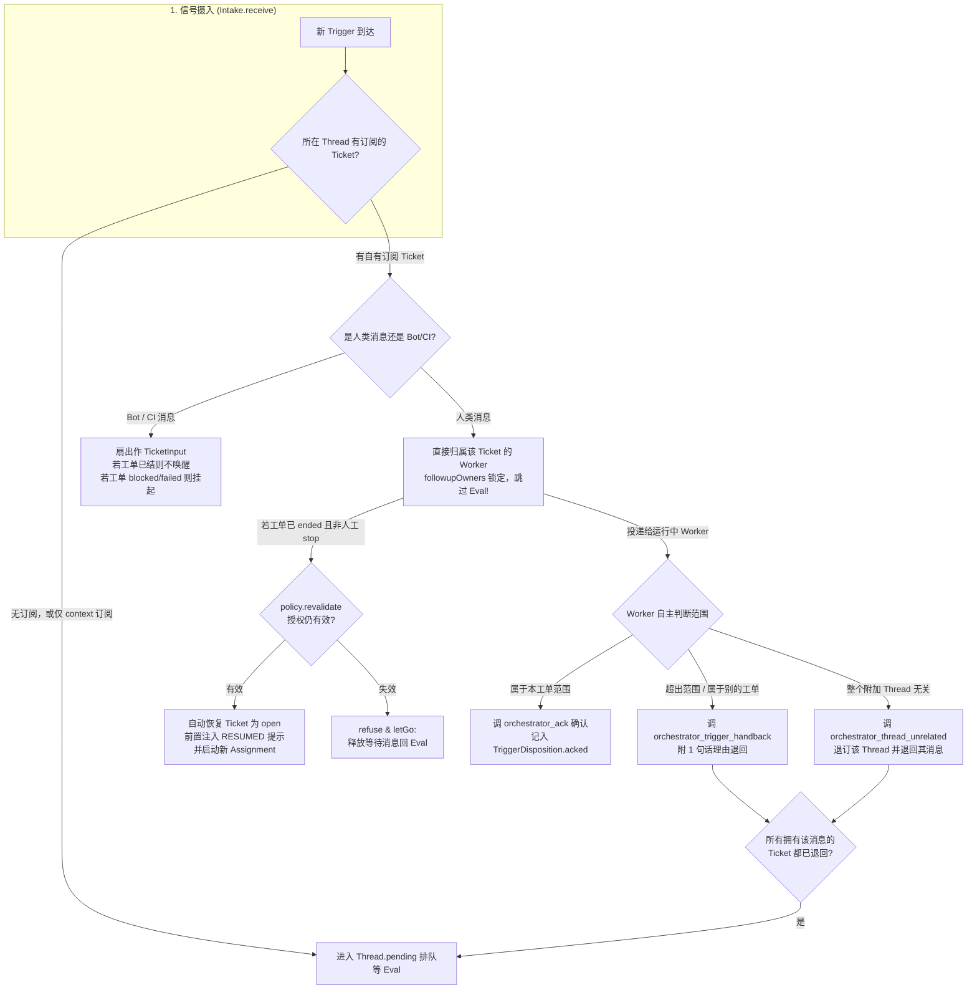
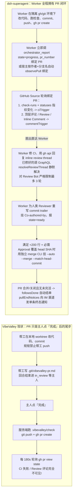

# dsh-superagent-prototype 与 VibeValley 深度机制对比与借鉴方案

`deepseek-ai/dsh-superagent-prototype`（119 个源码文件、15,587 行 TypeScript、20 个提示词与技能文件共 464 行）是运行在 DeepSeek Harness（DSH）内部的单仓库主动式编码 Agent 插件；VibeValley（服务端 302 个文件 49,934 行、`packages/agent` + `packages/ai` 43 个文件 7,140 行、Web 端 464 个文件 50,311 行，外加 Electron 桌面端、Swift 灵动岛与 Expo 手机端）是独立运行的本机多项目、多农机工程工作台。

两者的核心差距不在工程基建规模，而在 **Agent 围绕工单与 GitHub 的闭环完备度**：

- **VibeValley 工程落地显著更广、地基更强**：拥有独立服务端（Effect v4 + PGlite + `effect-sqlc`）、跨三端 UI（Solid 2 工作台 + PixiJS 农场 + 桌面/手机宿主）、自研模型与循环（`@vibevalley/ai` + `@vibevalley/agent`）、通过 `@botiverse/oar` 驱动多农机（Claude Code、Codex、pi、DSH、VibeValley）并核算配额花费、本地无工作区冲突预检（`git merge-tree`）、DAG 计划（`TaskGraph`）与冻结验收测试、中英文分词记忆检索（GSE + `tsvector` + 外部记忆源）、协作产出（`Artifact`）与六层测试金字塔。
- **dsh-superagent 的 Agent 业务闭环从前到后设计得更完备**：它将 Agent 定位为「消耗最少人类注意力、交付最大价值」的自治团队成员（[000-philosophy.md](https://github.com/deepseek-ai/dsh-superagent-prototype/blob/main/docs/000-philosophy.md)），打通了「**外部事件（GitHub/飞书）→ 两层准入与主动研判（Gate + Eval）→ 不可变授权契约（Mandate）→ 路由器零改写派单 → 订阅扇出与 Worker 自主决定追问（Subscription Fan-out & Handback）→ Worker 全权驱动 GitHub（建 PR、盯 CI、回 Review Thread、静默 Resolve、3 轮 Bot 预算、双账号 Auto-merge）→ 四用途门禁 Outbox 回源会话闭环**」的完整无人值守链路。
- **VibeValley 当前在工单与 GitHub 上的核心短板**：帮工被当成「在本地 worktree 跑完一轮、靠文末正则交一段话就停下等主人点按钮」的被动执行器；管家（`Orchestrator`）承担了过多自然语言转述而丢失原始上下文；GitHub 仅在主人点「完成」时才由宿主代跑 `git push` 与 `gh pr create`，PR 开出后的 CI 失败、行内代码评审（Inline Review Comment）、Review Bot 意见与 PR 上的追问全部处于失明状态。

---

## 一、全景对比总表

| 维度 | dsh-superagent-prototype | VibeValley | 胜出方与核心结论 |
|---|---|---|---|
| **产品假设与第一性原理** | 团队共享的自治成员；以**人类注意力成本**为唯一标尺，默认静默，只在需人决策或结果可用时回源对话说话 | 单人（`owner`）本机工作台；假设主人盯着看板和群聊，关键流转靠主人点按钮或喊管家 | **dsh-superagent** 的「低打扰自治闭环」适合无人值守；VibeValley 需补齐工单在途自治能力 |
| **工程体量与运行形态** | DSH 进程内 Cordis 插件（1.56 万行），单 GitHub 仓库 + 单飞书机器人，同步 `node:sqlite`，借用宿主 Session/Job | 独立全栈单机系统（超 11 万行），多项目仓库、多农机、PGlite、三端宿主、语音通话、像素农场与工作台双皮 | **VibeValley** 工程野心与落地深度远超对方 |
| **外部事件接入与准入（Intake & Gate）** | 插件化 `SourceKind`；确定性 `gate`（白名单、Bot 名单、3 列接收矩阵）+ 模型主动研判 `Eval`（`off`/`observe`/`auto` 三档） | 连接器（微信/飞书/QQ）只认唯一配对 `owner`；GitHub 无事件摄入；管家仅凭 `Actor.forOwner` 布尔值控权 | **dsh-superagent** 拥有完整的准入、防注入与主动发现（Proactive）机制 |
| **领域模型与概念正交性** | **Role（Agent 角色）与 Session（会话）完全正交**：`orchestrator`（管家）与 `worker`（帮工）是两类不同职责的 Agent；两者运行时都统一基于 `Session`（Main/Orchestrator Session 与 Worker Session）管理 | **把「帮工」等同于 `Session`（「帮工 = Session」）**：混淆了「干活的 Agent 角色（Worker）」与「运行时的会话容器（Session）」，导致管家游离在 `Session` 表外另起 `AgentHost` | **dsh-superagent** 概念边界更清晰；VibeValley 应废除「帮工 = Session」，回归「管家与帮工都是 Agent（Orchestrator vs Worker），统一基于 Session 管理」 |
| **管家（Orchestrator）职责边界** | 纯路由器（`dsh-superagent-router`）：单工具批量路由，**路由附言硬限 30 词**，严禁改写需求或加计划，Worker 直读原始 Trigger | 管家负责用自然语言重写工单 `title` / `description`；帮工看不到原始聊天上下文；另靠「起草（`refine`）」多跑一轮读代码 | **dsh-superagent** 消除了「传话筒失真」与多余的起草轮次 |
| **工单状态与报告协议** | Worker 调 `orchestrator_report` 传结构化枚举：`progress`、`waiting`、`ready`、`blocked`、`failed`、`dropped`；`blocked`/`failed` 自动挂起自动输入 | 帮工在自然语言末尾写 `结论：`、`要问主人：`、`标准 N：` 靠正则解析；一轮结束无条件进 `in_review`，无 `waiting` 与 `dropped` | **dsh-superagent** 结构化工具报告远比文末正则稳健，且区分了「等外部反馈」与「等主人验收」 |
| **讨论串订阅与追问路由（Follow-ups）** | 工单多对多订阅 Thread；人类在原串或 PR 发话**直接扇出给 Worker（跳过主 Session）**；超范围由 Worker 调 `handback` 退回重审；结单自动释放未读追问（`letGo`）；原串发话自动重验 Mandate 并无感唤醒已结工单 | 一张工单一个内部工单串；串内无退回（`handback`）机制；关单后必须手动重开，且重开会新建 Session 丢失原会话记忆 | **dsh-superagent** 的「订阅扇出 + Worker 拥有追问决定权 + 退回 + 自动续接」是其工单体验最精妙的设计 |
| **GitHub 全链路集成** | Worker 用隔离的 Agent `gh` 身份自己推分支、开 PR、报 `pr_number` 绑定；宿主轮询 PR 状态、CI 快照变化、PR 评论/Review/Inline Thread 并扇出给 Worker；Worker 回 inline thread、静默 `resolveReviewThread`、限 3 轮 Bot 评审、挂 `Co-authored-by`、按条件挂双账号 Auto-merge；PR 关闭且无未完活时自动结单并通知 IM | 帮工禁止 `push`，只写 `.git/vibevalley-pr.md`；仅当主人点「完成」时由服务端 `push` + `gh pr create`；PR 开出后只轮询 `open/merged/closed`，**完全不读 PR 评论、Inline Review 和 CI 失败** | **dsh-superagent** 完胜；VibeValley 目前的 PR 只是「交付动作的尾步」，而非「编码迭代的主战场」 |
| **对外通信与防噪音（Outbox）** | `Engine.reply` 强制校验 4 种用途（`acknowledgement`、`attention`、`answer`、`result`），未就绪拒发 `result`；问题更新自动从 Outbox 撤回旧提问；IM 强制 100 词上限；同工单同会话保序 | 帮工可随时调 `channel_message_send`；管家有话即发；靠 4 跳上限、60 秒冷却、3 次熔断防死循环 | **dsh-superagent** 从语义用途和字数上管住了噪音；VibeValley 从调用频率上管住了死循环，两者可互补 |
| **执行器与后台任务（Executor）** | 5 秒前台命令自动转后台 Job，Worker 不阻塞随时可接新消息；回合结束用 `untilQuiet` 守候后台任务（30 分钟）；移交人类验收时杀 subagent 释放槽位，但**保留后台预览服务（dev server）运行**；人类消息享有 **`+1` 特权并发槽** | 帮工同步等待工具完成；满并发位（6 全局 / 3 项目）时人类带话也受限于 `noRoom` 或需踢走闲置帮工 | **dsh-superagent** 的特权槽与后台任务/预览服务生命周期设计非常实用 |
| **副作用持久化与一致性** | `Effects` 表与业务状态在同一 SQLite 事务内 `enqueue`，`afterCommit` 触发调度；支持 `(kind, key)` 合并、`generation` 防并发覆盖、`Later` 延后不计失败、连续 3 次失败报健康错误 | 投递（`channel_delivery`）、发件（`connector_outbox`）、排队（`issue_queue`）各自为政；派活与合并尚未进统一事务队列（见提案 `2026-10-22-commit-then-effects.md`） | **dsh-superagent** 已落地的 `Effects` 队列可直接作为 VibeValley `core_job` 提案的蓝本 |
| **复杂任务拆解（DAG）与记忆** | 无 DAG 拆解，超出单模块小改动直接报 `blocked` 或 `dropped`；无跨工单记忆库，仅靠静态 Team Skills | 原生支持 `TaskGraph` 父子工单 DAG、计划分支无检出合并、验收件先行冻结；内置 GSE 中文分词 + `tsvector` + Nowledge/EverOS 跨档案记忆 | **VibeValley** 在复杂长任务编排与跨会话记忆上遥遥领先 |

---

## 二、九个深水区角度的机制拆解

### 1. 准入控制、主动研判与授权契约（Gate → Eval → Mandate）

在 `dsh-superagent` 中，外部世界的一切事件先归一化为不可变的 `Trigger`（`dsh-superagent:src/core/model.ts:22-39`），绝不直接作为指令喂给 Agent。它进入系统只有两条路：

1. **确定性门禁（Gate）与接收矩阵（Admission Table）**（`dsh-superagent:src/policy.ts:170-211`）：
   - 每个 `Source` 维护自己的白名单 `allowed` 和机器人名单 `bots`（不跨源映射自然人身份，跨源映射只写在团队 Skill 文本里）。
   - `gate(trigger, thread, tickets)` 区分三种结果：`explicit`（白名单成员直接 `@agent` 或私聊、已有工单线程上的白名单追问、或接收矩阵设为 `explicit`）、`inferred`（白名单成员在全量监听群里未 `@` 的发言、白名单 Bot 如 `dependabot[bot]` 的发言、默认分支 CI 失败、非白名单成员在已有工单上的追问）、`not admitted`（直接过滤并记录原因代码）。
2. **有界窗口的主动研判（Proactive Assessment）与 `observe` 模式**（`dsh-superagent:src/app/assessment.ts:18-64, 183-220`）：
   - `inferred` 候选必须经过 `orchestrator_eval` → `orchestrator_eval_decide`。
   - `admissionContext`（`dsh-superagent:src/sources/admission-context.ts:6-41`）只加载 Thread 的前 5 条消息 + Trigger 前后各 5 条消息（紧邻 2 条限 1,200 字，窗口内其余限 400 字，窗口外压成 50 字 stub 并标注 `omitted_before` 缺口数），避免长群聊撑爆主 Session 上下文；模型按需用 `orchestrator_eval_read` 展开单条消息、父消息、图片或仓库文件。
   - **代码强制的三要素研判（`directionAllowed`）**（`dsh-superagent:src/policy.ts:18-61`）：模型在 `orchestrator_eval_decide` 时，必须对每一条启用规则（不多不少）给出 `matched: boolean` 与理由，并填写 `AdmissionDirectionSchema`：
     - `implementation_requested: boolean`（确实要求改代码，而非泛泛吐槽或讨论竞品）；
     - `target_basis: 'specified' | 'existing-standard' | 'undetermined'`（目标明确，或有现成客观基准可恢复）；
     - `requires_design_decision: boolean`（是否还存在未决的产品/视觉/交互设计决策）；
     - `intent_evidence: string`（原文引证）。
     只要 `directionAllowed` 不满足，`assessmentOutcome` 在代码层直接将结果改判为 `ignore`（原因码 `directionUnsettled`），哪怕模型填了 `decision: 'accept'` 也无效！
   - **灰度观察模式（`eval.mode = 'observe'`）**：默认开启 `observe`，研判通过的候选不真建单，而是在 Decision 审计里记 `would_accept: true` 和拟建的 `proposal`（`dsh-superagent:src/policy.ts:56-58`）。团队在 Web 面板上看准了，再切 `auto`。
3. **不可变授权 `Mandate` 与唤醒重验（Revalidation）**（`dsh-superagent:src/core/model.ts:126-133`、`dsh-superagent:src/policy.ts:213-240`）：
   - 工单一旦创建，携带当时的 `Mandate`（含 `strength`、`policyVersion`、`basis`、`actor`、`scope`）。
   - 若 `strength === 'inferred'`，Worker 系统提示词自动追加 `mandateInstructions`（`dsh-superagent:src/executor/dsh.ts:90-95`）：要求 Worker 独立复核改动是否真的是单模块内部小改动；一旦发现涉及公共接口、产品行为变更或需要向人发问澄清，**禁止扩权、禁止主动发问打扰人，必须立即调 `orchestrator_report(state: 'dropped')` 静默结单**。
   - 当策略版本（`policyVersion`）变更时，`policyEffects`（`dsh-superagent:src/policy.ts:144-165`）自动比对每张在途工单所依赖的规则是否被改写/禁用、发起人是否被移出白名单、`auto` 模式是否关闭，并向受影响的在途工单精准注入 `policy-changed` 输入（`dsh-superagent:src/core/tickets.ts:200-208`）。

**对比 VibeValley**：VibeValley 目前只有「主人显式下令」一种高信任模式（[管家的授权提案](.agents/notes/proposed/feature/2026-10-21-orchestrator-authorization.md) 仅按读/写下来/定主意/落地分了四档工具权限）。未来当 VibeValley 接入 GitHub 仓库监听、定时巡检报错或多人协作群时，直接引入 `Gate → Observe/Auto Eval → Mandate` 模型，就能在不骚扰主人的前提下实现安全的主动接单。

---

### 2. 管家（Orchestrator）与帮工（Worker）的职责切分：为什么「路由器不改写需求」至关重要

`dsh-superagent` 在 [prompts/shared.md](https://github.com/deepseek-ai/dsh-superagent-prototype/blob/main/prompts/shared.md) 和 [prompts/dispatch.md](https://github.com/deepseek-ai/dsh-superagent-prototype/blob/main/prompts/dispatch.md) 中反复立下一条铁律：

> Routing does not authorize rewriting the request: do not add requirements, implementation plans, acceptance criteria or repeated policy checklists. Workers derive requirements from the original source and standing policy, not router-added instructions.

它的具体实现机制有三层：

1. **主 Session 只做路由（`orchestrator_route`），附言硬限 30 词**：
   - `RoutingNoteSchema`（`dsh-superagent:src/app/tools/main.ts:17-19`）在 Zod Schema 层用 `wordCount(text) <= 30` 拦截任何超过 30 个词的 `note`。
   - 宿主在启动 Worker 时（`dsh-superagent:src/executor/dsh.ts:458-464`），直接把原始 `Trigger` 的卡片（含发送者、时间、原文、源消息链接、所回复的前序消息预览）和同一批次的 `batch` 触发器原封不动交给 Worker，主 Session 的 `note` 只标为 `Routing note (not the source request)`。
2. **Worker 拥有按需回溯一手源的完整读取能力**：
   - Worker 拿到原始 `trigger_id` 后，如果原文超长被截断，调 `orchestrator_read("trigger/<id>")` 读全文；如果人类只说了一句「把上面说的那个修一下」，Worker 调 `orchestrator_read("feishu/<trigger-id>/parent")`、`/root`、`/around` 或 `"github/issues/<n>/comments/1"` 自己看上下文和截图（[skills/dsh-superagent-feishu/SKILL.md](https://github.com/deepseek-ai/dsh-superagent-prototype/blob/main/skills/dsh-superagent-feishu/SKILL.md)）。
3. **主 Session 严禁阻塞等待（`noWait` Guard）**：
   - `dsh-superagent:src/app/sessions.ts:76-86` 给主 Session 挂了工具守卫 `noWait`，任何含 `sleep` 的命令或超时 > 30 秒的调用直接被拒绝并提示「报告、追问、候选和后台任务结束会自动作为消息送达，请立即结束当前回合」。

**对比 VibeValley**：
- 在 VibeValley 中，主人在频道或电话里对管家说话，管家调 `issue_create` 时，由管家自己编写 `title` 和 `description`（`apps/server/src/orchestrator/prompts.ts:32`）；帮工拿到的 `issueBrief`（`apps/server/src/issue/brief.ts:9-14`）只有管家转述出来的文字，**没有关联触发该工单的原始频道消息 ID、前后对话上下文或图片附件路径**。
- 由于管家不读代码，管家自己编的描述往往不够准；VibeValley 为此设计了「起草（`issue.refine`）」（`apps/server/src/issue/refinement.ts`），专门开一个临时帮工读代码写 `why/todo/criteria/notDoing/files` 再重置 worktree。这在主人在看板上手写粗略想法时很有用，但对于「主人在聊天/GitHub 里指明了一个具体问题要修」的场景，让干活的帮工直接拿到原始消息引用、自己读代码并动手，比「管家转述」或「先派起草帮工再派执行帮工」更保真、更省钱、更快。

---

### 3. 工单状态机、订阅扇出与追问所有权（Ticket, Subscription Fan-out & Handback）

`dsh-superagent` 的工单核心引擎（`dsh-superagent:src/core/`，共 15 个文件 2,088 行，零外部 I/O，纯内存可测）把「多渠道对话与工单执行的关系」处理得极为严密：

这里有 **5 个可以直接被 VibeValley 借鉴的精巧机制**：

1. **订阅扇出（Subscription Fan-out）与追问直达 Worker**：
   - 一张工单可同时订阅多个 Thread（例如：发起工单的飞书话题 + 关联的 GitHub Issue + Worker 自己创建的 GitHub PR）。
   - 任何人在这些 Thread 上的后续发言，通过 `Intake.receive`（`dsh-superagent:src/core/intake.ts:34-59`）直接变成该工单的 `TicketInput`，**不需要主 Session 当二传手**。
2. **`followupOwners` 排他锁（主 Session 不抢方向盘）**（`dsh-superagent:src/core/model.ts:75-88`）：
   - 只要一条人类追问到达了至少一张存活工单（或可恢复的已结工单），且该工单的 Worker 还没退回它，这条消息的 `followupOwners` 就非空。
   - 此时主 Session 只收到一条 `follow_up` 通知（`dsh-superagent:src/app/notices.ts:86-106`），除非人类在这条消息里明确喊了「停下（stop）」，否则主 Session 对它调 `accept` / `attach` / `ignore` / `requeue` 全部在 `Engine` 层抛 `UserError('workerDecides')` 拒绝！这彻底防止了「主人在串里跟帮工说话，管家在旁边误以为是新需求又建了一张重复工单」。
3. **Worker 自主退回（`orchestrator_trigger_handback` & `orchestrator_thread_unrelated`）**（`dsh-superagent:src/app/tools/executor.ts:41-73`）：
   - 最了解当前改动边界的是正在写代码的 Worker，而不是外面的管家。当人类在工单串或 PR 下顺带提了一个超出范围的新请求时，Worker 自己调 `orchestrator_trigger_handback(trigger_id, reason)`，把这条消息连同 1 句话理由退回给 `Evals`，此时候选卡片带上 `handed_back` 理由交给主 Session 另建新单或挂到别的单。
4. **精准的已读水位线（`inputsRead` + `readUntil`）与结单防吞消息（`letGo`）**（`dsh-superagent:src/core/tickets.ts:19-20, 294-309, 345-363`）：
   - 消息投递进队列不等于模型读到了它！`DshExecutor` 监听底层 `session/event` 的 `user/message` 事件（`dsh-superagent:src/executor/dsh.ts:494-503`），只有当携带该 `TicketInput` 的消息真正进入某一步的模型历史时，才调用 `engine.inputsRead` 记下 `readAt`。
   - 当工单因 PR 合并或 Worker 报 `ready` 结束时，`end()` 检查所有 `TicketInput`：如果有一条人类追问是在 Worker 最后一次有效报告/回合结束之后才到达（或尚未被 `readAt`），且 Worker 既没有 `ack` 也没有回答它，说明这条追问是在结单擦肩而过时进来的！`letGo()` 会自动剥离该工单对它的扇出占用，并将它重新送回 `Eval` 队列交给主 Session 处理，**绝不因为结单竞态而静默吞掉用户的消息**。
5. **已结工单的原串无感续接（Resume under Mandate）**（`dsh-superagent:src/core/tickets.ts:252-270`）：
   - 工单结束后（哪怕 PR 已合并或关闭，只要不是被人类显式 `stop` 撤回授权），它依然保留对原 Thread 和 PR Thread 的订阅（最长轮询 2 周）。
   - 一旦人类在原飞书话题或已合并的 PR 下发一条新评论（例如：「合并后发现暗色模式下还有一处漏了」），`Intake.receive` 触发 `tickets.wake(ticketId)`：只要 `policy.revalidate(ticket.mandate)` 通过，工单自动从 `ended` 恢复为 `open`，在**同一个 Worker Session 和同一个工作目录**下创建新的 `Assignment`，前置注入 `RESUMED` 提示，直接接着干！

---

### 4. 结构化工作报告状态机 vs 自然语言文末正则

对比两边 Worker 向系统汇报状态的方式：

| 机制 | dsh-superagent（`orchestrator_report` 工具） | VibeValley（`session/report.ts` 文末正则） |
|---|---|---|
| **汇报通道** | 显式调用 `orchestrator_report` 工具（`dsh-superagent:src/app/tools/executor.ts:74-103`），参数经 Zod 严格校验，与 PR 认领同事务落盘 | 会话 turn 结束时，由 `readReport`（`apps/server/src/session/report.ts:167-185`）对最后一段自然语言跑正则（`结论：`、`要问主人：`、`标准 N：`、`记住：`） |
| **状态枚举** | 6 种：`progress`（干活中记账/绑 PR，不打扰主 Session）、`waiting`（本轮干完，等 CI 或他人 Review）、`ready`（自审验证通过，可交人验收）、`blocked`（受阻需人行动）、`failed`（失败）、`dropped`（无需改动，如不复现/重复/超范围，静默关单） | 仅从 oar turn 结局推 `completed` / `failed` / `interrupted`；只要 `completed` 就一律进 `in_review`（有 `要问主人：` 则显为 `asking`） |
| **回合结束没调报告怎么办** | `workerIdle`（`dsh-superagent:src/executor/dsh.ts:659-671`）自动补一条 `state: 'waiting'`，若模型连文字都没留，向主 Session 发提示让主 Session 按需调 `orchestrator_ticket_request_status` 追问状态 | 直接拿最后几段文字（凑够 80 字）当结论，工单直接变「等你验收」 |
| **提问的生命周期** | 独立字段 `human_action` + `question_for_trigger_id`：可边干活（`state: 'progress'`）边提问；传 `undefined` 保持原问题，传新字符串替换并自动从 Outbox 撤回未发出的旧问题，传 `null` 或 `state: 'ready'` 显式清空 | 从每轮汇报文本提取 `要问主人：` 行覆盖 `Issue.questions`；只能在回合结束停下后问，不能边跑边问 |
| **自动输入的阀门** | 当最新报告为 `blocked` 或 `failed` 且此后无人类新消息（`waitsForPerson` 为真，`dsh-superagent:src/core/model.ts:349-353`），所有非人类的自动输入（CI、Bot、主 Session Note）只存盘不投递，防止故障状态下被 CI/Bot 反复唤醒烧钱 | 无区分（因为目前也没有外部 CI/Bot 自动输入流） |

**核心启发**：VibeValley 让帮工经 `/mcp` 调一个结构化的汇报工具（或在保留文末兜底的同时提供结构化报告工具），并引入 `waiting`（等待外部 CI / PR 评审）与 `dropped`（经排查无需改动コード）两种状态，能彻底解决「帮工只是推了 PR 等 CI、或者查完发现不用改，工单却卡在待合并验收列」的问题。

---

### 5. GitHub 端到端闭环：从「点完成才推 PR」到「PR 即一等工作现场」

这是两边差距最大的一块。我们把两边的 GitHub 处理流程并排对比：

为什么 `dsh-superagent` 的 GitHub 方案完备得多？具体体现在 **7 个工程细节**：

1. **Git / GitHub CLI 进程环境硬隔离（Shim + 独立 GitConfig + 仓库配置校验）**（`dsh-superagent:src/infra/environment.ts:45-157`）：
   - VibeValley 直接继承宿主机的 `process.env` 和全局 `~/.gitconfig`，帮工如果自己跑 `git` 或 `gh` 用的是主人自己的凭据。
   - `dsh-superagent` 在 `<stateDir>/worker-bin` 写入原子替换的 `gh` 与 `lark-cli` 包装脚本，清理一切含 `KEY|PASSWORD|SECRET|TOKEN` 的环境变量及 `GIT_DIR`/`GIT_AUTHOR_*`，用 `GIT_CONFIG_GLOBAL=<stateDir>/worker-gitconfig` 配合 `GIT_CONFIG_NOSYSTEM=1` 强制 `user.useConfigOnly = true`、重写 SSH 为 HTTPS、绑定専用 `gh auth git-credential`；开工前还跑 `verifyDirectory` 扫描 worktree 本地 `.git/config` 是否定义了 `credential.*` 或 `http.*.extraheader`，防止恶意或残留仓库配置劫持凭据。
2. **PR 绑定双保险（主动申报 `claimPull` + 分支后缀自动发现 `observePull`）**（`dsh-superagent:src/sources/github-pull.ts:35-69`）：
   - Worker 开出 PR 后调 `orchestrator_report(state: 'progress', pr_number)`，`claimPull` 校验该 PR 确实是源 PR、或由 Agent 账号从工单专属分支（分支名最后一段等于 `ticket.execution.name`）开出，且未被其他活跃工单占用，随即在单个事务内调用 `bindThread` 绑定并订阅该 PR。
   - 如果 Worker 开了 PR 却忘了报 `pr_number`，GitHub 轮询到该 PR 时，`observePull` 会根据 `agentPull(pr) && ticketBranch(ticket, pr.head.ref)` 自动认领绑定！
3. **CI 检查聚合、快照指纹与按需详情**（`dsh-superagent:src/sources/github.ts:415-424`、`dsh-superagent:src/sources/github-read.ts:13-70`）：
   - `pullChecks` 同时拉取 `commits/<sha>/check-runs` 与 `commits/<sha>/statuses`（每个 context 取最新状态），排序后生成 `CiSnapshot` 并计算哈希 `fingerprint`。
   - 只有当 `fingerprint` 与上次不同时，才生成 `ciTrigger`（如 `CI failed 2/14 on PR #42 at a1b2c3d: lint, test; 1 still running. Read github/pulls/42/checks for every check.`）投递给 Worker；默认分支 CI（`pollBranchCi`）则只在失败集合（`ciFailures`）发生变化、且没有正在跑的检查时才触发，避免构建中途抖动误报。
4. **三类 PR 评论全覆盖与 Inline Review Thread 原位回复**（`dsh-superagent:src/sources/github.ts:384-403`、`dsh-superagent:src/sources/github-trigger.ts:48-77`）：
   - 轮询 PR 时，同时拉取三路增量：`issues/<n>/comments`（普通对话评论）、`pulls/<n>/comments`（代码行内评论 `inline`）、`pulls/<n>/reviews`（评审结论 `APPROVED` / `CHANGES_REQUESTED` / `COMMENTED`）。
   - **连没有正文的纯 Approval Review 也会生成 Trigger**（`github.ts:398`：`APPROVED review of commit <sha>`），因为等待审批的 Worker 需要靠它被唤醒去挂 Auto-merge！
   - 对于行内评论（`inline`），`reviewPlace` 自动提取 `path:line` 和 `diff_hunk` 的最后 3 行放进 Trigger 文本；Worker 用 `orchestrator_read("github/pulls/<n>/thread/<comment-id>")` 读整条讨论串，修好代码验证后直接调 GraphQL `resolveReviewThread` **静默解决讨论串**（不发噪音声称「已修好」）；若经评估不采纳，才调 `gh api repos/<owner>/<repo>/pulls/<pr>/comments/<root_id>/replies` 在该行内讨论串下回复一句事实理由（[prompts/team/communication.md:71-80](https://github.com/deepseek-ai/dsh-superagent-prototype/blob/main/prompts/team/communication.md)）。
5. **Review Bot（AI 审阅器）3 轮硬上限**（[prompts/team/communication.md:83-97](https://github.com/deepseek-ai/dsh-superagent-prototype/blob/main/prompts/team/communication.md)）：
   - 明确将 `[bot]` 及团队指定的自动审阅账号视为「可能出错的输入，而非完成门禁」：每个自动审阅账号在每个 PR 上跨 Worker 与重启最多响应 **3 轮**（按一次完整的 bot review run 计 1 轮，在 `orchestrator_report` 中记录 bot run ID 与轮次）；满 3 轮后不再请求重审、也不再因该 Bot 的新评论唤醒，直接把经过验证的 PR 连同剩余风险交给人。
6. **GitHub 出站评论的 HTML 标记幂等与删除降级**（`dsh-superagent:src/sources/github-channel.ts:18-45`）：
   - Outbox 往 GitHub 发评论或回复 review thread 时，在正文末尾附上 `<!-- dsh-superagent:<message.id> -->`。发送前先扫描现有评论是否已包含该 marker，确保网络超时重试绝不发出两条重复评论；如果目标行内评论已被作者删除（404/410），自动降级发到 PR 顶层评论，不丢消息。
7. **严谨的 PR 终态汇合规则（`followsDone` + `unfinished`）**（`dsh-superagent:src/core/tickets.ts:77-100, 370-379`）：
   - 一张工单可能跟随源 PR，也可能自己开出 1 个或多个 PR（`Follow.own = true`）。
   - 只有当它自己开的所有 PR 都已关闭（若没开自己的 PR，则它跟随的所有 PR 都已关闭），且没有在关闭后被新消息唤醒尚未报 `ready` 的在途任务，工单才以最后一个关闭 PR 的结果（`merged` 或 `closed`）自动结束，并由 `pullEndNotices` 向飞书等 IM 渠道发送唯一一条合并/关闭通知（GitHub 本身已有时间线，跳过不重复发）。

---

### 6. 对外通信门禁（Outbox & Replies）与防打扰体系

对比两边如何控制 Agent 对人说话的质量与频率：

- **dsh-superagent 的「四用途状态门禁 + 字数硬顶 + 提问自动撤回」**（`dsh-superagent:src/core/replies.ts:36-92`）：
  1. **没有自由发言工具**：主 Session 只有 `orchestrator_reply`，Worker 只有 `orchestrator_ack`（且系统在接单时已自动发了首条 Ack）。
  2. **代码强制的状态前置条件**：
     - 发 `result`：工单必须已报 `ready` 或已以 `merged`/`completed`/`dropped` 结束，否则抛 `UserError('notReady')`；彻底杜绝了「PR 才刚开出来、CI 还没跑、自己还没看一遍，就跑去群里喊主人来看」的半成品汇报。
     - 发 `attention`：传入的 `human_action` 字符串必须与工单当前挂起的 `ticket.attention.question` **逐字相等**（`replies.ts:77`）；如果 Worker 后来自己解决了问题或换了问题，`Assignments.report`（`assignments.ts:121`）立即调用 `withdrawAttention` 把 Outbox 里还没发出去的旧提问撤掉。
     - 发 `answer`：必须指定人类提问的 `trigger_id`，且 Worker 必须先在 `orchestrator_report` 里填了 `reply_to_trigger_id` 登记入 `ticket.answers`，发一次即核销（`replies.ts:81-90`）。
  3. **100 词硬上限（`checkedImText`）**：飞书消息超过 100 词直接由工具报错打回，并在提示词（`prompts/team/communication.md:30-66`）中给出极佳的反例与正例对比——禁止在 IM 里报改了哪几个辅助函数、跑了几个测试、对比了哪两个库；只说一句用户可见的结果与 PR 链接，技术证据全放进 PR 描述和内部报告。
- **VibeValley 的通信机制**：
  - 优点：人和管家、帮工在同一个 Discord 式的频道和工单串里直接对话，体验亲切；帮工之间可 `@` 协作，且有 `hopLimit = 4`、`agentWakeCooldownMs = 60s`、`wakeBreaker = 3` 三道硬闸防止 Agent 互聊失控（`docs/subsystems/channel.md:64`）。
  - 短板：帮工最后一轮自然语言汇报会自动贴进工单串，且连接器把汇报直接转给主人的微信/飞书/QQ（`docs/subsystems/channel.md:120`）。当引入「开 PR → 等 CI → 修 Review」的多轮自动循环后，如果每一轮中间进展都自动贴进工单串并推往外部连接器，主人的微信/飞书会被中间过程刷屏。

---

### 7. 执行器（Executor）：5 秒后台化、留守预览服务与人类特权槽

`dsh-superagent:src/executor/dsh.ts` 与 `background.ts` 中有三个工程细节非常值得 VibeValley 的 `Executor` / `Session` 借鉴：

1. **人类消息专属的 `+1` 并发特权槽（`WorkerSlots`）**（`dsh-superagent:src/executor/dsh.ts:171-199, 305-309`）：
   - `WorkerSlots.reserve(ticketId, by)`：当 `by === 'person'`（人类在工单上发了追问或点名查状态唤醒闲置 Worker）时，允许使用的槽位上限是 `this.max() + 1`；且 `launches()` 计算新工单可用槽位时，先把正在等待唤醒的 `wakes` 扣掉（`this.max() - new Set([...this.running(), ...wakes]).size`）。
   - **效果**：新工单排队永远不会堵死主人正在跟进的在途工单；主人回一句话，闲置帮工立刻借特权槽响应，不用像 VibeValley 现在那样要么拒收、要么把别的帮工请走（`makeRoom`）。
2. **回合结束后的后台任务守候（`untilQuiet`）**（`dsh-superagent:src/executor/dsh.ts:629-655`、`dsh-superagent:src/executor/background.ts:95-103`）：
   - 当 Worker 模型回合结束（`idle`）但尚未移交人类（没报 `ready`、没提问、没报 `blocked`/`failed`）时，如果它启动的后台 shell 任务或子 Agent 还在跑，`DshExecutor` 将该工单放入 `this.settling` 继续占住并发槽位，最长等待 30 分钟（`BACKGROUND_LIMIT_MS`）。
   - 期间若后台任务跑完，自动唤醒 Worker 接着处理结果；若满 30 分钟仍未跑完，自动杀掉超时 shell 任务、向 Worker 注入被杀通知，并替它向主 Session 汇报 `waiting`。
3. **移交人类验收时保留后台预览服务（`handOff`）**（`dsh-superagent:src/executor/dsh.ts:588-600`）：
   - 当 Worker 报了 `ready` 或提了 `human_action` 问题移交给人时，`handOff` 立即停止其子 Agent 并**释放 Worker 并发槽位**，但把它留下的后台 shell 进程（例如供主人点击预览验收的本地 Web Server）记入 `this.left`，豁免 30 分钟超时限制，一直保留到整个 Assignment 结束（工单关单或重派）才清理！

---

### 8. 上下文工程与提示词版本化（`orchestrator_read` & `Prompts`）

1. **统一分页只读资源协议 `orchestrator_read`**（`dsh-superagent:src/app/resources.ts`、`dsh-superagent:src/app/cards.ts`）：
   - 无论是主 Session 还是 Worker，所有推送进上下文的都是定长卡片（`preview` 160 字 + `chars` 总长 + `read` 资源路径）。
   - `orchestrator_read(resource, offset, limit)` 统一承载了 26 类资源的分页读取，且在 `offset === 0` 时将 GitHub/飞书等外部读取结果缓存在内存 LRU `TextCache`（`dsh-superagent:src/app/cache.ts`）中，后续翻页（`offset > 0`）直接切同一份快照（UTF-16 精确切片 `textPage`），既保证翻页一致性，又不重复调外部 CLI。
2. **提示词分层组装、前缀缓存保护与三方合并升级**（`dsh-superagent:src/app/prompts.ts`、`dsh-superagent:src/client/prompt-config.ts`）：
   - 提示词分为内置部件（`builtInParts`）、团队三段（Communication、Ticket Scope、Delivery Requirements）、团队技能（`skills`）和动态生成段（`environment`、`policy`）。
   - 动态变化的 `policy` 段固定排在系统提示词的**最后一段**（`docs/004-prompts.md:56-59`），使得策略变更时前面的全部系统提示词保持字节级不变，最大化命中 DeepSeek 的 Prefix Cache（这一点与 VibeValley `packages/agent/src/prefix.ts` 的思路一致，但 `dsh-superagent` 进一步支持了团队在线覆盖内置提示词段、保存不可变版本历史 `Versions`、以及升级后对比新旧默认值的 `defaultChanged` 三方 diff 提示）。

---

### 9. 副作用队列与持久化架构（`Effects` vs `core_job`）

VibeValley 在提案 [状态先提交，副作用由 worker 在提交之后做](.agents/notes/proposed/architecture/2026-10-22-commit-then-effects.md) 中计划引入 `core_job` 表，解决「写库、施加核心状态、调外部进程/GitHub 三步没有共同提交点」的问题。

`dsh-superagent` 的 `Effects`（`dsh-superagent:src/app/effects.ts:1-161`）和 `Outbox`（`dsh-superagent:src/app/outbox.ts:1-52`）已经把这一模式打磨得非常成熟，其表结构与调度规则可以直接拿来对照：

| 机制点 | dsh-superagent `Effects` 的实现（`dsh-superagent:src/app/effects.ts`） | 对 VibeValley `core_job` 落地的直接参考 |
|---|---|---|
| **同事务入队与同键合并** | `INSERT INTO effect (kind, key, value, seq, due, since) ... ON CONFLICT(kind, key) DO UPDATE SET value = excluded.value, generation = generation + 1, attempts = 0, error = '', due = excluded.due` | 用 `(kind, key)` 做唯一键：同一个工单的多次 `delivery` 或同一类 `notice` 在未执行前自动合并载荷、保持原 `seq` 队序 |
| **`generation` 防并发误删** | 正在执行的任务结束 `DELETE` 或 `UPDATE` 时，条件带 `WHERE kind = ? AND key = ? AND seq = ? AND generation = ?`（第 134 行） | 如果任务执行期间同 `(kind, key)` 又被新事务更新了载荷（`generation + 1`），旧执行完成时不会删掉新入队的载荷！ |
| **`Later`（延后）与真错误分离** | Handler 抛出 `new Later(...)`（如暂停中、无空闲并发槽、Outbox 前序消息未发出）时，只更新 `due = now + retry[0]`，**不递增 `attempts`，也不记入 `error`**（第 138-139 行） | 极关键！把「等空位/等前置条件」和「外部调用失败」分开，避免因满槽排队把重试次数耗尽报错 |
| **保序种类（`ordered: true`）** | 对 `relay` 和 `notice` 设 `ordered: true`：每次只取 `ORDER BY seq LIMIT 1`，若最老的一条还没到 `due` 重试时间或正在跑，后面的全部等待（第 108-113 行） | 通知管家的消息流和同一会话的发件需要严格保序，不能因前一条网络抖动重试导致后一条越过前一条 |
| **连续 3 次失败才报健康告警** | `FAILURES_BEFORE_ERROR = 3`：单次网络抖动静默退避重试，连续 3 次失败才把对应 `HealthEntry` 标为 `error` | 避免偶发网络波动在工作台刷出大量虚假的错误提醒 |

---

## 三、VibeValley 领先且不应倒退的设计

在借鉴 `dsh-superagent` 时，必须守住 VibeValley 已经建立的优势边界，不能盲目照搬对方的妥协之处：

1. **保持多项目（Multi-Project）与本地 Git 仓库一等公民模型**：
   - `dsh-superagent` 绑死单仓库，worktree 准备靠用户手写一行 `executor.prepare` shell 命令；VibeValley 的 `Project` 服务（`apps/server/src/project/project.ts`）原生管理多个项目、自动按工单号创建/复用 `worktrees/<项目>.<工单号>`、自动执行 `.vibevalley/setup` 与 `.vibevalley/check`、并用 `git merge-tree --write-tree` 在不污染工作区的情况下做冲突预检。这套地基比手写 shell 脚本稳固得多。
2. **保持 `packages/protocol` 单一状态帧（`StateFrame`）与响应式前端**：
   - `dsh-superagent` 的面板靠轮询 `GET /orchestrator/api/state` 和各分页接口；VibeValley 由 `Core.apply` 单写者演进 `WorkspaceState` 并经 SSE 推送 `StateFrame`、频道走 Effect RPC WebSocket 增量补齐，多端实时同步体验远胜轮询面板。
3. **保持多农机（Multi-Runtime）与计划图（`TaskGraph`）能力**：
   - `dsh-superagent` 只能跑在 DSH 内部 Session 上，且遇到跨模块大需求只能报 `blocked` 停机；VibeValley 能同时调度 Claude Code、Codex、pi 与自研 Brain，并能通过 `TaskGraph` 把长活拆成带冻结验收检查的 DAG 并行推进。
4. **保持跨档案记忆系统（`Memory`）**：
   - VibeValley 的 GSE 中文切词 + PGlite `tsvector` + Nowledge Mem / EverOS 多源融合检索（`apps/server/src/memory/`），比 `dsh-superagent` 纯手动的静态 Skill 文件具备更强的长期演进能力。

---

## 四、VibeValley 可落地的借鉴路线图（按投入产出比排序）

结合 VibeValley 现有的十模块架构（`Platform` → `Agents` → `Source Control` → `Agent Sessions` → `Collaboration` → `Issues` → `Inbox` → `Orchestrator` → `Gamification` → `Gateway`），建议按以下 **6 个事项** 分阶段吸收 `dsh-superagent` 的核心设计：

### P0：让工单与 GitHub PR 形成真正的闭环（解决「半吊子 PR」痛点）

1. **允许帮工在 PR 项目上自主创建/更新 PR，或由工具随时提 PR（不等主人点「完成」）**：
   - **现状问题**：现在只有主人点「完成」把工单挪到 `done` 时，`Issue.merge` 才去跑 `.vibevalley/check`、`git push` 和 `gh pr create`（`apps/server/src/issue/merge.ts:63-87`），导致 PR 开出前无法利用 GitHub CI 和团队 Code Review，且帮工在 worktree 里被禁止 push。
   - **借鉴改造**：
     - 给帮工 `/mcp` 增加结构化工具（或扩展汇报协议）：当工单所在项目开启了 PR 模式时，帮工完成一轮实现并通过本地 `.vibevalley/check` 后，可调用农场提供的 `issue_pr_submit`（由服务端在项目锁与凭据下执行 `git push` + `gh pr create/update` 并绑定 `Issue.pullRequest`），而不是等工单关单时才开 PR；
     - 为 `Project` 增加可选的 **Agent 专用 `gh` / Git 身份隔离配置**（参考 `dsh-superagent:src/infra/environment.ts` 的 `worker-gitconfig` 与 `gh` 凭据绑定），使帮工提交与开 PR 可以使用独立的团队 Bot 账号。
2. **补齐 GitHub PR 轮询的三块拼图：CI 状态变化、PR 评论/Inline Review 扇出、Review Thread 解决**：
   - **现状问题**：`refreshPullRequests`（`apps/server/src/issue/merge.ts:110-122`）只看 `state` 和 `mergedAt`。
   - **借鉴改造**（在 `apps/server/src/project` 与 `apps/server/src/issue` 中）：
     - **CI 监听**：对 `Issue.pullRequest.state === "open"` 的工单，轮询 `commits/<head_sha>/check-runs` 与 `statuses` 并计算快照指纹（参考 `dsh-superagent:src/sources/github-read.ts:60-70`）；当 CI 新出现失败时，自动将失败摘要写入工单串并唤醒帮工修 CI！
     - **PR 评论与行内 Review 扇出**：轮询 PR 的 `issues/<n>/comments`、`pulls/<n>/comments`（带 `path:line` 与 `diff_hunk` 尾部）和 `pulls/<n>/reviews`（按游标 `since` 与评论 `id + updated_at` 去重）；新评论自动同步进该工单的工单串（`Channel`）并唤醒帮工处理。
     - **Review Bot 3 轮熔断**：识别 `[bot]` 账号评论，同一 PR 上自动唤醒帮工修 Bot 意见最多 3 轮，超限只记入工单串等主人定夺，不无限循环烧钱。

### P1：升级帮工汇报协议与工单在途状态（消除文末正则脆弱性）

3. **引入结构化汇报工具与 `waiting` / `dropped` 语义（兼容现有文末标记兜底）**：
   - **现状问题**：帮工只能靠自然语言文末写 `结论：`、`要问主人：`、`标准 N：`（`apps/server/src/session/report.ts`），且回合一停就进 `in_review`（等主人验收）。
   - **借鉴改造**：
     - 在帮工 `/mcp` 工具表中提供结构化汇报工具（或在 `report` 事实中支持显式状态）：区分 `progress`（在途记账，不催主人）、`waiting`（已推 PR，正在等 GitHub CI 或外部审阅，工单阶段显示为等待外部检查而非催主人验收）、`ready`（自检通过、CI 绿，正式请主人验收 `in_review`）、`blocked`（带结构化 `questions` 请主人回答，且在主人回答前挂起一切 CI/Bot 自动唤醒）、`dropped`（无需改代码，说明原因后请求关单）。
     - 当帮工在新一轮汇报中更新或清空了 `questions` 时，自动清除 Inbox / 连接器发件表里尚未发出的旧问题通知（参考 `withdrawAttention`）。

### P1：强化工单串追问归属、范围退回（Handback）与管家防失真边界

4. **管家派单附带原始消息上下文引用，帮工支持「超范围追问退回（Handback）」**：
   - **现状问题**：管家建单时纯靠自己改写描述，丢失原话上下文；主人在工单串里如果顺口提了另一件事，帮工没法退回给管家另立新单。
   - **借鉴改造**：
     - `issue.create` 记录发起该工单的原始频道消息引用（`originMessage`）；拼装 `issueBrief` 时附上原始消息及前后相邻上下文（或提供只读查询），并在管家提示词中明确：**主人需求已清楚时直接原样立项，不要替帮工编写实现计划或捏造细节**。
     - 给帮工 `/mcp` 增加 `issue_handback`（或 `channel_message_handback`）：当工单串里收到超出本工单范围的新请求时，帮工可附一句理由将其退回给频道管家，由管家在频道里立新工单，避免一张工单的分支越滚越杂。
   - **已关工单的同上下文续接**：当刚完成或已关工单的工单串 / PR 收到人类的新追问时，优先尝试在原 `Session`（保留 `oar_session` 历史与记忆）上直接恢复下一轮 `Run`，仅在原会话不可恢复时才新开 Session。

### P2：执行器特权槽、后台任务守候与 `core_job` 持久化副作用队列

5. **在 `session/hiring.ts` 与 `executor` 中引入「人类唤醒 `+1` 特权槽」与「验收期保留预览服务」**：
   - 主人在工单串里主动发话唤醒歇着的帮工时（`RunTrigger.kind === "comment"` 且来自 `owner`），在 `noRoom` 判断中允许突破常规并发上限使用 1 个特权空位，确保主人的交互永不被后台排队的新工单卡住。
6. **落地 `core_job` 提案时直接采用 `dsh-superagent` 的 `Effects` 模型**：
   - 实施 [状态先提交，副作用由 worker 在提交之后做](.agents/notes/proposed/architecture/2026-10-22-commit-then-effects.md) 时，直接采用 `(kind, key)` 唯一约束合并、`generation` 版本号防并发完成误删、`Later` 延后异常不计入失败次数、`ordered` 保序队列以及连续 3 次失败才发错误通知的完整设计（`dsh-superagent:src/app/effects.ts:60-160`）。

### P3：面向团队/仓库监听的 Gate + Observe/Auto Eval（远期可选）

7. 当 VibeValley 从「单人本机指令驱动」扩展到「自动监听 GitHub 仓库新 Issue / 默认分支 CI 失败 / 飞书项目群讨论」时，引入 `dsh-superagent` 的 **两层准入（Gate 接收矩阵 + 三要素结构化 Eval）** 与 **`observe`（只记 `would_accept` 不真派活）→ `auto` 渐进开启模式**（`dsh-superagent:src/policy.ts:18-61`）。
