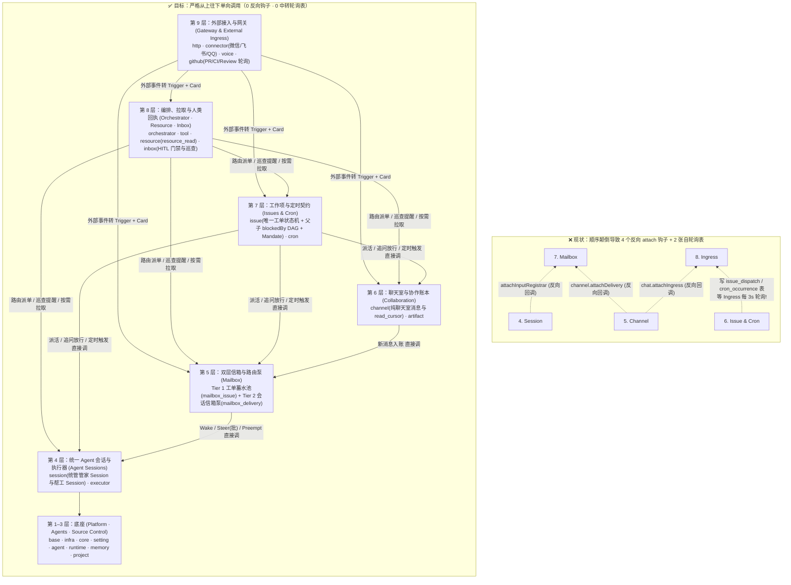

# VibeValley 四层架构正本清源与收口验收方案：理顺单向分层，砍掉一切反向钩子与中转冗余

## 实施与验收（2026-11-02）

本文件的五张收口任务已完成。本文保留下面的设计要求；当前行为沉淀在 [Mailbox](docs/subsystems/mailbox.md)、[Ingress](docs/subsystems/ingress.md)、[工单](docs/subsystems/issue.md)、[定时](docs/subsystems/cron.md) 和[架构](docs/architecture.md)，原实施 Note 已删除。

| 任务 | 落地结果 |
|---|---|
| Task 1 | Mailbox 位于 Session 之上、Collaboration 与 Issues 之下；四个反向回调和两张中转表无残留。Issue 自己推进排队，Cron 与 Inbox 直接投递，Ingress 不再承担内部调度或重放。 |
| Task 2 | 频道受众只产生候选，`posting.forward` 统一优先级、刹车、投递与回执事务；工单输入先经 Tier 1。agent 间提及与汇报保留频道受众，不被误当成给该工单的任务。Mailbox 服务文件 520 行。 |
| Task 3 | Fact 与 reducer 各 15 类，和成员表一致；原稿“14”已纠正。旧碎片类型无残留。 |
| Task 4 | Session 类型与表结构无 play；像素状态由游戏投影管理，页面读取 FarmView.plays。 |
| Task 5 | 架构、模块顺序、持久化、频道、巡查、定时与管家文档已同步；文档、类型、测试、死代码和逃生口检查通过。 |

新增或修复的行为证据：

- 聊天重放由 Channel 恢复受众，保留原始 Trigger 内容；多收件人中的一次写入失败使整批投递回滚，恢复后每人只得到一份。
- 投递与订阅前刷新工单投影，Session 结束派生的 reviewing 立即冻结机器输入，主人追问再放行。
- 运行时启动失败保留已有排队输入，非法档案或工单仍按原规则退回；父子分支回归用显式结束信号消除时间窗口，未删除行为断言。
- Cron 的时间推进与 Trigger 同事务保存；失败不推进时间。已关闭的一次性任务仍恢复先前未路由的 Trigger，重启不再建第二张工单。
- CLI 黄金数据共 54 条，仅第 36 条将异步帧序号从固定数字改为有效数字格式归一化；业务返回与其余样例不变。

执行结果：

```text
vp check                         pass: no warnings, lint errors, or type errors
vp run server:check              16/16 successful
server tests                    751 passed, 1 skipped (live model evaluation)
vp run web:check                 11/11 successful
vp run docs:verify               9/9 successful
vp run deadcode                  exit 0
vp run health:verify             2/2 successful; ratchet only lowered
comment-review --base HEAD       1 comment, 0 not kept
```

隔离程序命令：`vpx scripts/verify-server.ts --scripted-helper -- python3 /tmp/vv-close-smoke.py`。证据目录：

```text
/var/folders/hz/26kbk41x5_j5c4sykmx2yp7r0000gn/T/vibevalley-verify-eQJzdl
result.json: code=0, stopped=true, cleanupErrors=[]
ACCEPTED: issue creation, dispatch, report, dry-run, merge and state frame
ACCEPTED: one-off cron dispatched directly and retained one issue
```

服务端日志无 ERROR/WARN。使用脚本帮工与真实 git、数据库、HTTP 和状态帧；未调用真实模型、外部电话或真实编码 agent。检查日志保存在 `/tmp/vv-close-server-final.log`、`/tmp/vv-close-web-final.log`、`/tmp/vv-close-docs.log`、`/tmp/vv-close-health.log` 和 `/tmp/vv-close-deadcode.log`。

---

本文解决当前架构中最核心的层次问题：**为什么在引入 `Ingress`、`Mailbox`、`Resource` 之后，代码里反而出现了 `issue_dispatch`、`cron_occurrence` 这种自己轮询自己的中转表，以及 `attachIngress`、`attachDelivery`、`attachInputRegistrar`、`attachExternalChange` 这种下层反向回调上层的拧巴钩子？怎么把模块层次彻底理顺，并给出可通过「脚本 + 测试 + 文档」验收的可执行方案？**

---

## 一、一针见血：当前分层为什么绕？（根因诊断）

检查当前 `apps/server/src/modules.ts` 和 `src/ingress`、`src/mailbox` 的实现，所有拧巴和多余代码的根源只有一个：**把模块上下游的顺序排反了，并且把「内部业务动作」也强行绕道伪装成了「外部接入（Ingress）」！**

看现在 `modules.ts` 里的顺序：
`Agent Sessions (4)` → `Collaboration / Channel (5)` → `Issues & Cron (6)` → `Mailbox (7)` → `Ingress (8)`

因为规定「下层不能 `import` 上层」，把 `Mailbox (7)` 和 `Ingress (8)` 放在了 `Channel (5)` 和 `Issue / Cron (6)` 的**上面**，直接引发了 **4 处画蛇添足的绕路**：

1. **多余绕路 1：`Issue` 派活被迫建了一张 `issue_dispatch` 临时表自己轮询自己**
   - 主人在看板点开工或打回时，代码在 `Issue`（第 6 层）。因为第 6 层不能调第 7 层的 `Mailbox` 和第 8 层的 `Ingress`，`Issue` 被迫先往数据库 `issue_dispatch` 表写一行；然后等第 8 层的 「旧路径：apps/server/src/ingress/issue.ts（已删除）」 每 3 秒轮询（或听 Core 事实）把这行读出来，包成 `Trigger` 调第 7 层 `Mailbox.receive`，再反过来调第 6 层 `issues.tryQueued`，最后调 `issues.acknowledgeDispatch` 删掉那行！
2. **多余绕路 2：`Cron` 定时任务到点被迫建了一张 `cron_occurrence` 临时表自己轮询自己**
   - `Cron`（第 6 层）到点时，同样因为调不到第 7 层 `Mailbox`，被迫往 `cron_occurrence` 表写一行；再由第 8 层 「旧路径：apps/server/src/ingress/cron.ts（已删除）」 每 3 秒轮询读出来，调 `issues.scheduled` 和 `mailbox.receive`，再调 `crons.acknowledge`！
3. **多余绕路 3：`Channel` 被迫暴露 `attachIngress` 和 `attachDelivery` 两个反向可变槽位，`Mailbox` 写了双份路由**
   - `Channel` 在第 5 层，当主人在频道发消息时，第 5 层为了通知第 8 层的 `Ingress` 和第 7 层的 `Mailbox`，只能在 `Channel` 里塞两个可变回调 `chat.attachIngress`（`apps/server/src/ingress/channel.ts:74`）和 `channel.attachDelivery`（`apps/server/src/mailbox/mailbox.ts:642`）。
   - 更糟的是，`Mailbox` 为了接 `Channel`，在 `work.receive` 之外又写了一套平行的 `routeChannel` / `hearChannel`（`mailbox.ts:347-431`）！
4. **多余绕路 4：`Session` 暴露 `attachInputRegistrar`，`Inbox` 暴露 `attachExternalChange`**
   - `Session`（第 4 层）为了调第 7 层 `Mailbox` 登记初始输入，挂了 `sessions.attachInputRegistrar`（`mailbox.ts:602`）；
   - `Inbox`（第 10 层）为了通知第 13 层 `Connector`，挂了 `inbox.attachExternalChange`（`apps/server/src/connector/connector.ts:689`）。

---

## 二、正确的分层：从上往下单向直调，0 反向钩子、0 中转轮询表

要让层次彻底清晰，只需确立两条铁律：

1. **`Mailbox`（信箱与节流泵）是紧贴在 `Session` 之上的底层通信原语（第 5 层）**：
   - `Session`（第 4 层）管跑一轮；`Mailbox`（第 5 层）管给 `Session` 蓄水、算 `Urgency`、过三道刹车并调用 `Session.deliver`。
   - `Channel`、`Issue`、`Cron`、`Inbox` 全部排在 `Mailbox` **上面**！它们需要发消息或派活时，在同一个事务里**直接往下调用 `Mailbox`**，根本不需要 `attach*` 反向回调，更不需要 `issue_dispatch` 和 `cron_occurrence` 两张轮询中转表！
2. **`Ingress` 只管真正的「外部世界接入」（放在最外层，紧贴 `Gateway`）**：
   - 看板点按钮（`Issue`）、定时器到点（`Cron`）、内部超时巡查（`Inbox`）是服务端自己的内部模块动作，它们直接调 `Mailbox`，**绝不绕道 `Ingress`**！
   - `Ingress` 只负责把外部源（GitHub PR 的 CI/Review 轮询、外部连接器微信/飞书/QQ、声网语音、外部聊天输入）归一化为定长 `CompactCard` + `Trigger`，然后直接往下调 `Channel` / `Issue` / `Mailbox`！

### 理顺前后的分层对比图



---

## 三、四个核心层级的极简职责与正交状态设计

理顺层序后，你提出的四层架构在代码里呈现出一一对应、干净利落的边界：

### 1. 接入与载荷层（`Gateway / Ingress`，位于顶层）—— 解决「外部消息怎么进系统」
- **只管真正来自外部的输入**：
  1. **GitHub 增量轮询（`github`）**：轮询开着的 PR 的 `check-runs` 指纹变化、PR Review 与行内评论（带 `path:line` 和 `diff_hunk` 尾部），过滤 Agent 自发消息（Self-Echo Drop），生成 `Trigger` + 600 字定长 `CompactCard`（带 `vv://github/<proj>/pulls/<n>/...` 指针），直接调下层 `Mailbox` 投进对应工单的蓄水池。
  2. **人类聊天与外部连接器（`channel` / `connector` / `voice`）**：写入 `channel_message` 后，生成定长 `CompactCard`（带 `vv://trigger/<id>` 指针），直接调下层 `Mailbox` 投递。
- **砍掉的冗余**：
  - **删除 「旧路径：apps/server/src/ingress/issue.ts（已删除）」 与 `issue_dispatch` 表**：`Issue` 本来就在 `Mailbox` 上面，派活直接调 `Mailbox`；
  - **删除 「旧路径：apps/server/src/ingress/cron.ts（已删除）」 与 `cron_occurrence` 表**：`Cron` 本来就在 `Mailbox` 上面，到点直接调 `Issue` 与 `Mailbox`。

### 2. 网关与双层信箱层（`src/mailbox`，位于第 5 层）—— 解决「怎么蓄水、怎么分流、怎么节流」
- **对外只暴露一套统一入口，内部两级蓄水**：
  1. **Tier 1：工单蓄水池（`mailbox_issue` + `mailbox_subscription`）**
     - 状态仅 3 个：`held`（因工单处于 `asking / stuck / reviewing` 等人类拍板、或排队无帮工、或 Review Bot 超 3 轮而挂起蓄水）→ `forwarded`（已下发给在场 `Worker Session`）| `returned`（被帮工 `handback` 退回、或关单时未消费追问 `letGo` 释放给管家）。
     - **核心分流规则**：命中工单订阅的人类消息直接归属该工单（锁定 `followupOwner`，跳过管家，防管家抢建重复新单），并自动打开 `waitsForHuman` 冻结阀门，把池中挂起的 CI/Bot 消息一并放行！
  2. **Tier 2：会话执行信箱与节流泵（`mailbox_delivery` + `pump.ts`）**
     - 收件人统一是 **`session_id`（无论是管家的 `Orchestrator Session` 还是帮工的 `Worker Session`）**。
     - 状态仅 4 个：`pending` → `handed` → `consumed`（收到模型真实入模信号后打 👀）| `dropped`。
     - 统一由纯函数 `urgencyOf` 算 4 档（`interrupt | steer | queue | digest`），统一过三道刹车（`hopLimit = 4`、`cooldown = 60s`、`wakeBreaker = 3`）。
- **砍掉的冗余**：
  - 合并 `Mailbox.receive` 与 `Mailbox.routeChannel` / `hearChannel`，消除两套重复的写表与跳数统计逻辑。

### 3. 契约与工单层（`src/issue`，位于第 7 层）—— 解决「干什么活、边界在哪、父子 DAG 怎么推进」
- **只有 `Issue` 这一种工作项，只有 1 套状态机（6 个状态）**：
  - `backlog`（草稿）→ `todo`（排队/等依赖）→ `in_progress`（在做）→ `in_review`（等验收）→ `done` | `canceled`。
  - **原生父子与 `blockedBy` DAG**：已彻底砍掉原 `src/task` 模块和 `GraphState`（7 个状态）、`TaskState`（5 个状态）、`graph-draft / graph-ready / task-failed`（3 个 Inbox 状态）。子工单就是真 `Issue`，前置 `blockedBy` 全部 `done` 时自动派发，子工单做完通过检查（含冻结文件校验）后用 `git merge-tree` 自动合入父工单分支（`delivered: "merged_into_parent"`），全部子工单完成后父工单自动进入 `in_review`。
  - **三大工单契约**：
    1. `Mandate`：绑定 `originTriggerId` 一手源，管家附言 ≤ 30 词，帮工直接读一手源；
    2. `pullRequest` 在途闭环：帮工通过本地 `.vibevalley/check` 后可直接调 `issue_report(prSubmit: true)` 开/更新 PR 并订阅 CI 与 Review，不必等主人点「完成」才开 PR；
    3. `Handback & LetGo`：帮工调 `issue_handback` 将串内跑题追问退回管家另立新单；关单时未读追问自动释放回管家。

### 4. 拉取原语与信号层（`src/session` 第 4 层 + `src/resource` 第 8 层）—— 解决「怎么统一管会话、怎么拉、怎么打断」
- **正名与合并宿主**：
  - **管家（`role: "orchestrator"`）和帮工（`role: "worker"`）都是 Agent，在运行时统一作为 `Session`（Agent 会话）管理**，共用 `session` 表与 `session_run` 表。
- **双向信号（Signals：Mailbox ⇄ Session）**：
  - 下行：`Wake`（人类追问享 `+1` 特权并发槽）、`Steer`（`packages/agent/src/core/loop.ts` 在 Step 边界用 `takeAll` 一次性排空全部待插话卡片）、`Preempt`（打断时未 `Consumed` 的投递自动退回 `pending`）。
  - 上行：`Consumed(envelopeIds)`（消息真正写入模型请求历史时触发，取代靠 `spoke` 猜）、`Settling`（回合结束但后台任务仍在跑时守候槽位）、`HandedOff`（移交人类验收时释放槽位但保留预览 Server）。
- **统一只读拉取原语（`resource_read`）**：
  - 统一通过 `vv://trigger/<id>`、`vv://issue/<id>`、`vv://channel/<id>/messages`、`vv://github/<proj>/pulls/<n>/checks` 与 `/thread/<c>`、`vv://session/<id>/trajectory` 分页拉取；`offset = 0` 写入会话级 LRU `TextCache` 快照，`offset > 0` 在同一快照上按 UTF-16 切片。

### 5. 镜像层：Human-in-the-Loop 人类交付与回执（`src/inbox`，位于第 8 层）
- **复用 `channel_read_cursor`（主人已读游标），零新增表、零新增状态**：
  - **主人未读前（`read_cursor < 汇报消息号`）**：若帮工在后续轮次自己解决了问题或更新了问题，自动使旧汇报失效并从 `connector_outbox` 静默撤回，不让主人读过期问题；
  - **主人在场已读后（`read_cursor >= 汇报消息号`）**：抑制往微信/飞书重复推送，且 `Patrol` 巡查对已读项自动将宽限期拉长至 2 小时以上，不催促正在思考的主人。

---

## 四、核心状态事实（`Fact`）与隐性债务减法总表

### 4.1 协议层 `Fact` 从 23 个收敛为 15 个正交事实

| 所属模块 | 旧 `Fact`（23 个） | 收敛后的标准 `Fact`（15 个） | 清理掉了什么混乱 |
|---|---|---|---|
| **Session** | `hired`, `left`, `phase`, `run`, `doing`, `quiet`, `retry`, `spent`, `report` | **`session`**（入场/更新）<br>**`sessionGone`**（离场）<br>**`sessionPhase`**（合并 `phase/run/doing/quiet/retry/spent`）<br>**`sessionReport`**（轮次报告） | 废除「雇佣管家（`hired`）」拟人词；消除 5 个重复改 `Session.phase` 的碎片 Fact |
| **Issue** | `issue`, `issueGone`, `conflict`（原挂在 Session） | **`issue`**（内置 `conflict`）<br>**`issueGone`** | 分支冲突物归原主回到 `Issue`，换帮工不丢冲突状态 |
| **Channel** | `channel`, `channelGone`, `message`, `ownerMentions` | **`channel`**, **`channelGone`**, **`message`**, **`ownerMentions`** | 保持不变 |
| **Cron** | `cron`, `cronGone` | **`cron`**, **`cronGone`** | 保持不变 |
| **Gateway** | `call`, `connector` | **`voiceCall`**, **`connector`** | `call` 正名为 `voiceCall`，免与 tool call 混淆 |
| **Game** | `progress`, `commits`, `station` | **`gameProgress`**（合并三者） | 游戏金币、commit 等级与地块坐标收拢，不再霸占通用词 `progress` |

### 4.2 数据库表与存储瘦身账本

1. **已删除的 5 张冗余表**：`channel_seen_mark`、`issue_queue`、`mailbox_route`、`task_event`、`issue_follow`（合并进 `ingress_github` 与 `mailbox_subscription`）。
2. **接下来继续砍掉的 2 张自轮询中转表**：`issue_dispatch`、`cron_occurrence`（调整模块层序后由 `Issue` 和 `Cron` 直接调 `Mailbox`）。
3. **已淘汰的双源存储文件**：删除 `state.json`（开机直接从 `session` 表恢复）、删除 `spend.json`（迁入 `runtime_spend` 表）、统一管家 `MEMORY.md` 进 PGlite `memory` 表。

---

## 五、可执行任务单与「脚本 + 测试 + 文档」验收规范（直接交给开发者 / 智能体执行）

以下 **5 张收口任务单（Task 1 ～ Task 5）** 每一张都给出了精确的文件路径、修改契约和可一键复制执行的验收命令。执行人每完成一张单，必须贴出对应「脚本检查 + 测试运行 + 文档校验」的终端输出作为交单凭据。

---

### Task 1：调整 `modules.ts` 层序，删除 `issue_dispatch`、`cron_occurrence` 自轮询表与 4 个反向 `attach*` 钩子

- **目标与不变量**：
  - 将 `Mailbox` 下沉到第 5 层（紧贴第 4 层 `Agent Sessions` 之上、`Collaboration` 和 `Issues` 之下），使 `Channel`、`Issue`、`Cron`、`Inbox` 都能**从上往下直接调用 `Mailbox`**；
  - 彻底删除 `issue_dispatch`、`cron_occurrence` 两张轮询中转表及其 3 秒轮询纤程（「旧路径：ingress/issue.ts（已删除）」、「旧路径：ingress/cron.ts（已删除）」）；
  - 彻底删除 `chat.attachIngress`、`channel.attachDelivery`、`sessions.attachInputRegistrar`、`inbox.attachExternalChange` 四个反向可变回调。
- **精确修改文件清单**：
  1. `apps/server/src/modules.ts`：
     - 将模块顺序调整为：`Platform` → `Agents` → `Source Control` → `Agent Sessions` → `Mailbox` → `Collaboration` → `Issues` → `Ingress` → `Resource` → `Inbox` → `Orchestrator` → `Gamification` → `Gateway`。
  2. `apps/server/src/channel/chat.ts` 与 「旧路径：apps/server/src/ingress/channel.ts（已删除）」：
     - `Channel` 直接 `yield* Mailbox`，在写消息事务提交后直接调用 `mailbox`，删除 `chat.attachIngress` 与 `channel.attachDelivery`。
  3. `apps/server/src/issue/issue.ts`、`apps/server/src/cron/cron.ts`：
     - `Issue` 派活/改状态直接调 `mailbox`，删除 「旧路径：apps/server/src/ingress/issue.ts（已删除）」、「旧路径：apps/server/db/queries/issue_dispatch.sql（已删除）」 及 `0001_schema.up.sql` 中的 `issue_dispatch` 表；
     - `Cron` 到点直接调 `Issue` 与 `Mailbox`，删除 「旧路径：apps/server/src/ingress/cron.ts（已删除）」、「旧路径：apps/server/db/queries/cron_occurrence.sql（已删除）」 及 `0001_schema.up.sql` 中的 `cron_occurrence` 表；
     - 运行 `vp run --filter @vibevalley/server db:generate`。
  4. `apps/server/src/inbox/inbox.ts` 与 `apps/server/src/connector/connector.ts`：
     - 将 `inbox.attachExternalChange` 改为 `Inbox` 导出的 `readonly externalChanges: Effect.Effect<Stream.Stream<void>, never, Scope.Scope>`，由 `Connector` 订阅。
- **脚本 + 测试 + 文档验收命令**：
  ```bash
  # 1. 静态脚本验收：0 个反向 attach 钩子，0 张自轮询表
  ! rg '\battach(Ingress|Delivery|InputRegistrar|ExternalChange)\b' apps/server/src
  ! rg '\b(issue_dispatch|cron_occurrence)\b' apps/server/src apps/server/db
  vp run --filter @vibevalley/server db:check

  # 2. 模块边界与全链路流程测试验收
  (cd apps/server && vp test run src/modules.test.ts src/infra/schema.test.ts src/flows/ingress.test.ts src/flows/mailbox-order.test.ts src/flows/dispatch.test.ts src/cron/cron.test.ts)
  ```

---

### Task 2：合并 `Mailbox` 内部的两套平行路由（`receive` 与 `routeChannel` / `hearChannel` 合一）

- **目标与不变量**：
  - 消除 `apps/server/src/mailbox/mailbox.ts` 中 `routeChannel` / `hearChannel`（第 347–431 行）与 `apps/server/src/mailbox/work.ts` 中 `receive` / `forward` 的重复实现；
  - 所有进入 `Mailbox` 的信件（无论来自频道、工单还是 GitHub）统一走同一套「查 `mailbox_subscription` → 命中工单进 `mailbox_issue`（受 `waitsForHuman` 与 Bot 预算控制），未命中或放行后统一经 `forward` 过 `urgencyOf` + `brakes` 写 `mailbox_delivery` 并唤醒 `pump`」的单一路径。
- **精确修改文件清单**：
  1. `apps/server/src/mailbox/work.ts` 与 `apps/server/src/mailbox/mailbox.ts`：
     - 将群聊的多收件人扇出（`whoHears`）合并进统一的 `Mailbox.receive` 入口，删除 `Mailbox.routeChannel` 与 `Mailbox.hearChannel` 独立分支；
     - 保持 `mailbox/deliveries.test.ts`、`mailbox/urgency.test.ts`、`mailbox/brakes.test.ts` 全部断言不变。
- **脚本 + 测试 + 文档验收命令**：
  ```bash
  # 1. 静态脚本验收：Mailbox.ts 行数显著下降，无 routeChannel / hearChannel 双入口
  ! rg '\b(routeChannel|hearChannel)\b' apps/server/src
  test "$(wc -l < apps/server/src/mailbox/mailbox.ts)" -le 520

  # 2. 测试验收
  (cd apps/server && vp test run src/mailbox/deliveries.test.ts src/mailbox/urgency.test.ts src/mailbox/brakes.test.ts src/mailbox/reach.test.ts src/flows/thread.test.ts src/flows/returns.test.ts)
  ```

---

### Task 3：收拢协议层剩余 5 个碎片 `Fact`（`run`、`doing` → `sessionPhase`；`station`、`commits`、`progress` → `gameProgress`）

- **目标与不变量**：
  - 将 `packages/protocol/src/shapes.ts` 中的 `Fact` 最终收敛为第 4.1 节的 **15 个正交 `Fact`**；
  - `apps/server/src/projection/reduce.ts` 的 `switch (f.type)` 精确只剩 15 个分支。
- **精确修改文件清单**：
  1. `packages/protocol/src/shapes.ts` 与 `packages/protocol/src/schema.ts`：
     - 在 `FactSessionPhase`（`shapes.ts:2110`）增加 `brief?: string`，删除 `FactRun`、`FactDoing`；
     - 新增 `FactGameProgress { type: "gameProgress"; at: number; progress?: Progress; news?: ProgressNews; commits?: CommitCount; station?: { readonly id: SessionId; readonly station: number } }`，删除 `FactStation`、`FactCommits`、`FactProgress`。
  2. `apps/server/src/session/facts.ts`、`apps/server/src/session/session.ts`、`apps/server/src/game/game.ts`、`apps/server/src/core/core.ts`、`apps/server/src/projection/reduce.ts`：
     - 同步替换为 `sessionPhase` 与 `gameProgress`。
  3. `scripts/stale-names.ts`：
     - 新增规则拦截 `\b(FactHired|FactLeft|FactRun|FactDoing|FactStation|FactCommits|FactProgress)\b`。
- **脚本 + 测试 + 文档验收命令**：
  ```bash
  # 1. 静态脚本检查
  ! rg 'type:\s*"(run|doing|station|commits|progress)"' apps/server/src packages/protocol/src
  vpx scripts/stale-names.ts

  # 2. 黄金数据重写与单元测试
  vp run golden:update -- core
  (cd apps/server && vp test run src/session/report.test.ts src/game/play.test.ts src/game/game.test.ts src/core/core.test.ts src/core/schema.test.ts src/projection/reduce.test.ts src/issue/moves.test.ts)
  ```

---

### Task 4：剥离业务实体 `T.Session` 上的像素农场字段 `play`（兑现「先有概念，再有皮」）

- **目标与不变量**：
  - `T.Session`（`packages/protocol/src/shapes.ts:498`）与数据库 `session` 表（`0001_schema.up.sql:188`）删除 `play` 字段；
  - 像素小动物站位与工具动画历史移入 `FarmView.plays`（`StateFrame.view.plays`），由 `game` 模块维护。
- **精确修改文件清单**：
  1. `packages/protocol/src/shapes.ts`、`packages/protocol/src/schema.ts`：从 `Session` / `SessionView` 移出 `play`，加到 `FarmView.plays: Record<string, SessionPlayView>`。
  2. `apps/server/db/migrations/0001_schema.up.sql`、`apps/server/db/queries/session.sql`：删除 `play` 列，运行 `vp run --filter @vibevalley/server db:generate`。
  3. `apps/server/src/game/view.ts`、`apps/server/src/game/view.ts`、`apps/server/src/projection/frame.ts`、`apps/web/src/farm/`：将 `play` 的读写改走 `FarmView.plays`。
- **脚本 + 测试 + 文档验收命令**：
  ```bash
  ! rg '\bplay\b' apps/server/db/migrations/0001_schema.up.sql apps/server/db/queries/session.sql
  vp run --filter @vibevalley/server db:check
  (cd apps/server && vp test run src/infra/schema.test.ts src/game/play.test.ts src/session/session.test.ts)
  vp run web:check
  ```

---

### Task 5：同步全仓架构与子系统文档，消除已废弃概念（`state.json`、`spend.json`、`task.md`、「十个模块」）的文档漂移

- **目标与不变量**：
  - 将维护文档中的模块列表、存盘表名、事实名称与当前代码 100% 对齐，确保 `vp run docs:verify` 零报错。
- **精确修改文件清单**：
  1. `docs/architecture.md`（第 65、78、86、102、106 行）：更新模块分层说明，删除 `state.json`、`spend.json` 存盘描述，改为 `session` 表、`runtime_spend` 表、`ingress_trigger` 与 `mailbox_delivery` 表。
  2. `docs/reference/concept-map.md`（第 49、54、67、68、69 行）：将 `spend.json`、`state.json` 更新为对应的数据库表。
  3. `docs/subsystems/foundation.md`（第 29、160、167 行）、`docs/subsystems/channel.md`（第 34、131 行）、`docs/subsystems/game.md`（第 20、60 行）、`docs/subsystems/issue.md`、`docs/README.md`：更新模块数、删除 `state.json` 描述，将原 `docs/subsystems/task.md` 中仍成立的父子工单分支与冻结验证规则并入 `docs/subsystems/issue.md`。
- **脚本 + 测试 + 文档验收命令**：
  ```bash
  ! rg '十个模块|spend\.json' docs/architecture.md docs/reference/concept-map.md docs/subsystems/
  vp run docs:verify
  vp check && vp run server:check && vp run web:check && vp run deadcode && vp run health:verify
  ```

---

## 六、基于 CodeGraph（47,431 节点 / 245,643 边）的深度图谱诊断与精简清单

使用 `colbymchenry/codegraph` 对全仓 2,380 个文件构建符号调用图（47,431 个符号节点、245,643 条调用与引用边），对 `apps/server/src/` 的跨模块边、服务公开方法扇入（Fan-in）和零外部调用导出做图谱查询后，抓出了 **5 处靠肉眼看局部文件极难发现的结构性膨胀点**：

**文档检查**：`vpx scripts/doc-links.ts`（`vp run docs:verify` 的一部分）会检查 Markdown 里每一个反引号路径，确认文件在仓库中存在。删掉或迁移过的文件不能再以反引号路径出现，要写成「旧路径：…（已删除/已迁移）」，否则 `docs:verify` 会因为 broken link 失败。

### 6.1 `Mailbox` 服务接口过度暴露：37 个公开方法中 13 个外部调用数为 0（可砍掉 43% 表面积）

- **图谱证据**：
  `apps/server/src/mailbox/mailbox.ts` 的 `Mailbox` 服务暴露了 **37 个 `readonly` 成员**，但 CodeGraph 跨模块调用边显示，其中 **13 个方法在 `src/mailbox/` 之外的生产调用数为 0**：
  - 仅 `src/mailbox/pump.ts` 内部调用的 8 个方法：`hand`、`consume`、`returnHanded`、`breakerSpoke`、`breakerFailed`、`breakerReset`、`breakerOpen`、`sessionLeft`；
  - 仅 `src/mailbox/mailbox.ts` 和旧路径：apps/server/src/mailbox/posting.ts（已并入 `apps/server/src/mailbox/work.ts`）内部自调的 5 个方法：`insert`、`replay`、`flushIssue`、`urgency`、`deliveryChannel`。
- **根因**：`makePump(mailbox, sessions, ports)` 直接把公开的 `Mailbox["Service"]` 接口当成了内部紧耦合句柄传入，迫使所有内部账本推进和熔断器计数方法全部挂到了公开 `Context.Service` 上。
- **精简动作**：`makePump` 直接接收模块私有的 `Deliveries` 与 `WakeBreaker` 实例，将这 13 个方法从 `Mailbox` 公开接口中彻底移除（若连同 6.3 的 3 个 `Response` 方法一并收拢，`Mailbox` 公开接口直接从 **37 个缩减到 21 个**）。

### 6.2 为绕开模块层级而产生的「影子状态复制」与最后一个反向回调 `attachPullRequestPolicy`

- **图谱证据**：
  1. **影子状态复制**：`apps/server/src/mailbox/mailbox.ts:133` 内部自己维护了一个 `const board = new Map<string, T.Issue>()`，并在 `mailbox.ts:448` 订阅 `core.subscribe` 实时把 `FactIssue` / `FactIssueGone` 抄一份到内存里，还单独建了「旧路径：apps/server/src/mailbox/issue.ts（已并入 `apps/server/src/mailbox/routing.ts`）」重复了一份 `waitsForHuman`！
  2. **反向可变回调**：`apps/server/src/session/session.ts:144` 暴露了 `readonly attachPullRequestPolicy: (follows: (issue: string) => boolean) => void`（内部用 `let followsPullRequest = (_issue: string) => false` 存可变函数），仅在 `apps/server/src/issue/issue.ts:178` 被注入一次。
- **精简动作**：
  - `Issue` 在调 `Mailbox.receive` / `Mailbox.subscribe` 时直接传入 `waitsForHuman: boolean`（或状态改变时调 `Mailbox.setIssueHold(issueId, held)`），删掉 `mailbox.ts` 里监听 `Core` 事实复制的 `board` Map 和「旧路径：apps/server/src/mailbox/issue.ts（已并入 `apps/server/src/mailbox/routing.ts`）」；
  - `Issue` 在派发帮工调用 `Session` 时，直接把 `followsPullRequest: boolean` 作为会话启动/运行参数传入（或写入 `session` 行），删掉 `Session.attachPullRequestPolicy` 这个反向可变钩子。

### 6.3 `OrchestratorResponse` 违背「一模块一服务」且在同进程内用 `responsePort` 字符串绕圈

- **图谱证据**：
  - `apps/server/src/orchestrator/` 目录下定义了 **两个** `Context.Service`：`Orchestrator`（`orchestrator.ts:432`）和 `OrchestratorResponse`（`response.ts:38`），违背了 `AGENTS.md`「每个模块导出一个服务，名字是概念的单数词」的铁律。
  - 更绕的是，`OrchestratorResponse` 为了拿流式回答，先调 `mailbox.openResponse(latest)` 在 `Mailbox` 内存 `Map<string, Caller>` 里挂一个回调，生成 `responsePort: id` 字符串塞进 `Ingress` → 写进数据库 `ingress_trigger.meta` → 流经 `Channel` → 写进 `mailbox_delivery` → 唤醒 `Orchestrator` → 再由 `Orchestrator` 调 `mailbox.takeResponse(id)` 从 `Mailbox` 内存 Map 里把这个 `Caller` 捞出来！
- **精简动作**：
  - 将 `OrchestratorResponse` 并入 `Orchestrator` 服务的方法（消除同一目录下第二个 `Context.Service`），或者把 `responses` Map 收归 `Orchestrator` 自己管理，删掉 `Mailbox` 上的 `openResponse` / `takeResponse` / `dropResponse` 三个方法。

### 6.4 领域契约下漏进地基目录：旧路径 apps/server/src/base/chat.ts（226 行，已拆入 `apps/server/src/mailbox/chat.ts` 与 `apps/server/src/channel/contracts.ts`）

- **图谱证据**：
  - `AGENTS.md` 明确规定：「`base` 是不碰外面的地基（id、JSON、排序、脱敏）」。
  - 但「旧路径：apps/server/src/base/chat.ts（已拆入 `apps/server/src/mailbox/chat.ts` 与 `apps/server/src/channel/contracts.ts`）」（226 行）被塞入了 `ChannelEnvelopeRow`、`ChannelAudience`、`ChannelRouteFact`、`ChannelRouteResult`、`OrchestratorNews`、`IngressPurpose`、`MetaSchema` 等纯属 `Channel / Mailbox / Orchestrator` 业务的契约，在全仓产生了 28 条跨模块边。
- **根因**：因为 `Mailbox` 在 `Channel` 之下，为了让两者共享聊天室行与路由类型，把业务契约硬塞进了 `base/`。
- **精简动作**：
  - 属于协议形状的（如 `Meta`）放回 `packages/protocol/src/shapes.ts`；属于 `Mailbox` 投递入参的（如 `InboxMessage`、投递信封契约）放回 `apps/server/src/mailbox/mailbox.ts`（或 `apps/server/src/mailbox/payload.ts`），上层 `Channel`、`Ingress`、`Orchestrator` 自然向下引用 `src/mailbox/`，让 `src/base/` 重新只留 `ids.ts`、`json.ts`、`order.ts`、`redact.ts`、`card.ts` 纯地基。

### 6.5 僵尸公开方法与零生产调用的导出符号清理

- **图谱证据**：
  1. **`ChannelService`（`apps/server/src/channel/contracts.ts`）有 53 个方法**，其中 `replayDelivery`、`handoffSubject`、`recent` 在 `src/channel/` 之外的生产调用数为 **0**；`Issue`（`apps/server/src/issue/issue.ts`）上的 `hire` 在 `src/issue/` 之外的生产调用数也为 **0**。
  2. **零生产调用的导出符号**：
     - 完全无任何调用的死导出：`apps/server/src/base/ids.ts:38`（`code`）、`apps/server/src/agent/template.ts:57`（`TemplateProblem`）、`apps/server/src/infra/files.ts:10`（`NotWritten`）、`apps/server/src/session/inProcessRun.ts:15`（`RunBusy`）、`apps/server/src/setting/setting.ts:19`（`SettingRefused`）、`apps/server/src/resource/uri.ts:14`（`ResourceError`）；
     - 生产代码已改用模板文件、仅剩旧单测还在引用的冗余导出：`apps/server/src/inbox/prompts.ts`（`patrolSystemPrompt`、`patrolTaskPrompt`）、`apps/server/src/memory/prompts.ts`（`extractionPrompt`）、`apps/server/src/orchestrator/prompts.ts`（`systemPrompt`、`situationPrompt`）、`apps/server/src/tool/prompts.ts`（`toolNote`、`workerPrompt`）。

---

### Task 6（新增）：落地 CodeGraph 精简项——收敛 `Mailbox / Channel / Issue / Session` 服务表面积并清空旧路径 base/chat.ts 的领域下漏

- **目标与不变量**：
  - `Mailbox` 公开接口删掉 13 个内部自用方法；`ChannelService` 删掉 `replayDelivery`、`handoffSubject`、`recent`；`Issue` 删掉公开的 `hire`；`Session` 删掉 `attachPullRequestPolicy`；
  - `apps/server/src/orchestrator/response.ts` 不再单独导出第二个 `Context.Service`；
  - 消除「旧路径：apps/server/src/base/chat.ts（已拆入 `apps/server/src/mailbox/chat.ts` 与 `apps/server/src/channel/contracts.ts`）」中的业务专属契约下漏，删除零调用死导出。
- **脚本 + 测试 + 文档验收命令**：
  ```bash
  # 1. 静态脚本验收：无 attachPullRequestPolicy，无内部方法外泄，旧 base/chat.ts 已拆入 mailbox/chat.ts
  ! rg '\battachPullRequestPolicy\b' apps/server/src
  ! rg '\b(breakerSpoke|breakerFailed|breakerReset|breakerOpen|returnHanded|replayDelivery|handoffSubject)\b' apps/server/src/mailbox/mailbox.ts apps/server/src/channel/contracts.ts
  test -f apps/server/src/mailbox/chat.ts

  # 2. 全量类型、死代码与服务端测试验收
  vp check && vp run deadcode && vp run server:check
  ```

