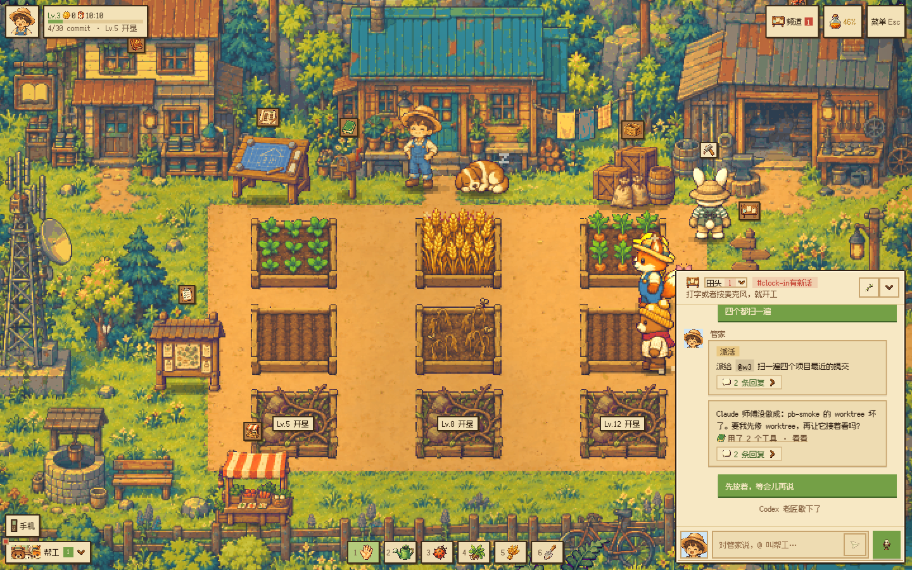
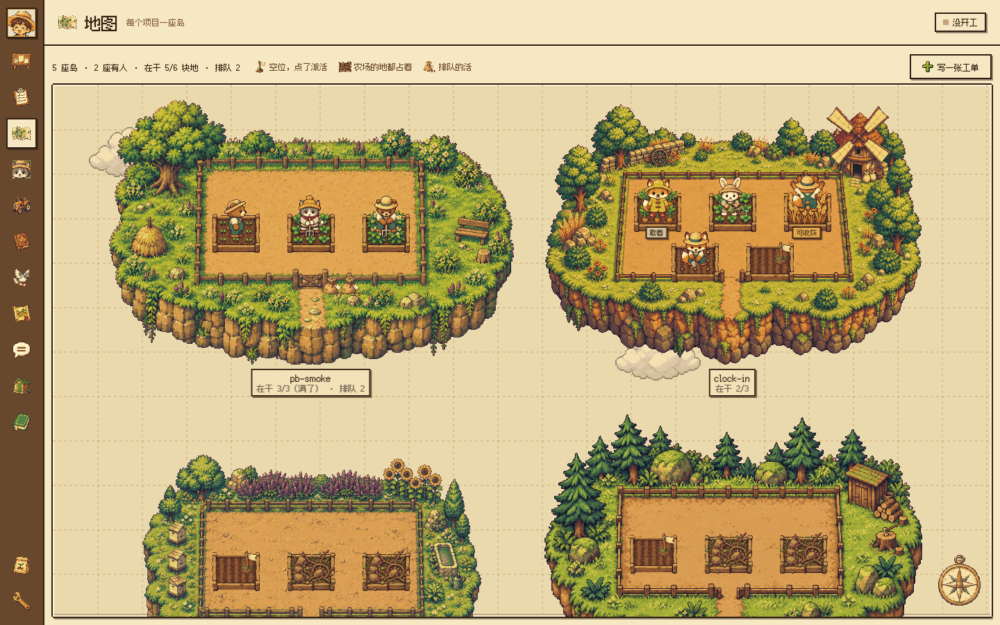
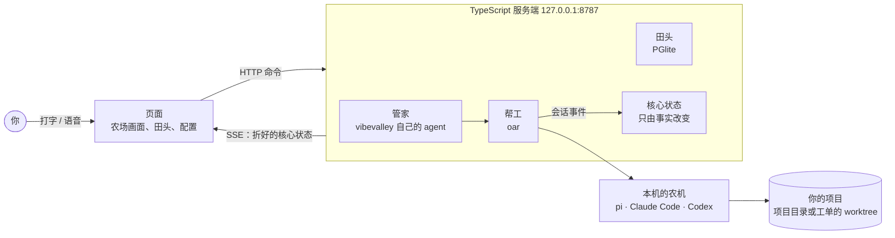

<h1 align="center">VibeValley · 码农场物语</h1>

> A team of coding agents you direct by voice or chat, drawn as a pixel farm. Runs on your own machine.

**VibeValley**（码农场物语）是一个用语音或打字指挥的编码 agent 团队，画成一座像素农场。

你只和**管家**说话。管家把活派给**帮工**，帮工是你机器上真实的编码 agent（pi、Claude Code、Codex……），在你的项目里开分支、改代码、跑测试、提交。地里的庄稼跟着它们的真实进度长：读代码时发芽，改文件时长叶，做完了结出麦子。你看过**收成清单**，才把它的分支合进主分支。

你、管家和帮工在同一个群聊**田头**里说话：每件活下面挂着一个工单串，帮工在里面确认、提问、汇报，你随时插话。说到底，VibeValley 是跑在本机的 AI 版 Linear：工单派给编码 agent，它在项目里一轮一轮干活，你看过改动再合并；农场是穿在外面的皮（[概念](docs/concepts.md)）。



> [!WARNING]
> 帮工**没有权限确认、不开沙箱**，能在这台机器上执行任意命令。服务端只监听 `127.0.0.1`，不要把它暴露到网络上。只把你愿意交给编码 agent 的项目放进工作目录。

## 能做什么

- **派活和收获**：对管家说「在 clock-in 里加一个查询打卡记录的接口，写测试」。管家挑一个合适的帮工，按档案设置给它开独立的分支和 worktree，或让它在项目目录里干活。做完后你看提交、diff 和会不会冲突，确认了再合进主分支；冲突了让它自己解决。
- **同时干好几件活**：最多 6 个帮工同时在地里干活；用 worktree 的帮工各有独立分支。
- **地图**：每个项目是一座小岛，岛上的地对着它在做的工单和还能派活的空位，排队的活是院门外的种子袋；点空位就给这个项目写一张工单。
- **看得见过程**：每个帮工的每一步都记成轨迹，包括收到的话、每条命令和输出、说的话。哪一步不对，可以就那一步写评论，它会接着改。
- **种植计划**：长任务先派一个帮工读代码、拆成一张有先后的步骤图，你看过草稿再开工。互不依赖的步骤同时做，每一步过了检查才合进计划分支，最后一次收进主分支。修 bug 时第一步先写一个**会失败的验收测试**，后面的步骤不能改它，最后一步要让它通过。
- **频道、定时和巡查**：按项目开频道；「每天九点跑一遍测试」这样的定时任务；不调模型的巡查，提醒没人回的提问、没动静的帮工、做完没收的活。
- **帮工档案和记性**：给帮工捏人设、选农机和模型、装技能。帮工在汇报里写的「记住：……」，下次开工时会想起来。
- **语音**：按住说话，语音管家（Agora Conversational AI）听你说完，交给同一个管家去派活。
- **从外面派活**：把田头接到微信、飞书或 QQ，只认你自己的账号。手机或另一台电脑可以经「连接到本机」连进来，前提是你在本机点过头。
- **管住花费**：每个农机的额度、今天花了多少、每日预算；额度快用完时提醒，用完了就不再派。
- **农场本身**：像素村有昼夜和光照，有狗、会在路上走的帮工、成就和称号，还有一部能玩小游戏的手机。



## 它是怎么工作的



- **服务端**（`apps/server`，TypeScript，Effect v4，跑在 Node 上）：管家、帮工、田头、项目和收获、种植计划、语音、连接器都在这一个进程里，数据在 PGlite。帮工由 [oar](https://github.com/botiverse/oar) 驱动，它统一驱动不同的编码 agent 程序。
- **核心状态只有一份**：农场上的一切是一个值，只因「事实」而变（雇了一个帮工、开始一轮、跑了一条命令……）。服务端用纯函数把事实折进状态，页面只读折好的结果。
- **页面**（`apps/web`，Solid 2）：农场和像素村、田头、工单、文档、配置页、语音，由服务端在 `/` 提供；浏览器直接打开就能用。
- **桌面版**（`apps/desktop`，Electron）：带着服务端起来、打开它的页面，加上通知、菜单栏和语音的快捷键。
- **形状只写一次**：接口和数据形状写在 `packages/protocol`（`shapes.ts`、`schema.ts`、`api.ts`），服务端和页面 import 同一份，两边不会对不上。

更多见 [docs/architecture.md](docs/architecture.md)。

## 快速开始

> [!NOTE]
> 仓库正在密集调整：概念、接口和存盘格式都还会变，可能会有 bug，升级后旧数据也可能要迁移。升级前先备份农场的数据（`~/.vibevalley`）。遇到问题欢迎提 issue。

### 需要

- macOS（Apple 芯片）。macOS 应用是主要的形态，单独跑的服务端也能用浏览器打开；手机版正在换成新的壳，暂时用不了。
- 至少一个装好并登录的编码 agent：[pi](https://www.npmjs.com/package/@earendil-works/pi-coding-agent)、[Claude Code](https://docs.anthropic.com/en/docs/claude-code)、[Codex](https://github.com/openai/codex)。VibeValley 也自带一个农机，只要 DeepSeek 的钥匙。
- 一把 [DeepSeek](https://platform.deepseek.com/) 的 API 钥匙，管家要用。
- 构建要 Node 24 和 [Vite+](https://viteplus.dev)（`vp`，它带着 pnpm）。
- 可选：[Agora](https://www.agora.io/) 的凭据（用来语音），以及微信、飞书或 QQ 的机器人（从外面派活）。

### 打一个 macOS 应用

```bash
git clone https://github.com/vibevalleyhq/vibevalley.git && cd vibevalley
vp install
vp run package:mac                  # 打出 apps/desktop/dist 里的 VibeValley.app 和 .dmg
open apps/desktop/dist/mac-arm64/VibeValley.app
```


应用没有签名，第一次打开要在「系统设置 → 隐私与安全性」里放行。它在一个空闲的本机端口上启动内置的服务端；农场的数据放在 `~/.vibevalley`（`VIBEVALLEY_HOME`），服务端的日志在 `~/.vibevalley/logs/desktop-server.log`。

### 或者分开跑（开发时）

```bash
vp install && vp run --filter vibevalley-web build      # 页面
vp run --filter vibevalley-server start --web ../web/dist   # 服务端，127.0.0.1:8787，浏览器打开它
```

数据同样在 `~/.vibevalley`（`VIBEVALLEY_HOME`）。钥匙在「设置」里填，存在 `$VIBEVALLEY_HOME/settings.json`；也可以写进 `$VIBEVALLEY_HOME/vibevalley.yaml`（或 `--config` 给的文件）和相应的环境变量。设置里的钥匙优先，详见[设置和配置](docs/subsystems/setting.md)。

### 第一次打开

1. 在首页「设置」里填 DeepSeek 的钥匙。
2. 在「农具」页里启用本机装好的农机。
3. 把项目放进工作目录（默认 `~/vibevalley-dev`，`VIBEVALLEY_WORK_ROOT`），一个文件夹一个项目。没有也行，管家会帮你建。
4. 在田头对管家说要做什么。

从派第一张工单到收获、处理冲突和失败、管住花费，见 [使用指南](docs/guide.md)。

## 目录

```
apps/server/       TypeScript 服务端（Effect v4、PGlite）：src/ 按概念分的服务（工单、执行、项目、群聊、管家、频道和连接器、游戏……），db/ 表结构和查询
apps/web/          页面（Solid 2）：农场、像素村、田头、工单、文档、配置页、语音；服务端在 / 提供
apps/desktop/      Electron 壳：带着服务端起来，打开它的页面；package:mac 打成 macOS 应用
packages/protocol/ 形状、接口和几处共用的规则的唯一来源，服务端和页面都 import 它
packages/host/     宿主接口：通知、菜单栏、快捷键，没有的是 null
site/              官网 vibevalley.dev（Astro）
design/            像素素材的生图提示词、脚本和切图规则（原图和效果图在单独的仓库 vibevalley-art）
docs/              文档：现在怎么用、怎么开发、各部分怎么工作
.agents/notes/     Agent Notes：每个设计决策为什么这样做、放弃了什么
```

## 开发和文档

- [docs/development.md](docs/development.md)：跑起来、检查和测试、打包。
- [AGENTS.md](AGENTS.md)：代码的规矩和常用命令（编码 agent 和人都照它来）。
- [docs/](docs/README.md)：各部分现在怎么工作，和农场叫法的用语表。
- [.agents/notes/](.agents/notes/README.md)：设计决策。改大的行为之前先读相关的那篇。

## 致谢

- [oar](https://github.com/botiverse/oar)（botiverse，Apache-2.0）：驱动编码 agent 的运行时。田头的频道、工单串和外部渠道参照了 botiverse 的 Raft。
- [Effect](https://effect.website/)、[PGlite](https://pglite.dev/)、[Solid](https://www.solidjs.com/) 和 [Electron](https://www.electronjs.org/)：服务端、数据库、页面和桌面版。
- [Agora Conversational AI](https://www.agora.io/)：语音管家；服务端照它的官方示例 [agent-quickstart-nextjs](https://github.com/AgoraIO-Conversational-AI/agent-quickstart-nextjs)（MIT）改写。
- [DeepSeek](https://www.deepseek.com/)：管家用的模型。
- [Fusion Pixel Font](https://github.com/TakWolf/fusion-pixel-font)（OFL）：像素字体。
- [Hugeicons](https://hugeicons.com/)（MIT）、[LobeHub Icons](https://github.com/lobehub/lobe-icons)（MIT）：像素图标和农机 logo 照它们的形状重画。
- [openclaw-weixin](https://www.npmjs.com/package/@tencent-weixin/openclaw-weixin)、[botpy](https://github.com/tencent-connect/botpy)（腾讯，MIT）：微信和 QQ 的连接器照它们写。
- [LDtk](https://ldtk.io/)：像素村的地图。

## 许可证

[Apache License 2.0](LICENSE)。用到的别的项目和它们的许可证见 [NOTICE](NOTICE)。

Claude、Codex、Cursor、DeepSeek、Agora、微信、飞书、QQ 等名字和 logo 归各自的所有者。VibeValley 用它们只为说明连的是哪一个，和它们没有隶属或背书关系。

发现安全问题请看 [SECURITY.md](SECURITY.md)。
