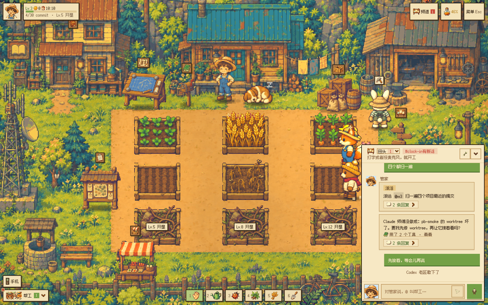
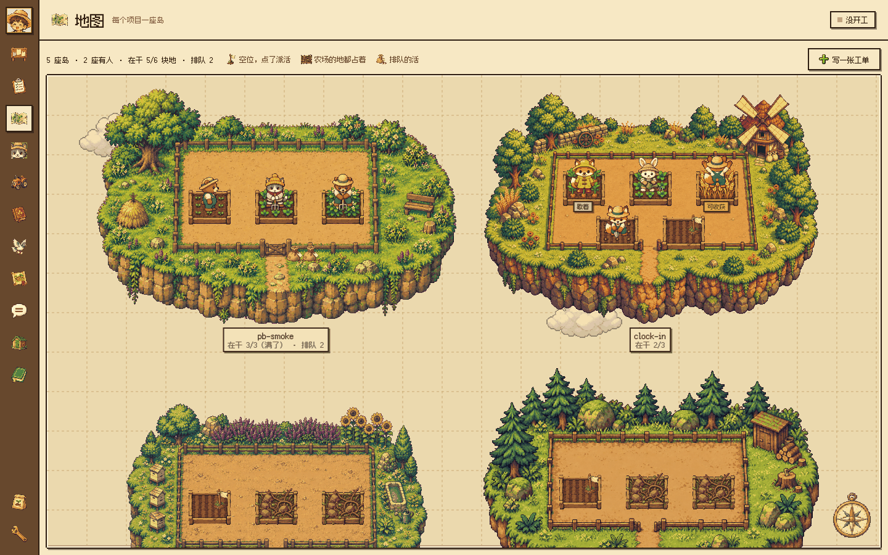
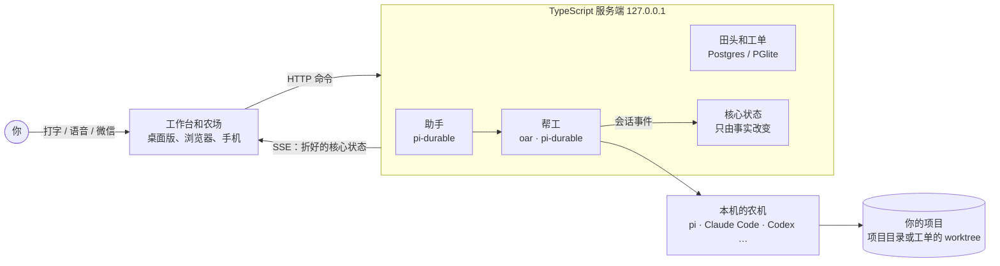

<h1 align="center">VibeValley · 码农场物语</h1>

> Direct a team of coding agents by voice or chat, on your own machine. Linear for agents, drawn as a pixel farm.

**VibeValley**（码农场物语）让一个人用一句话指挥一队编码 agent：你对**助手**说要做什么，它拆成工单、挑帮工、派出去、把结果告诉你；**帮工**是你机器上真实的编码 agent（pi、Claude Code、Codex……），在你的项目里开分支、改代码、跑测试、提交；你看过改动，才合进主分支。它是跑在本机的 AI 版 Linear，外面画成一座像素农场：庄稼跟着真实的进度长（[概念](docs/concepts.md)）。



## 为什么用它

- **说一句话，派出一队人。** 你只和助手说话，打字或按住说话都行。它把一句话拆成工单，按档案挑帮工、开分支，派出去；帮工确认、提问、汇报都在同一个群聊（田头）里，每件活一个串，你随时插话。
- **用的是你本机真的编码 agent。** pi、Claude Code、Codex 等由 [oar](https://github.com/botiverse/oar) 统一驱动，用你已经登录好的账号；没有也行，自带一个只要 DeepSeek 钥匙的农机。
- **同时干好几件，互不踩脚。** 最多 6 个帮工同时干活（每个仓库默认 3 个），各在自己工单的 worktree 和分支上；派不出去的排队，空出来自动接上。
- **合不合由你说了算。** 做完的活先给你看提交、diff 和会不会冲突，你说「完成」才合进主分支；冲突了让它自己解决。长任务拆成有先后的子工单，修 bug 先写一个**会失败的验收测试**，后面的子工单改不了它，最后一步要让它通过。
- **服务端停了也不丢活。** 助手和自带的农机跑在 [pi-durable](https://www.npmjs.com/package/@earendil-works/pi-durable) 上：每一轮、每个工具调用先落盘再显示。助手答到一半服务端停了，重启后接着答完；进程崩在半路时，帮工也从断点接着做，这一轮只记一次。
- **一眼看清谁在干什么。** 工作台照 Linear：看板、工单详情、每一步的轨迹（收到的话、每条命令和输出），哪一步不对就在那一步写评论。农场把同样的状态画出来：每个仓库是一座岛，在做的工单是一块地，读代码发芽、改文件长叶、做完结出麦子。
- **在哪都能派活。** 语音（Agora）、微信、飞书、QQ 只认你自己的账号；手机或另一台电脑经「连接到本机」连进来，前提是你在本机点过头。
- **少操心。** 「每天九点跑一遍测试」这样的定时任务；不调模型的巡查，提醒没人回的提问、没动静的帮工、做完没收的活；每个农机的额度和每日预算，用完了就不再派。
- **全在你的机器上。** 服务端默认只听 `127.0.0.1`，数据在你的家目录（`~/.vibevalley`）；帮工的记性、档案、笔记和 Artifact 都在本机。

> [!WARNING]
> 帮工**没有权限确认、不开沙箱**，能在这台机器上执行任意命令。服务端只监听 `127.0.0.1`，不要把它暴露到网络上。只把你愿意交给编码 agent 的项目放进工作目录。



## 它是怎么工作的



- **一个服务端进程**（`apps/server`，TypeScript，Node 24）：助手、帮工、田头、工单和交付、Artifact 和笔记、语音、连接器都在里面；数据在 Postgres（没配就是家目录里的 PGlite），助手和帮工的对话在 pi-durable 的 `durable.db`。
- **核心状态只有一份**：农场上的一切是一个值，只因「事实」而变（雇了一个帮工、开始一轮、跑了一条命令……）。服务端用纯函数把事实折进状态，页面只读折好的结果。
- **一份页面，三个宿主**（`apps/web`，Solid 2 + Tailwind）：`/` 是工作台，`/farm` 是像素农场；桌面版（Electron）加上通知、菜单栏、灵动岛和语音快捷键，手机壳（Expo）扫码配对后打开同一个页面。
- **契约只写一次**：接口和形状按概念写在 `packages/protocol`（Zod），服务端、页面和命令行用同一份，两边对不上就编不过。

更多见 [docs/architecture.md](docs/architecture.md)。

## 快速开始

> [!NOTE]
> 还在快速迭代：概念、接口和存盘格式都会变，升级后旧数据可能作废重建。升级前先备份 `~/.vibevalley`。遇到问题欢迎提 issue。

### 需要

- macOS（Apple 芯片）。macOS 应用是主要的形态；单独跑的服务端用浏览器打开；手机壳（iOS、Android）要自己构建（[apps/mobile](apps/mobile/README.md)）。
- 至少一个装好并登录的编码 agent：[pi](https://www.npmjs.com/package/@earendil-works/pi-coding-agent)、[Claude Code](https://docs.anthropic.com/en/docs/claude-code)、[Codex](https://github.com/openai/codex)。VibeValley 也自带一个农机，只要 DeepSeek 的钥匙。
- 一把 [DeepSeek](https://platform.deepseek.com/) 的 API 钥匙，助手要用。
- 构建要 [Vite+](https://viteplus.dev)（`vp`）：它照 `.node-version` 装 Node 24，带着 pnpm。
- 可选：[Agora](https://www.agora.io/) 的凭据（用来语音），以及微信、飞书或 QQ 的机器人（从外面派活）。

### 打一个 macOS 应用

```bash
git clone https://github.com/vibevalleyhq/vibevalley.git && cd vibevalley
vp install
vp run package:mac                  # 打出 apps/desktop/dist 里的 VibeValley.app 和 .dmg
open apps/desktop/dist/mac-arm64/VibeValley.app
```


应用没有签名，第一次打开要在「系统设置 → 隐私与安全性」里放行。它在一个空闲的本机端口上启动内置的服务端；农场的数据放在 `~/.vibevalley`（`VIBEVALLEY_HOME`），服务端的日志在 `~/.vibevalley/logs/desktop-server.log`。

### 或者分开跑（开发时）

```bash
vp install && vp run --filter @vibevalley/web build      # 页面
vp run --filter @vibevalley/server start --web ../web/dist   # 服务端，127.0.0.1:8787，浏览器打开它
```

数据同样在 `~/.vibevalley`（`VIBEVALLEY_HOME`）。钥匙在「设置」里填，存在 `$VIBEVALLEY_HOME/settings.json`；也可以写进 `$VIBEVALLEY_HOME/vibevalley.yaml`（或 `--config` 给的文件）和相应的环境变量。设置里的钥匙优先，详见[设置和配置](docs/subsystems/setting.md)。

### 第一次打开

1. 在首页「设置」里填 DeepSeek 的钥匙。
2. 在「农机」页里启用本机装好的农机。
3. 把项目放进工作目录（默认 `~/vibevalley-dev`，`VIBEVALLEY_WORK_ROOT`），一个文件夹一个项目。没有也行，助手会帮你建。
4. 在聊天里对助手说要做什么。

从派第一张工单到收获、处理冲突和失败、管住花费，见 [使用指南](docs/guide.md)。

## 目录

```
apps/server/       TypeScript 服务端（Hono、Zod、Postgres / PGlite）：src/ 按概念分的服务（工单、帮工、信箱、项目、频道、Artifact、笔记、助手、连接器、游戏……），db/ 表结构和查询
apps/cli/          命令行（vibevalley）：照领域模型一条命令一个操作，经 VibeValleyApi 调服务端
apps/web/          页面（Solid 2）：农场、像素村、田头、工单、Artifact、笔记、配置页、语音；服务端在 / 提供
apps/desktop/      Electron 壳：带着服务端起来，打开它的页面；package:mac 打成 macOS 应用
apps/site/         官网 vibevalley.dev（Solid 2 静态生成）
packages/protocol/ 形状、接口、几处共用的规则和宿主接口的唯一来源，服务端、命令行、页面和两个壳都 import 它
design/            像素素材的生图提示词、脚本和切图规则（原图和效果图在单独的仓库 vibevalley-art）
docs/              文档：现在怎么用、怎么开发、各部分怎么工作
.agents/notes/     Agent Notes：每个设计决策为什么这样做、放弃了什么
```

## 开发和文档

- [docs/development.md](docs/development.md)：跑起来、检查和测试、打包。
- [AGENTS.md](AGENTS.md)：代码的规矩和常用命令（编码 agent 和人都照它来）。
- [docs/](docs/README.md)：各部分现在怎么工作，和农场叫法的用语表。
- [.agents/notes/](.agents/notes/README.md)：设计决策。改大的行为之前先读相关的那篇。

## 致谢

- [oar](https://github.com/botiverse/oar)（botiverse，Apache-2.0）：驱动编码 agent 的运行时。田头的频道、工单串和外部渠道参照了 botiverse 的 Raft。
- [pi-durable 和 pi-ai](https://github.com/earendil-works/pi)（Earendil）：助手和帮工跑在上面，断在半路的一轮重启后接着做。
- [Hono](https://hono.dev/)、[Zod](https://zod.dev/)、[PGlite](https://pglite.dev/)、[Solid](https://www.solidjs.com/)、[Tailwind CSS](https://tailwindcss.com/) 和 [Electron](https://www.electronjs.org/)：服务端的接口、契约、数据库、页面、样式和桌面版。
- [Agora Conversational AI](https://www.agora.io/)：语音助手；服务端照它的官方示例 [agent-quickstart-nextjs](https://github.com/AgoraIO-Conversational-AI/agent-quickstart-nextjs)（MIT）改写。
- [DeepSeek](https://www.deepseek.com/)：助手用的模型。
- [Fusion Pixel Font](https://github.com/TakWolf/fusion-pixel-font)（OFL）：像素字体。
- [Hugeicons](https://hugeicons.com/)（MIT）、[LobeHub Icons](https://github.com/lobehub/lobe-icons)（MIT）：像素图标和农机 logo 照它们的形状重画。
- [openclaw-weixin](https://www.npmjs.com/package/@tencent-weixin/openclaw-weixin)、[botpy](https://github.com/tencent-connect/botpy)（腾讯，MIT）：微信和 QQ 的连接器照它们写。
- [LDtk](https://ldtk.io/)：像素村的地图。

## 许可证

[Apache License 2.0](LICENSE)。用到的别的项目和它们的许可证见 [NOTICE](NOTICE)。

Claude、Codex、Cursor、DeepSeek、Agora、微信、飞书、QQ 等名字和 logo 归各自的所有者。VibeValley 用它们只为说明连的是哪一个，和它们没有隶属或背书关系。

发现安全问题请看 [SECURITY.md](SECURITY.md)。
