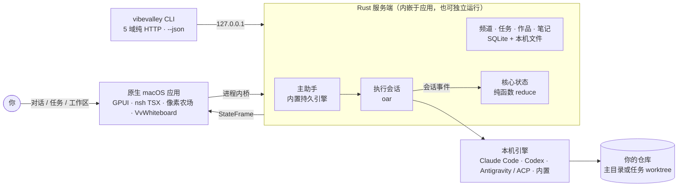

<h1 align="center">VibeValley · 码农场物语</h1>

> Personal (and small-team) Agent OS — amplify your output by operating coding and creation agents like a mechanized farm.

同时开十几个终端盯着编码 Agent，精力很快耗在来回切窗口上。**VibeValley** 是跑在本机的**个人与小团队 Agent OS**，让你像经营一座**机械化农场**一样用 AI 放大产出——多机并行、分田隔离、流水产出、由人掌闸（[概念](docs/concepts.md)）。


## 像经营机械化农场一样管理 Agent

| 机械化农场 | 在 VibeValley 里 |
|---|---|
| **统一农机调度** | 经 [oar](https://github.com/botiverse/oar) 驱动本机 Claude Code、Codex、Antigravity（`agy` / ACP）等引擎及内置引擎，到额度或日预算自动停派。 |
| **分田并行，由人掌闸** | 最多 6 路并发（单仓库默认 3 路），每项任务独占分支与 Git worktree；看清 Diff 与冲突、点击「完成」才合入主分支，重启可从断点续接。 |
| **三种工作姿态** | **对话**托管给主助手拆单盯盘；**工作区**并排开原生终端、OAR 直连对话与 Diff；**像素农场**全局总览——仓库是岛、任务是地、进度长成庄稼。 |
| **统一产出仓** | 笔记、作品与媒体收在同一侧栏（19 套双语模板）：单栏大纲笔记、纯 Rust 无限白板 `VvWhiteboard`、幻灯片／看板／网页作品与右侧协作对话。 |
| **全本机与自动化** | 仅监听 `127.0.0.1`，数据与记忆留在你的 Mac；配定时任务、零模型巡查，及支持 `--json` / `--dry-run` 的 5 域纯 HTTP 命令行 `vibevalley`。 |

> [!WARNING]
> 任务自动执行会话**无逐条权限确认、不开沙箱**。服务端仅监听 `127.0.0.1`，不应暴露到公网；只将信任的项目放入工作目录。


## 架构一眼看懂



- **单一 Rust 服务端**（`crates/server`）：内嵌于应用或独立运行，承载主助手、执行会话、频道、任务、作品、笔记与媒体。
- **唯一核心状态**（`crates/core`）：全部业务状态由纯函数 `reduce` 经不可变「事实」折叠，界面与像素农场只读 `StateFrame`。
- **原生 macOS 客户端**（`apps/mac`）：GPUI 窗口内置 PTY 终端、文件／Diff 查看、像素农场与 `VvWhiteboard`；工作台与直连对话由 `nsh` 跑 TSX；另附命令行 `vibevalley`（`crates/cli`）。仅支持 macOS（[原生计划](.agents/notes/proposed/architecture/2026-11-14-native-vibevalley.md)）。
- **契约单源**（`crates/protocol`）：Rust 定义形状与接口，自动生成 TS 类型与客户端，三端严格对齐。详见 [docs/architecture.md](docs/architecture.md)。

## 快速开始

> [!NOTE]
> 项目仍在高频迭代，内部存盘格式与接口会随演进调整；升级前请先备份数据目录。

### 环境要求

- **系统**：macOS（Apple Silicon）。
- **引擎与密钥**：至少一个已登录本机引擎——[Claude Code](https://docs.anthropic.com/en/docs/claude-code)、[Codex](https://github.com/openai/codex)、Antigravity（`agy`）或其他 ACP 引擎（或仅用内置引擎）；另需一把 [DeepSeek](https://platform.deepseek.com/) API 密钥供主助手与内置引擎使用。
- **源码构建**：Rust（照 `rust-toolchain.toml`）、Zig 与 [Vite+](https://viteplus.dev)（`vp`，照 `.node-version` 管理 Node 24 与 pnpm）。

### 从源码运行

```bash
git clone https://github.com/vibevalleyhq/vibevalley.git && cd vibevalley
vp install
vp run nsh:install                  # 安装打包工作台所需的 nsh 命令行
vp run mac:check                    # 校验并构建工作台页面包
cargo run -p vibevalley-mac         # 启动原生 macOS 应用（内嵌服务端）
```

> 端口与数据目录按发布通道隔离：`dev` 默认 `127.0.0.1:8790` / `~/.vibevalley-dev`，`release` 默认 `127.0.0.1:8787` / `~/.vibevalley`（`alpha 8789`、`beta 8788`，均可用 `VIBEVALLEY_HOME` / `VIBEVALLEY_PORT` / `VIBEVALLEY_CHANNEL` 覆盖，见 [设置和配置](docs/subsystems/setting.md)）。

只跑服务端与命令行（评测另拆为 `--features eval` 的 `vibevalley-eval`）：

```bash
cargo run -p vibevalley-server                        # 默认 dev 通道：127.0.0.1:8790
cargo run -p vibevalley-cli -- doctor                 # 体检服务端、状态流、引擎与密钥
cargo run -p vibevalley-cli -- --json issue list      # 以原始 JSON 列出任务
```

### 首次启动

1. 在「设置」填入 DeepSeek API 密钥（保存于 `$VIBEVALLEY_HOME/settings.json`）。
2. 在「团队」启用本机已安装的编码引擎（Claude Code、Codex、Antigravity 等）。
3. 在「工作区」添加、克隆或新建本地仓库。
4. 在「对话」向主助手布置第一项任务，或在「工作区」直接开终端／对话标签开工。

更多日常用法见 [使用指南](docs/guide.md)。

## 目录与文档

```
crates/            Rust 核心：protocol、core、runtime（oar 与自研引擎）、rich（原生富内容与白板）、server、cli
apps/mac/          原生 macOS 应用：GPUI 外壳、PTY 终端与像素农场（Rust），工作台与工作区页面（nsh TSX）
apps/island/       刘海灵动岛小程序（Swift）
apps/site/         官网 vibevalley.dev（Vite + Solid 2 静态生成）
packages/          页面共享 TS 包：生成的契约与 Zod 校验、词典目录
assets/ · design/  像素素材、字体、地图与设计令牌（design/tokens.json）
docs/ · .agents/   文档（docs/README.md）、架构提案（Agent Notes）与校验脚本（scripts/）
```

- [docs/guide.md](docs/guide.md)（使用指南）· [docs/development.md](docs/development.md)（开发与发版）· [AGENTS.md](AGENTS.md)（规矩与命令）· [docs/README.md](docs/README.md)（文档地图与用语表）· [.agents/notes/README.md](.agents/notes/README.md)（Agent Notes）

## 致谢

- **核心技术**：[oar](https://github.com/botiverse/oar)（Apache-2.0，多引擎运行时模型）· [pi](https://github.com/earendil-works/pi)（持久执行参考）· [GPUI](https://www.gpui.rs/)（Zed / [gpui-fast](https://github.com/longbridge/gpui-fast)）· [nsh](https://github.com/longbridge/nsh)（原生 TSX 视图运行时）· [Ghostty](https://ghostty.org/)（[libghostty-vt](https://github.com/uzaaft/libghostty-rs) 终端引擎）· [Loro](https://loro.dev/)（CRDT 协同内容引擎）
- **字体与像素素材**：[Fusion Pixel Font](https://github.com/TakWolf/fusion-pixel-font)（OFL 1.1）· [Hugeicons](https://hugeicons.com/) / [LobeHub Icons](https://github.com/lobehub/lobe-icons)（MIT）

## 许可证

[Apache License 2.0](LICENSE)，第三方声明见 [NOTICE](NOTICE)，安全漏洞请见 [SECURITY.md](SECURITY.md)。

Claude、Codex、Antigravity、Cursor、DeepSeek、Agora、微信、飞书、QQ 等名称与标识归各自所有者所有，VibeValley 仅用于说明集成对象，与上述各方无隶属或背书关系。
