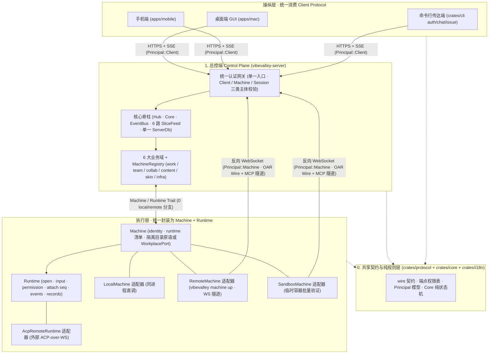
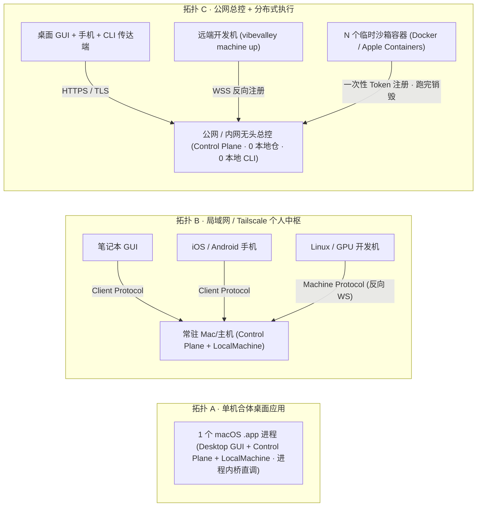
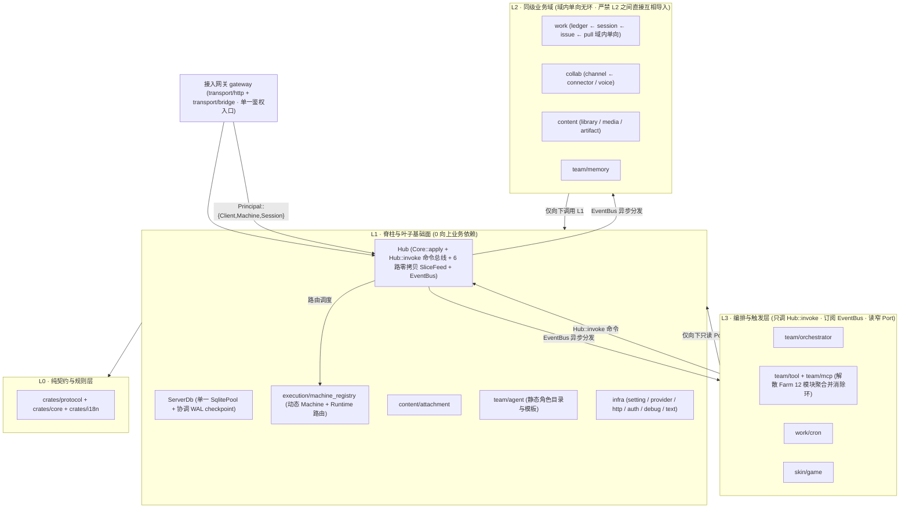
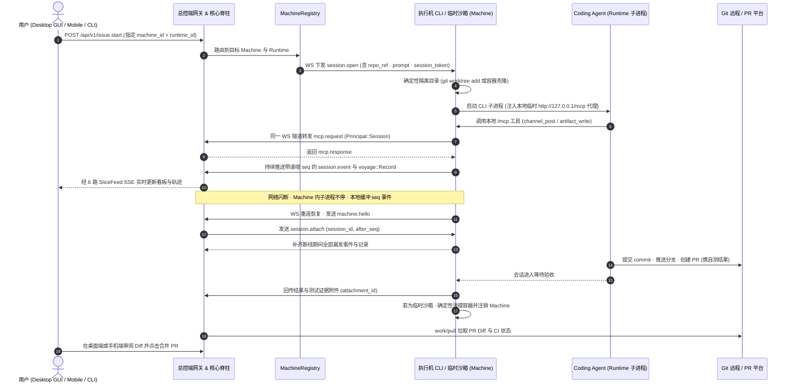

# VibeValley 整体目标架构规范

**逻辑架构应按职责边界严格拆分，物理架构可按部署形态自由合并或拆分，且不应绕过逻辑边界。**

本文规定 VibeValley 的目标逻辑与物理架构、部署拓扑、模块边界收敛蓝图、主体鉴权模型、跨边界协议与三阶段迁移路径；当前系统现状见 [docs/architecture.md](docs/architecture.md)。

## 术语表

以下术语与 [docs/README.md](docs/README.md#用语) 保持一词一义：

| 术语 | 英文 / 代码标识 | 唯一含义 |
|---|---|---|
| 总控端 | `Control Plane` | 持有核心状态、编排状态机、持久化与主体鉴权的中枢服务 |
| 操纵端 | `Client` | 供人、脚本或 CI 查询状态并向总控端发出命令的客户端 |
| 执行层 | `Execution Layer` | 由 `Machine` 与 `Runtime` 组成的代码执行抽象层 |
| 机器 | `Machine` | 物理机、虚拟机或临时容器，持有本地文件系统、仓库、隔离目录与 `Runtime` 清单 |
| 引擎 | `Runtime` | 归属于某台 `Machine` 的编码代理实现（`claude`、`codex`、`acp`、`vibevalley`） |
| 任务 | `Issue` | 看板中的一条工作单元，包含状态、交付方式与验收标准 |
| 执行会话 | `Session` | 分配给某台 `Machine` 的某 `Runtime` 运行的一轮或多轮编码会话 |
| 主助手 | `Orchestrator` | 运行在总控端编排层、协助用户拆解与巡查任务的内建代理 |
| 工作区 | `Workplace` | 仓库与 Git 工作树的磁盘隔离环境 |
| 改动 | `Changes` | 任务分支或工作树产生的提交、Diff 与冲突摘要 |
| 轨迹 | `Trajectory` | `SessionEvent` 组成的结构化执行记录 |
| 核心状态 | `SpaceState` | 总控端经 `Core::apply` 维护的唯一实时状态快照 |
| 切片 | `Slice` | 按业务域切分的 6 路状态投影（`board`、`sessions`、`collab`、`inbox`、`ops`、`farm`） |
| 主体 | `Principal` | 通过网关鉴权后的调用身份（`Client`、`Machine`、`Session`） |

---

## 1. 逻辑架构与物理架构解耦

### 1.1 逻辑架构总图

逻辑架构分为 4 个单向依赖平面：共享契约层（`Protocol`）、操纵层（`Client`）、总控层（`Control Plane`）与执行层（`Execution Layer`）。



### 1.2 物理部署拓扑（合并 vs 拆分）

物理架构决定「进程怎么打包、跨进程怎么通信」，逻辑架构决定「谁持有状态、谁调谁」。两者之间仅通过传输适配器切换。



> [!IMPORTANT]
> **逻辑边界不可绕过**：在拓扑 A 的单机合体模式中，桌面宿主应只替换传输实现（用进程内桥与本地 trait 替代 HTTP / WebSocket），不应在业务或视图中直接访问 `Control Plane` 私有字段（如具体的 `Voice`、`Orchestrator` 或 `Board` 内部结构体）。

| 部署拓扑 | 物理进程合并方式 | 通信媒介 | 适用场景 |
|---|---|---|---|
| **拓扑 A：单机合体应用** | `Desktop GUI` + `Control Plane` + `LocalMachine` 同进程启动 | 进程内桥（`transport/bridge`）+ 内存 trait 直调 | 双击即用的本地个人桌面模式，本机 Git 提交与 Diff 零延迟 |
| **拓扑 B：局域网个人中枢** | 一台主机运行 `Control Plane + LocalMachine`；其余设备独立运行 | 局域网 / Tailscale HTTPS + 反向 WS | 多台电脑加手机协同，算力仍在个人设备之间共享 |
| **拓扑 C：公网总控 + 分布式执行** | `Control Plane` 独立部署于服务器；`Desktop GUI`、`Mobile`、`CLI`、`Machine`、`Sandbox` 全部分离 | 公网 TLS（`HTTPS` + `WSS`） | 团队或个人 24 小时在线总控、异地开发机调度与批量沙箱验证 |

---

## 2. 顶层平面职责边界矩阵

| 逻辑平面 | 物理载体 | 应负责（Owns） | 不应负责（Does NOT Own） | 对外唯一端口 |
|---|---|---|---|---|
| **总控端 `Control Plane`** | [crates/server](crates/server/src/lib.rs) | 核心状态 `SpaceState`、6 路 `SliceFeed` 投影、任务队列与依赖推进、频道投递、主助手轮次、`Artifact` 与记忆持久化、三类 `Principal` 鉴权、`MachineRegistry` 注册表 | 具体的子进程管理、远端宿主机文件读写、UI 组件树排版 | `Server` trait（对进程内桥）与单一 HTTP/WS 网关（`transport/http`） |
| **桌面端 GUI `Desktop`** | [apps/mac](apps/mac/Cargo.toml) + [apps/mac/ui](apps/mac/ui) | GPUI 原生窗口、工作台页面、本地终端（`terminal`）、像素农场渲染（`pixel`）、可选「单机合体启动器」与可选连接远端总控端 | 业务规则计算、擅自改写 `SpaceState`、越过协议直调服务端内部领域模块 | `Client Protocol`（连远端总控端）或 `transport/bridge` + 进程内主机端口 |
| **手机端 `Mobile`** | [apps/mobile](apps/mobile) | iOS / Android 移动界面（收件箱、频道、会话、任务）、设备配对、Keychain / Keystore 凭据存储、折叠屏双栏自适应 | 任何服务端状态存储、本地模型或 CLI 执行 | `Client Protocol`（`@vibevalley/protocol/remote`） |
| **命令行 `CLI`** | [crates/cli](crates/cli/src/main.rs) | 1）`Client` 模式：经认证向总控端查询、创建任务、频道发言与提交作品证据；2）`Machine` 模式：在执行机上探针 CLI、维持反向 WS、驱动子进程 | 总控端全量状态镜像、多用户看板 UI 呈现 | `Client Protocol`（模式 1）与 `Machine Protocol`（模式 2） |
| **执行层 `Execution Layer`** | `Machine` + `Runtime`（含 [crates/runtime/src/oar](crates/runtime/src/oar/mod.rs)） | `Machine` 在线注册、会话持久化存活、工作目录预置与清理、驱动 `claude`/`codex`/`acp` 子进程、回传事件与轨迹、本地 MCP 代理隧道 | 任务优先级队列、频道受众路由、用户账号或跨机器授权策略 | `Machine` trait 与 `Runtime` trait |

---

## 3. 子模块划分与详细边界规范

### 3.1 共享契约与纯规则层

| 子模块 | 路径 | 应负责（Owns） | 不应负责（Does NOT Own） | 当前边界缺口与收敛目标 |
|---|---|---|---|---|
| **协议契约源** | [crates/protocol](crates/protocol/src/contract/mod.rs) | 全部线上结构体、`ENDPOINTS`、`NATIVE_ENDPOINTS`、`SUBSCRIPTIONS` 权限表、`BizCode`、`home.rs`、TS 声明生成器 | 业务执行逻辑、数据库建表、网络客户端 | 将 1,383 行桌面专有 `contract/host.rs` 收归 `host` feature，避免 CLI 与移动端编译背负桌面外壳类型；为 `Subscription` 补齐 `can: &[Principal]` |
| **TS 边界编解码** | [packages/protocol](packages/protocol) | Rust 生成的类型、`api.ts`、`client.ts`、运行期边界 Zod Schema、`remote/transport.ts`（纯 Fetch + SSE 续读） | UI 状态缓存、平台持久化存储 | Stage 4A `C2` 已清除 48 个无消费 Zod 声明；后续与 `Subscription` 鉴权对齐 |
| **纯状态与领域规则** | [crates/core](crates/core/src/lib.rs) | 纯函数 `Core::apply`、`SliceMask`、6 路切片投影、任务状态迁移校验、定时到期计算（`cron`）、作品引擎规则（`artifact`） | 任何 I/O、时间系统调用、网络请求、SQLite 访问 | `Cargo.toml:20` 因 `brief.rs:80` 依赖 `crates/i18n`，导致 `SliceFeed` 绑定进程全局语言；多客户端不同语言时，应改为投影结构化词典键并在客户端本地化 |
| **多语言词典** | [crates/i18n](crates/i18n/src/lib.rs) + [packages/i18n](packages/i18n) | 中英双语词典查询与参数插值（对用户文本） | 业务逻辑与提示词正文（提示词正文归 `crates/server/assets`） | 边界清晰，维持现状 |

### 3.2 总控端内部子模块与调用收敛（`Control Plane`）

总控端内部收敛为 **4 层严格无环 DAG（`L3 -> L2 -> L1 -> L0`）**。同层业务域之间不应互相导入具体结构体，所有跨域交互收口至 `Hub` 与 `EventBus`。



#### 3.2.1 跨域调用收敛规则（仅 3 条合法通道）

| 通道类型 | 唯一机制 | 应承担场景 | 被取代的旧直调路径 |
|---|---|---|---|
| **命令写（Command）** | 进程内强类型 `Hub::invoke<O: Op>(principal, input)` | 任何跨域写入（工具调用、频道发帖、任务状态迁移、触发媒体/作品动作）；不经 JSON 编解码，统一在 `Hub` 门口校验 `Principal` 与 `ENDPOINTS.can` 并写入 `DebugKit` 轨迹 | 解散 `team/tool::Farm` 持有的 12 个具体模块直调；移除 `work/issue` / `content/media` 直调 `Chat`；移除 `work/cron` 的 2 处 `OnceLock` 晚绑定 |
| **异步反应（Reaction）** | `EventBus::publish` / `EventBus::subscribe` | 一件事完成后引发的多域联动（频道消息唤醒 `Session` / `Orchestrator` / `library` 入库；会话结束触发 `memory` 沉淀与 `skin/game` 记账；任务流转触发 `pull` 与 `game`） | 移除 `memory` 直挂 `Sessions::on_news` 与 `start.rs` 回调胶水 |
| **只读查询（Read）** | 读 `Hub` 上的 `SpaceState` 快照、向下导入 `L1` 叶子模块，或单方法只读 Port trait | `content/artifact` 解析 `#编号` 直接读 `SpaceState`；跨 `L2` 读取（记忆召回、引用摘要、会话上下文）改以单方法 `MemoryRecallPort` / `ArtifactQuotePort` / `SessionContextPort` 在启动期注入 | 移除 `content/artifact` 导入 `work/issue::Board`；移除 `team/agent <-> team/memory` 双向导入；移除 `content/pkm` 直接导入 `team/memory::terms_list` |

#### 3.2.2 收敛前后指标与静态防退化门禁

| 结构指标 | 现状实证 | 目标态 |
|---|---|---|
| **模块间直接耦合** | `team/tool` 导入 14 模块（`Farm` 持有 12 个具体模块）；`orchestrator::words` 被 4 模块逆向引用 | **`L2` 之间 0 条跨模块导入**；共享文案下沉至 `L1` (`infra/text`) / `L0` |
| **模块循环依赖** | 4 组环：`ledger <-> issue <-> session`、`tool <-> mcp`、`tool <-> orchestrator`、`agent <-> memory` | **0 组循环依赖**（严格 `L0 <- L1 <- L2 <- L3` 单向 DAG） |
| **启动期晚绑定钩子** | `start.rs:421–548` 共 7 处 `attach_*`/`set_*` / `OnceLock` 破环 | **0 处**；按 `L0 -> L1 -> L2 -> L3` 顺序一次性不可变构造 |
| **SQLite 与状态写入** | 15 条独立 `server.db` 连接；`runtime_inbox` 绕过 `Core::apply` 私增 `seq` | **1 个 `ServerDb` 连接池**；所有核心状态变更只经 `Hub::apply` |

> [!IMPORTANT]
> **静态边界门禁强制生效**：应把模块依赖规则写进 `scripts/audit/` 静态检查脚本并纳入 `vp check`，防止架构在后续迭代中回潮。

1. 扫描 `crates/server/src/transport/` 与 `lib.rs`：不应出现任何 `crate::modules::*` 导入。
2. 扫描 `L1` 基础层模块：不应出现任何指向 `L2` 或 `L3` 模块的 `use` 语句。
3. 扫描 `L2` 同级业务域（`work` / `collab` / `content` / `team/memory`）：不应出现跨大域的具体模块 `use` 语句。
4. 对 `crates/server/src/modules/` 的模块导入图执行拓扑排序：发现任意有向环时，检查立即失败并定位违规 `use` 行。

#### 3.2.3 总控端全子模块边界表

| 子模块 | 分层 | 应负责（Owns） | 不应负责（Does NOT Own） | 当前裂缝与治理动作 |
|---|---|---|---|---|
| **`gateway` (`transport/{api,http,bridge}`)** | 接入层 | 统一绑定监听地址；校验三类 `Principal` 令牌；执行 `ENDPOINTS` 与 `SUBSCRIPTIONS` 的 `can` 鉴权；提供零克隆 `Arc<str>` 切片 SSE、`/attachment/{id}` Range 流与 `/mcp` 入口 | 任何业务规则、具体模块导出或直连 SQLite 表 | 修复 `GET /attachment/{id}` 丢弃 `CallerContext` 与 8 条订阅缺少 `can` 校验的问题（`#1`）；将 `bridge-0..3` OS 线程池迁入共享 `rt` |
| **`spine` (`Hub`, `EventBus`, `SliceFeed`, `ServerDb`)** | `L1` | 唯一状态写入口 `Hub::apply`、进程内命令总线 `Hub::invoke<O>`、异步 `EventBus`、6 路 `SliceFeed`、全局唯一 `ServerDb` 连接池与端口 trait 定义 | 持有具体业务模块（`Orchestrator`、`Voice`）与旁路状态队列 | 删除 0 调用方 `Server::raise_budget` 与 `Hub.execution`；`Voice` 改走 `LiveVoicePort`；`runtime_inbox` 改为 `Fact` 经 `Hub::apply`；15 路连接收拢为单 `ServerDb`；`Started` 只暴露 `hub`、`set_mcp_url`、`close` |
| **`execution/machine_registry`** | `L1` | 维护在线 `Machine`（`LocalMachine` / `RemoteMachine` / `SandboxMachine`）及其 `Runtime` 清单；推送 `LiveEventRuntime`；将 `Session` 指令路由至目标 `Machine` | 进程启动、Git 命令与网络细节（归各适配器） | 将静态 `Registry` 升级为动态路由表；把具体 `Arc<Workplace>` 收口为 `Machine` 的 `WorkplacePort` 或轻隔离原语 |
| **`content/attachment`** | `L1` | SHA-256 内容寻址对象存储（支持本机路径导入与远程按 ID 流式拉取）与 `attachment` 表 | 业务路由、聊天规则、媒体编排 | 保持 0 向上导入；新增本地 `importPath` 消除 50 MB 文件 Base64 进 JS 堆 |
| **`team/agent`** | `L1` | 角色档案（`config.json`）、技能库、模板、`Machine`/`Runtime` 解析 | 主助手多轮逻辑或直接依赖 `team/memory` | 剥离 `memory` 与 `orchestrator::words` 逆向边；按只读 Port 注入记忆召回 |
| **`infra/{setting,provider,http,auth,debug,text}`** | `L1` | 配置密钥（Keychain / headless `0600`）、供应商目录、公网防 SSRF 下载、统一三类 `Principal` 鉴权、门控 `DebugKit`、共享文案格式 `text` | 导入任何 `L2` / `L3` 业务模块 | `infra/remote` 泛化为通用 `infra/auth`；接管下沉的提示词与分词纯工具 |
| **`work/{ledger,session,issue,pull}`** | `L2` | 域内单向 `ledger <- session <- issue <- pull`：统一写入与 `Fact` 折叠、会话槽位与邮箱、看板状态机、GitHub/GitLab PR 交付与快照 | 同层互相环状导入；直调 `collab/channel` 或 `orchestrator::words` | 拆 `work/chat` 消解 `session <-> issue`；`reopen` 回调注入 `Ledger::open`；写频道改经 `Hub::invoke`；`pump` 线程迁入 `rt` |
| **`collab/{channel,connector,voice}`** | `L2` | 域内 `channel <- connector / voice`：纯受众投递与广播、外联平台桥、语音授权与 MOSS Live 桥 | 音频硬件驱动（在 `apps/mac`）；Agora/`cloudflared`/Dictation（Stage 4B `S4` 退场） | 维持 `channel` 零向上依赖；完成 `S4` 清理与 `LiveVoicePort` 隔离 |
| **`content/{library,media,artifact}`** | `L2` | 素材目录、媒体任务状态机、多版本 HTML / 结构化条目 / Loro 块协作 | 并行笔记栈 `pkm`（Stage 4B `S2` 并入 `ArtifactType::Outline`）；直接导入 `work/issue::Board` 或 `collab/channel` | `artifact` 改从 `SpaceState` 解析 `#编号`；频道素材收集改订阅 `EventBus`；发帖写回改经 `Hub::invoke`；补全 `S1` 与 `S6` |
| **`team/memory`** | `L2` | 记忆表 CRUD、检索打分、`gse` 分词、会话报告沉淀 | 被 `team/agent` 直接反向导入或挂接私有观察器回调 | 通过 `EventBus` 消费会话完成事件，对外通过 `MemoryRecallPort` 提供召回 |
| **`team/orchestrator`, `team/tool`, `team/mcp`, `work/cron`, `skin/game`** | `L3` | 编排与触发：主助手对话轮次、工具目录分发与 `/mcp` 门、定时触发、游戏账本与成就 | 跨越 `L2` 域直接持有 12 模块结构体 `Farm`，或用 `OnceLock` 晚绑定 | 工具执行统一走 `Hub::invoke<O>`（与 HTTP 共用 `can` 鉴权门）与只读 `vv://` Port；解散 `Farm`，切断 `tool <-> mcp` 与 `tool <-> orchestrator` 环 |

### 3.3 执行层子模块（`Execution Layer`：`Machine` + `Runtime`）

#### 核心抽象接口

1. **`Machine` 接口**：
   - `machine_id()`、`label()`、`platform()`（`macos` / `linux` / `container`）、`status()`（`online` / `offline` / `draining`）。
   - `runtimes()`：返回该机器当前可用的 `Arc<dyn Runtime>` 清单。
   - `prepare_workdir(spec)` / `cleanup_workdir(ref)`：在启动 `Runtime` 前创建确定性隔离目录（`git worktree` 或临时克隆）。
   - `workplace()`（可选 `Option<Arc<dyn WorkplacePort>>`）：仅本机模式返回完整本地 Diff/Merge 端口；远端与沙箱返回 `None`，代码交付一律走 PR-First（`commit` / `push` / `gh pr create`），由总控端既有 `work/pull` 展示改动与执行合并。
2. **`Runtime` 接口**：
   - `id()`（经路由表复合为 `machine_id + runtime_id`）、`capabilities()`、`list_models()`、`account_usage()`。
   - 固定会话协议：`open(SessionOptions)`、`input(prompt / steer / queue / abort / set_config / dispose，带幂等键 `input_id`)`、`respond(permission / interaction)`、`attach(after_seq)`、`events()`、`records()`。

#### Git 确定性动作与 Coding Agent 职责分界

> [!WARNING]
> **切勿由 Coding Agent 执行启动前目录隔离或产出原始 Diff 审查数据**：并发 Agent 共享同一工作目录会相互改脏分支，强杀时 Agent 无法清理残余目录，且模型转述的改动存在遗漏风险。

| 环节 | 归属 | 原因 |
|---|---|---|
| 启动前 `worktree add` / 失败或关闭后清理目录 | **确定性代码（`Machine`）** | 防止同仓库多任务启动踩踏，保证被强杀或超时后不遗留僵尸目录 |
| 读取原始 Diff / 变更文件 / CI 状态展示给用户 | **确定性代码（本机 `WorkplacePort` 或远端 `work/pull` PR 平台）** | 零 token 成本、客观准确、防止模型幻觉遮掩未提交改动 |
| 编码实现、运行测试、提交 commit、推送分支、创建 PR、按审阅意见解冲突与补修测试 | **Coding Agent（`Runtime`）** | 需要代码语义理解与自主修复，且远端 Agent 自推分支可直接接入总控端 `work/pull` |
| 最终合入主分支 | **本机：系统树哈希验签 + `.vibevalley/check` 后合入；远端 / 沙箱：PR Merge** | 防止审阅后又被意外篡改或绕过门禁检查 |

#### 执行层适配器子模块表

| 适配器子模块 | 运行位置 | 实现方式 | 对总控端呈现 |
|---|---|---|---|
| **`LocalMachine`** | 与总控端同进程（单机合体 / 个人中枢模式） | 包装现有 [crates/server/src/modules/work/workplace](crates/server/src/modules/work/workplace/mod.rs) 与 [crates/runtime/src/oar](crates/runtime/src/oar/mod.rs)，0 网络序列化 | 一台永远在 `local` 的普通 `Machine`，唯一支持免推送本地即时 Diff 与合并的节点 |
| **`RemoteMachine`** | 任意开发机 / GPU 机（运行 `vibevalley machine up`） | 反向连接总控端 WS，探针本机 `claude`/`codex`/`acp`，用本地 `oar` 驱动子进程并把事件按 `seq` 写盘缓冲支持断线续读；本机起临时 `127.0.0.1:<port>/mcp` 经同一 WS 隧道回调总控端 | 一台与本机完全平权的 `Machine`；下线时注册表置为 `offline`，但已启动的远端会话继续运行等待重连 |
| **`SandboxMachine`** | Docker / Apple Containers / 云沙箱（批量验证与赛马） | 容器镜像内置轻量 `vibevalley` 二进制与一次性 `Principal::Machine` 令牌，启动后自动挂上指定 `Runtime` 与仓库快照，跑完测试并回传验证证据（测试日志、截图、PR 链接）后退出销毁 | 一台声明为 `ephemeral` 的 `Machine`，任务完结自动注销并清理凭证 |
| **`AcpRemoteRuntime`** | 外部独立暴露标准 ACP-over-WS 的 Agent 服务 | 在总控端或 `Machine` 内将远程 JSON-RPC 2.0 ACP 流适配为标准 `oar::Session` | 当作单个独立 `Runtime` 挂载于某台虚拟或宿主 `Machine` 之下 |

### 3.4 操纵层子模块（`Desktop GUI`、`Mobile`、`CLI`）

| 客户端 | 内部子模块 | 应负责（Owns） | 不应负责（Does NOT Own） | 当前边界整理目标 |
|---|---|---|---|---|
| **桌面端 GUI (`apps/mac`)** | 1）`shell`（`WorkspaceProjects` / `HostChrome` / `NativeOverlays`）；2）`hosted`（单 `workbench` QuickJS 宿主）；3）`native`（纯 GPUI `MarkdownPane`、终端、文件浏览、像素农场）；4）`embedded_hub`（可选单机合体启动器） | 多窗口与工作区面板编排；连接到本地或远端总控端；本地文件与终端展示 | 自己实现业务状态机；把 3–6 个多余 QuickJS VM 全年常驻内存 | `Shell` 50 字段拆成 3 个子模型；`MarkdownPane` 直连 `VvMarkdown`；幻灯片缩略图改为单离屏 `WKWebView` 快照；`apps/mac/ui/design/` 脱离 `infra/` 倒置，抽为跨桌面/移动共享原语；连接方式抽象为 `ClientTransport` 支持切换本地内嵌与远端总控端 |
| **手机端 (`apps/mobile`)** | 1）`infra`（`HttpRemoteTransport` + `SecureStorage` + `lifecycle` / `Notifications`）；2）`features`（4 标签页 + `PairScreen`）；3）`design`（与桌面原语逐步对齐） | 移动交互、后台挂起 SSE 与前台 `Last-Event-ID` 瞬间续读、折叠屏与 iPhone Duo 主从自适应双栏 | 本机直连执行引擎、桌面像素场景与多窗工作区布局 | Token 迁入 iOS Keychain / Android Keystore；接通 `nsh` 的 `lifecycle`、`wakeCount`、`Notifications` 与复用 `<List>` |
| **命令行 (`crates/cli`)** | 1）`client`（`Principal::Client`：`auth`、`issue`、`chat`、`session`、`artifact`、`pull`）；2）`machine`（`Principal::Machine`：`up`、`status`、`doctor`） | **传达端**：人在远端终端、CI 流水线或代理内部向总控端发出结构化指令与回报；**执行宿主机端**：在有 Coding Agent 的机器上以统一协议接通总控端 | 直接读写总控端 SQLite，或维护一套独立于总控端的任务数据库 | `client.rs` 补齐持久化 Bearer 凭据管理（`$VIBEVALLEY_HOME` 下的 `auth` 凭据文件，`0600`）；新增 `machine` 子命令域承载反向 WS 守护与 `oar` 驱动 |

---

## 4. 身份、安全与跨边界协议规范

### 4.1 三类主体（`Principal`）与权限边界

总控端不再区分「本地回环特权门」与「Tailscale 远程门」，所有访问一律携带身份主体（单机合体模式启动时自动注入同进程生成的 `Principal::Client` 本地所有者凭据）：

| 主体类型 | 典型持有者 | 认证方式与作用域 `scope` | 允许的通道与动作 | 严格禁止的越权行为 |
|---|---|---|---|---|
| **`Principal::Client`** | 桌面 GUI、手机 App、`vibevalley auth` CLI | 一次性配对码交换的 Bearer 令牌（或内嵌同进程令牌）；按设备分 `owner` / `remote:client` | 查询 6 路 `Slice`、调用业务 RPC、订阅授权的 SSE、按权读取签名/Range 附件、验收与合并 | 冒充执行机上报任意 `Machine` 状态或伪造运行轨迹 |
| **`Principal::Machine`** | `LocalMachine`、`RemoteMachine` CLI、临时 `SandboxMachine` | 机器级长期令牌（`scope: remote:runtime`）或沙箱一次性短期令牌（`ttl` 过期失效） | 建立 `Machine` 反向 WS；注册/更新本机 `Runtime` 清单；领受分配给自己的会话指令；推送 `SessionEvent` 与检验产物 | 读写总控端配置 `setting.*`、查看非本机任务或跨机越权拉取他机仓库 |
| **`Principal::Session`** | 运行中的 `claude`/`codex`/`acp` 子进程 | 会话开启时签发的短期会话 JWT/随机令牌（绑定唯一 `session_id` + `issue_id`） | 调用 `/mcp`（本地机器经代理转发至 WS 隧道）执行已授权的模型工具与读取授权范围内的 `vv://` 资源 | 更改全局配置、吊销设备、跳过门禁关闭他人任务 |

### 4.2 两条标准线协议

1. **Client Protocol（面向桌面 GUI / Mobile / CLI 传达端）**：
   - `POST /api/v1/{op}`：强类型 RPC 命令，统一经 `Hub::dispatch_call` 校验 `Principal` 与端点 `can`。
   - `GET /api/v1/slice/{name}`：支持快照与 `WatchStream` SSE（携带 `Last-Event-ID` 断线续读），共享 `Arc<str>` 零克隆输出。
   - `GET /api/v1/subscribe/{name}` 与 `issue/watch/{id}`：显式携带 `CallerContext` 并在 `Hub::open_subscription` 按协议声明的 `can` 统一鉴权。
   - `GET /api/v1/attachment/{id}`：校验 `CallerContext`，支持 HTTP `Range` 与短时效签名媒体 URL 分块流式传输。
2. **Machine Protocol（单条反向双向 WebSocket，面向一切执行机与沙箱）**：
   - **注册与保活帧**：`machine.hello`（平台、能力、工作区支持情况）、`machine.inventory`（可用 `Runtime` 与模型列表全量上报）、`machine.ping`/`pong`。
   - **固定对话帧（OAR Wire / ACP 对齐）**：`session.open`（携带 `runtime_id`、`workdir_spec`、`system_prompt` 与会话级 MCP 配置）、`session.input`（`prompt`/`steer`/`queue`/`abort`/`set_config`/`dispose`，带幂等 `input_id`）、`session.respond`（权限与交互应答）、`session.attach(session_id, after_seq)`（断线重连无损补齐）、`session.event` 与 `session.record`。
   - **MCP 反向隧道帧**：`mcp.request` / `mcp.response`（将远端子进程访问本地临时 `127.0.0.1/mcp` 的 JSON-RPC 请求原路透传给总控端 `team/mcp::Door`）。
   - **产物与工作区帧**：`artifact.upload` / `attachment.fetch(id)` 与轻量目录隔离 `worktree.prepare` / `worktree.cleanup`（不包含远程全量 Diff / 本地 Merge RPC）。

### 4.3 跨边界资源 ID 化规则

> [!WARNING]
> **跨边界禁用宿主机绝对路径**：控制面与多台执行机不在同一文件系统时，任何跨平面载荷（RPC、Slice、Machine Protocol）不应直接传递未解析的本地文件系统路径。

- 引擎路由一律传递 `(machine_id, runtime_id)`。
- 仓库与任务工作目录一律传递 `repo_ref`（由所在 `Machine` 解析到本地磁盘或容器挂载路径）。
- 附件一律传递内容寻址 `attachment_id`，客户端按流式 HTTP 拉取，执行机经同一条反向通道按需落入会话临时目录。

---

## 5. 端到端核心时序与状态机

### 5.1 跨端派活、执行、断线续读与 PR 验收完整时序



### 5.2 执行机连接状态与会话独立生命周期

```mermaid
stateDiagram-v2
  [*] --> Connecting: 持有 Principal::Machine 发起反向 WS 认证
  Connecting --> Online: 鉴权通过并上报 machine.inventory
  Online --> Disconnected: 网络超时或连接中断 (不中止已启动 Agent)
  Disconnected --> Online: 自动重连成功 · 触发 session.attach(after_seq) 补发
  Disconnected --> Offline: 超过宽限心跳窗口 (看板标记机台失联)
  Offline --> Online: 恢复连线重报清单
  Online --> Draining: 收到下线或沙箱任务终结信号 (拒绝新 session.open)
  Draining --> Terminated: 现有运行会话回传完毕并释放目录
  Terminated --> [*]
```

---

## 6. 现状差距映射与三阶段迁移路线

### 6.1 仓库现状与目标架构差距对照

| 模块 / 文件位置 | 现状 | 目标态缺口 | 迁移切分位置 |
|---|---|---|---|
| [crates/server/src/start.rs](crates/server/src/start.rs) | 启动时硬编码绑定本地 `Repos`、本机 `Fleet` 扫描、15 路 `server.db` 连接与 7 处后置挂钩 | `Control Plane` 启动不应强依赖本地代码仓或 CLI；需支持独立无头部署与单 `ServerDb` 连接池 | 第一刀 + 第二刀 |
| [crates/server/src/modules/infra/remote/mod.rs](crates/server/src/modules/infra/remote/mod.rs) | 作为 `127.0.0.1` 旁的「副门」存在；仅允许 Tailscale CGNAT/回环 | 合并为统一网关 + 三类 `Principal`；`GET /attachment/{id}` 与 8 条订阅补齐 `can` 鉴权 | 第一刀 |
| [crates/server/src/lib.rs](crates/server/src/lib.rs) & [transport/api/mod.rs](crates/server/src/transport/api/mod.rs) | `Hub` / `Server` 泄漏具体 `Orchestrator`、`Voice`、`runtime_inbox_items`；`Started` 暴露 27 字段 | 拔除死接口与具体类型穿透，只保留窄 Port 与不可绕过的 `Hub::apply` 单写通道 | 第一刀 + 脊柱治理 |
| [crates/runtime/src/oar/mod.rs](crates/runtime/src/oar/mod.rs) & [work/issue/board.rs](crates/server/src/modules/work/issue/board.rs) | 静态 `Registry` 与写死的本地 `Arc<Workplace>` | 升级为动态 `MachineRegistry` + 区分「可选本地 `WorkplacePort`」与「PR-First 远端模式」 | 第二刀 |
| [apps/mac/src/shell/mod.rs](apps/mac/src/shell/mod.rs) & [crates/cli/src/client.rs](crates/cli/src/client.rs) | Mac 端写死同进程启动服务端且部分穿透具体模块；CLI 只连本机 `server.json` | Mac 端支持「切换连接远端总控 vs 一键内置启动」；CLI 支持 `auth login` 传达模式与 `machine up` 执行模式 | 第一刀 + 第二刀 |

### 6.2 分阶段迁移与验收路线

1. **前置收尾（Stage 4A 与 Stage 4B）**
   - 完成 Stage 4A 零争议减法（Wave 2 三方改动均已自测通过，进入全量验收与合入）及 Stage 4B 产品边界收敛（`S1` / `S2` / `S4` / `S6`）。
2. **第一刀 — 统一总控网关、主体鉴权、逻辑调用收敛与客户端纯协议化**
   - 收口单一 HTTP/WS 网关模型与 `Principal::{Client, Machine, Session}`；在 `crates/protocol` 为 `Subscription` 增加 `can` 并贯通 `CallerContext` 至 `Hub::open_subscription` 与 `/attachment/{id}`（含 Range 流式下载）。
   - 收敛大模块间逻辑调用：为 `Hub` 增加进程内强类型 `Hub::invoke<O>` 命令总线，解散 12 字段上帝结构体 `Farm` 并切断 4 组循环依赖，消除 `start.rs` 7 处后置挂钩，收拢单 `ServerDb` 连接池；在 `scripts/audit/` 启用 `L0–L3` 静态边界检查门禁。
   - 清理 `Hub` / `Server` 具体模块穿透（`LiveVoicePort`、删除 `raise_budget`、`runtime_inbox` 归入 `Core::apply`），使 `apps/mac` 具备纯粹走协议连接远端总控端的能力；为 `crates/cli` 新增 `auth login` 与持久化 Bearer 凭据，并落地**看板 Issue 前端友好引导**与 `MarkdownPane` / Mobile `nsh` 能力接入。
3. **第二刀 — 拆出 `Machine` + `Runtime` 执行层与双向总线**
   - 定义 `Machine` 与动态 `MachineRegistry`，将现有本地 `Registry` / `Workplace` 封装为内置 `LocalMachine` 适配器。
   - 实现 `Machine Protocol` 反向 WebSocket 服务端网关与 CLI 端 `vibevalley machine up`（含本地 `127.0.0.1/mcp` 代理隧道、断线 `after_seq` 续读、`input_id` 幂等与轻隔离工作区）。
   - 看板派单对非本地 `Machine` 默认采用 PR-First 工作流：Agent 自推分支并创建 PR，由既有 `work/pull` 完成 Diff 审查与合并。
4. **第三刀 — 临时沙箱（`SandboxMachine`）与批量自动验证**
   - 在 `Machine` 抽象之上接入 `SandboxProvider`（Docker / Apple Containers / 云容器），签发短期一次性 `Principal::Machine` 令牌。
   - 支持一键批量派单进干净容器、同题多模型赛马（Best-of-N）对比 PR 与测试证据、以及 `crates/runtime/src/eval` 评测任务与沙箱执行器完全合流。

### 6.3 架构落地验收准则

1. 运行单机合体模式（拓扑 A）：断开公网与 Tailscale 后，启动 `apps/mac` 验证核心状态、本机派单、即时 Diff 与本地合并均正常完成，且代码中无跨模块穿透。
2. 运行独立总控端（拓扑 C）：在 0 本地仓库、0 本地编码 CLI 的 Linux 环境启动 headless `vibevalley-server` 并挂载鉴权；验证 `Desktop GUI`、`apps/mobile` 与远端 `CLI Client` 均能经同一套端口登录、收看 6 路切片与发送指令，且越权订阅与无令牌附件访问返回 `401` / `403`。
3. 验证统一执行协议：用另一台装有 Coding Agent 的机器执行 `vibevalley machine up` 接入总控端，向其分派任务并在执行中途切断网络 10 s 后恢复；确认任务未中断、事件按 `seq` 完整续传、MCP 工具经双向 WS 隧道成功回调频道，最终由 Agent 提交 PR 并在总控端审查合入。
4. 运行 `vp check` 静态边界检查门禁：确认 `crates/server` 存在 0 组循环依赖、0 条 `L2` 同层跨域直接导入、0 处 `Hub`/`transport/api` 业务模块穿透。
