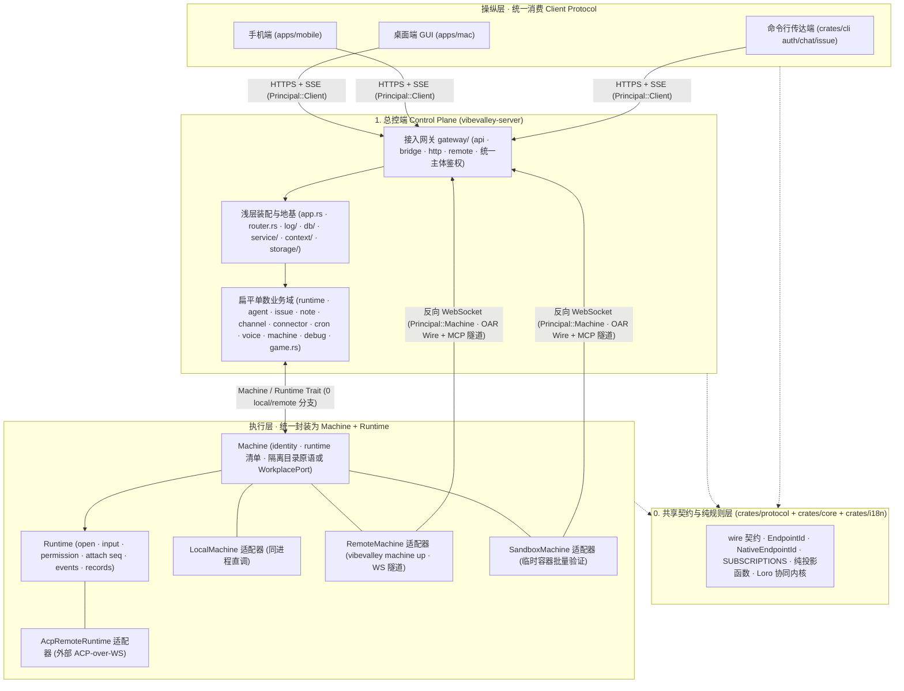
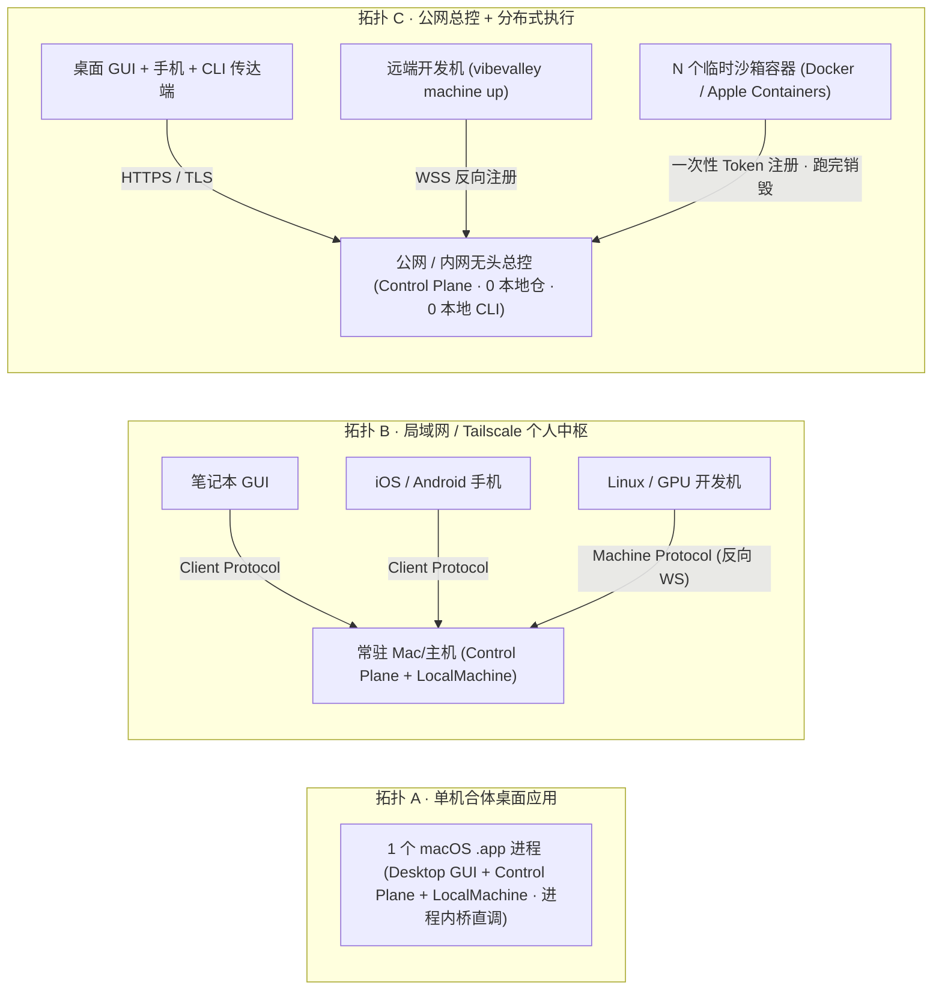
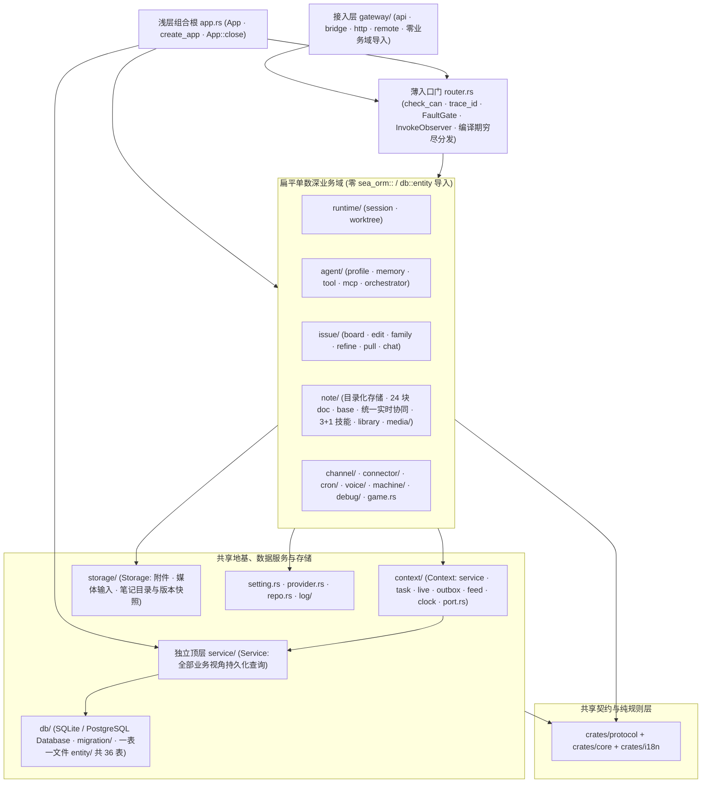
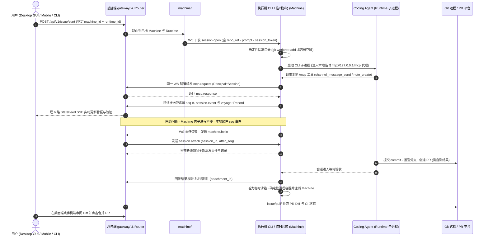

# VibeValley 整体目标架构规范

**逻辑架构应按职责边界严格拆分，物理架构可按部署形态自由合并或拆分，且不应绕过逻辑边界。**

本文规定 VibeValley 的目标逻辑与物理架构、部署拓扑、模块边界收敛蓝图、主体鉴权模型、跨边界协议与三阶段迁移路径；当前系统现状见 [docs/architecture.md](docs/architecture.md)。

## 术语表

以下术语与 [docs/README.md](docs/README.md#用语) 保持一词一义：

| 术语 | 英文 / 代码标识 | 唯一含义 |
|---|---|---|
| 总控端 | `Control Plane` | 持有持久化真源、编排状态机、切片投影与主体鉴权的中枢服务 |
| 操纵端 | `Client` | 供人、脚本或 CI 查询状态并向总控端发出命令的客户端 |
| 执行层 | `Execution Layer` | 由 `Machine` 与 `Runtime` 组成的代码执行抽象层 |
| 机器 | `Machine` | 物理机、虚拟机或临时容器，持有本地文件系统、仓库、隔离目录与 `Runtime` 清单 |
| 引擎 | `Runtime` | 归属于某台 `Machine` 的编码代理实现（`claude`、`codex`、`acp`、`vibevalley`） |
| 任务 | `Issue` | 看板中的一条工作单元，包含状态、交付方式与验收标准 |
| 执行会话 | `Session` | 分配给某台 `Machine` 的某 `Runtime` 运行的一轮或多轮编码会话 |
| 主助手 | `Orchestrator` | 运行在总控端编排层、协助用户拆解与巡查任务的内建代理 |
| 工作区 | `Workplace` | 仓库与 Git 工作树的磁盘隔离环境 |
| 改动 | `Changes` | 任务分支或工作树产生的提交、Diff 与冲突摘要 |
| 轨迹 | `Trajectory` | `SessionEvent` 组成的结构化执行记录 |
| 数据服务 | `Service` | 独立顶层 `crates/server/src/service/` 聚合的业务视角持久化查询层（挂于 `Context::service`） |
| 切片 | `Slice` | 按业务域切分的 6 路状态投影（`board`、`sessions`、`collab`、`inbox`、`ops`、`farm`） |
| 主体 | `Principal` | 通过网关鉴权后的调用身份（`Client`、`Machine`、`Session`） |

---

## 1. 逻辑架构与物理架构解耦

### 1.1 逻辑架构总图

逻辑架构分为 4 个单向依赖平面：共享契约层（`Protocol`）、操纵层（`Client`）、总控层（`Control Plane`）与执行层（`Execution Layer`）。



### 1.2 物理部署拓扑（合并 vs 拆分）

物理架构决定「进程怎么打包、跨进程怎么通信」，逻辑架构决定「谁持有状态、谁调谁」。两者之间仅通过传输适配器切换。



> [!IMPORTANT]
> **逻辑边界不可绕过**：在拓扑 A 的单机合体模式中，桌面宿主应只替换传输实现（用 `gateway/bridge/` 与本地 trait 替代 HTTP / WebSocket），不应在业务或视图中直接访问 `Control Plane` 私有业务域（如具体的 `voice/`、`agent/` 或 `issue/` 内部结构体）。

| 部署拓扑 | 物理进程合并方式 | 通信媒介 | 适用场景 |
|---|---|---|---|
| **拓扑 A：单机合体应用** | `Desktop GUI` + `Control Plane` + `LocalMachine` 同进程启动 | 进程内桥（`gateway/bridge/`）+ 内存 trait 直调 | 双击即用的本地个人桌面模式，本机 Git 提交与 Diff 零延迟 |
| **拓扑 B：局域网个人中枢** | 一台主机运行 `Control Plane + LocalMachine`；其余设备独立运行 | 局域网 / Tailscale HTTPS + 反向 WS | 多台电脑加手机协同，算力仍在个人设备之间共享 |
| **拓扑 C：公网总控 + 分布式执行** | `Control Plane` 独立部署于服务器；`Desktop GUI`、`Mobile`、`CLI`、`Machine`、`Sandbox` 全部分离 | 公网 TLS（`HTTPS` + `WSS`） | 团队或个人 24 小时在线总控、异地开发机调度与批量沙箱验证 |

---

## 2. 顶层平面职责边界矩阵

| 逻辑平面 | 物理载体 | 应负责（Owns） | 不应负责（Does NOT Own） | 对外唯一端口 |
|---|---|---|---|---|
| **总控端 `Control Plane`** | [crates/server](crates/server/src/lib.rs) | 持久化单一真源（`db/` + `service/`）、`Outbox`、`LiveState`、6 路 `StateFeed` 投影、任务队列与依赖推进、频道投递、主助手轮次、笔记目录与统一实时协同、记忆持久化、三类 `Principal` 鉴权、`machine/` 注册表 | 具体的子进程管理、远端宿主机文件读写、UI 组件树排版 | `gateway/api/`（含 `Router` 与 `GatewayPorts`）及单一 HTTP/WS 网关（`gateway/http/` + `gateway/remote/`） |
| **桌面端 GUI `Desktop`** | [apps/mac](apps/mac/Cargo.toml) + [apps/mac/ui](apps/mac/ui) | GPUI 原生窗口、工作台页面、本地终端（`terminal`）、3D 纸雕农场渲染（`diorama`）、可选「单机合体启动器」与可选连接远端总控端 | 业务规则计算、擅自改写服务端持久化状态、越过协议直调服务端内部业务域 | `Client Protocol`（连远端总控端）或 `gateway/bridge/` + 进程内主机端口 |
| **手机端 `Mobile`** | [apps/mobile](apps/mobile) | iOS / Android 移动界面（收件箱、频道、会话、任务）、设备配对、Keychain / Keystore 凭据存储、折叠屏双栏自适应 | 任何服务端状态存储、本地模型或 CLI 执行 | `Client Protocol`（`@vibevalley/protocol/remote`） |
| **命令行 `CLI`** | [crates/cli](crates/cli/src/main.rs) | 1）`Client` 模式：经认证向总控端查询、创建任务、频道发言与提交笔记版本；2）`Machine` 模式：在执行机上探针 CLI、维持反向 WS、驱动子进程 | 总控端全量状态镜像、多用户看板 UI 呈现 | `Client Protocol`（模式 1）与 `Machine Protocol`（模式 2） |
| **执行层 `Execution Layer`** | `Machine` + `Runtime`（含 [crates/runtime/src/oar](crates/runtime/src/oar/mod.rs)） | `Machine` 在线注册、会话持久化存活、工作目录预置与清理、驱动 `claude`/`codex`/`acp` 子进程、回传事件与轨迹、本地 MCP 代理隧道 | 任务优先级队列、频道受众路由、用户账号或跨机器授权策略 | `Machine` trait 与 `Runtime` trait |

---

## 3. 子模块划分与详细边界规范

### 3.1 共享契约与纯规则层

| 子模块 | 路径 | 应负责（Owns） | 不应负责（Does NOT Own） | 当前边界缺口与收敛目标 |
|---|---|---|---|---|
| **协议契约源** | [crates/protocol](crates/protocol/src/contract/mod.rs) | 全部线上结构体、`ENDPOINTS`、`NATIVE_ENDPOINTS`、`SUBSCRIPTIONS` 权限表、`BizCode`、`home.rs`、TS 声明生成器；笔记收敛为 3+1 `NoteType` 原语（`doc`/`base`/`canvas`/`media`）与 24 块 `BlockKind` | 业务执行逻辑、数据库建表、网络客户端 | 将桌面专有 `contract/host.rs` 收归 `host` feature，避免 CLI 与移动端编译背负桌面外壳类型 |
| **TS 边界编解码** | [packages/protocol](packages/protocol) | Rust 生成的类型、`api.ts`、`client.ts`、运行期边界 Zod Schema、`remote/transport.ts`（纯 Fetch + SSE 续读） | UI 状态缓存、平台持久化存储 | 保持与 Rust `note` 契约单源同步 |
| **纯状态、规则与协同内核** | [crates/core](crates/core/src/lib.rs) | 纯投影函数（`projection.rs` 6 路切片）、`SliceMask`、任务状态迁移校验、收件箱（`inbox.rs`）、定时到期计算（`cron/`）、笔记解析投影（`note/`）与内容平面 Loro 协同内核（`collab/`：`PresenceHub` 与 `CollabDoc`） | 任何 I/O、时间系统调用、网络请求、数据库访问 | 多客户端不同语言时，将切片文案改为结构化词典键并在客户端本地化 |
| **多语言词典** | [crates/i18n](crates/i18n/src/lib.rs) + [packages/i18n](packages/i18n) | 中英双语词典查询与参数插值（对用户文本，含 3+1 原语笔记名称与摘要） | 业务逻辑与提示词正文（提示词正文归 `crates/server/assets`） | 边界清晰，维持现状 |

### 3.2 总控端扁平单数架构与无环 DAG（`Control Plane`）

总控端不再按 `work/`、`team/`、`collab/`、`content/`、`skin/`、`infra/` 人工嵌套，改为扁平单数顶层目录 + 浅层组合根 `create_app(config) -> App` + 薄入口门 `router.rs` + 独立顶层 `service/` + 一表一文件 `db/entity/`（36 表），全部模块构成严格无环 DAG：



#### 3.2.1 跨域通信与数据边界硬规矩

| 边界 | 唯一机制 | 硬规矩 |
|---|---|---|
| **持久化读写** | 独立顶层 `crates/server/src/service/`（`Service`，挂载于 `ctx.service`） | `crates/server/src/db/entity/` 严格一表一文件（`<table_name>.rs`，共 36 表）；**`crates/server/src/{db,service}/` 之外零 `sea_orm::` 与 `db::entity` 导入** |
| **入口分发** | `router.rs`（`Router` 编译期穷尽 `match`）+ `GatewayPorts` | 零运行时 handler `HashMap` 与 `attach_*` 晚绑定槽位；`gateway/` 不导入任何业务域 |
| **状态广播与异步因果** | 同事务写 `Outbox` + `ctx.mark_dirty(SliceMask)` → `StateFeed` 单航班纯投影；瞬态流与农场特效进 `LiveState` | 零内存影子库、零启动重放水合、零 `EventBus` |
| **笔记目录与统一实时协同** | `storage/` 托管 `<storage>/note/<note_id>/{manifest.json,structure/,asset/}`，6 张表（`note`、`note_version`、`note_collab`、`note_change`、`note_suggestion`、`note_link`）覆盖 3+1 `NoteType` 原语 | 全类型支持多人 + 多 Agent Loro 实时协同、在场、按 `origin` 历史、评审建议与双向链接图谱（详见 [Note](docs/subsystems/note.md)） |

#### 3.2.2 静态防退化门禁

静态边界检查由 `cargo xtask audit`（[xtask/src/boundaries.rs](xtask/src/boundaries.rs) 与 [xtask/src/ratchets.rs](xtask/src/ratchets.rs)）守护：

1. 扫描 `crates/server/src/gateway/`：禁止导入任何业务域模块，只允许依赖 `router.rs` 与 `GatewayPorts`。
2. 扫描 `crates/server/src/`：除 `db/` 与 `service/` 之外禁止任何 `sea_orm::` 或 `crate::db::entity` 导入。
3. 扫描 `crates/server/src/` 模块导入图：拓扑排序确保零有向环，破环统一收口至 `context/` 的 `port.rs`。
4. 守住异步并发棘轮（`SERVER_BLOCK_ON_CEILING` 仅保留同步宿主与启动边界）。

#### 3.2.3 总控端核心模块边界表

| 模块 | 职责（Owns） | 不负责（Does NOT Own） |
|---|---|---|
| **`main.rs`、`app.rs`、`router.rs`** | `log::init` → `create_app(config) -> App` → `gateway::serve` 浅层装配；`App::close()` 统一停机；`Router` 鉴权、`trace_id` span、`FaultGate`、`InvokeObserver` 与 `EndpointId` / `NativeEndpointId` 编译期穷尽分发 | 具体业务规则或直连 SQL |
| **`log/`、`context/`、`storage/`** | 统一日志与跨任务 span（`log/`）；共享上下文 `Context`（`service`、`task`、`live`、`outbox`、`feed`、`clock`）、`error.rs`、`http.rs`、`text.rs`、`port.rs`；统一对象与作品目录存储 `Storage` | 业务域编排或向上导入业务域 |
| **`db/` 与独立顶层 `service/`** | `db/` 管双后端 `Database`、`migration/` 与严格一表一文件 `db/entity/<table_name>.rs`（36 表）；`service/`（`Service`）管全部业务视角持久化查询与事务性 `Outbox` 写入 | 协议鉴权、HTTP/WS 传输或前端切片展示逻辑 |
| **`gateway/{api,bridge,http,remote}`** | 窄契约与 `GatewayPorts`、GPUI 进程内桥、Axum HTTP/SSE/`/mcp`/`/api/v1/attachment/{id}`/`/api/v1/machine/ws` 网关、默认关闭的受认证远程监听门 | 导入任何业务域模块或直连数据库 |
| **`runtime/`、`machine/`、`issue/`、`agent/`** | 执行会话与 worktree（经 `SessionDriver` 与 `agent/` 解耦）；动态 `Machine` 注册路由；任务板、父子任务、起草、PR 与话题；角色档案、记忆、工具、MCP 与主助手 | 直接调用 `sea_orm::` 或绕过 `ctx.service` 写表 |
| **`note/`** | `storage/` 笔记目录生命周期、24 块 `doc` 与多维库 `base`、统一多人/多 Agent 实时协同层（`note_collab`、`note_change`、`note_suggestion`、`note_link`、`PresenceHub`）、3+1 `NoteType` 双语技能，以及并列的 `library` 与 `media/` | 直接调用 `sea_orm::` 或绕过 `ctx.service` 写表 |
| **`channel/`、`connector/`、`cron/`、`voice/`、`debug/`、`game.rs`** | 频道受众投递、外联平台桥、定时任务、MOSS Live 实时通话与语音、门控 `DebugKit`、游戏账本与成就 | 音频硬件驱动（在 `apps/mac`）或直连 `sea_orm::` |

### 3.3 执行层子模块（`Execution Layer`：`Machine` + `Runtime`）

#### 核心抽象接口

1. **`Machine` 接口**：
   - `machine_id()`、`label()`、`platform()`（`macos` / `linux` / `container`）、`status()`（`online` / `offline` / `draining`）。
   - `runtimes()`：返回该机器当前可用的 `Arc<dyn Runtime>` 清单。
   - `prepare_workdir(spec)` / `cleanup_workdir(ref)`：在启动 `Runtime` 前创建确定性隔离目录（`git worktree` 或临时克隆）。
   - `workplace()`（可选 `Option<Arc<dyn WorkplacePort>>`）：仅本机模式返回完整本地 Diff/Merge 端口；远端与沙箱返回 `None`，代码交付一律走 PR-First（`commit` / `push` / `gh pr create`），由总控端既有 `issue/pull/` 展示改动与执行合并。
2. **`Runtime` 接口**：
   - `id()`（经路由表复合为 `machine_id + runtime_id`）、`capabilities()`、`list_models()`、`account_usage()`。
   - 固定会话协议：`open(SessionOptions)`、`input(prompt / steer / queue / abort / set_config / dispose，带幂等键 `input_id`)`、`respond(permission / interaction)`、`attach(after_seq)`、`events()`、`records()`。

#### Git 确定性动作与 Coding Agent 职责分界

> [!WARNING]
> **切勿由 Coding Agent 执行启动前目录隔离或产出原始 Diff 审查数据**：并发 Agent 共享同一工作目录会相互改脏分支，强杀时 Agent 无法清理残余目录，且模型转述的改动存在遗漏风险。

| 环节 | 归属 | 原因 |
|---|---|---|
| 启动前 `worktree add` / 失败或关闭后清理目录 | **确定性代码（`Machine`）** | 防止同仓库多任务启动踩踏，保证被强杀或超时后不遗留僵尸目录 |
| 读取原始 Diff / 变更文件 / CI 状态展示给用户 | **确定性代码（本机 `WorkplacePort` 或远端 `issue/pull/` PR 平台）** | 零 token 成本、客观准确、防止模型幻觉遮掩未提交改动 |
| 编码实现、运行测试、提交 commit、推送分支、创建 PR、按审阅意见解冲突与补修测试 | **Coding Agent（`Runtime`）** | 需要代码语义理解与自主修复，且远端 Agent 自推分支可直接接入总控端 `issue/pull/` |
| 最终合入主分支 | **本机：系统树哈希验签 + `.vibevalley/check` 后合入；远端 / 沙箱：PR Merge** | 防止审阅后又被意外篡改或绕过门禁检查 |

#### 执行层适配器子模块表

| 适配器子模块 | 运行位置 | 实现方式 | 对总控端呈现 |
|---|---|---|---|
| **`LocalMachine`** | 与总控端同进程（单机合体 / 个人中枢模式） | 包装本机 `worktree` 与 [crates/runtime/src/oar](crates/runtime/src/oar/mod.rs)，0 网络序列化 | 一台永远在 `local` 的普通 `Machine`，唯一支持免推送本地即时 Diff 与合并的节点 |
| **`RemoteMachine`** | 任意开发机 / GPU 机（运行 `vibevalley machine up`） | 反向连接总控端 WS，探针本机 `claude`/`codex`/`acp`，用本地 `oar` 驱动子进程并把事件按 `seq` 写盘缓冲支持断线续读；本机起临时 `127.0.0.1:<port>/mcp` 经同一 WS 隧道回调总控端 | 一台与本机完全平权的 `Machine`；下线时注册表置为 `offline`，但已启动的远端会话继续运行等待重连 |
| **`SandboxMachine`** | Docker / Apple Containers / 云沙箱（批量验证与赛马） | 容器镜像内置轻量 `vibevalley` 二进制与一次性 `Principal::Machine` 令牌，启动后自动挂上指定 `Runtime` 与仓库快照，跑完测试并回传验证证据（测试日志、截图、PR 链接）后退出销毁 | 一台声明为 `ephemeral` 的 `Machine`，任务完结自动注销并清理凭证 |
| **`AcpRemoteRuntime`** | 外部独立暴露标准 ACP-over-WS 的 Agent 服务 | 在总控端或 `Machine` 内将远程 JSON-RPC 2.0 ACP 流适配为标准 `oar::Session` | 当作单个独立 `Runtime` 挂载于某台虚拟或宿主 `Machine` 之下 |

### 3.4 操纵层子模块（`Desktop GUI`、`Mobile`、`CLI`）

| 客户端 | 内部子模块 | 应负责（Owns） | 不应负责（Does NOT Own） | 当前边界整理目标 |
|---|---|---|---|---|
| **桌面端 GUI (`apps/mac`)** | 1）`shell`（`WorkspaceProjects` / `HostChrome` / `NativeOverlays`）；2）`hosted`（单 `workbench` QuickJS 宿主）；3）`native`（纯 GPUI `MarkdownPane`、终端、文件浏览、像素农场）；4）`embedded`（可选单机合体启动器） | 多窗口与工作区面板编排；连接到本地或远端总控端；本地文件与终端展示 | 自己实现业务状态机；直调服务端业务域模块 | `apps/mac/ui/design/` 脱离 `infra/` 倒置，抽为跨桌面/移动共享原语；连接方式抽象为 `ClientTransport` 支持切换本地内嵌与远端总控端 |
| **手机端 (`apps/mobile`)** | 1）`infra`（`HttpRemoteTransport` + `SecureStorage` + `lifecycle` / `Notifications`）；2）`features`（4 标签页 + `PairScreen`）；3）`design`（与桌面原语逐步对齐） | 移动交互、后台挂起 SSE 与前台 `Last-Event-ID` 瞬间续读、折叠屏与 iPhone Duo 主从自适应双栏 | 本机直连执行引擎、桌面像素场景与多窗工作区布局 | Token 迁入 iOS Keychain / Android Keystore；接通 `nsh` 的 `lifecycle`、`wakeCount`、`Notifications` 与复用 `<List>` |
| **命令行 (`crates/cli`)** | 1）`client`（`Principal::Client`：`auth`、`issue`、`chat`、`session`、`note`、`pull`）；2）`machine`（`Principal::Machine`：`up`、`status`、`doctor`） | **传达端**：人在远端终端、CI 流水线或代理内部向总控端发出结构化指令与回报；**执行宿主机端**：在有 Coding Agent 的机器上以统一协议接通总控端 | 直接读写总控端数据库，或维护一套独立于总控端的任务数据库 | 保持 `auth` 持久化 Bearer 凭据（`auth.json`，`0600`）与 `machine` 子命令域承载反向 WS 守护与 `oar` 驱动 |

---

## 4. 身份、安全与跨边界协议规范

### 4.1 三类主体（`Principal`）与权限边界

总控端不再区分「本地回环特权门」与「Tailscale 远程门」，所有访问一律携带身份主体（单机合体模式启动时自动注入同进程生成的 `Principal::Client` 本地所有者凭据）：

| 主体类型 | 典型持有者 | 认证方式与作用域 `scope` | 允许的通道与动作 | 严格禁止的越权行为 |
|---|---|---|---|---|
| **`Principal::Client`** | 桌面 GUI、手机 App、`vibevalley auth` CLI | 一次性配对码交换的 Bearer 令牌（或内嵌同进程令牌）；按设备分 `owner` / `remote:client` | 查询 6 路 `Slice`、调用业务 RPC、订阅授权的 SSE（频道、作品实时协同/建议/在场、会话与工单）、按权读取签名/Range 附件、验收与合并 | 冒充执行机上报任意 `Machine` 状态或伪造运行轨迹 |
| **`Principal::Machine`** | `LocalMachine`、`RemoteMachine` CLI、临时 `SandboxMachine` | 机器级长期令牌（`scope: remote:runtime`）或沙箱一次性短期令牌（`ttl` 过期失效） | 建立 `Machine` 反向 WS；注册/更新本机 `Runtime` 清单；领受分配给自己的会话指令；推送 `SessionEvent` 与检验产物 | 读写总控端配置 `setting.*`、查看非本机任务或跨机越权拉取他机仓库 |
| **`Principal::Session`** | 运行中的 `claude`/`codex`/`acp` 子进程 | 会话开启时签发的短期会话 JWT/随机令牌（绑定唯一 `session_id` + `issue_id`） | 调用 `/mcp`（本地机器经代理转发至 WS 隧道）执行已授权的模型工具与读取授权范围内的 `vv://` 资源 | 更改全局配置、吊销设备、跳过门禁关闭他人任务 |

### 4.2 两条标准线协议

1. **Client Protocol（面向桌面 GUI / Mobile / CLI 传达端）**：
   - `POST /api/v1/{op}`：强类型 RPC 命令，统一经 `Router` 校验 `Principal` 与端点 `can`。
   - `GET /api/v1/slice/{name}`：支持快照与 `WatchStream` SSE（携带 `Last-Event-ID` 断线续读），共享 `Arc<str>` 零克隆输出。
   - `GET /api/v1/subscribe/{name}` 与 `issue/watch/{id}`：显式携带 `CallerContext` 并在 `Router` 按协议声明的 `can` 统一鉴权（`channel.follow`、`channel.reports`、`note.follow`、`note.suggestion.follow`、`note.presence.follow`、`session.watch`、`issue.watch`）。
   - `GET /api/v1/attachment/{id}`：校验 `CallerContext`，支持 HTTP `Range` 与短时效签名媒体 URL 分块流式传输。
2. **Machine Protocol（单条反向双向 WebSocket，面向一切执行机与沙箱）**：
   - **注册与保活帧**：`machine.hello`（平台、能力、工作区支持情况）、`machine.inventory`（可用 `Runtime` 与模型列表全量上报）、`machine.ping`/`pong`。
   - **固定对话帧（OAR Wire / ACP 对齐）**：`session.open`（携带 `runtime_id`、`workdir_spec`、`system_prompt` 与会话级 MCP 配置）、`session.input`（`prompt`/`steer`/`queue`/`abort`/`set_config`/`dispose`，带幂等 `input_id`）、`session.respond`（权限与交互应答）、`session.attach(session_id, after_seq)`（断线重连无损补齐）、`session.event` 与 `session.record`。
   - **MCP 反向隧道帧**：`mcp.request` / `mcp.response`（将远端子进程访问本地临时 `127.0.0.1/mcp` 的 JSON-RPC 请求原路透传给总控端 `agent/mcp/`）。
   - **产物与工作区帧**：`note.upload` / `attachment.fetch(id)` 与轻量目录隔离 `worktree.prepare` / `worktree.cleanup`（不包含远程全量 Diff / 本地 Merge RPC）。

### 4.3 跨边界资源 ID 化规则

> [!WARNING]
> **跨边界禁用宿主机绝对路径**：控制面与多台执行机不在同一文件系统时，任何跨平面载荷（RPC、Slice、Machine Protocol）不应直接传递未解析的本地文件系统路径。

- 引擎路由一律传递 `(machine_id, runtime_id)`。
- 仓库与任务工作目录一律传递 `repo_ref`（由所在 `Machine` 解析到本地磁盘或容器挂载路径）。
- 附件与作品目录资源一律传递内容寻址 `storage_id` / `attachment_id` 与作品目录内 `asset/` 相对路径，客户端按流式 HTTP 拉取，执行机经同一条反向通道按需落入会话临时目录。

---

## 5. 端到端核心时序与状态机

### 5.1 跨端派活、执行、断线续读与 PR 验收完整时序



### 5.2 执行机连接状态与会话独立生命周期

```mermaid
stateDiagram-v2
  [*] --> Connecting: 持有 Principal::Machine 发起反向 WS 认证
  Connecting --> Online: 鉴权通过并上报 machine.inventory
  Online --> Disconnected: 网络超时或连接中断 (不中止已启动 Agent)
  Disconnected --> Online: 自动重连成功 · 触发 session.attach(after_seq) 补发
  Disconnected --> Offline: 超过宽限心跳窗口 (看板标记机台失联)
  Offline --> Online: 恢复连线重报清单
  Online --> Draining: 收到下线或沙箱任务终结信号 (拒绝新 session.open)
  Draining --> Terminated: 现有运行会话回传完毕并释放目录
  Terminated --> [*]
```

---

## 6. 落地路线与验收准则

### 6.1 分阶段路线

1. **第一刀 — 服务端扁平单数架构与笔记目录化统一协同直接切换（已落地）**
   - 落地 `main.rs` → `create_app(config) -> App`、薄 `router.rs`、统一 `log/`、严格一表一文件 `db/entity/<table_name>.rs`（36 表）、独立顶层 `service/`（`Service` 挂于 `Context::service`，`{db,service}/` 外零 `sea_orm::` 与 `db::entity` 导入）、`storage/` 与 `gateway/` 隔离（[地基](docs/subsystems/foundation.md)、[架构](docs/architecture.md)）。
   - 收敛为 `<storage>/note/<note_id>/{manifest.json,structure/,asset/}` 目录化存储 + 6 表统一多人/多 Agent 实时协同与双向链接图谱 + 3+1 `NoteType` 原语渐进披露技能（[Note](docs/subsystems/note.md)）。
   - 启用 `cargo xtask audit`（[xtask/src/boundaries.rs](xtask/src/boundaries.rs) 与 [xtask/src/ratchets.rs](xtask/src/ratchets.rs)）守住扁平无环 DAG、`gateway/` 隔离与 `{db,service}/` 数据访问边界。
2. **第二刀 — 统一 `Machine` + `Runtime` 执行层与无头部署**
   - 完善 `LocalMachine` 与 `RemoteMachine`（`vibevalley machine up`、本地 `127.0.0.1/mcp` 代理隧道、断线 `after_seq` 续读与 `input_id` 幂等）。
   - 非本地 `Machine` 默认走 PR-First 工作流，经 `issue/pull/` 完成 Diff 审查与合并；桌面端支持切换内嵌与远端总控端。
3. **第三刀 — 临时沙箱（`SandboxMachine`）与批量自动验证**
   - 在 `Machine` 抽象之上接入 `SandboxProvider`（Docker / Apple Containers / 云容器），签发短期一次性 `Principal::Machine` 令牌，支持同题多模型赛马（Best-of-N）与评测合流。

### 6.2 架构落地验收准则

1. 运行单机合体模式（拓扑 A）：断开公网与 Tailscale 后，启动 `apps/mac` 验证核心状态、本机派单、即时 Diff 与本地合并均正常完成，且宿主零业务域穿透。
2. 运行独立总控端（拓扑 C）：在 0 本地仓库、0 本地编码 CLI 的 Linux 环境启动 headless `vibevalley-server` 并挂载鉴权；验证 `Desktop GUI`、`apps/mobile` 与远端 `CLI Client` 均能经同一套端口登录、收看 6 路切片与发送指令，且越权订阅与无令牌附件访问返回 `401` / `403`。
3. 验证统一执行协议：用另一台装有 Coding Agent 的机器执行 `vibevalley machine up` 接入总控端，向其分派任务并在执行中途切断网络 10 s 后恢复；确认任务未中断、事件按 `seq` 完整续传、MCP 工具经双向 WS 隧道成功回调频道，最终由 Agent 提交 PR 并在总控端审查合入。
4. 运行 `cargo xtask audit` 与全仓验证：确认 `crates/server` 存在 0 组循环依赖、0 条 `gateway/` 业务域导入、0 处 `{db,service}/` 外的 `sea_orm::` 或 `db::entity` 导入。
