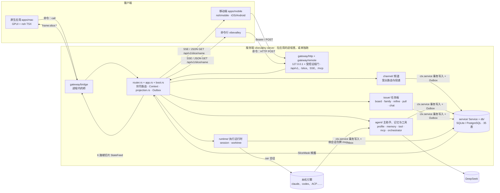

# 架构

## 总图

系统交互走两条线：

- **命令**：接口表是 `vibevalley-protocol` 的 `ENDPOINTS`（`crates/protocol/src/contract/endpoints.rs`）与原生端点表 `NATIVE_ENDPOINTS`（`crates/protocol/src/native.rs`）。原生应用的页面经 `gateway/bridge/` 按操作名调（[客户端](docs/subsystems/app.md#桥)），命令行与移动端经 `gateway/http/` 的 `POST /api/v1/<路径>` 调；两条路进入同一个薄入口门 `Router`（`router.rs`），携带调用上下文 `CallerContext` 并按 `EndpointId` / `NativeEndpointId` 编译期穷尽分发到对应业务域处理器。执行会话通过服务端的 `/mcp` 调工具（[频道](docs/subsystems/channel.md)）。
- **状态**：持久化状态以数据库及独立顶层数据服务 `service/`（`Service`，挂载于 `Context::service`）为唯一真源。每次事务写入返回脏切片掩码 `SliceMask`（外部投递在同一事务写入 `Outbox`），由 `StateFeed` 结合 `LiveState` 中的实时运行流与 `crates/core/src/projection.rs` 纯投影函数按需产出 6 路独立切片（`board`、`sessions`、`collab`、`inbox`、`ops`、`farm`）：桥上是 `frame:slice:<name>`，HTTP 上是 `GET /api/v1/slice/{name}`（SSE 或 JSON 快照）。

桌面宿主与服务端运行于 macOS；主 HTTP 门只听 `127.0.0.1`，另提供默认关闭的受控远程监听门（绑定 Tailscale IPv4 `100.64.0.0/10` 或开发用回环地址），供独立原生移动应用 `apps/mobile`（iOS 优先、Android 就绪）经一次性配对与持久 Bearer 令牌访问（[受控远程访问](docs/subsystems/core.md#受控远程访问)、[移动端与远程访问](docs/subsystems/app.md#移动端与远程访问)）。

## 分层

仓库目录结构见根目录 [AGENTS.md](AGENTS.md#目录)。

- **契约与环境约定（`crates/protocol` → `packages/protocol`）**：服务端与客户端唯一的共享契约，以 Rust 为源：`src/contract/` 一个概念一个文件（含 5 域切片、`FarmFrame`、`debug.rs` 的 `DebugKit` 契约、`remote.rs` 的远程访问与配对契约、强类型 `EndpointId`、`crates/protocol/src/native.rs` 的 `NativeEndpointId`、带 `CAN` 的 `SUBSCRIPTIONS`，以及 GPUI 壳 ↔ 托管界面的强类型 `host.rs`：`Host*` 帧、`HostAction` 与 40 成员封闭 `HostOp`），`typescript.rs` 写出 `packages/protocol/src/<概念>/shapes.gen.ts` 与 `endpoints.gen.ts`（`cargo xtask protocol --write`）；`home.rs` 约定家目录、`server.json` 与语言；页面在边界解码用的 Zod（`schema.ts`）和带入参出参的端点表（`api.ts`）是手写的，由测试对着生成物查（[契约](docs/subsystems/foundation.md#契约规则和数据库)）；`@vibevalley/protocol/remote`（[transport.ts](packages/protocol/src/remote/transport.ts)）导出零平台依赖的纯 Web Fetch `HttpRemoteTransport`（支持 Bearer 鉴权、`Last-Event-ID` SSE 断线续读与 `vibevalley://pair` 深链解析）。
- **规则、投影与内容协同内核（`crates/core`）**：纯函数规则与切片投影层：`crates/core/src/projection.rs` 的 6 路切片投影（`board`、`sessions`、`collab`、`inbox`、`ops`、`farm`）、任务状态与阶段和可执行动作、收件箱（`crates/core/src/inbox.rs`）、简报与起草、农场的画面（[核心状态](docs/subsystems/core.md)）、定时任务规则（`cron/`），以及内容平面 Loro 实时协同内核（`crates/core/src/collab/`：`PresenceHub` 与 `CollabDoc`，支撑全类型多人/多 Agent 实时共编）。
- **服务与网关（`crates/server`）**：扁平、全单数、浅层装配的 Rust 服务端：
  - **入口与浅层装配**：`main.rs` → `log::init(...)` → `create_app(config).await?` → `gateway::serve(...)`；`app.rs` 提供浅层不可变组合根 `App`、`create_app(config)` 与 `App::close()`；`boot.rs` 收拢运行时构建、主助手落座监听、频道/作品与农场事件桥装配；`router.rs` 与 `router/glue.rs` 构成薄入口门 `Router`，收拢 `check_can`、`trace_id` span、`FaultGate`、`InvokeObserver`、订阅表鉴权以及对全部 `EndpointId` / `NativeEndpointId` 的编译期穷尽分发与端点胶水，非 RPC 流与端口拆出为薄 `GatewayPorts`；`projection.rs` 专注纯 6 路切片投影（`SliceSources`、`project_slice_json`、`finish_boot_and_start_feeds`）；`debug_sources.rs` 承载 DevTools 诊断源（`ServerDebugSources`、`build_debug_kit`）。
  - **共享地基、数据服务与可观测性**：`crates/server/src/log/` 统一日志初始化（`init`）、跨任务 span 传播（`span`、`spawn_traced`、`spawn_blocking_traced`）与 `observer`（`InvokeObserver`）；`crates/server/src/db/` 收拢双后端 `Database`、`migration/` 与严格一表一文件的 `db/entity/<table_name>.rs`（全仓共 35 张表实体）；**独立顶层 `crates/server/src/service/`** 提供业务视角持久化查询聚合 `Service`（`outbox`、`storage`、`channel`、`connector`、`artifact`、`session`、`issue`、`memory`、`cron`、`remote`），**硬规矩：`crates/server/src/{db,service}/` 之外禁止出现任何 `sea_orm::`、`db::entity` 或直接 `crate::db::` 导入（统一经 `crate::service::` 引入 `DbError`、`Tx`、`DatabaseConfig`、`internal_db`）**；`crates/server/src/context/` 提供共享 `Context`（`ctx` 持有 `service: Arc<Service>`、`task: TaskGroup`、`live: Arc<LiveState>`、`outbox: Arc<Outbox>`、`feed: Arc<StateFeed>`、`clock: SharedClock`）以及 `error.rs`、`http.rs`、`text.rs` 与最小破环 `port.rs`；`crates/server/src/storage/` 统一文件、附件、媒体输入与作品目录（`<storage>/artifact/<artifact_id>/{manifest.json,structure/,asset/}`）存储（`Storage`）；顶层基础文件为 `setting.rs`、`provider.rs`、`repo.rs`。
  - **外部接入层（`crates/server/src/gateway/`）**：整合 `api/`、`bridge/`、`http/` 与 `remote/`，提供进程内桥、本机回环 Axum HTTP/SSE 门、`/mcp`、带鉴权与 HTTP `Range` 分块流式的 `/api/v1/attachment/{id}`，以及默认关闭的受认证远程监听门（Tailscale 状态探测、5 分钟一次性配对码、按 `scope` 区分的 SHA-256 哈希 `vv_dev_*` 令牌校验与 6 类 `RemotePlatform`）；`gateway/` 只依赖 `Router` 与 `GatewayPorts`，不导入任何业务域模块。
  - **扁平深业务域**：全部业务域平铺于 `crates/server/src/` 顶层，目录与对外结构体一律单数（深业务域为 `<domain>::Service`，单概念与基础模块为 `Storage`、`Setting`、`Provider`、`Repo`、`Game`）：`runtime/`（`session/` + `worktree/`，纯执行运行时，经 `SessionDriver` 与 `agent/` 解耦，不含农场皮肤逻辑）、`agent/`（`profile/`、`memory/`、`tool/`、`mcp/`、`orchestrator/`）、`issue/`（`board`、`edit`、`family`、`refine`、`pull/`、`chat`）、`artifact/`（`storage/` 作品目录化存储 + 统一多人/多 Agent 实时协同 `collab` + 12 类 `ArtifactType` 渐进披露技能 `types` + 并列 `library` 与 `media/`，仅保留 5 张作品表并删除旧 `block`/`entry` 引擎），以及 `channel/`、`connector/`、`cron/`、`voice/`、`machine/`（薄 WebSocket 与持久化适配器，委托 `vibevalley_runtime::machine` 执行远端 OAR 代理）、`debug/`（仅 `VIBEVALLEY_DEBUG=1` 启用 `DebugKit`、故障注入与纯 Rust ZIP 诊断包导出）、`game.rs`（独立持有像素农场瞬态工位状态 `plays`，仅由 `boot.rs` 的会话与实时事件桥驱动）、`fake/`；无环依赖、分层 DAG 与 `no-db-outside-service` 边界由 `cargo xtask audit` 与 `cargo xtask uml arch --strict` 静态守住（[xtask/src/boundaries.rs](xtask/src/boundaries.rs)）。
- **运行与引擎（`crates/runtime`、`crates/rich`、`crates/engines`）**：`crates/runtime` 提供进程级共享 Tokio 运行时 `rt`（`vibevalley_runtime::rt::{handle, spawn, block_on}`，工作线程 `vibevalley-io-{n}`），合拢 `oar/`（Claude Code、Codex、ACP、自研 `vibevalley` 与 scripted，含基于 `arc-swap` 的零开销 `OarObserver` 钩子与 `oar-voyage/3` 记录流）、`machine/`（`LocalMachine` 与 `RemoteMachine` OAR 代理）与自研 `agent/`（经工作区 `reqwest` 与 `backon` 接 DeepSeek，[自研 agent](docs/subsystems/brain.md)）；`crates/rich` 基于 `crates/engines/{onig,pele,shiki}` 提供原生富内容组件与文本引擎（`engine/{canvas,chart,genui,pinyin,whiteboard}`，其中 `canvas` 专注静态 JSON Canvas 1.0 SVG 渲染，交互白板编辑由 `whiteboard` 承接），[icon.rs](crates/rich/src/icon.rs) 亦作为 97 枚 reicons 矢量路径的单一事实源供 [icons.ts](scripts/gen/icons.ts) 导出给 `<Canvas>` + `Path2D` 回退。
- **存储（SQLite / PostgreSQL + 文件）**：服务端全业务表与持久执行引擎统一使用 `SeaORM` + `SeaQuery` 双后端架构，数据库基础设施收拢于 `crates/server/src/db/`（`Database`、`migration/`、严格一表一文件的 `entity/` 共 35 张表），全部业务查询收拢于独立顶层 `crates/server/src/service/`（`Service`，挂载于 `Context::service`），持久执行引擎位于 `crates/runtime/src/agent/durable/`。`Database` 按 `DatabaseConfig` 支持默认本机 SQLite `server.db` 读写分离连接池或 `--database-url` / `VIBEVALLEY_DATABASE_URL` 指定的 PostgreSQL 连接池，启动自动执行 `Migrator::up`，SQLite 停机执行 `PRAGMA wal_checkpoint(TRUNCATE)` / `PRAGMA optimize`；`outbox_item`、`seq_counter`、`issue`、`session` 系列、`channel*`、5 张作品表（`artifact`、`artifact_version`、`artifact_collab`、`artifact_change`、`artifact_suggestion`）、媒体表与远程访问表（`remote_config`、`remote_device`）都在同一数据库中。
- **客户端（`apps/mac`、`apps/mobile`、`crates/cli`）**：macOS 原生应用带着服务端（外壳拆为 `apps/mac/src/shell/` 九个文件，含 `VIBEVALLEY_DEBUG=1` 门控的底边悬浮胶囊、`⇧⌥D` 浮层与独立拆窗 `devtools.rs`，独占支撑库在 `apps/mac/crates/{pixel,terminal,workspace}`），宿主只消费 `vibevalley_server::gateway::api` 窄契约而不导入任何业务域模块；工作台（`apps/mac/ui/{app,workspace,design,features,farm,infra}`，含六视图 `HostedView("devtools")` 与设置页 `/settings/connections/remote`）是 nsh 跑的 TSX，像素场景由 Rust 画（[客户端](docs/subsystems/app.md)、[农场的皮](docs/subsystems/farm.md)）；独立原生移动端 `apps/mobile/` 基于 `nsh/mobile` 提供 4 标签页（收件箱、频道、会话、任务）与 `<Canvas>` + `Path2D` 图标渲染；命令行 `vibevalley` 支持本机 `server.json` 与远程 Bearer 凭据（`auth.json`、`--server`、`--token`），提供 `vibevalley auth` 与 `vibevalley remote` 子命令。

## 核心状态

持久化数据以数据库与顶层 `service/`（`Service`）为单一真源，不维护内存影子库；实时运行状态按持久与瞬态分离，通过 `StateFeed` 投影为 6 路客户端切片（[核心状态](docs/subsystems/core.md)）：

- **事务写入 + `Outbox` + 脏掩码**：业务域通过 `ctx.service` 在同一数据库事务内提交状态变更并写入需要异步投递的 `Outbox` 条目，返回脏切片掩码 `SliceMask` 后通知 `StateFeed`。
- **瞬态进 `LiveState` 与 `game.rs`**：运行中会话的实时事件流与心跳写入 `LiveState`（`context/live.rs`），不落盘；像素农场的瞬态工位状态 `plays` 由 `game.rs` 独立持有，由 `boot.rs` 的事件桥订阅会话与实时事件更新，并在 `projection.rs` 投影 `farm` 切片时按需拼入。
- **5 域切片 + 独立 `FarmFrame`**：`StateFeed` 维护 6 路基于 `tokio::sync::watch` 的脏合并通道（`board`、`sessions`、`collab`、`inbox`、`ops`、`farm`），仅对 `SliceMask` 命中的切片做单航班合并查询并调用 `crates/core/src/projection.rs` 纯投影函数输出预编码 `Arc<str>` JSON；游戏特效只进入 `farm` 切片，静态成就列表经 `game.achievement.list` 按需查询。HTTP 门通过 `GET /api/v1/slice/{name}` 以 `WatchStream` 提供无阻塞线程的 SSE（带 `Last-Event-ID` 续读）与 JSON 快照，离线夹具与场景导出使用 `SliceBundle`。

## 事件流和接口

HTTP 门上命令走 `POST /api/v1/<路径>`，状态、事件和订阅走 SSE；全部路由、流、权限 `can`、受控远程访问与错误信封见[核心状态和接口](docs/subsystems/core.md)，每个接口的权限见生成的[能力表](docs/reference/capabilities.md)。主监听只听 `127.0.0.1`；远程监听默认关闭，显式开启后仅绑定 Tailscale IPv4（`100.64.0.0/10`）或开发用回环地址，并对每个请求强制校验 Bearer 令牌与 `Caller::Remote` 边界。

## 存了什么

数据分两层：Host（`$VIBEVALLEY_HOME`，默认 `~/.vibevalley`）和 Space（`$VIBEVALLEY_WORK_ROOT`，默认 `~/vibevalley-dev`，原生应用与独立服务端遵循同一约定），各放什么见[概念](docs/concepts.md#host-和-space)。

Host：

| 路径 | 内容 |
|---|---|
| `server.json` | 当前运行服务端的地址与 pid（命令行据此找本机服务端，`crates/protocol/src/home.rs`） |
| `auth.json` | 命令行远程登录凭据（权限 `0600`，由 `vibevalley auth login` 写入，存远程地址、设备标识与 Bearer 令牌） |
| `config.json` | 角色（主助手和执行角色）、技能书、引擎设置 |
| `agent-templates/<id>/` | 从本机导入的角色模板 |
| `settings.json` | 钥匙、AI 服务连接（权限 `0600`） |
| `server.db` | SQLite（或通过 `--database-url` / `VIBEVALLEY_DATABASE_URL` 接入 PostgreSQL），共 35 张业务表：`outbox_item`、任务、领域无关 `AgentSession`（`session`、`session_run`、`session_mailbox`、`session_event`）、定时任务（`cron`）、PR 与事件（`pull`、`pull_event`）、频道与投递队列（`channel*`）、附件、记忆、媒体任务与媒体库、作品与统一协同表（`artifact`、`artifact_version`、`artifact_collab`、`artifact_change`、`artifact_suggestion`）、远程访问配置与已配对设备哈希表（`remote_config`、`remote_device`）以及持久执行引擎表 |
| `issues/` | 任务板进程锁、引擎原始记录与结构化汇报文件 |
| `ledger.jsonl` | 游戏账本 |
| `records/` | 执行会话与主助手的 `oar-voyage/3` JSONL 原始记录流（`record_to`） |
| `conversations/` | `vibevalley` 引擎上执行会话的对话 |
| `agent/<角色 id>/` | 主助手的对话 `conversation.jsonl` 和 `MEMORY.md` |
| `attachments/`（`storage/`） | 附件、媒体输入以及按目录托管的作品实体文件与版本快照（`<storage>/artifact/<artifact_id>/{manifest.json,structure/,asset/}`） |
| `debug-bundles/` | `debug.bundle.export` 导出的脱敏诊断包（`debug-bundle-*.zip`，仅 `VIBEVALLEY_DEBUG=1`） |

Space 下：
- `repos/`：仓库的 git 仓库。
- `worktrees/`：任务分支的 git worktree。

## 配置

配置的来源、优先级、校验和配置键说明见[设置和配置](docs/subsystems/setting.md#模型和不变量)。启动流程见[客户端](docs/subsystems/app.md#怎么走)。原生应用外壳自己的项目、布局和设置另存在 `~/Library/Application Support/VibeValley/state.db`。

演进至多端分布式部署的目标逻辑架构与物理部署拓扑见[目标架构与部署拓扑](docs/architecture-topology.md)。服务端扁平化与单数架构直接切换方案见[服务端扁平化与单数架构重构](.agents/notes/proposed/architecture/2026-11-24-first-principles-server-spine.md)，作品目录化存储、统一实时协同与 12 类技能体系见[作品目录化存储、统一实时协同引擎与 12 类产品技能体系](.agents/notes/proposed/architecture/2026-11-24-artifact-unified-collab.md)。
