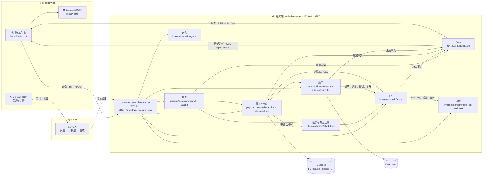

# 架构

## 总图

系统交互走三条线：

- **命令**：页面和命令行通过 HTTP `POST` 调 `VibeValleyApi`（`packages/protocol/src/api.ts` 的 `endpoints`），或经 `pkg/chord` 多路复用 `Link`（客户端 `/chord/ws` 与桌面端进程内管道）执行。帮工通过服务端的 `/mcp` 调工具（[频道](docs/subsystems/channel.md)）。
- **状态与远程执行**：服务端持有唯一的核心状态 `SpaceState`，状态每变一次产生一条事实（`Fact`），经 `GET /api/v1/state` 与 `/api/v1/live` SSE 推给页面；`pkg/chord` 负责增量折叠订阅及 `/machine/ws` 上对零密钥 `cmd/vibe-machine` 节点的反向调用、挂载同步与 `/egress` 代理（[帮工](docs/subsystems/session.md)）。
- **语音**：页面与 Agora 频道收发音频和字幕；服务端签发令牌并接入语音线路与 `/api/v1/voice/*` WebSocket 中继（[语音](docs/subsystems/voice.md)）。

## 分层

仓库目录结构见根目录 [AGENTS.md](AGENTS.md#目录)。

- **契约（`packages/protocol`）**：服务端与客户端唯一的共享契约。每个概念一个目录 `src/<概念>/`，包含 `shapes.ts`（类型）、`schema.ts`（`Codec<T.X>` 解码器）和 `api.ts`（接口行与 `Handlers`）。`src/rules/` 只放服务端与页面共用的纯函数；Go 导出结构经 `cmd/vibe-tsgen` 与 `scripts/gen/go-contract.ts` 对账；仅服务端使用的规则留在 Go 各自域里（[地基](docs/subsystems/foundation.md)）。
- **Go 五层 DAG 与拓扑（`arch_test.go`）**：严格单向依赖 `pkg/chord` ← `pkg/{contract,oar,migrate,db}` ← `internal/{config,durable,vault,machine,provider}`（同层跨子系统严禁互引）← `internal/domain/*`（19 个单数概念业务域，`internal/domain/stack/stack.go` 负责装配与恢复）← `cmd/*`。`pkg/oar` 仅依赖 Go 标准库，`cmd/vibe-machine` 隔离数据库驱动、模型 SDK、`durable`、`vault` 与 `mygo`，`github.com/egoist/mygo` 仅限于 `cmd/vibe-desktop`（[地基](docs/subsystems/foundation.md#模块与包边界)）。
- **网关与工具（`internal/domain/gateway/`、`internal/domain/stack/tools.go`）**：`gateway.go` 与 `handlers_*.go` 挂载 `/api/v1/*` 路由，`streams.go` 提供 SSE 流，`cron_runner.go` 运行定时调度循环；另挂 `/chord/ws`、`/machine/ws`、`/egress`（`vault.EgressProxy`）与独立预览 HTTP 监听（`preview_addr`）；`internal/domain/stack` 同时供助手与帮工工具调用（[核心状态](docs/subsystems/core.md)、[助手](docs/subsystems/orchestrator.md)）。
- **存储（`pkg/db` + SQLite WAL + SQLc + `pkg/migrate`）**：`durable`、`vault`、`agent`、`repo`、`game`、`issue`、`channel`、`watch`、`memory`、`pkm` 与 `gateway` 共 11 个模块的迁移对（`0001_durable`–`0011_gateway` `{up,down}.sql`）集中于 `pkg/db/migrations/`，查询集中于 `pkg/db/queries/*.sql`，由单块根目录 `sqlc.yaml` 经 `vpx scripts/gen/go-sqlc.ts` 生成 `pkg/db/generated/`（`package generated`）强类型 Go 绑定。运行时（`stack.New`）11 个持久化模块共享同一份 SQLite WAL 数据库（`vibevalley.db` / `platform.db`，迁移作用域 `platform`，全局启用 `sqlite-vec` 向量函数），由 `pkg/db.OpenPool` 提供单写连接加并发 WAL 读连接池，无分库文件（[地基](docs/subsystems/foundation.md#契约规则和数据库)）。
- **客户端与节点（`apps/web`、`cmd/vibe-desktop`、`apps/mobile`、`cmd/vibe`、`cmd/vibe-machine`）**：`apps/web` 按概念分 feature，层间单向依赖（`base` → `infra` → `state` → `ui` → `ui/domain` → `ui/pixel` → `features` → `farm`/`tree` → `app`）。MyGo 原生桌面壳（`cmd/vibe-desktop`）、浏览器与手机壳（Expo WebView）共用同一份页面（[客户端](docs/subsystems/app.md)）；`cmd/vibe-machine` 作为零密钥远程节点外连控制面（[帮工](docs/subsystems/session.md)）。

## 核心状态

`SpaceState`（`packages/protocol/src/core/shapes.ts`）汇总农场实时状态：通话、在场会话（助手与帮工）、最近 100 个频道和串、开着的与最近关闭的 50 张工单、定时任务、commit 数、游戏进度与地块动作（[核心状态](docs/subsystems/core.md)）。

- **唯一修改入口**：核心状态折叠与投影集中在 `internal/domain/gateway/projection.go`（与 `overlay.go`），页面和客户端只读帧、不折叠。
- **派生帧 `StateFrame`**：`GET /api/v1/state` 由 `internal/domain/gateway/streams.go` 推送，并填入工单阶段、可执行动作与界面派生视图；持久层不保存派生文案。

## 事件流和接口

命令走 `POST /api/v1/<路径>`，状态、事件和订阅走 SSE；全部路由、流、权限 `can` 和错误信封见[核心状态和接口](docs/subsystems/core.md#sse-流和其余路由)，每个接口的权限见生成的[能力表](docs/reference/capabilities.md)。从外面来的只经「连接到本机」那道门（[连接到本机](docs/subsystems/lan.md)）。

## 存了什么

数据分两层：Host（`$VIBEVALLEY_HOME`，默认 `~/.vibevalley`）和 Space（`$VIBEVALLEY_WORK_ROOT`，默认 `~/vibevalley-dev`），各放什么见[概念](docs/concepts.md#host-和-space)。

Host：

| 路径 | 内容 |
|---|---|
| `.vibevalley.lock` | 家目录租约（记录持有进程的 pid） |
| `server.json` | 当前运行服务端的地址与 pid（供 CLI 发现） |
| `config.json` | 档案（助手和帮工）、技能书、农机设置 |
| `agent-templates/<id>/` | 从本机导入的档案模板（`agent.json`、`persona.md`） |
| `settings.json` | 密钥、语音设置、记忆来源配置（权限 `0600`） |
| `vibevalley.yaml` | 可选静态配置文件（由 `internal/config` 经 Koanf 加载，[设置和配置](docs/subsystems/setting.md#静态配置appconfig)） |
| `vibevalley.db` | 统一平台 SQLite WAL 数据库（`platform` 迁移作用域，11 个持久化模块共享单库与 `sqlite-vec`） |
| `events/` | 会话轨迹事件持久化数据 |
| `logs/` | 帮工运行日志与服务端日志 |

Space `$VIBEVALLEY_WORK_ROOT`（默认 `~/vibevalley-dev`）下：
- `repos/`：仓库的 git 仓库。
- `worktrees/`：工单分支的 git worktree（`worktrees/<仓库>.<工单号>`）。
- `pkm/`：笔记库（PARA 目录与日记 Markdown，可通过 `pkm.root` 改到别处，[笔记](docs/subsystems/pkm.md)）。
- `contexts/<Session id>-<后缀>/`：非工单聊天会话的独立工作目录。

页面偏好（主题、音量、看板视图、草稿）保存在浏览器 `localStorage`（统一经 `apps/web/src/state/stored.ts` 读写）。

## 配置

配置的来源、优先级、校验和配置键说明见[设置和配置](docs/subsystems/setting.md#模型和不变量)。桌面端启动流程见[客户端](docs/subsystems/app.md#怎么走)。
