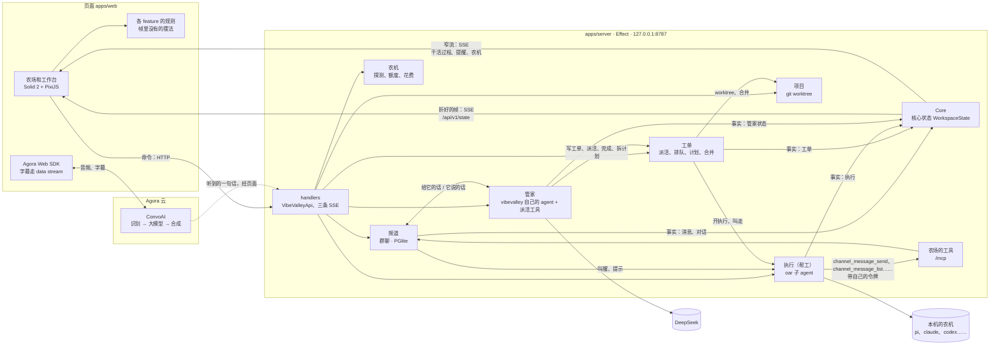

# 架构

## 总图

三条线：

- **命令**：页面通过 HTTP 调 `VibeValleyApi`（`packages/protocol` 的客户端，按 `api.ts` 的接口表）：在频道说话、写和派工单、带话、叫停、收工、完成、计划、读配置。帮工在频道说话走另一个入口：服务端的 MCP 端点 `/mcp`（[频道](docs/subsystems/channel.md)）。
- **状态**：服务端的核心状态每变一次就是一条事实。页面收折好的帧（`GET /api/v1/state`），自己不折。
- **语音**：页面和 Agora 频道之间是音频和字幕，服务端只签令牌、请语音管家进出频道（[语音](docs/subsystems/voice.md)）。

## 分层

仓库的目录见根目录 [AGENTS.md](AGENTS.md#目录)。

- **契约**：`packages/protocol` 是服务端和页面之间唯一的契约。形状写在 `src/shapes.ts`，`src/schema.ts` 给每个形状一个由它定类型的 Effect Schema（读写 JSON 时解码），接口写在 `src/api.ts`（路径、参数、请求体、答复、谁能调）；`src/rules` 只放两边都跑的纯函数（帮工在干什么的话、一行的标题、站位的名字、Inbox 里哪些是刚来的、文档的顺序键）。只有服务端跑的规则在它的模块里（`apps/server/src/<模块>`），结论写进帧（[理由](docs/subsystems/foundation.md)）。
- **服务**：`apps/server/src/` 下一块业务一个文件夹，名字用单数；文件夹归进十个模块，从下往上是 Platform（`base`、`core`、`setting`）、Agents（`agent`、`runtime`、`memory`、`ai`）、Source Control（`project`）、Collaboration（`channel`、`doc`）、Agent Sessions（`session`）、Issues（`issue`、`task`、`recurrence`）、Notifications（`notice`）、Orchestrator（`orchestrator`、`tool`）、Gamification（`game`）、Gateway（`http`、`mcp`、`lan`、`connector`、`voice` 和根目录的入口文件），表在 `src/modules.ts`。一个模块只 import 排在它前面的模块，也不读核心状态里别的模块那一块（经那个模块的查询），`src/modules.test.ts` 查。每个文件夹导出一个 Effect 服务（`Context.Service`）和它的 `layer`，反方向的消息走它们给的流（`Stream`）。`services.ts` 按模块组装，分两段：先建好所有模块（建的时候订阅自己要跟的事），再按模块顺序跑开机（第一次看 GitHub、把帮工请回来、整理被打断的种植计划、定时开始走、记下 Inbox 里已有的并开始巡查、数 commit）；测试的 `testing/world.ts` 用同一套组装函数（[理由](docs/subsystems/foundation.md)）。执行由 [oar](https://www.npmjs.com/package/@botiverse/oar) 驱动，管家是 VibeValley 自己的 agent（`agent/brain`，[管家](docs/subsystems/orchestrator.md)）。
- **HTTP 和 MCP**：`src/http` 在最上面：`api.ts` 照 protocol 的接口表挂路由，`handlers.ts` 答每一个，`streams.ts` 是三条事件流；`/mcp` 是给编码 agent 的另一个入口（`src/mcp`）；`main.ts` 单独跑它，`--web` 时也在 `/` 提供页面（[子系统](docs/subsystems/README.md)）。命令走 HTTP，事件和状态走 server-sent events（[理由](docs/subsystems/core.md)）。
- **存盘**：PGlite（进程里的 Postgres），表在 `apps/server/db/migrations/`，查询在 `db/queries/`、由 effect-sqlc 生成成 `db/generated/`（[理由](docs/subsystems/foundation.md)）；下文「存了什么」。
- **页面**：只连服务端的接口，用 Solid Query 读一次性的数据，帧由一条流给（[理由](docs/subsystems/app.md)）；按概念分 feature，和服务端的模块对得上，层只往前 import；三个宿主共用：桌面是 Electron 带着服务端起来、打开它的地址，浏览器直接打开（[页面](docs/subsystems/app.md)）。

## 核心状态

农场上的一切（通话、管家、帮工、频道、工单和计划、定时、commit 数、金币和成就）是一个值 `WorkspaceState`（`packages/protocol/src/shapes.ts`；[理由](docs/subsystems/core.md)）。只有服务端持有它，只在 `Core.apply`（`apps/server/src/core/core.ts`）里改：每个事实（雇了一个帮工、开始一轮、这一轮结束、一张工单变了……）由纯函数 `reduce(state, fact)`（`apps/server/src/projection/reduce.ts`，用各模块的规则）折进去。折法和拼帧读每个模块的规则，所以放在组装那一层（`projection/`），组装时交给 Platform 里的 `core`（`Projection`），`core` 不 import 上面的模块。不改变状态的事实不发。

帮工的阶段和每种阶段要主人做什么见[帮工](docs/subsystems/session.md#模型和不变量)。核心状态只保留在场的帮工，离开就删掉。

工单（`Issue`）里开着的和最近关的 50 张（`keepClosedIssues`，连同子工单）在核心状态里，全部在数据库；状态由 `issueStatusOf` 算。种植计划是带 `graph` 的父工单，每一件是带 `task` 的子工单，`graphsOf` 读成 `TaskGraph`（[种植计划](docs/subsystems/task.md)）。频道模块在核心状态里的只是页面马上要画的：频道、最近的串和最近的消息，更早的用 HTTP 取。定时、账本折出来的进度也在里面（[定时](docs/subsystems/recurrence.md)、[游戏](docs/subsystems/game.md)）。

给页面的是 `StateFrame`（`GET /api/v1/state`，至多每 200 毫秒一帧）：折好的 `state`，从它推出来的 `inbox`、`graphs`、`view`（地块、等级），和这段时间的效果 `effects`。帧只由纯函数 `frameOf` 拼：给人看的话（帮工在干什么、定时什么时候跑、计划是哪个状态、动作叫什么、现在能做什么）只在这一步填进状态的副本，`reduce` 和 `state.json` 里没有。页面的规则（各 feature 里的纯函数）只是读帧，不重写服务端的规则。帮工在院子里走到哪、一闪而过的效果，只在页面。

## 事件流

`GET /api/v1/events`（server-sent events）：连上先发一条 `snapshot`（整份核心状态），之后发事实，以及几样核心状态之外的：轨迹的一步（`step`）、提醒（`notice`）、农机变了（`runtime`）。断线重连又从快照开始。这条流留给命令行（`state`、`events`）和调试。

`GET /api/v1/live`（server-sent events）是页面的窄流：只发 `LiveEvent` 的三种成员（会话的一步、提醒、农机），不发事实、不发快照；状态仍由 `/api/v1/state` 给。事实的种类见 `shapes.ts` 的 `Fact`；帮工的会话事件怎么变成事实见 [帮工](docs/subsystems/session.md)。

三条流每 20 秒发一次心跳；写不出去就结束订阅。核心状态按首个变化起算的 500 毫秒窗口合并落盘，持续收到事实不会推迟这次保存；关闭时再保存最后的状态。

## HTTP 接口

接口的唯一定义是 `packages/protocol/src/api.ts` 的接口表 `endpoints`：每个接口的 `op`（`issue.status.update`，路径就是它：`POST /api/v1/issue/status/update`）、`about`、输入和答复的 Schema、`can`（谁能调）。服务端照它挂路由、解码输入、编码答复，页面和命令行都照它调。**当前都在 `/api/v1` 下**，没有 v2 或版本协商；不兼容改动和 v1 的保留照[接口版本](docs/subsystems/core.md#为什么这样)。不在表里的：`/api/v1/events`、`/api/v1/state`、`/api/v1/live` 三条流，和给帮工的 `/mcp`（每个会话带自己的令牌，[频道](docs/subsystems/channel.md)）、给语音管家的 `/v1/chat/completions`（[语音](docs/subsystems/voice.md)）。「连接到本机」只放 `can` 里有 `remote` 的（[能力表](docs/reference/capabilities.md)、[连接到本机](docs/subsystems/lan.md)）。

## 存了什么

服务端都在 `$VIBEVALLEY_HOME`（默认 `~/.vibevalley`）。存盘的格式只有现在这一种：不认旧名字下的文件，也没有搬旧数据的命令。

| 文件 | 内容 |
|---|---|
| `.vibevalley.lock` | 家目录的租约：里面是在用它的服务端的 pid；同一目录只允许一个服务端，那个进程没了就接过来 |
| `config.json` | 帮工档案、技能书、每台农机的设置。第一次启动时用 protocol 的种子（`apps/server/src/agent/seeds.json`） |
| `settings.json` | 「设置」里存的钥匙、语音设置和记性的来源（Nowledge Mem、EverOS 的地址和 key）；只有你能读 |
| `state.json` | 核心状态，频道、进度、定时和工单除外：帮工、commit 数 |
| `db/` | PGlite 的库：频道、工单和它们的帮工、文档、每次干活（`session_run`）、计划的经过、账本、记性、定时、连接器、「连接到本机」的设备；新建的行主键是 uuidv7，工单和每条消息另有自己的顺序号（表名是「模块_概念」、单数，结构在 `apps/server/db/migrations/0001_schema.up.sql`，一个基线，改表直接改它，旧库删掉重建）。查询都在 `db/queries/`，一张表一个文件。启动时把工单、最近的对话、定时放回核心状态，把账本折成进度 |
| `events/<id>.json` | 每个 Session 的事件日志（走了留 30 天；是谁、为哪张工单、怎么关的在库里的 `session` 表，一直留着）；管家的是 `orchestrator.json` |
| `helpers/<oar 会话 id>.jsonl` | VibeValley 自己的帮工的对话，每个 oar 会话一份 |
| `spend.json` | 今天每台农机花了多少 |
| `orchestrator/` | 管家（VibeValley 自己的 agent）：对话 `orchestrator.jsonl`、记性 `MEMORY.md`、压掉的旧对话 `archive/`、主人标出的做错的一轮 `evals/` |
| `logs/` | 每个帮工会话的原始记录 |
| `vibevalley.yaml` | 可选：配置（见下）；放钥匙时不进仓库 |

页面的偏好（宠物、静音、看板的样子……）存在浏览器里（`localStorage`），只在这台机器上。

## 配置

配置的来源、优先级、校验和每个键的用途、默认值见[设置和配置](docs/subsystems/setting.md#模型和不变量)。桌面版起服务端时的端口和页面位置见[客户端](docs/subsystems/app.md#怎么走)。
