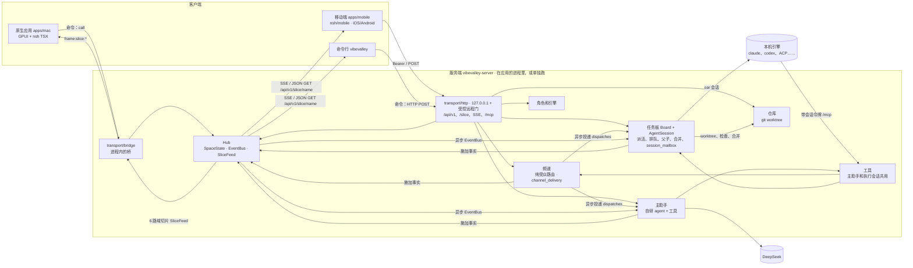

# 架构

## 总图

系统交互走两条线：

- **命令**：接口表是 `vibevalley-protocol` 的 `ENDPOINTS`（`crates/protocol/src/contract/endpoints.rs`）。原生应用的页面经进程内的桥按操作名调（[客户端](docs/subsystems/app.md#桥)），命令行经 HTTP `POST /api/v1/<路径>` 调；两条路进的是同一个 `Hub`，均携带调用上下文 `CallerContext`。执行会话通过服务端的 `/mcp` 调工具（[频道](docs/subsystems/channel.md)）。
- **状态**：服务端持有唯一的核心状态 `SpaceState`。状态每变一次产生一条事实（`Fact`）并算出脏切片掩码 `SliceMask`，客户端按需订阅独立切片（`board`、`sessions`、`collab`、`inbox`、`ops`、`farm`）：桥上是 `frame:slice:<name>`，HTTP 上是 `GET /api/v1/slice/{name}`（SSE 或 JSON 快照）。

桌面宿主与服务端运行于 macOS；主 HTTP 门只听 `127.0.0.1`，另提供默认关闭的受控远程监听门（绑定 Tailscale IPv4 `100.64.0.0/10` 或开发用回环地址），供独立原生移动应用 `apps/mobile`（iOS 优先、Android 就绪）经一次性配对与持久 Bearer 令牌访问（[受控远程访问](docs/subsystems/core.md#受控远程访问)、[移动端与远程访问](docs/subsystems/app.md#移动端与远程访问)）。

## 分层

仓库目录结构见根目录 [AGENTS.md](AGENTS.md#目录)。

- **契约与环境约定（`crates/protocol` → `packages/protocol`）**：服务端与客户端唯一的共享契约，以 Rust 为源：`src/contract/` 一个概念一个文件（含 5 域切片、`FarmFrame`、`debug.rs` 的 `DebugKit` 契约、`remote.rs` 的远程访问与配对契约，以及 GPUI 壳 ↔ 托管界面的强类型 `host.rs`：`Host*` 帧、`HostAction` 与 40 成员封闭 `HostOp`），`typescript.rs` 写出 `packages/protocol/src/<概念>/shapes.gen.ts` 与 `endpoints.gen.ts`（`vp run protocol:ts`）；`home.rs` 约定家目录、`server.json` 与语言；页面在边界解码用的 Zod（`schema.ts`）和带入参出参的端点表（`api.ts`）是手写的，由测试对着生成物查（[契约](docs/subsystems/foundation.md#契约规则和数据库)）；`@vibevalley/protocol/remote`（[transport.ts](packages/protocol/src/remote/transport.ts)）导出零平台依赖的纯 Web Fetch `HttpRemoteTransport`（支持 Bearer 鉴权、`Last-Event-ID` SSE 断线续读与 `vibevalley://pair` 深链解析）。
- **规则（`crates/core`）**：纯函数规则层：`reduce`、`SliceMask` 与按域切片投影（`board_slice`、`sessions_slice`、`collab_slice`、`inbox_slice`、`ops_slice`、`farm_frame`）、任务的状态与阶段和可做的动作、收件箱、简报和起草、农场的画面（[核心状态](docs/subsystems/core.md)），并收拢定时任务规则（`cron/`）与作品引擎（`artifact/`）。
- **服务与传输（`crates/server`）**：`src/lib.rs` 的 `Hub` 持有核心状态、接口表、进程内强类型命令总线 `Hub::invoke`、异步 `EventBus`、基于 `tokio::sync::watch` 且预编码共享 `Arc<str>` JSON 的 6 路 `SliceFeed<T>`、`tokio::sync::broadcast` 实时事件流、`CancellationToken`/`TaskTracker` 生命周期与 `arc-swap` 无锁可插拔脊柱钩子（`CallerContext`/`ClientIdentity`、`InvokeObserver`、`FaultGate`、`HostDebugBridge`、`RemoteAuth`），以及 `LiveVoicePort` 窄语音端口，脊柱与 `src/transport/` 不导入任何 `crate::modules::*` 具体模块；`src/modules/` 按 `work`、`team`、`collab`、`content`、`skin`、`infra` 六个业务域分组并收敛为严格 `L0`–`L3` 无环 DAG（`L1` 为 `infra/*`、`content/attachment`、`team/agent`；`L2` 为四个互不直调的同级域 `work`、`collab`、`content`、`team/memory`；`L3` 为 `team/{orchestrator,tool,mcp}`、`work/cron`、`skin/game`，由 `vp run audit:boundaries` 静态门禁守住，见 [scripts/audit/module-boundaries.ts](scripts/audit/module-boundaries.ts) 与 [目标架构与部署拓扑](docs/architecture-topology.md#32-总控端内部子模块与调用收敛control-plane)）；`infra/debug/` 提供 `DebugKit`（仅 `VIBEVALLEY_DEBUG=1` 启用四泳道定长环形缓冲、跳过 `debug.*` 的 `FaultGate`、统一脱敏器与纯 Rust ZIP `debug-bundle.zip` 导出），`infra/remote/` 提供默认关闭的远程访问控制、Tailscale 状态探测、5 分钟一次性配对码、按 `scope` 区分的 SHA-256 哈希 `vv_dev_*` 设备令牌校验与全 6 类 `RemotePlatform`（`ios`、`android`、`cli`、`machine`、`sandbox`、`other`）；进程日志经工作区 `tracing` + `tracing-subscriber` 初始化；`src/start.rs` 照 `L0` → `L1` → `L2` → `L3` 次序不可变组装各模块并仅对外暴露 `Started { hub, set_mcp_url, close }`；`src/db/{entities,migration}/` 集中管理 13 域双后端（SQLite + PostgreSQL）SeaORM 实体与迁移（含共享 `seq_counter` 与 `infra_remote`）；`src/transport/` 收拢服务接口（`api`）、进程内桥（`bridge`）和跑在共享运行时上的 HTTP 门（`http`：本机回环门与默认关闭的受认证远程监听门、基于 `WatchStream` 的 `/api/v1/slice/{name}`、按 `Subscription::CAN` 鉴权的 SSE 订阅流、带鉴权与 HTTP `Range` 分块流式的 `/api/v1/attachment/{id}`、`/mcp`）。
- **运行与引擎（`crates/runtime`、`crates/rich`、`crates/engines`）**：`crates/runtime` 提供进程级共享 Tokio 运行时 `rt`（`vibevalley_runtime::rt::{handle, spawn, block_on}`，工作线程 `vibevalley-io-{n}`），合拢 `oar/`（Claude Code、Codex、ACP、自研 `vibevalley` 与 scripted，含基于 `arc-swap` 的零开销 `OarObserver` 钩子与 `oar-voyage/3` 记录流）与自研 `agent/`（经工作区 `reqwest` 与 `backon` 接 DeepSeek，[自研 agent](docs/subsystems/brain.md)）；`crates/rich` 基于 `crates/engines/{onig,pele,shiki}` 提供原生富内容组件与文本引擎（`engine/{canvas,chart,genui,pinyin,whiteboard}`，其中 `canvas` 专注静态 JSON Canvas 1.0 SVG 渲染，交互白板编辑由 `whiteboard` 承接），[icon.rs](crates/rich/src/icon.rs) 亦作为 97 枚 reicons 矢量路径的单一事实源供 [icons.ts](scripts/gen/icons.ts) 导出给 `<Canvas>` + `Path2D` 回退。
- **存储（SQLite / PostgreSQL + 文件）**：服务端全业务表与持久执行引擎统一使用 `SeaORM` + `SeaQuery` 双后端架构，定义于 `crates/server/src/db/{entities,migration}/` 与 `crates/runtime/src/agent/durable/{entities,migration}/`，运行期经单一共享 `ServerDb` 门户（`crates/server/src/base.rs`，按 `DatabaseConfig` 支持默认本机 SQLite `server.db` 读写分离连接池或 `--database-url` / `VIBEVALLEY_DATABASE_URL` 指定的 PostgreSQL 连接池，启动自动执行 `Migrator::up`，SQLite 停机执行 `PRAGMA wal_checkpoint(TRUNCATE)` / `PRAGMA optimize`）提供 `read_conn()` 与 `write_conn()`；`seq_counter` 共享序号、任务（单表 `issue`）、领域无关 `AgentSession`（`session`、`session_run`、`session_mailbox`、`session_event`）、`channel_delivery`、作品/媒体表与远程访问表（`remote_config`、`remote_device`）都在同一数据库中。
- **客户端（`apps/mac`、`apps/mobile`、`crates/cli`）**：macOS 原生应用带着服务端（外壳拆为 `apps/mac/src/shell/` 九个文件，含 `VIBEVALLEY_DEBUG=1` 门控的底边悬浮胶囊、`⇧⌥D` 浮层与独立拆窗 `devtools.rs`，独占支撑库在 `apps/mac/crates/{pixel,terminal,workspace}`），宿主只消费 `vibevalley_server::transport::api` 窄端口（含 `SharedLiveVoice`）而不导入 `vibevalley_server::modules::*`；工作台（`apps/mac/ui/{app,workspace,design,features,farm,infra}`，含六视图 `HostedView("devtools")` 与设置页 `/settings/connections/remote`）是 nsh 跑的 TSX，像素场景由 Rust 画（[客户端](docs/subsystems/app.md)、[农场的皮](docs/subsystems/farm.md)）；独立原生移动端 `apps/mobile/` 基于 `nsh/mobile` 提供 4 标签页（收件箱、频道、会话、任务）与 `<Canvas>` + `Path2D` 图标渲染；命令行 `vibevalley` 支持本机 `server.json` 与远程 Bearer 凭据（`auth.json`、`--server`、`--token`），提供 `vibevalley auth` 与 `vibevalley remote` 子命令。

## 核心状态

`SpaceState`（契约的 `core` 形状）汇总实时状态：在场执行会话（主助手与执行会话）、最近的频道和话题、开着的与最近关闭的任务、定时任务、commit 数、游戏进度与地块动作（[核心状态](docs/subsystems/core.md)）。

- **唯一修改入口**：只有 `Hub::apply` 修改 `SpaceState`。纯函数 `reduce`（`crates/core/src/core.rs`）计算新状态并返回受影响的脏切片掩码 `SliceMask`；不改变状态的事实不发送，且经异步 `EventBus` 扇出 `Transition`。
- **5 域切片 + 独立 `FarmFrame`**：`Hub` 维护 6 路基于 `tokio::sync::watch` 的脏合并 `SliceFeed<T>`（`board`、`sessions`、`collab`、`inbox`、`ops`、`farm`），每次 `Hub::apply` 仅唤醒 `dirty: SliceMask` 命中的切片，游戏特效 `GameEffect` 只发往 `farm` 切片；静态成就列表与进度经 `game.achievement.list` 按需查询（`AchievementList`）。HTTP 门通过 `GET /api/v1/slice/{name}` 以 `WatchStream` 提供无阻塞线程的 SSE（带 `Last-Event-ID` 续读）与 JSON 快照，离线夹具与场景导出使用 `SliceBundle`。

## 事件流和接口

HTTP 门上命令走 `POST /api/v1/<路径>`，状态、事件和订阅走 SSE；全部路由、流、权限 `can`、受控远程访问与错误信封见[核心状态和接口](docs/subsystems/core.md)，每个接口的权限见生成的[能力表](docs/reference/capabilities.md)。主监听只听 `127.0.0.1`；远程监听默认关闭，显式开启后仅绑定 Tailscale IPv4（`100.64.0.0/10`）或开发用回环地址，并对每个请求强制校验 Bearer 令牌与 `Caller::Remote` 边界。

## 存了什么

数据分两层：Host（`$VIBEVALLEY_HOME`，默认 `~/.vibevalley`）和 Space（`$VIBEVALLEY_WORK_ROOT`，默认 `~/vibevalley-dev`，原生应用与独立服务端遵循同一约定），各放什么见[概念](docs/concepts.md#host-和-space)。

Host：

| 路径 | 内容 |
|---|---|
| `server.json` | 当前运行服务端的地址与 pid（命令行据此找本机服务端，`crates/protocol/src/home.rs`） |
| `auth.json` | 命令行远程登录凭据（权限 `0600`，由 `vibevalley auth login` 写入，存远程地址、设备标识与 Bearer 令牌） |
| `config.json` | 角色（主助手和执行角色）、技能书、引擎设置 |
| `agent-templates/<id>/` | 从本机导入的角色模板 |
| `settings.json` | 钥匙、AI 服务连接（权限 `0600`） |
| `server.db` | SQLite（或通过 `--database-url` / `VIBEVALLEY_DATABASE_URL` 接入 PostgreSQL）：任务、领域无关 `AgentSession`（`session`、`session_run`、`session_mailbox`、`session_event`）、定时任务（`cron`）、PR 与事件（`pull`、`pull_event`）、频道与投递队列（`channel*`、`channel_delivery`）、附件、记忆、媒体任务与媒体库、作品（含结构化条目、Loro 协同快照与变更日志）、远程访问配置与已配对设备哈希表（`remote_config`、`remote_device`）以及持久执行引擎表 |
| `issues/` | 任务板进程锁、引擎原始记录与结构化汇报文件 |
| `ledger.jsonl` | 游戏账本 |
| `records/` | 执行会话与主助手的 `oar-voyage/3` JSONL 原始记录流（`record_to`） |
| `conversations/` | `vibevalley` 引擎上执行会话的对话 |
| `agent/<角色 id>/` | 主助手的对话 `conversation.jsonl` 和 `MEMORY.md` |
| `attachments/` | 附件，按 SHA-256 存一份 |
| `debug-bundles/` | `debug.bundle.export` 导出的脱敏诊断包（`debug-bundle-*.zip`，仅 `VIBEVALLEY_DEBUG=1`） |

Space 下：
- `repos/`：仓库的 git 仓库。
- `worktrees/`：任务分支的 git worktree。

## 配置

配置的来源、优先级、校验和配置键说明见[设置和配置](docs/subsystems/setting.md#模型和不变量)。启动流程见[客户端](docs/subsystems/app.md#怎么走)。原生应用外壳自己的项目、布局和设置另存在 `~/Library/Application Support/VibeValley/state.db`。

演进至多端分布式部署的目标逻辑架构、物理部署拓扑、模块边界收敛规范与迁移路线见[目标架构与部署拓扑](docs/architecture-topology.md)。
