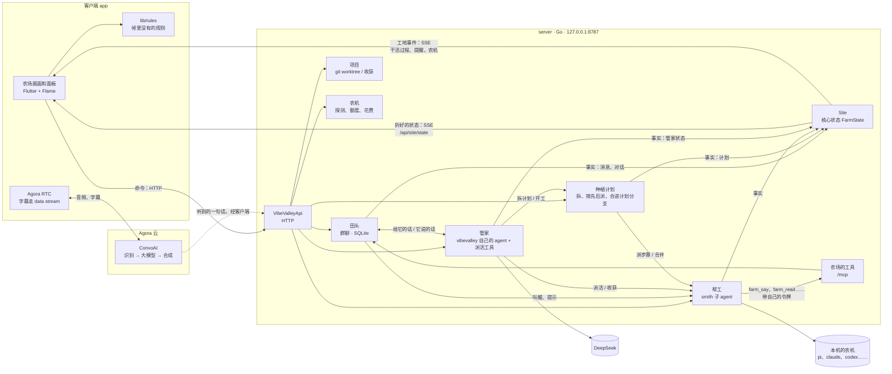

# 架构

## 总图



三条线：

- **命令**：客户端通过 HTTP 调 `VibeValleyApi`（Flutter 用 `lib/gen/vibevalley.dart` 里生成的客户端）：在田头说话、带话、叫停、收工、收获、种植计划、读配置。帮工在田头说话走另一个入口：服务端的 MCP 端点 `/mcp`（[server.md](server.md)「田头」）。
- **状态**：服务端的核心状态每变一次就是一条事实。Flutter 收折好的状态（`GET /api/site/state`），自己不折。
- **语音**：客户端和 Agora 频道之间是音频和字幕，服务端只签令牌、请语音管家进出频道（[voice.md](voice.md)）。

## 分层和目录

```
vibevalley/
  server/                    服务端，一个 Go 模块 vibevalley
    cmd/                     vibevalley（服务端）、vibevalley-agent（自己的 agent 的命令行）
    internal/                农场的服务，一个概念一个包（base、projects、memory、runs、chat、tickets、manager、
                             channels、game），farm 把它们组装起来，handler 答 HTTP；只给本模块用
    internal/protocol/       形状（shapes.go、api.go）和规则的唯一来源；gen.go 由 tool/shapegen 生成
    pkg/smith/               oar 的 Go 移植：驱动各家编码 agent，带自己的 cmd/oar、cmd/oar-bridge
    pkg/agent、agentcore、ai/  VibeValley 自己的 agent
    pkg/agora/               声网：令牌、语音 agent 的拼法和进出频道
    pkg/weixin、feishu、qq/  微信（iLink）、飞书、QQ 机器人的接口：登录、收、发
    tool/                    开发时的工具：shapegen 和两个 Node 脚本
  app/                       客户端：农场画面、像素村（Flame）、配置页、语音；macOS 版带着服务端
  design/pixel/            像素素材的生图提示词、原图和切图；产出是 Flutter 的贴图（app/assets/）
  design/assets/           界面图的手绘原图和它们的提示词：design/pixel 照它们重画
  design/mockups/          界面四个型号的效果图
  docs/
```

形状只往外流：Go 的 `server/internal/protocol/shapes.go` 和 `api.go` 是唯一的来源，`server/tool/shapegen` 从它们写出 Go 的胶水代码（`internal/protocol/gen.go`）和 Flutter 的类型与接口客户端（`app/lib/gen/vibevalley.dart`）（[server](../server/README.md#形状和规则从哪来)、[理由](../.agents/notes/implemented/architecture/2026-10-15-go-owns-the-shapes.md)）。规则也只在 `server/internal/protocol` 里。Flutter 只连服务端的接口；macOS 版把服务端打进应用（[desktop.md](desktop.md)）。

服务端是一个 Go 库（`farm`），每个服务是它所属概念的包里的一个结构体，构造函数列出它用到的服务，由 fx 组装（[server/README.md](../server/README.md#服务)），`cmd/vibevalley` 单独跑它（[server.md](server.md)；[理由](../.agents/notes/implemented/architecture/2026-10-13-go-server-on-smith.md)）。帮工由 smith 驱动，管家是 VibeValley 自己的 agent（[agents-and-runtimes.md](agents-and-runtimes.md)）。Flutter 用 Riverpod 管状态（[理由](../.agents/notes/implemented/architecture/2026-10-13-flutter-client-over-ts-server.md)）。命令走 HTTP，事件和状态走 server-sent events（[理由](../.agents/notes/implemented/architecture/2026-10-10-site-events-over-sse.md)）。

## 核心状态

农场上的一切（通话、管家、帮工、田头、工单和种植计划、commit 数、金币和成就）是一个值：`FarmState`（`server/internal/protocol/shapes.go`；[理由](../.agents/notes/implemented/architecture/2026-10-11-farm-core-state.md)）。只有服务端持有它；Flutter 读服务端折好的。它只因「事实」而变：一个事实是发生了的一件事（雇了一个帮工、开始一轮、跑了一条命令、这一轮结束……），由纯函数 `Reduce(state, fact)`（`server/internal/protocol/farm.go`）折进状态。它和下文提到的规则都是 Go 的 `protocol` 包里的纯函数，黄金数据守着它们（`internal/protocol/testdata/`，几千个随机事实和调用；有意改了规则用 `go test ./internal/protocol -update` 重写，[server](../server/README.md#形状和规则从哪来)）。

每个帮工（`Helper`）有一个阶段 `phase`，这是它生命周期的唯一状态：

| 阶段 | 含义 | 要你做什么（`NeedOf`） |
|---|---|---|
| `arriving` | 会话正在打开 | — |
| `working` | 一轮正在进行；带 `doing`（在做什么，就是头顶的气泡），可能带 `quietSince`（太久没动静）、`retry`（模型调用在重试） | 没动静：看看过程，不对就叫停 |
| `ripe` | 上一轮完成，有活可以看、可以收 | 收获；分支会冲突时先让它解决 |
| `failed` | 上一轮失败 | 杀虫（让它接着修）或请它收工 |
| `resting` | 被叫停，或者服务端重启后回来；带句话就接着干 | 分支会冲突时先让它解决 |

帮工的 `play` 是地里那一层：它在哪块地（`station`，雇来时占第一块空地；人在某块地上播种时，服务端把这块地带进 `hired` 事实）、最近做过的 30 步、这一轮调了几次工具、各种工具用了几次、碰过的文件和跑过的命令；也由 `Reduce` 从 `turn`、`doing` 事实折出来。帮工离开（收工、收获）就从状态里删掉。做种植计划的帮工带 `playbook`（哪个计划、哪一步；没有步骤就是在拆计划）。`conflict` 是它的分支和主分支的关系，以最近一次 git 检查为准，不属于阶段。「在做什么」（`DoingOf`）、「要你做什么」（`NeedOf`）、「管家怎么描述它」（`PhaseText`）、「能不能收」（`CanHarvest`）都由阶段推出来，地里的作物和牌子、详情面板、管家的「农场现状」读的是同一套推导。

工单（`Issue`）也在核心状态里：开着的和最近关的。种植计划（`Playbook`）是带子工单的父工单：目标、项目、计划分支、状态在父工单上，每一步是一张子工单（工单、要等的步骤、谁来做、检查命令、状态、谁在做、结论、提交、花费），`PlaybookOf` 从工单把计划拼出来（`plan_issues.go`）。哪些步骤能开工（`Startable`）、计划通不通（`PlanProblems`）、怎么改（`EditNode`）、帮工被告知什么（`NodeTask`）、验收步骤的规则（`AcceptanceChecks`、`FrozenTouched`）是 protocol 的纯函数（`playbook.go`；[server.md](server.md)「种植计划」）。收完和放弃的计划只留最近 10 个。

田头（`chat`）在核心状态里的只是页面马上要画的：每个频道和最近的串（`Conversation`：`square` 是田头，`channel` 是主人开的频道，带名字、说明、默认项目；`thread` 带它所在的频道。频道不会被挤掉，串最多 100 个，最冷清的先去掉），以及它们最近的消息（`ChatMessage`，加起来最多 300 条）。全部记录在服务端的数据库里，页面打开一个串或往前翻时用 HTTP 取更早的。一条消息先写进数据库，再施加 `message` 事实，所以页面看到的每一条库里都有；管家边想边说的那条用同一个 `seq` 再发。谁被 @ 了、一条消息给谁、叫不叫醒、帮工收到什么，是 protocol 的纯函数（`chat.go`、`chat_rules.go`）。帮工的已读位置、跟着哪些串、每条消息给到哪一步，只有服务端用，只在数据库里。

定时（`schedules`）是按时间往频道里说的话，数据库是它们的家，核心状态里的是副本（`schedule`、`unschedule` 事实），页面从这里列出来；什么时候到点是 protocol 的纯函数（`schedules.go`）（[server.md](server.md)「定时」）。

金币、连胜、成就（`progress`）是**农场账本**按顺序折出来的：账本记下值得记的事（一个帮工的活收进主分支、一轮没做成、合进主分支会冲突、主人给帮工带了话……），`ProgressOf` 把整本折成进度，`ProgressStep` 一次折一条并说出这一条带来了什么（`ProgressNews`：多少金币、给哪个帮工、到了哪些成就的哪一档）。哪些事实要记进账本是 `EntriesFor(before, fact, after)`，别的由看到它的地方记（收获、田头上的话、语音、看收成清单）。这些都是 protocol 的纯函数（`progress.go`；[server.md](server.md)「账本」；规则见 [game-ui.md](game-ui.md)「计分」）。

状态只在一处改：服务端的 `Site.Apply`（`server/internal/base/site.go`）。不改变状态的事实（比如一轮结束后才到的字）不发。

给 Flutter 的是一帧一帧的 `SiteFrame`（`GET /api/site/state`）：折好的状态、由它推出来的 Inbox（要你处理的事，protocol 的 `inbox.go`）和 `view`（地块、等级，protocol 的 `view.go`）、这段时间里事实带来的效果。帧里没有、要从状态推出来的（阶段的说法、计划的规则、成就、未读……）移植在 `app/lib/rules/`（[app](../app/README.md#和服务端)）。

客户端在核心状态之上叠一层游戏（`lib/farm/`、`lib/game/`、`lib/village/`）：帮工在院子里走到哪、金币飘起和成就提示这些一闪而过的效果、离开的帮工走出门的那几秒；聊天窗口另有语音里说的话（只给语音管家，不进田头）、开着哪个对话、往前翻取回来的更早的消息。这些只在客户端上。

## 工地事件

服务端到客户端：`GET /api/site/events`（server-sent events），每条消息一个 JSON，都带 `type` 和 `at`（Unix 毫秒）。连上先发一条 `snapshot`（整份核心状态），之后发事实，以及几样不属于核心状态的东西。断线自己重连，重连又从快照开始。Flutter 不折事实，读的是 `/api/site/state`（上面「核心状态」）；它也连这条流，但只要核心状态之外的那几样。形状的唯一来源是 `server/internal/protocol/shapes.go`，下面是示意。

```jsonc
// 整份核心状态：每次连上先发这条
{"type":"snapshot","at":0,"state":{"call":"idle","foreman":"idle","helpers":[/* Helper */],"chat":{"conversations":[/* Conversation */],"messages":[/* ChatMessage */]},"commits":{"total":12,"repos":[]},"issues":[/* Issue */]}}

// ── 事实：改核心状态的，服务端用 Reduce 折进去 ──
{"type":"call","at":0,"state":"error","reason":"加入语音频道失败"}            // 通话：idle | connecting | live | ending | error
{"type":"foreman","at":0,"state":"thinking"}                                  // 管家：idle | listening | thinking | speaking
{"type":"message","at":0,"message":{"seq":4820,"conversation":7,"from":"w3","fromKind":"helper","name":"后端老周","agent":"backend","kind":"chat","text":"@主人 接口要按月查吗？","final":true,"mentions":["user"],"at":0}} // 田头的一条消息，新的或在长的（同一个 seq）；kind：chat | dispatch | report | notice
{"type":"conversation","at":0,"conversation":{"id":7,"kind":"thread","parent":4812,"subjectKind":"job","subjectId":"w3","lastSeq":4820,"replies":5,"read":4815,"at":0}} // 一个对话新开或变了：田头、一个频道，或挂在 4812 号消息下的串；read 是主人读到哪
{"type":"hired","at":0,"helper":{"id":"w1","name":"后端老周","agent":"backend","runtime":"pi","task":"搭 server 骨架","project":"clock-in","branch":"vibevalley/w1-…","worktree":"…","hiredAt":0,"turns":0,"phase":{"_tag":"arriving"}}}
{"type":"turn","at":0,"id":"w1"}                                              // 开始一轮 → working
{"type":"doing","at":0,"id":"w1","action":"run_command","label":"pnpm test"}  // 气泡；也结束「没动静」和「重试」
{"type":"quiet","at":0,"id":"w1","since":0}                                   // 一轮里太久没动静
{"type":"retry","at":0,"id":"w1","attempt":2,"of":3}                          // 模型调用失败，在重试
{"type":"spent","at":0,"id":"w1","spent":{"tokens":43978,"cny":0.017}}        // 雇来以后一共花了多少
{"type":"report","at":0,"id":"w1","outcome":"completed","summary":"28 个测试全过","turns":1,"spent":{"tokens":43978,"cny":0.017}} // 这一轮结束 → ripe / failed / resting
{"type":"conflict","at":0,"id":"w1","conflict":{"base":"main","files":["src/app.ts"]}} // 分支检查的结果；不带 conflict 就是能干净合并
{"type":"left","at":0,"id":"w1"}                                              // 收工或收获，离开农场
{"type":"commits","at":0,"commits":{"total":12,"repos":[]}}                   // 你的 commit 数（农场经验）
{"type":"progress","at":0,"progress":{"coins":120,"streak":2,"bestStreak":2,"counts":{"harvests":2},"unlocked":[{"id":"harvests","tier":1,"at":0}]},"news":{"coins":44,"helper":"w1"}} // 账本折出来的进度，整个；news 是这一条带来的（没有就是没什么可说的）
{"type":"playbook","at":0,"playbook":{"id":"p1","title":"按月查询","goal":"…","project":"clock-in","branch":"vibevalley/pb-p1-…","state":"running","parallel":3,"createdAt":0,"nodes":[{"id":"schema","title":"数据层","task":"…","needs":[],"state":"merged","conclusion":"…","commits":["3f2a1bc"],"tries":0}]}} // 种植计划现在的样子，整个；同样的再来一次不算

// ── 核心状态之外的 ──
{"type":"step","at":0,"id":"w1","step":{"n":4,"at":0,"kind":"tool","text":"pnpm test","action":"run_command","tool":"bash","output":"ℹ pass 28","ok":true}} // 轨迹的一步（帮工的，或管家的：id 是 foreman），新的或长了的（同一个 n）
{"type":"notice","at":0,"level":"warn","text":"后端老周 已经 4 分钟没动静了"}  // 不属于对话、但人该知道的事
{"type":"runtime","at":0,"info":{/* RuntimeInfo */}}                          // 农机的信息变了（多半是额度、今天的花费）
```

`doing` 的 `action` 是 smith `observe` 包的工具分类（照 oar）（`run_command`、`read_file`、`edit_file`、`search`、`web`、`mcp`、`wait`、`other`），加上 `thinking`、`speaking_text`。帮工的会话事件怎么变成事实见 [server.md](server.md)「帮工」。

## HTTP 接口

接口的唯一定义是 Go 的 `Handlers`（`server/internal/protocol/api.go`）：每个接口是一个方法，`//vibevalley:route` 写它的名字、方法和路径；`internal/handler/api.go` 实现它们。生成的 `Mount` 解码请求、编码回答和带标签的错误；Flutter 用从同一份方法生成的 `VibeValleyApi` 客户端（`lib/gen/vibevalley.dart`），两边类型一致。

| 方法 | 路径 | 做什么 |
|---|---|---|
| GET | `/api/health` | 服务端在不在 |
| POST | `/api/start`、`/api/end` | 开工；收工（全部帮工收工） |
| GET、PUT | `/api/settings` | 农场的钥匙：读到的是每样从哪来和最后几个字；存（[server.md](server.md)「设置」） |
| POST | `/api/say` | 在田头说话：频道里的话给管家（除非 @ 了别人），串里的给串里的人；`conversation` 不填是田头；没开工会先开工 |
| POST | `/api/channels` | 开一个频道：名字、说明、默认项目；重名或名字不对时 409 |
| PUT | `/api/channels/{id}` | 改一个频道的说明、默认项目 |
| POST | `/api/schedules` | 建一个定时（[server.md](server.md)「定时」）；不对时 409 |
| PUT | `/api/schedules/{id}` | 打开或关掉一个定时（`enabled`） |
| DELETE | `/api/schedules/{id}` | 删掉一个定时 |
| POST | `/api/dispatch` | 语音管家听到的一句话：管家只派活，不回话 |
| POST | `/api/workers/{id}/tell` | 给帮工带话：说在它的工单串里，干着活就插进去，歇着就开新一轮；带 `on` 是评论干活过程的第几步（那一步太早、不在了时 404） |
| GET | `/api/chat/{id}/messages?before=&limit=` | 一个对话里更早的消息，从旧到新 |
| POST | `/api/chat/{id}/read` | 主人在这个对话里读到了哪条 |
| POST | `/api/workers/{id}/stop` | 叫停这一轮 |
| POST | `/api/workers/{id}/dismiss` | 请它收工 |
| GET | `/api/workers/{id}/changes` | 收成清单：提交、改了的文件和 diff、没提交的、会不会冲突 |
| POST | `/api/workers/{id}/harvest` | 收获：合进主分支，然后收工 |
| GET | `/api/workers/{id}/steps` | 干活过程的全部步骤 |
| GET | `/api/trajectories?agent=` | 谁有轨迹（每个帮工的，走了也在；管家的），新的在前；`agent` 只看一个帮工档案派出去的 |
| GET | `/api/trajectories/{id}` | 一条轨迹：是谁的、为什么干，和全部步骤 |
| GET、POST | `/api/issues` | 全部工单（核心状态里只有开着的和最近关的）：还没派的在前，按排的先后，其余新的在前；每张带着标题和说明、它的执行（`runs`，帮工的 id，旧的在前）和状态（`status`：`todo`、`queued`、`working`、`waiting`、`closed`）。写一张（没有标题 409） |
| GET | `/api/issues/{id}` | 一张工单；`id` 也可以是它某次执行的帮工 id。没有 404 |
| PUT、DELETE | `/api/issues/{id}` | 改一张还没派的工单（标题 `title`、说明 `description`、项目、帮工、优先级 `urgent`/`high`/`normal`/`low`）、删掉；派出去的 409 |
| PUT | `/api/issues/{id}/place` | 把一张还没派的排到 `before` 那张前面，不给就排到最后；回答全部工单 |
| POST | `/api/issues/{id}/start` | 开工：派它选的帮工档案到它的项目（发在田头），回答帮工的 id；地都占满时排上队，回答为什么等（`queued`）。没选帮工、派不出去、已经派过 409 |
| PUT | `/api/issues/{id}/queue` | 排上队等空地，或拿出队列（`queued`） |
| POST | `/api/issues/{id}/reopen` | 重开一张关了的工单（`id` 也可以是帮工 id）：同一张工单再开一次执行，同一个帮工档案、同一个项目，带上 `text`、原来要做什么和上一次怎么关的；回答新帮工的 id。还开着、合进了计划分支的 409，没有 404 |
| GET、POST | `/api/agents/{id}/memories` | 一个 agent 的记性，新的在前；替它记一条（`text`，`project` 不填就是所有项目） |
| DELETE | `/api/agents/{id}/memories/{memory}` | 让它忘掉一条 |
| GET、POST | `/api/manager/memories` | 管家的记性（`MEMORY.md`，新的在前；跑在哪种 agent 上，系统提示带得下几条）；替它记一条（`text`） |
| DELETE | `/api/manager/memories/{memory}` | 让管家忘掉一行 |
| GET | `/api/manager/archive?q=` | 管家压掉的旧对话：文件，新的在前；有 `q` 时加上搜到的行 |
| GET | `/api/manager/archive/{name}` | 一个旧对话文件的全文 |
| POST | `/api/progress/carry` | 旧存档里的金币，记进账本，只一次（回答这次记了没有） |
| POST | `/api/progress/title` | 挂一个称号（成就和档位），不带就是摘下 |
| POST | `/api/playbooks` | 种植计划：派人拆（目标、项目、谁来拆） |
| PUT、DELETE | `/api/playbooks/{id}/nodes/{node}` | 改一步（没有就加上）、删一步 |
| POST | `/api/playbooks/{id}/act` | 开工、暂停、继续、放弃、收获 |
| POST | `/api/playbooks/{id}/nodes/{node}/act` | 重试、跳过一步 |
| GET | `/api/playbooks/{id}/changes` | 收获计划前的清单：计划分支对主分支 |
| GET | `/api/playbooks/{id}/events` | 计划的经过：谁在什么时候做了什么，从旧到新 |
| GET | `/api/runtimes` | 全部农机的 `RuntimeInfo` |
| POST | `/api/runtimes/{id}/refresh` | 重新探测 |
| PUT | `/api/runtimes/{id}/settings` | 存 `RuntimeSettings` |
| POST | `/api/runtimes/{id}/upgrade` | 现在总是拒绝（409）：升级会改动这台机器，请在终端里做 |
| GET、PUT、DELETE | `/api/agents`、`/api/agents/{id}` | 帮工档案 |
| GET、PUT、DELETE | `/api/skills`、`/api/skills/{id}` | 技能书；删技能时从档案上一起去掉 |
| GET | `/api/projects` | 工作目录下的项目：名字、在这台机器上的路径（`path`）、是不是 git 仓库、最近一次提交的时间、同时能有几个帮工在里面干活 |
| POST | `/api/projects` | 新增项目：`name` 是目录名，可带 `github` 公开仓库主页地址；同名或失败时 409，成功返回项目 |
| GET | `/api/projects/{name}/languages` | 项目种了什么：tokei 现数的每种语言的文件、代码、注释、空行；没有这个项目 404，没装 tokei 409（带怎么装） |
| GET | `/api/projects/{name}/activity` | 项目一年的提交：按天、按人；所有分支，不算合并；还有总提交数、第一个和最近一个提交的时间 |
| POST | `/api/voice/session`、`/renew`、`/agent`、`/agent/stop` | 语音：令牌、续期、请语音管家进出频道（[voice.md](voice.md)） |
| GET | `/api/connectors` | 微信、飞书、QQ 的连接器：连没连、主人是谁、接在哪个频道（[server.md](server.md)「连接器」） |
| POST | `/api/connectors/{id}/login`、`/verify`、`/logout` | 连上（扫码或填凭据）、确认、断开 |
| PUT | `/api/connectors/{id}/channel` | 接在哪个频道 |
| GET、PUT | `/api/lan` | 院门：开没开、地址、正在进行的配对、设备；打开或关上（[server.md](server.md)「院门」）。只在本机 |
| POST、DELETE | `/api/lan/pairing` | 换一个配对码；不加了。只在本机 |
| POST | `/api/lan/pairing/answer` | 主人对正在等的设备点头或不让（`allow`）。只在本机 |
| DELETE | `/api/lan/devices/{id}` | 移除一台设备。只在本机 |
| POST | `/api/lan/pair` | 设备带配对码和名字来要钥匙，等主人回答；院门上唯一不要钥匙的接口 |
| GET | `/api/lan/me` | 这把钥匙是哪台设备的 |
| GET | `/api/site/events` | 工地事件（不在 `VibeValleyApi` 里，是一个流） |
| GET | `/api/site/state` | 给客户端（Flutter 不自己折事实，[理由](../.agents/notes/implemented/architecture/2026-10-13-flutter-client-over-ts-server.md)）：每条是一个 `SiteFrame`：折好的核心状态、由它推出来的 `inbox`（要你处理的事，农场手机的来电，protocol 的 `inbox.go`）和 `view`（地块、等级，protocol 的 `view.go`）、这段时间里事实带来的效果（金币、升级、成就、没做成的惩罚）；状态变了就再发一份，至多每 200 毫秒一份；不在 `VibeValleyApi` 里 |
| POST | `/mcp` | 农场的工具，给帮工用（MCP，不在 `VibeValleyApi` 里）：每个帮工的会话带着自己的令牌（[server.md](server.md)「田头」） |

## 存了什么

服务端都在 `$VIBEVALLEY_HOME`（`cmd/vibevalley` 默认 `~/.vibevalley`；macOS 应用默认 `~/Library/Application Support/vibevalley`，Alpha、Beta 各有自己的，[desktop.md](desktop.md)）。这个项目以前叫 heybro（又短暂地叫过 vibefarm）；那时的农场不会被找到，先用 `vibevalley migrate` 迁移一次（[server.md](server.md)「搬家」，[理由](../.agents/notes/implemented/process/2026-10-15-rename-to-vibevalley.md)）。

| 文件 | 内容 |
|---|---|
| `config.json` | 帮工档案、技能书、每台农机的设置。第一次启动时用 protocol 的种子（`seeds.ts`，导出成 Go 的 `internal/protocol/seeds.json`） |
| `settings.json` | 首页「设置」里存的钥匙：DeepSeek 的 API Key、Agora 的 App ID 和 Certificate；声音页和管家页存的语音设置（`voice`，只存改过的）；只有你能读 |
| `farm.json` | 核心状态，田头、进度、定时和工单除外：帮工、commit 数 |
| `farm.db` | SQLite：田头的消息、对话、跟着哪些串、谁读到哪、每条消息给到谁走到哪一步；工单（连同种植计划，它是带子工单的父工单）和它们的执行；种植计划的经过；农场账本（`ledger`）；每个 agent 的记性（`memories`）；定时（`schedules`）；连接器的账号和发件表。表在 `server/migrations/`。启动时它把最近的对话和消息、定时放回核心状态，把账本折成进度 |
| `crew.json` | 只有服务端需要的：每个帮工的项目目录或 worktree、农机自己的会话 id、最后一轮的完整原话 |
| `steps/<id>.json`、`steps/<id>.head.json` | 轨迹：每个帮工的干活过程（帮工走了留 30 天）和它是谁、干什么、怎么关的（一直留着，就是看板上的工单），管家的（`foreman`） |
| `spend.json` | 今天每台农机花了多少 |
| `foreman/` | 管家（VibeValley 自己的 agent）：对话 `manager.jsonl`、记性 `MEMORY.md`、压掉的旧对话 `archive/` |
| `logs/` | smith 记的每个帮工会话的原始记录 |
| `.env` | 可选：Agora 的凭据、DeepSeek 的钥匙这类环境变量（见下） |

从 TypeScript 服务端留下的家搬过来见 [server.md](server.md)「搬家」。

客户端的偏好（管家的样子、宠物、静音……）存在本机（`lib/shell/prefs.dart`）；每个档案的战绩在服务端的账本里。

## 环境变量

服务端读（`cmd/vibevalley` 还读 `--env-file` 给的文件和 `$VIBEVALLEY_HOME/.env`，那里放 Agora 的凭据和 DeepSeek 的钥匙，不进仓库；已经设了的变量优先）：

| 变量 | 用途 | 默认 |
|---|---|---|
| `VIBEVALLEY_WORK_ROOT` | 工作目录：每个子文件夹是一个项目，帮工只在这里面干活；也是算经验的范围 | `~/vibevalley-work` |
| `VIBEVALLEY_HOME` | VibeValley 自己的设置和记录 | `~/.vibevalley` |
| `VIBEVALLEY_DB` | 数据库：SQLite 文件，给的是文件夹就用里面的 `farm.db`；`memory` 是只在内存里 | `$VIBEVALLEY_HOME/farm.db` |
| `VIBEVALLEY_FOREMAN_MODEL` | 管家用的 DeepSeek 模型（`deepseek-flash` 或 `deepseek/deepseek-flash`） | `deepseek-flash` |
| `VIBEVALLEY_FOREMAN_RUNTIME` | 管家用什么想事情：只有 `vibevalley`（自己的 agent）；`pi` 会被拒绝，不认识的值用默认 | `vibevalley` |
| `DEEPSEEK_API_KEY`、`DEEPSEEK_BASE_URL` | 管家和 VibeValley 农机用的 DeepSeek 密钥和地址；首页「设置」里存了钥匙就用那个 | 本机 pi 配的 DeepSeek；`https://api.deepseek.com` |
| `VIBEVALLEY_TOKEI` | 数项目种了什么用的 tokei 在哪 | PATH 上的 `tokei` |
| `VIBEVALLEY_GIT_EMAILS` | 算经验时也算作「你」的 commit 邮箱，逗号分隔 | git 全局和各仓库的 user.email 本来就算 |
| `VIBEVALLEY_CNY_PER_USD` | pi 的价目表是美元，折成人民币的汇率 | 7.2 |
| `VIBEVALLEY_STALL_SECONDS` | 一轮里多久没动静就提醒 | 240 |
| `VIBEVALLEY_TRAJECTORY_DAYS` | 帮工走了以后，它的干活过程留几天（轨迹的头，也就是工单，一直留着）；0 是一直留着 | 30 |
| `VIBEVALLEY_SCHEDULE_TICK_MS` | 多久看一遍有没有到点的定时 | 20000 |
| `VIBEVALLEY_HEARTBEAT_MINUTES` | 巡查的间隔，0 是关掉 | 10 |
| `VIBEVALLEY_MAX_PER_PROJECT` | 一个项目里最多几个帮工同时干活，0 不限 | 3 |
| `AGORA_APP_ID`、`AGORA_APP_CERTIFICATE` | 语音：签 RTC 和 RTM 令牌、请语音管家；首页「设置」里存了就用那个；都没有语音不可用，别的照常 | |
| `VIBEVALLEY_VOICE_LINE_PORT`、`VIBEVALLEY_VOICE_LINE_URL` | 语音线路（「想」选农场的管家时）：只给声网用的那个监听的端口；你自己的隧道的公网地址，没有就用 cloudflared 临时隧道 | 8788、（无） |
| `VIBEVALLEY_VOICE_MODEL`、`VIBEVALLEY_VOICE_ID` | 语音管家用的托管大模型和音色的默认；声音页里改过的优先 | `gpt-4.1-mini`、`Chinese (Mandarin)_Gentle_Youth` |
| `VIBEVALLEY_NOTICE_BATCH_MS` | 忙着的帮工收到的提示，攒多久合成一条 | 3000 |
| `VIBEVALLEY_RETRY_WAKE_MS` | 叫醒在开口前就失败了，多久以后再叫一次 | 3000 |
| `HOST`、`PORT` | 只听本机：帮工没有权限确认，服务端不能对外。帮工拿到的 `/mcp` 地址也由它们拼出 | `127.0.0.1`、`8787` |
| `VIBEVALLEY_LAN_PORT` | 院门的端口：打开院门时在所有网卡上听，只放配对过的设备（[server.md](server.md)「院门」）；0 是随便一个 | 8790 |

几个写错的值用默认值而不是让服务端起不来（[server](../server/README.md)）。macOS 应用起服务端时另设 `VIBEVALLEY_HOME`、`VIBEVALLEY_WORK_ROOT`、`PORT` 和登录 shell 的 `PATH`（[desktop.md](desktop.md)）。

**警告：** 密钥只在服务端。客户端只拿 App ID、频道名、uid 和自己的令牌。

## 开发时

检查和测试见 [development.md](development.md)。
