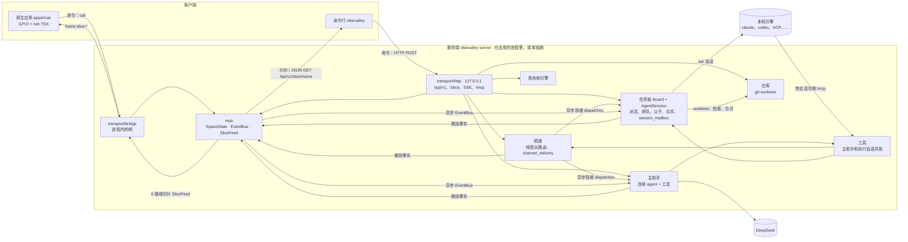

# 架构

## 总图

系统交互走两条线：

- **命令**：接口表是 `vibevalley-protocol` 的 `ENDPOINTS`（`crates/protocol/src/contract/endpoints.rs`）。原生应用的页面经进程内的桥按操作名调（[客户端](docs/subsystems/app.md#桥)），命令行经 HTTP `POST /api/v1/<路径>` 调；两条路进的是同一个 `Hub`，均携带调用上下文 `CallerContext`。执行会话通过服务端的 `/mcp` 调工具（[频道](docs/subsystems/channel.md)）。
- **状态**：服务端持有唯一的核心状态 `SpaceState`。状态每变一次产生一条事实（`Fact`）并算出脏切片掩码 `SliceMask`，客户端按需订阅独立切片（`board`、`sessions`、`collab`、`inbox`、`ops`、`farm`）：桥上是 `frame:slice:<name>`，HTTP 上是 `GET /api/v1/slice/{name}`（SSE 或 JSON 快照）。

只支持 macOS，只在本机：没有浏览器页面、手机壳和从别的设备进来的门（[原生计划](.agents/notes/proposed/architecture/2026-11-14-native-vibevalley.md)）。

## 分层

仓库目录结构见根目录 [AGENTS.md](AGENTS.md#目录)。

- **契约与环境约定（`crates/protocol` → `packages/protocol`）**：服务端与客户端唯一的共享契约，以 Rust 为源：`src/contract/` 一个概念一个文件（含 5 域切片、`FarmFrame` 与 GPUI 壳 ↔ 托管界面的强类型 `host.rs`），`typescript.rs` 写出 `packages/protocol/src/<概念>/shapes.gen.ts` 与 `endpoints.gen.ts`（`vp run protocol:ts`）；`home.rs` 约定家目录、`server.json` 与语言；页面在边界解码用的 Zod（`schema.ts`）和带入参出参的端点表（`api.ts`）是手写的，由测试对着生成物查（[契约](docs/subsystems/foundation.md#契约规则和数据库)）。
- **规则（`crates/core`）**：纯函数规则层：`reduce`、`SliceMask` 与按域切片投影（`board_slice`、`sessions_slice`、`collab_slice`、`inbox_slice`、`ops_slice`、`farm_frame`）、任务的状态与阶段和可做的动作、收件箱、巡查、简报和起草、农场的画面（[核心状态](docs/subsystems/core.md)），并收拢定时任务规则（`cron/`）、笔记大纲引擎（`pkm/`）与作品引擎（`artifact/`）。
- **服务与传输（`crates/server`）**：`src/lib.rs` 的 `Hub` 持有核心状态、接口表、异步 `EventBus`、6 路 `SliceFeed<T>` 与可插拔脊柱钩子（`CallerContext`/`ClientIdentity`、`InvokeObserver`、`FaultGate`、`HostDebugBridge`）；`src/modules/` 按 `work`、`team`、`collab`、`content`、`skin`、`infra` 六个业务域分组，`src/start.rs` 照依赖次序打开各模块（任务板拆成 `work/issue`、`work/session`、`work/workplace`，都只经 `work/ledger.rs` 写；频道仅做纯受众路由与 `channel_delivery`）；`src/db/{queries,generated}/` 集中管理服务端 12 组 SQLite 命名查询与 sqlc 生成绑定；`src/transport/` 收拢服务接口（`api`）、进程内桥（`bridge`）和 HTTP 门（`http`：命令、`/api/v1/slice/{name}`、SSE、`/mcp`）。
- **运行与引擎（`crates/runtime`、`crates/rich`、`crates/engines`）**：`crates/runtime` 合拢 `oar/`（Claude Code、Codex、ACP、自研 `vibevalley` 与 scripted，含零开销 `OarObserver` 钩子与 `oar-voyage/3` 记录流）与自研 `agent/`（只接 DeepSeek，[自研 agent](docs/subsystems/brain.md)）；`crates/rich` 基于 `crates/engines/{onig,pele,shiki}` 提供原生富内容组件与文本引擎（`engine/{canvas,chart,genui,pinyin}`）。
- **存储（SQLite + 文件）**：模块各自在家目录的 `server.db` 建表（`create table if not exists`），查询统一收在 `crates/server/src/db/{queries,generated}/`；任务、领域无关 `AgentSession`（`session`）、`session_mailbox`、`session_event` 与 `channel_delivery` 都在同一个库；没有迁移，形状变了直接改。
- **客户端（`apps/mac`、`crates/cli`）**：原生应用带着服务端（外壳拆为 `apps/mac/src/shell/` 八个文件，独占支撑库在 `apps/mac/crates/{pixel,terminal,workspace}`），工作台（`apps/mac/ui/{app,workspace,design,features,farm,infra}`）是 nsh 跑的 TSX，像素场景由 Rust 画（[客户端](docs/subsystems/app.md)、[农场的皮](docs/subsystems/farm.md)）；命令行经 `server.json` 找到运行中的服务端。

## 核心状态

`SpaceState`（契约的 `core` 形状）汇总实时状态：在场执行会话（主助手与执行会话）、最近的频道和话题、开着的与最近关闭的任务、定时任务、commit 数、游戏进度与地块动作（[核心状态](docs/subsystems/core.md)）。

- **唯一修改入口**：只有 `Hub::apply` 修改 `SpaceState`。纯函数 `reduce`（`crates/core/src/core.rs`）计算新状态并返回受影响的脏切片掩码 `SliceMask`；不改变状态的事实不发送，且经异步 `EventBus` 扇出 `Transition`。
- **5 域切片 + 独立 `FarmFrame`**：`Hub` 维护 6 路有界容量 1 的脏合并 `SliceFeed<T>`（`board`、`sessions`、`collab`、`inbox`、`ops`、`farm`），每次 `Hub::apply` 仅唤醒 `dirty: SliceMask` 命中的切片，游戏特效 `GameEffect` 只发往 `farm` 切片；静态成就列表与进度改为经 `game.achievement.list` 按需查询（`AchievementList`）。HTTP 门通过 `GET /api/v1/slice/{name}` 提供 SSE（带 `Last-Event-ID` 续读）与 JSON 快照，离线夹具与场景导出使用 `SliceBundle`。

## 事件流和接口

HTTP 门上命令走 `POST /api/v1/<路径>`，状态、事件和订阅走 SSE；全部路由、流、权限 `can` 和错误信封见[核心状态和接口](docs/subsystems/core.md)，每个接口的权限见生成的[能力表](docs/reference/capabilities.md)。服务端只听 `127.0.0.1`。

## 存了什么

数据分两层：Host（`$VIBEVALLEY_HOME`，默认 `~/.vibevalley`）和 Space（`$VIBEVALLEY_WORK_ROOT`，默认 `~/vibevalley-dev`，原生应用与独立服务端遵循同一约定），各放什么见[概念](docs/concepts.md#host-和-space)。

Host：

| 路径 | 内容 |
|---|---|
| `server.json` | 当前运行服务端的地址与 pid（命令行据此找服务端，`crates/protocol/src/home.rs`） |
| `config.json` | 角色（主助手和执行角色）、技能书、引擎设置 |
| `agent-templates/<id>/` | 从本机导入的角色模板 |
| `settings.json` | 钥匙、AI 服务连接（权限 `0600`） |
| `server.db` | SQLite：任务、领域无关 `AgentSession`（`session`、`session_run`、`session_mailbox`、`session_event`）、定时任务（`cron`）、PR 与事件（`pull`、`pull_event`）、频道与投递队列（`channel*`、`channel_delivery`）、附件、记忆、媒体任务与媒体库、作品（含结构化条目与变更日志）、笔记索引（`pkm_term`）、批注与撤销 |
| `issues/` | 任务板进程锁、引擎原始记录与结构化汇报文件 |
| `ledger.jsonl` | 游戏账本 |
| `records/` | 执行会话与主助手的 `oar-voyage/3` JSONL 原始记录流（`record_to`） |
| `conversations/` | `vibevalley` 引擎上执行会话的对话 |
| `agent/<角色 id>/` | 主助手的对话 `conversation.jsonl` 和 `MEMORY.md` |
| `attachments/` | 附件，按 SHA-256 存一份 |

Space 下：
- `repos/`：仓库的 git 仓库。
- `worktrees/`：任务分支的 git worktree。
- `pkm/`：笔记库（PARA 目录与日记 Markdown，可通过 `pkm.root` 改到别处，[笔记](docs/subsystems/pkm.md)）。

## 配置

配置的来源、优先级、校验和配置键说明见[设置和配置](docs/subsystems/setting.md#模型和不变量)。启动流程见[客户端](docs/subsystems/app.md#怎么走)。原生应用外壳自己的项目、布局和设置另存在 `~/Library/Application Support/VibeValley/state.db`。
