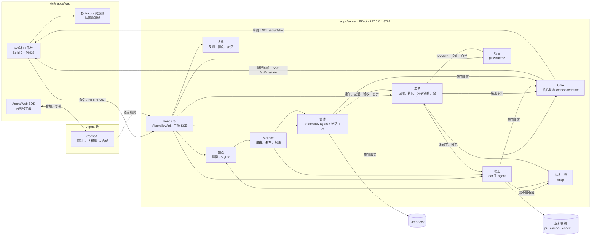

# 架构

## 总图

系统交互走三条线：

- **命令**：页面和命令行通过 HTTP `POST` 调 `VibeValleyApi`（`packages/protocol/src/api.ts` 的 `endpoints`）。帮工通过服务端的 `/mcp` 调工具（[频道](docs/subsystems/channel.md)）。
- **状态**：服务端持有唯一的核心状态 `WorkspaceState`。状态每变一次产生一条事实（`Fact`），页面只收折好的帧 `GET /api/v1/state`。
- **语音**：页面与 Agora 频道收发音频和字幕；服务端签发令牌并接入语音线路（[语音](docs/subsystems/voice.md)）。

## 分层

仓库目录结构见根目录 [AGENTS.md](AGENTS.md#目录)。

- **契约（`packages/protocol`）**：服务端与客户端唯一的共享契约。每个概念一个目录 `src/<概念>/`，包含 `shapes.ts`（类型）、`schema.ts`（`Codec<T.X>` 解码器）和 `api.ts`（接口行与 `Handlers`）。`src/rules/` 只放服务端与页面共用的纯函数；仅服务端使用的规则留在各自模块（[地基](docs/subsystems/foundation.md)）。
- **服务（`apps/server/src/`）**：一块业务一个单数目录，归入 13 个有序模块（见 `apps/server/src/modules.ts`）：
  1. `Platform`（`base`、`infra`、`core`、`setting`）
  2. `Agents`（`agent`、`runtime`、`memory`；模型和循环在 `packages/ai`、`packages/agent`）
  3. `Source Control`（`project`）
  4. `Agent Sessions`（`executor`、`session`）
  5. `Mailbox`（`mailbox`）
  6. `Collaboration`（`channel`、`artifact`、`pkm`）
  7. `Issues`（`issue`、`cron`）
  8. `Ingress`（`ingress`）
  9. `Resource`（`resource`）
  10. `Inbox`（`inbox`）
  11. `Orchestrator`（`orchestrator`、`tool`）
  12. `Gamification`（`game`）
  13. `Gateway`（`http`、`mcp`、`lan`、`connector`、`voice`）
  模块只可 import 排在它前面的模块，不直接读其他模块在 `WorkspaceState` 里的字段（`apps/server/src/modules.test.ts` 检查）。反向通知走 `Stream` 或窄端口。`apps/server/src/services.ts` 分两阶段组装：先构建所有服务并注册订阅，再按模块顺序执行启动任务。
- **网关（`apps/server/src/http`、`mcp`）**：`http/api.ts` 按 `endpoints` 挂载路由，`http/handlers/<概念>.ts` 实现接口，`http/streams.ts` 提供三条 SSE 流；`src/mcp/` 为帮工提供 `/mcp`（[核心状态](docs/subsystems/core.md)）。
- **存储（SQLite + 文件）**：进程内 `node:sqlite`，表结构基线为 `apps/server/db/migrations/0001_schema.up.sql`，查询在 `apps/server/db/queries/<表>.sql`，由 `scripts/sqlite-generate.ts` 生成 `apps/server/db/generated/`（[地基](docs/subsystems/foundation.md)）。
- **客户端（`apps/web`、`apps/desktop`、`apps/mobile`、`apps/cli`）**：`apps/web` 按概念分 feature，层间单向依赖（`base` → `infra` → `state` → `ui` → `ui/pixel` → `features` → `farm`/`tree` → `app`）。桌面壳（Electron）、浏览器和手机壳（Expo WebView）共用同一份页面（[客户端](docs/subsystems/app.md)）。

## 核心状态

`WorkspaceState`（`packages/protocol/src/core/shapes.ts`）汇总农场实时状态：通话、在场会话（管家与帮工）、最近 100 个频道和串、开着的与最近关闭的 50 张工单、定时任务、commit 数、游戏进度与地块动作（[核心状态](docs/subsystems/core.md)）。

- **唯一修改入口**：只有 `Core.apply` 可修改 `WorkspaceState`。纯函数 `reduce(state, fact)`（`apps/server/src/projection/reduce.ts`）计算新状态；不改变状态的事实不发送。
- **派生帧 `StateFrame`**：`GET /api/v1/state` 至多每 200 毫秒推送一帧。纯函数 `frameOf`（`apps/server/src/projection/frame.ts`）在状态副本上填入界面文案（`phaseText`、`whenText`、工单 `stage` 与可执行动作 `acts`），并计算 `inbox`、`view` 和 `effects`。持久层和 `reduce` 不保存界面文案。

## 事件流

服务端提供三条 SSE 流（每 20 秒发送一次心跳，容量 64，积压超限断开重连）：

| 路径 | 连接初值 | 后续推送 | 消费者 |
|---|---|---|---|
| `GET /api/v1/state` | 当前 `StateFrame` | 200ms 窗口合并后的 `StateFrame` | 页面、`issue show --watch` |
| `GET /api/v1/live` | 无 | `LiveEvent`（`SessionEvent`、`Notice`、`Runtime`） | 页面 |
| `GET /api/v1/events` | `snapshot`（`WorkspaceState`） | `ServerEvent`（每条 `Fact` 及 `LiveEvent`） | 调试 |

## HTTP 接口

`packages/protocol/src/api.ts` 汇总各概念的 `endpoints`。每个接口定义 `op`（如 `issue.status.update`，对应 `POST /api/v1/issue/status/update`）、`about`、输入与输出的 Schema，以及权限集合 `can`（`owner`、`remote`、`orchestrator`）。

- 所有命令接口均使用 `POST /api/v1/<路径>`，参数统一放在 JSON 请求体中。
- 除三条 SSE 流外，另有 `GET /api/v1/attachment/<id>`（聊天附件）、`GET /api/v1/artifact/<id>/<version>`（网页稿子）、`GET /api/v1/rpc`（频道与稿子订阅 WebSocket）、`/mcp`（帮工工具）和 `POST /v1/chat/completions`（语音管家入口）。
- 「连接到本机」仅放行 `can` 含 `remote` 的接口与流（[能力表](docs/reference/capabilities.md)、[连接到本机](docs/subsystems/lan.md)）。

## 存了什么

服务端数据存放在 `$VIBEVALLEY_HOME`（默认 `~/.vibevalley`），不兼容旧格式：

| 路径 | 内容 |
|---|---|
| `.vibevalley.lock` | 家目录租约（记录持有进程的 pid） |
| `server.json` | 当前运行服务端的地址与 pid（供 CLI 发现） |
| `config.json` | 档案（管家和帮工）、技能书、农机设置 |
| `agent-templates/<id>/` | 从本机导入的档案模板（`agent.json`、`persona.md`） |
| `settings.json` | 密钥、语音设置、记忆来源配置（权限 `0600`） |
| `vibevalley.yaml` | 可选的静态配置文件 |
| `db/vibevalley.db` | SQLite 数据库：会话与运行（`session`、`session_run`）、信箱（`mailbox_trigger`、`mailbox_delivery`、`mailbox_subscription`、`mailbox_issue`）、外部观察游标（`ingress_github`）、频道、工单、稿子、游戏账本、记忆、定时任务、连接器、配对设备、笔记批注与撤销 |
| `events/<id>.json` | 会话轨迹日志（帮工离开后保留 30 天） |
| `helpers/<oar-id>.jsonl` | `vibevalley` 农机帮工的对话记录 |
| `agent/<档案 id>/` | 管家对话 `<档案 id>.jsonl`、压缩归档 `archive/`、评测样例 `evals/` |
| `logs/` | 帮工原始运行日志与桌面端服务端日志 |
| `artifacts/<sha256>` | 网页稿子内容文件（按内容哈希去重，[稿子](docs/subsystems/artifact.md)） |

工作空间 `$VIBEVALLEY_WORK_ROOT`（默认 `~/vibevalley-dev`）下：
- `repos/`：项目的 git 仓库。
- `worktrees/`：工单分支的 git worktree（`worktrees/<项目>.<工单号>`）。
- `pkm/`：笔记库（PARA 目录与日记 Markdown，可通过 `pkm.root` 改到别处，[笔记](docs/subsystems/pkm.md)）。
- `contexts/<Session id>-<后缀>/`：非工单聊天会话的独立工作目录。

页面偏好（主题、音量、看板视图、草稿）保存在浏览器 `localStorage`（统一经 `apps/web/src/state/stored.ts` 读写）。

## 配置

配置的来源、优先级、校验和配置键说明见[设置和配置](docs/subsystems/setting.md#模型和不变量)。桌面端启动流程见[客户端](docs/subsystems/app.md#怎么走)。
