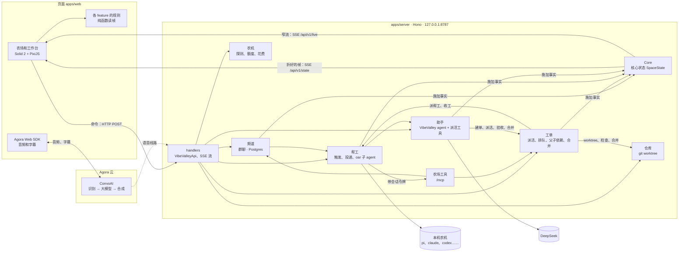

# 架构

## 总图

系统交互走三条线：

- **命令**：页面和命令行通过 HTTP `POST` 调 `VibeValleyApi`（`packages/protocol/src/api.ts` 的 `endpoints`）。帮工通过服务端的 `/mcp` 调工具（[频道](docs/subsystems/channel.md)）。
- **状态**：服务端持有唯一的核心状态 `SpaceState`。状态每变一次产生一条事实（`Fact`），页面只收折好的帧 `GET /api/v1/state`。
- **语音**：页面与 Agora 频道收发音频和字幕；服务端签发令牌并接入语音线路（[语音](docs/subsystems/voice.md)）。

## 分层

仓库目录结构见根目录 [AGENTS.md](AGENTS.md#目录)。

- **契约（`packages/protocol`）**：服务端与客户端唯一的共享契约。每个概念一个目录 `src/<概念>/`，包含 `shapes.ts`（类型）、`schema.ts`（`Codec<T.X>` 解码器）和 `api.ts`（接口行与 `Handlers`）。`src/rules/` 只放服务端与页面共用的纯函数；仅服务端使用的规则留在各自模块（[地基](docs/subsystems/foundation.md)）。
- **服务（`apps/server/src/`）**：一块业务一个单数目录，归入 10 个有序模块（见 `apps/server/src/modules.ts`）：
  1. `Platform`（`base`、`infra`、`core`、`setting`、`user`、`attachment`、`provider`）
  2. `Agents`（`agent`、`runtime`、`memory`；循环和持久是 pi-durable 的，`runtime/durable.ts` 开它的 `Harness`，我们自己的工具在 `packages/agent`）
  3. `Source Control`（`repo`）
  4. `Agent Sessions`（`session`：触发和投递、会话和每一轮、工作目录、执行器）
  5. `Collaboration`（`channel`、`media`（含素材库）、`artifact`、`pkm`）
  6. `Issues`（`issue`、`cron`）
  7. `Inbox`（`inbox`）
  8. `Orchestrator`（`orchestrator`、`tool`）
  9. `Gamification`（`game`）
  10. `Gateway`（`http`、`mcp`、`lan`、`connector`、`voice`、`chat`、`projection`，及顶层入口 `main.ts`、`services.ts`、`modules.ts`）
  模块只可 import 排在它前面的模块，不直接读其他模块在 `SpaceState` 里的字段（`apps/server/src/modules.test.ts` 检查）。反向通知走订阅（`AsyncIterable`）或窄端口。`apps/server/src/services.ts` 的 `buildModules` 照模块次序一行一个 `makeX({ … })`、依赖在调用处写明，建到工单和定时任务（模块测试的 `moduleWorld` 也用它）；`makeFarm` 接着建后面的，再按模块顺序调各模块的 `boot()`；建到一半失败就倒着关掉已建的。
- **网关（`apps/server/src/gateway/http`、`mcp`）**：`http/api.ts` 按 `endpoints` 挂载路由，`http/handlers/<概念>.ts` 实现接口，`http/streams.ts`、`http/rpc.ts` 提供 SSE 流；`gateway/mcp/` 为帮工提供 `/mcp`（[核心状态](docs/subsystems/core.md)）。
- **存储（Postgres + 文件）**：配了 `database.url` 连那个 Postgres，否则是进程内的 PGlite，同一种方言；表结构基线为 `apps/server/db/migrations/0001_schema.up.sql`，查询在 `apps/server/db/queries/<表>.sql`，由 `apps/server/scripts/pg-generate.ts` 生成 `apps/server/db/generated/`（[地基](docs/subsystems/foundation.md)）。
- **客户端（`apps/web`、`apps/desktop`、`apps/mobile`、`apps/cli`）**：`apps/web` 按概念分 feature，层间单向依赖（`base` → `infra` → `state` → `ui` → `ui/domain` → `ui/pixel` → `features` → `farm`/`tree` → `app`）。桌面壳（Electron）、浏览器和手机壳（Expo WebView）共用同一份页面（[客户端](docs/subsystems/app.md)）。

## 核心状态

`SpaceState`（`packages/protocol/src/core/shapes.ts`）汇总农场实时状态：通话、在场会话（助手与帮工）、最近 100 个频道和串、开着的与最近关闭的 50 张工单、定时任务、commit 数、游戏进度与地块动作（[核心状态](docs/subsystems/core.md)）。

- **唯一修改入口**：只有 `Core.apply` 可修改 `SpaceState`。纯函数 `reduce(state, fact)`（`apps/server/src/gateway/projection/reduce.ts`）计算新状态；不改变状态的事实不发送。
- **派生帧 `StateFrame`**：`GET /api/v1/state` 至多每 200 毫秒推送一帧。纯函数 `frameOf`（`apps/server/src/gateway/projection/frame.ts`）在状态副本上填入界面文案（`phaseText`、`whenText`、工单 `stage` 与可执行动作 `acts`），并计算 `inbox`、`view` 和 `effects`。持久层和 `reduce` 不保存界面文案。

## 事件流和接口

命令走 `POST /api/v1/<路径>`，状态、事件和订阅走 SSE；全部路由、流、权限 `can` 和错误信封见[核心状态和接口](docs/subsystems/core.md#sse-流和其余路由)，每个接口的权限见生成的[能力表](docs/reference/capabilities.md)。从外面来的只经「连接到本机」那道门（[连接到本机](docs/subsystems/lan.md)）。

## 存了什么

数据分两层：Host（`$VIBEVALLEY_HOME`，默认 `~/.vibevalley`）和 Space（`$VIBEVALLEY_WORK_ROOT`，默认 `~/vibevalley-dev`），各放什么见[概念](docs/concepts.md#host-和-space)。

Host：

| 路径 | 内容 |
|---|---|
| `.vibevalley.lock` | 家目录租约（记录持有进程的 pid） |
| `server.json` | 当前运行服务端的地址与 pid（供 CLI 发现） |
| `config.json` | 档案（助手和帮工）、技能书、农机设置 |
| `agent-templates/<id>/` | 从本机导入的档案模板（`agent.json`、`persona.md`） |
| `settings.json` | 密钥、语音设置、记忆来源配置（权限 `0600`） |
| `vibevalley.yaml` | 可选的静态配置文件 |
| `db/` | PGlite 的数据目录（配了 `database.url` 时不用它）：会话、运行、触发和投递（`session`、`session_run`、`session_run_issue`、`session_trigger`、`session_order`、`session_delivery`、`session_subscription`、`session_issue_input`、`session_machine`）、工单（`issue`）、PR 的 GitHub 观察游标（`session_github_cursor`）、频道、媒体任务与素材库（`media_job`、`media_input`、`media_library_item`）、Artifact、游戏账本、记忆、定时任务、连接器、用户的账号和设备、笔记批注与撤销 |
| `events/<id>.json` | 会话轨迹日志（帮工离开后保留 30 天） |
| `durable.db` | pi-durable 的对话：助手的，和 `vibevalley` 农机上帮工的（一个 oar 会话一个）（测试农场在内存里） |
| `agent/<档案 id>/` | 助手的评测样例 `evals/`；终端对话 `chat` 的 `durable.db`（它自己的，对话开着时租着这个目录）、`MEMORY.md` 和 `mcp.json` |
| `logs/` | 帮工原始运行日志与桌面端服务端日志 |

Space `$VIBEVALLEY_WORK_ROOT`（默认 `~/vibevalley-dev`）下：
- `repos/`：仓库的 git 仓库。
- `worktrees/`：工单分支的 git worktree（`worktrees/<仓库>.<工单号>`）。
- `pkm/`：笔记库（PARA 目录与日记 Markdown，可通过 `pkm.root` 改到别处，[笔记](docs/subsystems/pkm.md)）。
- `contexts/<Session id>-<后缀>/`：非工单聊天会话的独立工作目录。

页面偏好（主题、音量、看板视图、草稿）保存在浏览器 `localStorage`（统一经 `apps/web/src/state/stored.ts` 读写）。

## 配置

配置的来源、优先级、校验和配置键说明见[设置和配置](docs/subsystems/setting.md#模型和不变量)。桌面端启动流程见[客户端](docs/subsystems/app.md#怎么走)。
