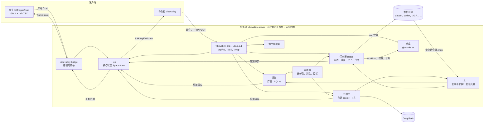

# 架构

## 总图

系统交互走两条线：

- **命令**：接口表是 `vibevalley-protocol` 的 `ENDPOINTS`（`crates/vibevalley-protocol/src/contract/endpoints.rs`）。原生应用的页面经进程内的桥按操作名调（[客户端](docs/subsystems/app.md#桥)），命令行经 HTTP `POST /api/v1/<路径>` 调；两条路进的是同一个 `Hub`。执行会话通过服务端的 `/mcp` 调工具（[频道](docs/subsystems/channel.md)）。
- **状态**：服务端持有唯一的核心状态 `SpaceState`。状态每变一次产生一条事实（`Fact`），客户端只收折好的帧：桥上的 `frame:state`，HTTP 上的 `GET /api/v1/state`。

只支持 macOS，只在本机：没有浏览器页面、手机壳和从别的设备进来的门（[原生计划](.agents/notes/proposed/architecture/2026-11-14-native-vibevalley.md)）。

## 分层

仓库目录结构见根目录 [AGENTS.md](AGENTS.md#目录)。

- **契约（`crates/vibevalley-protocol` → `packages/protocol`）**：服务端与客户端唯一的共享契约，以 Rust 为源：`src/contract/` 一个概念一个文件，`typescript.rs` 写出 `packages/protocol/src/<概念>/shapes.gen.ts` 与 `endpoints.gen.ts`（`vp run protocol:ts`）；页面在边界解码用的 Zod（`schema.ts`）和带入参出参的端点表（`api.ts`）是手写的，由测试对着生成物查（[契约](docs/subsystems/foundation.md#契约规则和数据库)）。
- **规则（`crates/vibevalley-core`）**：只读状态的纯函数：`reduce`、`frame_of`、任务的状态与阶段和可做的动作、收件箱、巡查、简报和起草、农场的画面（[核心状态](docs/subsystems/core.md)）。
- **服务（`crates/vibevalley-server`）**：`src/lib.rs` 的 `Hub` 持有核心状态和接口表，模块用 `Hub::on` 按接口挂处理函数、只经 `Hub::apply` 改状态。`src/modules/` 一个概念一个模块（`mod.rs` 列全），`src/start.rs` 照依赖次序打开它们：设置、游戏、AI 服务、角色和引擎、仓库、记忆、轨迹、任务板（`modules/issue` 的 `Board`，执行会话在 `modules/session`，worktree 与合并在 `modules/workplace`，都经 `modules/ledger.rs` 写）、定时任务（`modules/cron`）、PR 与分支发布（`modules/pull`）、附件、媒体、频道、作品（`modules/artifact`）、笔记、工具和 `/mcp`、主助手、观察层。
- **门（`crates/vibevalley-http`、`crates/vibevalley-bridge`）**：HTTP 门按接口表挂路由，SSE 给 `/state`、`/live`、`/events`，`/mcp` 交给服务端的工具；桥让原生应用的页面在进程内调同一个 `Server`（`crates/vibevalley-server-api`）。
- **引擎（`crates/vibevalley-oar`、`crates/vibevalley-agent`）**：oar 的 Rust 实现驱动 Claude Code、Codex、ACP、自研 `vibevalley` 与测试用的 scripted；自研 agent 只接 DeepSeek（[自研 agent](docs/subsystems/brain.md)）。
- **存储（SQLite + 文件）**：模块各自在家目录的 `server.db` 建表（`create table if not exists`），任务、执行会话、每轮与待带的话也在同一个库；没有迁移，形状变了直接改。
- **客户端（`apps/mac`、`crates/vibevalley-cli`）**：原生应用带着服务端，工作台是 nsh 跑的 TSX，像素场景由 Rust 画（[客户端](docs/subsystems/app.md)、[农场的皮](docs/subsystems/farm.md)）；命令行经 `server.json` 找到运行中的服务端。

## 核心状态

`SpaceState`（契约的 `core` 形状）汇总实时状态：在场执行会话（主助手与执行会话）、最近的频道和话题、开着的与最近关闭的任务、定时任务、commit 数、游戏进度与地块动作（[核心状态](docs/subsystems/core.md)）。

- **唯一修改入口**：只有 `Hub::apply` 修改 `SpaceState`。纯函数 `reduce`（`crates/vibevalley-core/src/core.rs`）计算新状态；不改变状态的事实不发送。
- **派生帧 `StateFrame`**：`GET /api/v1/state` 至多每 200 毫秒推送一帧。纯函数 `frame_of`（同一个文件）在状态副本上填入界面文案、任务 `stage` 与可执行动作，并计算收件箱、农场画面和特效。

## 事件流和接口

HTTP 门上命令走 `POST /api/v1/<路径>`，状态、事件和订阅走 SSE；全部路由、流、权限 `can` 和错误信封见[核心状态和接口](docs/subsystems/core.md)，每个接口的权限见生成的[能力表](docs/reference/capabilities.md)。服务端只听 `127.0.0.1`。

## 存了什么

数据分两层：Host（`$VIBEVALLEY_HOME`，默认 `~/.vibevalley`）和 Space（`$VIBEVALLEY_WORK_ROOT`，默认 `~/vibevalley-dev`，原生应用与独立服务端遵循同一约定），各放什么见[概念](docs/concepts.md#host-和-space)。

Host：

| 路径 | 内容 |
|---|---|
| `server.json` | 当前运行服务端的地址与 pid（命令行据此找服务端，`crates/vibevalley-home`） |
| `config.json` | 角色（主助手和执行角色）、技能书、引擎设置 |
| `agent-templates/<id>/` | 从本机导入的角色模板 |
| `settings.json` | 钥匙、AI 服务连接（权限 `0600`） |
| `server.db` | SQLite：任务、执行会话与每轮、待带的话、定时任务（`cron`）、PR 与事件（`pull`、`pull_event`）、频道与事件、附件、记忆、媒体任务与媒体库、作品（含结构化条目与变更日志）、笔记索引（`pkm_term`）、批注与撤销 |
| `issues/` | 任务板进程锁、引擎原始记录与结构化汇报文件 |
| `ledger.jsonl` | 游戏账本 |
| `events/` | 会话轨迹 |
| `conversations/` | `vibevalley` 引擎上执行会话的对话 |
| `agent/<角色 id>/` | 主助手的对话 `conversation.jsonl` 和 `MEMORY.md` |
| `attachments/` | 附件，按 SHA-256 存一份 |

Space 下：
- `repos/`：仓库的 git 仓库。
- `worktrees/`：任务分支的 git worktree。
- `pkm/`：笔记库（PARA 目录与日记 Markdown，可通过 `pkm.root` 改到别处，[笔记](docs/subsystems/pkm.md)）。

## 配置

配置的来源、优先级、校验和配置键说明见[设置和配置](docs/subsystems/setting.md#模型和不变量)。启动流程见[客户端](docs/subsystems/app.md#怎么走)。原生应用外壳自己的项目、布局和设置另存在 `~/Library/Application Support/VibeValley/state.db`。
